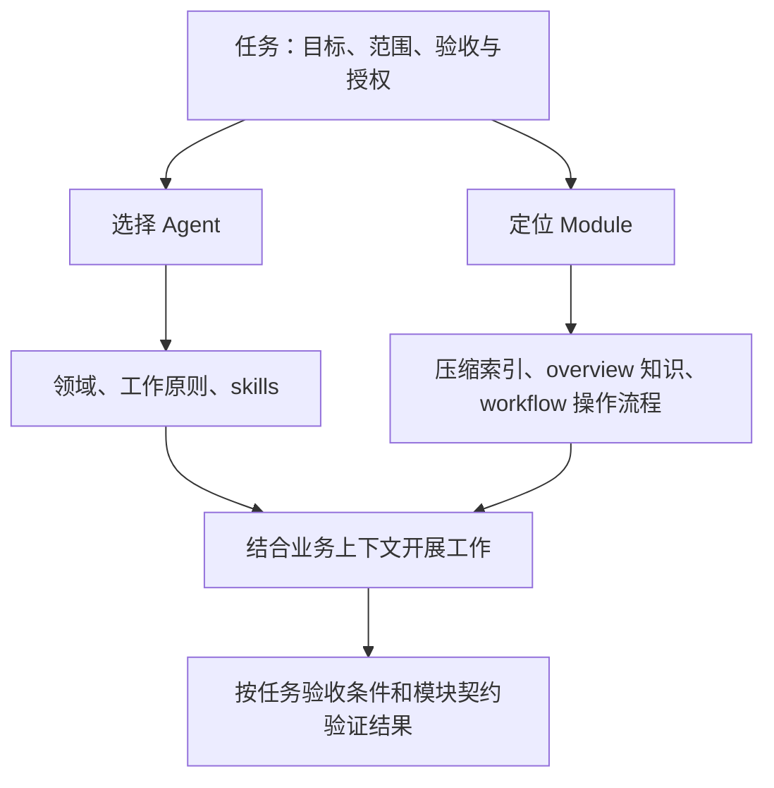

# CBIM 总体设计

版本：1.4｜author：linan

## 定位

CBIM 通过独立的能力抽象与业务抽象组织专业方法和工作对象，在具体任务中组合二者。CBIM = Capability-Business Independence + Memory；个人短期记忆是可选辅助，不是执行与恢复任务的前提。

本文维护 core 的总体结构、两侧关系与组合约定；概念依据见 [CBIM 架构设计理论](../docs/02-CBIM架构设计理论.md)。两侧分别维护自身设计，不相互引用设计文档，也不重复维护总体关系。

## 结构与职责

能力文档与业务文档都是知识，分别承载能力知识与业务知识，均属于固化、稳定、可复用的长期记忆。这里的 Memory（M）专指临时的个人本地短期记忆，不是所有记忆的统称。

| 部分 | 定位 | 设计入口 |
|---|---|---|
| Capability | 定义具备什么专业能力、依据什么判断、如何推进工作及有哪些专业方法 | [Agent 设计](capability/README.md) · [BaseAgent](capability/base-agent.md) |
| Business | 定义处理对象的定位、边界、契约、知识、依赖与操作流程 | [Module 设计](business/README.md) · [BaseModule](business/base-module.md) |
| Memory | 保存临时的个人本地短期记忆，使用前核实 | 不替代长期知识和任务证据 |

图示表达组合关系，不另行定义执行循环，也不表示已有自动调度器。

## 任务中的组合

[Task 单一任务抽象](task/README.md) 封装一个 Agent 与一个或多个由它维护的模块、目标和执行上下文。design/task/ 保存抽象，具体任务实例由 CBIM 内部调度与持久化服务管理；Skill 提供分析和协作方法，不能替代实际派发回执。

[Task Loop](task/task-loop.md) 是 CBIM AI 助理共用的任务构建与结果反馈循环，CBIM AI 助理 Skills 在各自业务或治理判断下使用它。它按模块与 authors 路由匹配 Agent，分析依赖后打包 Task，组织顺序或并行执行，再用结果驱动下一轮；不属于AI 成员 的能力属性。

- CBIM AI 助理内置三类默认流程，落地为四个 Skill：[知识查询](skills/knowledge-query/SKILL.md) 定位权威资料并回答，[需求实现](skills/business-execution/SKILL.md) 组织新功能、修复与整体交付，治理分为 [知识检查与维护](skills/knowledge-governance/SKILL.md) 和 [架构治理](skills/architecture-governance/SKILL.md)。前者检查事实、格式、引用与索引，按已有授权修正；后者组织模式观察、架构评估、渐进演进与复查。主入口根据用户目标选择流程，上述流程统一复用 Task Loop，不互相调用，也不登记到专业 AI 成员 的本地 skills 列表。
- 新增操作方法由入口分别路由到 [新建 Workflow](skills/create-workflow/SKILL.md) 与 [新建 Agent Skill](skills/create-agent-skill/SKILL.md)。前者维护模块 workflows，后者维护已有 Agent 的 skills，均附确定性创建脚本；这两个 core Skill 不登记到专业成员的 skills 清单。
- CBIM AI 助理是用户对接的唯一入口，负责理解需求、依据模块图谱拆出任务列表，并为每个业务任务组合一个AI 成员 与一个或多个由它维护的模块。CBIM AI 助理分析任务依赖、共享物理源与写入冲突，安排顺序或并行执行，跟踪结果、协调冲突、核实整体目标并统一交付；AI 成员 在派发时已确定的模块与工作区内，按任务上下文、工作原则及内部大脑循环完成任务并回报。当前成员自动领取与执行尚未接通，实际委派受已实现能力与授权约束。
- Agent 与 Module 是多对多关系：同一能力可以处理不同模块，同一模块可以由不同专业能力处理，双方不永久绑定。
- 根据模块 authors 在真人花名册中的共同组归属确定默认候选团队，再按任务内容、Agent 名称与摘要匹配执行者。作者未知时按内容检索团队；跨专业任务可扩大候选范围。
- 命中后核实能力描述、工作原则与所需方法。团队归属只提供候选范围，不扩大执行授权。
- 任务明确本次目标、对象范围、所选能力、必要知识、验收条件与授权，并保留所用定义的版本依据。
- CBIM AI 助理的 Skills 组织需求分析、任务拆分、调度、验收和治理；Skill 提供具体专业操作方法；Module 的 Workflow 定义该对象的操作步骤、条件与出口，DNA 提供知识与契约。
- `skills` 列出 Agent 自身目录下的可用方法；Module 通过 `workflows` 清单引用 `workflows/<工作流名>/workflow.md`，每个流程独立成目录，与 Agent Skill 对偶。任务按需要选择流程，并为相关步骤匹配适用方法；能力方法与业务流程不要求一一对应。
- 无专属 Workflow 时，AI 成员 根据任务上下文使用内部大脑执行循环 推进，记录所依据的契约和验证要求。方法或必要知识缺失时明确缺口，不编造可用入口。
- 列表和索引用于定位，命中后核实适用性并按需读取正文。任务组合不扩大授权，执行结束不等于验收通过。

## 独立设计与知识维护

[Core 检查工具](skills/core-check/SKILL.md) 仅由用户明确发起，不属于核心工作流，也不在 core 变更或交付时自动运行。用户可要求检查依赖方向、README 引用隔离与文档职责；检查默认只读，修正与复查按用户明确要求的范围进行。

能力侧保存可复用的专业定义，业务侧保存对象知识与约定。增强能力不要求重建业务模型，新增模块不要求改写通用方法；跨侧关系统一由本文说明，各侧字段与维护规则以各自设计文档为准。

core 提供通用抽象与 CBIM AI 助理的 Skills，项目扩展层提供具体 Agent、Module、索引和任务配置，并引用 core；core 不依赖具体项目实例。

C、B 是共享且版本管理的长期记忆。“固化、稳定”表示知识已经整理为可持续复用的文档，不表示永不更新，也不表示所有记录都具有强制约束效力；知识仍按证据和确认结果维护。

M 只保存临时的本地线索和工作笔记，不承担长期知识保存责任。其中内容经核实整理后，才可固化为能力知识或业务知识。用户主目录下的 `<用户主目录>/.cbim/<项目标识>/` 统一存放本地工作数据：`memory/` 保存短期线索，`task-records/` 保存任务决定、进度、版本快照和验证证据，后续临时目录也置于其中。整个目录由根 `.gitignore` 与 `.p4ignore` 排除，不默认共享；跨设备恢复与人员接管须显式传递必要记录。清理前保留在途任务所需证据。更换执行引擎或缺少个人短期记忆时，共享定义仍应能够被理解、定位和核验。

## 定义格式

Agent 使用 agent.json，Module 使用 module.json，作为结构化字段与引用的唯一来源。Module 的 id、summary、sources 与直属 children 属于压缩索引；完整知识放同级 module.md，操作流程放 workflows/<工作流名>/workflow.md，不复制正文。Markdown 只承载被引用的工作原则、类图、知识与流程正文。Agent 注册表按组组织，Agent 和模块索引条目均只保存目录 id 与 summary，通过目录内约定文件读取完整对象；两侧各自的 JSON Schema 定义字段与类型。

## 单向依赖约束

- design/skills/ 仅向 task/ 依赖，不直接依赖底层对象规范，也不互相调用其他 CBIM AI 助理 Skill。
- task/ 仅向 business/ 和 capability/ 依赖，不读取上层 Skill、项目入口或外部维护工具流程。
- business/ 与 capability/ 不互相引用，可共同依赖 connector/，不反向依赖 task/ 或 design/skills/。Agent 内部的专业 skills 列表属于能力数据，不是对 CBIM AI 助理 Skills 的依赖。
- 同一层内部可引用自身正文；CBIM AI 助理 Skill 内部辅助正文可以引用，但不得跨 Skill。跨流程选择与项目资料、工具装配由入口层负责。上下文中的业务资料是输入数据，不应借此要求下层加载或执行上层流程。
- docs/ 与 README 为人类阅读材料，执行入口及执行文档不得加载；scripts/ 为校验与维护工具，可由入口提供给任务；抽象目录不直接依赖 docs/ 或 scripts/。工具可以读取被校验层，抽象不反向调用工具。

依赖校验见 [维护工具说明](scripts/README.md)。显式引用检查与正文语义复核需要同时通过。

## Cindy 插件声明

CBIM 当前维护连接器定义和 Cindy 插件身份映射；Task 按需合并成员与作业模块的引用。实际外部插件调用、账号接入和工具隔离尚未实现，不因资源登记就声称可以执行。未来适配器负责工具发现与调用，不能让领域定义层承担连接生命周期。
