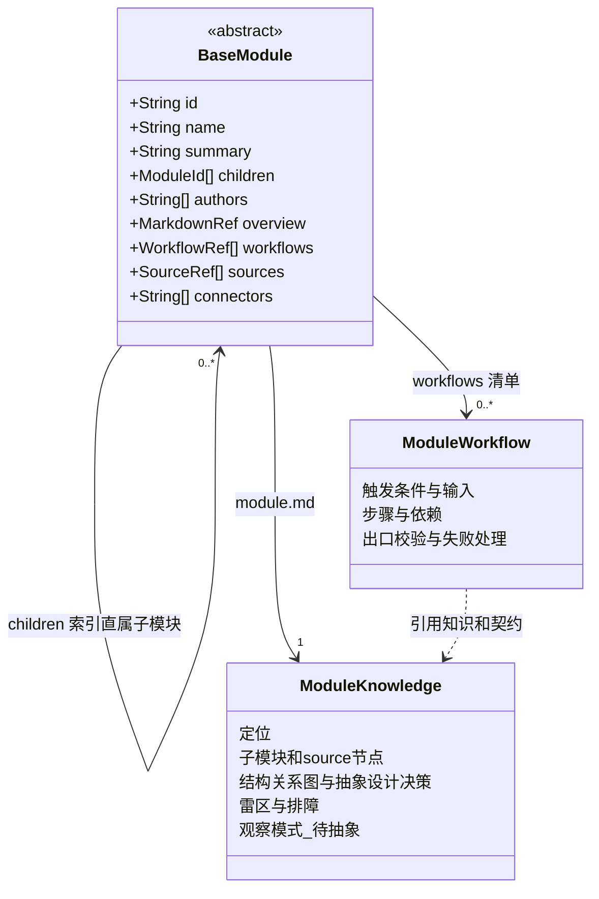

# BaseModule：模块基础抽象

author：linan

面向人的模块对象设计。字段语义与唯一内容归属见 [Module 定义与维护规范](module-spec.md)。类图描述设计，不代表已部署执行器。

## 压缩索引与正文

- module.json 是全局检索与路由使用的压缩索引。id 对应实际模块目录；children 保存直属子模块标识，叶子节点为 []。
- module.md 是唯一完整知识正文，不复列 id、summary 或结构化索引。source 路径逐条集中说明，每条不超过 250 字；第三节统一一张结构关系图，source 与直属子模块都是同层的抽象子节点，类型分别标明。节点说明位于第二节；第三节同时保留极简设计理由和依据，随后为雷区与排障、观察模式-待抽象。
- workflows/<工作流名>/workflow.md 是独立操作正文，每个流程一个目录，与 Agent 的 skills/<技能名>/ 结构对偶。诊断与恢复的知识归 overview；重复操作的具体步骤归 workflow，以引用关联。
- module.json 与 module.md 平级存放；流程在 workflows/ 下各自成目录，可包含脚本和资源，由 workflows 清单登记；不建立 dna/ 或重复正文。
- sources 与模块目录独立，一个模块可以维护多个分散物理源。父模块不重复子模块的源；引用不代表所有权或写入授权。
- 父子结构与业务依赖分别表达，不能从目录嵌套推导调用或执行顺序。子模块内部细节由子模块维护。

## 渐进演进与维护

正式抽象与观察模式是 overview 内的知识分类，不增加 JSON 知识字段。未验证观察不能作为正式规范；确认后迁入正式抽象一节，保留决定依据并去除重复正文。

跨模块共享知识由一个所属模块维护，其他模块引用。authors 记录真人维护来源，不表示 AI 成员、操作授权或调度策略。核验限制与具体问题记入 overview 的雷区与排障，不能仅凭格式正确声称业务已验证。

当前设计与旧实例迁移边界遵循 Module 规范；不将兼容旧结构的校验当作新格式验收。

正式架构依赖约束由人工 review 确认后写入 overview；代码引用用于检查实现是否符合约束，不能自动成为正式规则。任务执行前置关系属于 Task，不存入模块定义。

模块类图是经人工 review 并确认的设计规范与约束，包含模块结构及依赖关系，是 Agent 核查实现的架构依据，不是从代码自动生成的现状图。正文用于解释图中的契约与设计理由，不另建重复的依赖索引。代码与类图不一致时记录实现偏差；只有取得人工确认的架构变更决定后，才能修改相应类图与约束。尚未确认的建议或观察不得混入正式类图。
