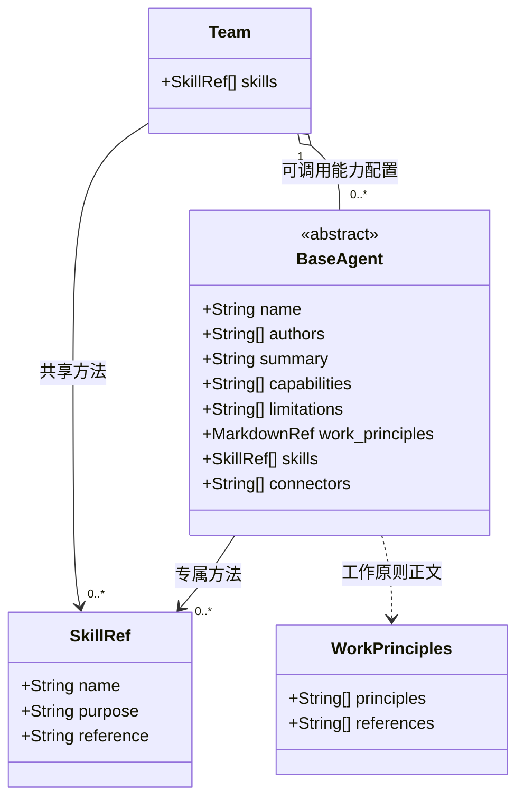

# BaseAgent：能力基础抽象

author：linan

面向人的能力对象设计。字段含义与组织约定见 [Agent 定义与维护规范](../../assets/capability/agent-spec.md)；以下类图表达结构，不代表已部署的数据模型或执行器，也不作为 Agent 启动或执行输入。

## 领域、工作原则与 Skill 列表

- Agent 的名称与摘要说明职业和技术定位，capabilities 与 limitations 说明能力范围与局限。
- authors 使用无重复字符串数组保存作者来源；不关联真人花名册或组，未知作者填 []。
- 工作原则指导判断、取舍与产出质量，包含必要的验证要求，是 Agent 内部判断与验收的首要依据。references 引用支持判断的原则文档、参考手册或技术规范，说明用途与适用范围，正文只维护一份。展示顺序不改变原则的优先级。
- 每个 Agent 接收调用方的指令、上下文、工作范围和验收要求，使用统一执行抽象调用工具或其他 Agent，并向直接调用方反馈；不得自行扩大权限。直接面向用户的 Agent 是主 Agent，其他角色相对于每次调用确定。
- Skill 列表（skills）列出该 Agent 自己目录下所有可用 Skill 的名称、用途与入口引用。Skill 封装具体专业操作方法，回答某一步如何完成。路径相对 agent.json，专业方法统一放在 skills/ 下；引用入口，不复制正文。没有可用 Skill 时明确写为 `skills：[]`。列表完整登记，正文按任务需要读取。

## 能力扩展

具体 Agent 通过填写领域、工作原则与 Skill 列表形成专业角色。分组与检索索引按 Agent 定义规范维护，不在成员字段中引入组织层级或协调角色。只读取命中的定义与当前步骤所需引用，不因组织关系加载全部成员或资料。

Team 是可调用 Agent 的配置集合，不是独立聊天模式。既有能力目录分组和 Skill 继承属于资料存储约定，不决定运行调用关系。Agent 工具可以递归调用；界面仅按普通工具调用逐层展开，不新增组织层级。

目标行为见 [产品需求](../agent-tool-product-requirements.md)；当前文件格式和运行支持仍按规范及源码核实，不能以概念类图代替实际实现。
