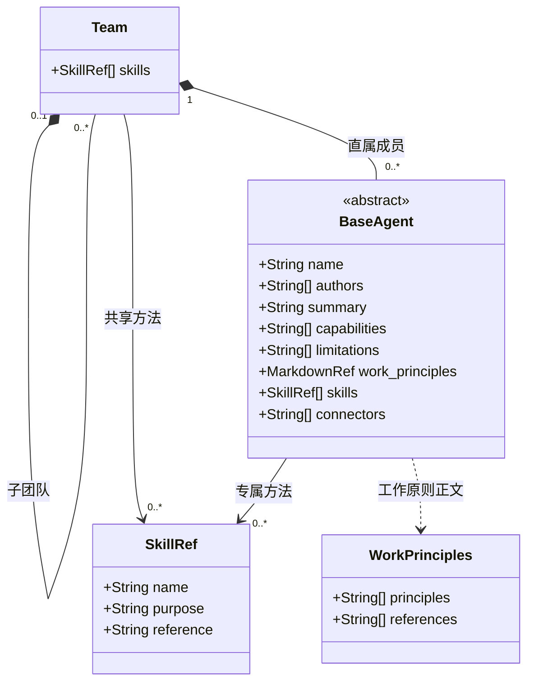

# BaseAgent：能力基础抽象

author：linan

面向人的能力对象设计。字段含义与组织约定见 [Agent 定义与维护规范](agent-spec.md)；以下类图表达结构，不代表已部署的数据模型或执行器，也不作为 Agent 启动或执行输入。

## 领域、工作原则与 Skill 列表

- Agent 的名称与摘要说明职业和技术定位，capabilities 与 limitations 说明能力范围与局限。
- authors 引用定义的真人作者 id，使用无重复数组；所有作者必须属于同一个已知组，未知作者填 []。
- 工作原则指导判断、取舍与产出质量，包含必要的验证要求，是 Agent 内部判断与验收的首要依据。references 引用支持判断的原则文档、参考手册或技术规范，说明用途与适用范围，正文只维护一份。展示顺序不改变原则的优先级。
- AI 成员 接收明确的上下文、工作范围和验收要求，使用宿主默认 loop 完成专业工作并回报；不声明独立循环，不自行扩大范围。
- Skill 列表（skills）列出该 Agent 自己目录下所有可用 Skill 的名称、用途与入口引用。Skill 封装具体专业操作方法，回答某一步如何完成。路径相对 agent.json，专业方法统一放在 skills/ 下；引用入口，不复制正文。没有可用 Skill 时明确写为 `skills：[]`。列表完整登记，正文按任务需要读取。

## 能力扩展

具体 Agent 通过填写领域、工作原则与 Skill 列表形成专业角色。分组与检索索引按 Agent 定义规范维护，不在成员字段中引入组织层级或协调角色。只读取命中的定义与当前步骤所需引用，不因组织关系加载全部成员或资料。

Team 是任意深度的树，Agent 是直属成员叶子。图中 skills 是各节点自己拥有的方法：Agent 登记到 agent.json，Team 登记到 skills.json。加载 Agent 时按自身、直属 Team、祖先 Team 至根合并完整清单并记录来源；不继承兄弟节点，冲突显式报错。合并结果是运行上下文，不重复写入 Agent 定义。
