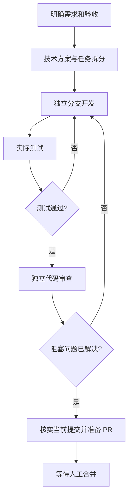

# Cindy + Git：CBIM 岗位 Skill 开发管线方案

日期：2026-11-08。状态：整体管线为方案；用户侧两项菜单与内置 Skill 已接入 GitHub Device Flow、直接提交和原提交核实。OAuth App、真实授权、正式 APP 的唯一 Issue 提交、更新日志及手动升级已完成验收；内部开发自动化仍待实施。

用户已选择：以现有 CBIM 工程试点，自动推进至 PR 可供人工合并；合并及发布由人决定。本方案承接该新目标，不自动恢复已在 Step55 收口的产品功能开发。

用户侧入口：CBIM 对话窗“+”菜单提供「BUG 反馈」「需求许愿」，分别调用对应内置 Skill，引导用户按格式补充上下文，目标是由 Skill 直接提交 GitHub Issue。修复与功能变化统一通过软件更新日志查看，不建设自有反馈服务器，不做逐条处理结果或进度回传；详见[反馈 Skill 与更新日志方案](task/user-feedback-intake.md)。

## 1. 工作方式

不同岗位的人通过对应 Skill 提供目标、约束或判断，Cindy 完成其授权范围内的执行和交接。同一人可以兼任多个岗位，也可以只由一位负责人管理；岗位数量不等于常驻 Agent 数量。

每个岗位 Skill 定义输入、职责、交付、验收和失败去向。真正推进流程还需要工单记录、任务身份、执行回执、状态核验和 Git／CI 规则，不能仅凭上一段对话中的“完成了”启动下一阶段。

第一版由 GitHub Issue 或团队主动提出的需求进入；Issue 经分诊采纳后接入下列开发路径：

需求范围或接口约定改变时回到需求／方案阶段；新提交产生后，重新核实受影响的测试和审查。资料缺失、预算耗尽、持续失败或外部操作结果未知时进入等待或核实状态，不能无限返修。预先授权的范围内正常推进，不增加逐岗位人工批准流程。

## 2. 岗位入口

下列 Skill 名称为拟建入口，目前尚未安装。

| 面向岗位 | 拟建入口 | 核心交付 | 可以进入下一阶段的条件 |
| --- | --- | --- | --- |
| 测试／产品分诊人员 | `cbim-triage` | GitHub Issue 分类、重复关联、复现线索与处理建议 | 已采纳、信息齐备且具备明确开发授权的工单 |
| 产品负责人／需求提出者 | `cbim-requirement` | 问题说明、范围与非目标、验收例子、优先级和约束 | 验收可检查，关键业务歧义已解决 |
| 技术负责人／架构师 | `cbim-design` | 模块影响、接口与数据变化、实施拆分、测试及回退安排 | 对应当前仓库基线，依赖明确，变更范围可执行 |
| 项目负责人 | `cbim-coordinate` | 工单状态、任务分派、依赖、预算、阻塞原因和交接记录 | 所需输入和权限齐备，同一工单没有重复执行者 |
| 开发工程师 | `cbim-implement` | 分支提交、实现、必要测试、注释与架构文档 | 范围内实现和本地检查完成，交付指向确定提交 |
| 测试工程师 | `cbim-verify` | 验收用例结果、回归证据、可复现缺陷、测试限制 | 对当前提交实际运行，失败和跳过均有明确处置 |
| 代码审查者 | `cbim-review` | 独立审查结论、具体问题及其位置、返修后的复核 | 绑定当前 diff 和提交，阻塞问题已关闭 |
| 维护者／交付负责人 | `cbim-ready` | PR 描述、验证摘要、待发布更新日志、风险和回退说明、人工合并交接 | 当前提交所需检查齐备，PR 处于可评审状态，日志与实际改动一致 |

UI／交互设计、数据库迁移、安全专项等按任务需要增加专门输入或审查，不要求每次小改动都走一套大型组织流程。

开发入口复用现有 [cbim-development](../.agents/skills/cbim-development/SKILL.md)，源码变更继续遵循 [architecture-maintenance](../.codex/skills/architecture-maintenance/SKILL.md)。新岗位 Skill 放在 Cindy 项目级来源中，优先采用本仓库已有的 `.agents/skills/` 结构；其他执行引擎入口按实际加载方式保持一致，不另造互相冲突的开发规范。

上述八项岗位 Skill 服务于开发本仓库，不加入 CBIM 产品业务工具清单。用户侧「BUG 反馈」「需求许愿」属于另一组产品内置 Skill，其实际正文位于 `design/runtime/`，由 `Builtins` 白名单和 `cbim_skill_*` 工具供产品 Agent 读取。二者不能混作 Cindy 项目开发 Skill。各岗位只保留影响决策的约束，共同交接协议集中维护，较长模板按需读取。

## 3. Cindy、Git 与 CI 的职责

| 部件 | 负责什么 | 不从中推断什么 |
| --- | --- | --- |
| CBIM 反馈 Skill 与更新日志 | 菜单调用对应 Skill，按格式收集上下文；后续接入直接创建 Issue 及随版本展示日志 | 读取 Skill／整理上下文不等于已创建 Issue，PR 合并不等于软件已发布 |
| 岗位 Skill | 该岗位的方法、输入、交付和交接要求 | 加载 Skill 不等于获得仓库管理或发布权限 |
| Cindy 任务 | 在指定工程和目录执行工作，保存对话、工具调用及任务状态 | 任务正常结束不等于业务验收通过 |
| 协调环节 | 读取工单与真实结果，判断下一阶段，保存派工和去重记录 | 一次定时触发不等于某个阶段执行成功 |
| Git 分支和提交 | 保存代码、设计及版本身份；提供可比较的变更 | 提交成功不等于已测试、合并或发布 |
| GitHub Issue／PR | 多人共享的需求、评审、讨论和交付入口 | 标签、评论和 AI 自述不能单独满足通过条件 |
| CI 与实际验收脚本 | 对具体代码版本执行可重复检查并生成证据 | 通过的旧提交不能证明新提交也通过 |

建议首轮一项已采纳 Issue 对应一个开发分支和一个 PR。重复 Issue 关联同一主工单，不重复启动开发；一条 Issue 含多个独立问题时先分诊拆分。开发任务使用独立 worktree；审查从确定提交读取或使用独立检出目录，避免审查过程中工作树被改动。Cindy 任务仍属于同一个 CBIM 项目，worktree 只是执行目录。

需求与方案版本、实施代码、正式验收摘要及版本日志进入 Git；工单和 PR 的状态以 GitHub 实际记录为准。协调器的任务绑定、租约、重试、游标和未决操作保存在内部持久执行记录中，不把频繁变化的运行状态写进每个源码提交。两者通过工单、提交和原操作标识关联。

## 4. 最小交接协议

每次交接至少携带：

- 仓库、工单、目标分支、基线提交，以及当前需求／方案版本。
- 来自软件入口时，引用 GitHub Issue、报告版本及必要摘要；不额外建立客户端反馈记录或默认复制原始诊断材料。
- 当前角色、Cindy `session_id`、项目归属、执行电脑和实际工作目录。
- 本阶段输入、允许修改范围、已授权操作、预算与停止条件。
- 输出提交 `head_sha`、产物位置、实际命令、结果和未解决问题。
- 下一阶段、交接编号、上次操作回执与需要核实的未知结果。

第一版由一个协调者持有同一工单的推进权。阶段启动前可靠保存意图和执行绑定，接到可信回执后再记录结果。去重标识包含仓库、工单、输入版本、阶段和尝试编号；重启或轮询重复看到同一事件时复用原任务。

创建任务、推送分支、创建 PR 等发生超时或回包丢失时，先核实原任务／分支／PR。调用接口没有声明幂等保证时，不因换一个 ID 就认为可以安全重试。已有任务返回 queued 时表示消息已入队，不再次发送。用户停止或归档的任务不能因下一次轮询自动复活。

建议起始策略为每张工单最多 2 轮自动返修，预算与超时由项目配置确定；持续出现相同失败、超出原需求或缺少决定时交回人处理。这是待实施的默认策略，不是当前已生效配置。

## 5. PR 就绪的判定

`PR_READY` 是交给人合并的状态，要求：

1. 当前需求与方案的验收项有对应结果；新增范围已记录并获得相应授权。
2. PR 的目标分支和当前 `head_sha` 与本次验证、审查相符；测试 merge commit 时同时记录其 base/head 和实际被测提交。
3. 该类变更所需检查已通过，没有把未运行、取消或过期检查解释为通过。
4. 独立审查没有未解决的阻塞项；测试缺陷有修复及复核证据。
5. PR 包含使用者可理解的变化、验证范围、限制及回退安排。
6. 当前远端允许继续评审；分支冲突、基线变化或新提交发生后重新判断。
7. 待发布更新日志描述本次已验证的修复、功能新增或改进，尚未发布的内容不写成当前版本已有能力。

GitHub 可通过 required status checks 和 required reviews 约束合并，是否可用以及当前配置需在落地时读取目标仓库规则，不能由文档宣称已启用。[GitHub 分支保护说明](https://docs.github.com/en/repositories/configuring-branches-and-merges-in-your-repository/managing-protected-branches/about-protected-branches)

AI 独立审查是工程质量环节；它不冒充真人审批，也不保证满足 GitHub 对评审者身份的要求。第一版停在 PR 就绪，不启用自动合并、签名发布或生产部署。

## 6. 复用 CBIM 的验证体系

当前仓库已有 `pnpm typecheck`、`pnpm check:architecture`（包含依赖检查）、`pnpm test`、`pnpm make`，以及桌面、成员、协作和便携包验收脚本。尚未跟踪 `.github` 目录，因此本次未发现可直接复用的已提交 GitHub Actions 工作流。

拟定检查分层：

| 变更 | 所需检查 |
| --- | --- |
| 纯文档 | 引用、必要示例和差异检查，不为了形式重跑产品测试 |
| 源码 | 类型、架构／依赖、与变更对应的行为测试；注释和目录类图同步 |
| 合入产品分支前 | 按仓库规则运行最终回归；明确完整回归与相关回归各自对应的提交 |
| Windows 执行／桌面／打包 | Windows 环境下实际平台与 EXE 验收，记录构建身份和日志；不能用 Linux 测试替代 |

首个 CI 配置必须先验证依赖安装、Windows 原生调用及桌面脚本对 runner 的要求。需要交互桌面的验收使用明确登记的 Windows 执行环境，并将报告绑定被测提交；本机结果在没有可信绑定和回传前不冒充远端 required check。

同一 PR 的 CI 可按并发组管理，旧的纯验证任务可由新提交取代；这类取消不直接用于替换正在进行的副作用操作。具体行为按 [GitHub Actions 并发规则](https://docs.github.com/en/actions/how-tos/write-workflows/choose-when-workflows-run/control-workflow-concurrency)配置并验证。

CI 使用最小必要权限，普通测试不持有合并／发布凭证；Issue、PR 评论和仓库内容作为工作输入，不作为修改管线权限的可信指令。不把未经信任的提交放在带生产凭证的执行环境中运行。[GitHub Actions 安全使用说明](https://docs.github.com/en/actions/reference/security/secure-use)

## 7. Cindy 能力核实结果

以下为本次宿主工具发现结果，只确认接口可发现，不代表管线端到端已跑通：

| 能力 | 本次确认 | 落地要求 |
| --- | --- | --- |
| 独立工程任务 | `send_to_session` 可创建任务、返回真实任务和目录，支持 `use_worktree`；已有任务按 ID 继续 | 记录项目、电脑、任务及 worktree 回执；普通独立任务不等于 Orca 协同 worker |
| 运行查询 | `get_session_runtime` 可读任务生命周期和运行状态 | 结合实际交付、提交和检查，不能只读“已结束” |
| 定时自动化 | 可创建、暂停、恢复与单次运行 schedule | 初期用于读取工单和 PR 变化；调度保存不等于立即运行，明确执行电脑和预算 |
| PR 跟踪 | 可读状态、CI、评审详情及变化游标，并关联 Cindy 任务 | 处理部分结果、游标失效与重复事件；关联 PR 不会自动启动跟进 |
| Skill | 可发现 Skill 管理及学习／发布入口 | 项目 Skill 先纳入 Git；学习提案须审阅，发布另按明确要求执行 |
| 伙伴例行任务 | 当前会话该配置入口不可用 | 第一版不依赖该入口；需要时在可用上下文重新发现，不改用另一应用代管 |

第一版建议在当前执行电脑 LINAN-XDT 上登记协调与执行范围，其他人员从 Cindy 和 GitHub 使用各自入口；远程发消息的电脑不自动成为执行机器。任务权限、模型配置、结果去向以宿主回执为准。

远端默认分支本次核实为 `master`，当前功能分支为 `feat/cbim-production-governance`，已推送至 `0572991`。新试点须明确采用哪份基线；现有功能分支已推送不等于已合入 `master`。

## 8. 落地顺序与首轮验收

1. **产品反馈 Skill 与更新日志。** 先接通加号菜单两项 Skill 和格式引导，再接入 GitHub 用户授权、受控 Issue 创建与原请求核实；同步建立版本日志来源及软件展示。用户在 CBIM 内提供上下文，不跳转网页手动填单。
2. **分诊、岗位入口与工单协议。** 建立上述 Skill、统一交接格式及 Issue 采纳／重复关联规则，复用现有开发规范；角色可以由不同人调用。
3. **PR 检查与交付门槛。** 接入适合本工程的 CI，定义各类变更的必要检查、提交绑定和人工合并规则。
4. **完整试点。** 从软件入口创建的 Issue 中选取已采纳、明确授权的小缺陷，跑通开发、测试、审查、PR 交接及待发布日志整理。
5. **自动推进与故障验证。** 在试点通过后接 schedule，验证重复触发不重复派工、重启能找回原任务、新提交使旧结果失效、预算到限会停、PR 就绪后等待人工；发布时将核对后的版本日志随软件交付。

首轮验收从软件入口创建的 GitHub Issue 开始，以一张已采纳工单、一个可人工合并的 PR 和对应日志草稿为开发交付单位；另验证发布版本能在软件内展示准确的更新日志。记录周期、自动返修次数、缺陷发现、人工介入点及模型／执行成本。不以生成岗位 Skill 文件或演示一轮对话作为管线完成。

用户结果出口为软件更新日志，展示实际版本的 BUG 修复、功能新增和改进。内部 Issue／PR 状态不向软件回传，也不新增逐条结果通知。具体入口与验收见[Issue 入口与更新日志方案](task/user-feedback-intake.md)。

两项菜单与上下文收集已完成[前一步验证](verification/feedback-skills-20261108.md)，现在已接入 GitHub 直连提交与核实，成功不追加结果消息。正式桌面版、更新日志与独立 updater 已交付；真实登录、在线升级和唯一 Issue #8 已通过，见[验收报告](verification/desktop-release-20261108.md)。内部岗位 Skill、定时任务、CI 工作流和分支保护仍未实施，本步不启动后续管线。
