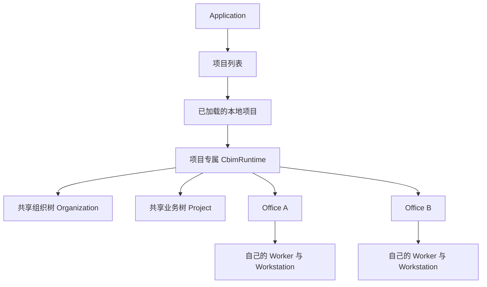

# CBIM 核心系统设计

CBIM 把一个本地项目组织成可运行的 AI 团队。项目定义“有哪些岗位、在哪些目录工作”，Office 负责“这次由谁、在哪里、完成什么目标”。用户始终通过 Office 的内置主 Agent 提需求、看反馈和调整任务。一个项目可以同时进行多场对话，每场对话都拥有自己的 Office。

## 1. 项目运行时与对象归属

| 对象 | 持有什么 | 何时建立或释放 |
|---|---|---|
| 应用与项目列表 | 本机项目登记、已加载项目和正在打开项目的请求 | 同一项目并发打开时复用加载结果；退出时关闭各项目运行时 |
| Logic 的 Project | 本地目录登记、项目架构资源、一个 CbimRuntime | 首次打开时读取组织与业务描述，作为运行时初始化数据 |
| Framework 的 Project | 业务树及工作区节点的查询接口 | 与 Organization 同属项目运行时；项目内各 Office 引用同一组定义 |
| Office | 根会话身份、主 Agent、成员绑定、工位绑定、任务管理器、Office 权限 | 打开对话时取得；关闭时停止调度、释放成员及工作区实例 |
| Worker、Workstation | 分别绑定本 Office 的 Agent 实例和 WorkspaceInstance | 由 Office 内部维护；外部按 Agent、Workspace 的实例身份查询 |
| 引擎插件包、模型配置 | 本机共享的已安装版本与用户配置 | 跨项目复用；每次执行独立取得兼容版本和模型配置 |

例如，两个 Office 同时调用同一“测试工程师”岗位时，共享岗位描述，各自拥有独立 Agent 身份、执行上下文和计量。同一源码目录可以为两个 Office 分别打开 Git worktree。worktree 隔离工作文件；如何提交、合并以及处理合并冲突，仍需由交付流程决定。

## 2. 能力树与业务树

能力树以 Organization 为根，中间节点表示团队，叶子表示 Agent 岗位。团队用于表达隶属关系、查找成员和继承专业能力。执行由叶子 Agent 提供，跨成员协调归 Office。业务树以 Project 为根，每个 Workspace 节点描述项目中的物理目录、工作规范及工作流；打开节点后得到可供任务使用的工作区实例。

| | 能力侧 | 业务侧 |
|---|---|---|
| 定义回答的问题 | 谁具备所需专业技能 | 这项工作在哪里进行、遵循什么流程 |
| 文字说明 | Skill，例如代码审查方法 | Workflow，例如本目录的测试与交付步骤 |
| 工具来源 | 岗位工具，例如 Git、IDE | 领域工具，例如 Blender、Unity |
| 继承范围 | 本岗位及其祖先团队 | 当前工作区及其祖先节点 |
| 运行时绑定 | Worker → Agent 实例 | Workstation → WorkspaceInstance |

派发时，Office 根据选中的两端组装任务上下文。Agent 获得岗位及祖先团队的 Skill，并追加当前工作区可用的 Workflow；工具列表合并岗位工具与业务工具。配置中的工具声明描述能力范围，Office 权限决定本次允许的操作。组织或业务配置热更新的设计目标，是标记受影响的 Worker，在下一轮 turn 开始时经 hook 重新装配，使执行中的一轮保持一致。

## 3. 用户需求如何变成任务

普通问答由主 Agent 直接回复。需要协作时，主 Agent 分析目标，指定执行成员、工作区、验收条件与依赖，向 Office 提交任务图。管理器保存状态、检查图、启动就绪任务。主 Agent 负责创建、挂起、恢复、取消和改派，并向用户解释结果。

1. **构图。** 父子关系表达目标拆解，`dependsOn` 表达执行先后。属于同一父任务的两个节点可以互不依赖。
2. **接纳。** 图中存在缺失依赖、重复身份或环时，整张图拒绝接纳，避免合法节点先行启动。
3. **执行。** 无未满足依赖的节点进入就绪队列。独立分支可并行；派发还要考虑成员占用。任务通过 Office 获取本次绑定的成员和工位。
4. **异常反馈。** 执行异常时节点进入 `suspended`，原因随事件回到主 Agent。主 Agent 根据观察结果选择补充指令后恢复、改派或取消；等待中的后继保留原依赖。
5. **完成与收尾。** 完成节点解锁后继。取消会沿依赖链将后继标记为 `blocked`，并记录直接阻塞来源。主 Agent 汇总成功结果、未完成部分和需要用户决定的事项。

例如 A 生成资产，B 依赖 A 做导入，C 依赖 B 做验证，D 独立整理文档。A 挂起时 D 可以完成；若主 Agent 恢复 A，B 和 C 依次获得执行机会；若取消 A，B 因 A 取消而受阻，C 因 B 受阻而停下。任务状态变化与用户可见回复是两个事件，回复结束只表示一轮对话完成。

## 4. 引擎、模型和连接器

Kernel 提供稳定的引擎、模型、输入、输出和生命周期契约。调用方提供引擎工厂与模型配置引用；插件适配具体厂商的启动、流式事件、工具调用及停止行为。架构上，一个执行中的 Agent 独占自己的引擎实例。插件制品可全局复用，运行实例与会话按所属 Agent 隔离。

桌面包内登记 Codex、Claude Code 和 Pi 三种默认引擎。用户选择安装时从正式仓库下载，宿主验签索引、校验制品摘要和依赖，再激活对应版本。Office 发送前核对本机版本、兼容候选、启用状态及具体模型。模型供应商地址、凭据、型号和计价属于本地配置；Office 历史独立保存，使后续轮次可选择另一兼容引擎继续对话。

连接器是 Agent 使用的办公工具，可以是独立工具进程，也可以适配外部服务。插件工厂按 ID 加载产品实例，运行时按声明的独占或共享模式获取、释放会话。共享进程时，每次工具请求仍须归属明确的 Office、调用者和鉴权上下文，防止并发结果交叉返回。Skill 和 Workflow 提供操作说明，连接器提供实际调用能力。

## 5. 模块依赖与数据边界

| 模块 | 负责的决策或数据 |
|---|---|
| View | 展示项目、Office、设置和监控，接收用户操作并呈现真实状态 |
| Logic／Application | 组织面向界面的用例，装配项目、数据服务、运行时及宿主端口 |
| Framework | 实现运行时对象与行为；Office 单向使用能力、业务模块，Monitor 订阅运行时事件 |
| Resource | 资源和本地数据的增删改查，包含模板、技能、仓库连接、插件安装记录、模型配置及会话历史 |
| Bridge／宿主 | IPC 校验、文件与凭据访问、制品下载、插件装载、进程和系统指标采样 |
| Core | 独立通用基础库，提供 IO、序列化、日志等技术能力 |

项目模板可作为资产分发；用户选中的本地目录及其 worktree 属于工作现场。岗位模板与已启动的 Agent、签名插件与运行进程也分别具有自己的身份。View 经应用接口访问数据，Framework 通过注入的工厂或端口取得宿主能力。持久化层不持有活动 Office，也不代替主 Agent 决定任务状态。

## 6. 观测、恢复与当前接入边界

Agent 实例以稳定 ID 累计 Token，执行时计算短窗口速率，空闲时停止统计。Office 聚合成员数据，RuntimeMonitor 根据事件更新相应条目；宿主以较低频率采样真实 CPU、内存和 PID。虚拟负载按 Agent × 10、引擎实例 × 100、工作区实例 × 5、连接器实例 × 50 汇总。参考阈值 1000 用于观察，未来的准入控制需单独设计。

当前桌面 Office 已接入主 Agent 多轮对话、历史保存、插件选择和停止请求。桌面对话适配在每轮开始时打开主引擎，结束后关闭；再次发送时从会话历史重建输入。框架已经提供任务图与生命周期命令，桌面聊天适配当前提供的任务工具列表仍为空。将日常聊天中的任务拆解、派发、异常回调和下一轮决策串起来，是桌面主 Agent 需要补齐的接入边界。持久化消息可以恢复阅读；跨重启恢复正在执行的任务还需要单独的任务日志和恢复策略。

### 评审时检查的四个场景

- 同一项目开两个 Office，共享树定义；同一岗位或目录在两边产生可区分的运行实例。
- 主 Agent 取消挂起任务后，依赖链受阻且独立任务继续；界面能说明每个节点停下的原因。
- 切换引擎后原对话可继续，原运行实例释放；插件安装记录、模型配置与对话历史各自保留。
- 关闭一个 Office 后，其运行资源从监视器移除；另一个 Office 仍能使用自己的成员与工位。

### 实现与交互入口

[项目加载](../src/logic-new/projects/project.ts) · [运行时](../src/framework/cbim-runtime.ts) · [Office](../src/framework/office/office.ts) · [任务管理器](../src/framework/office/task-manager.ts) · [桌面对话用例](../src/logic-new/projects/offices.ts) · [引擎适配入口](../src/bridge/server/desktop/office-plugin.ts) · [桌面 UX 规范](desktop-ux-spec.md)

