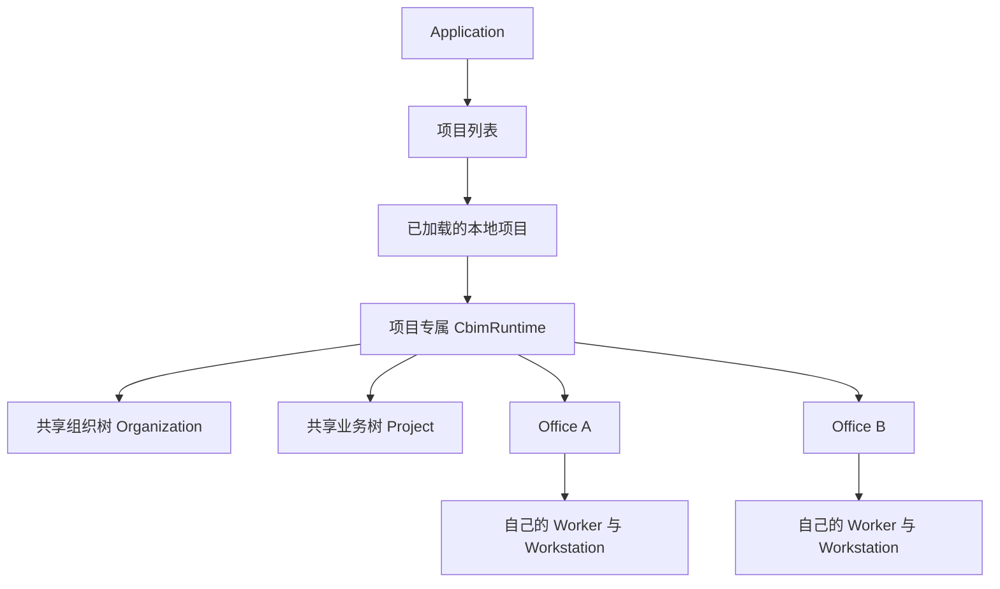

# CBIM 核心系统设计

CBIM 的核心设计沿两个方向展开。**资源复用、共享与扩展系统**让一个团队开发的工具、岗位和工作方法可以被其他项目组合使用，并可进一步通过云端服务分发。**本地 AI 工作流系统**让用户在自己的项目中通过 Office 提出目标，由助理组织成员、使用工作区并交付结果。

两个系统通过**项目采用资源**衔接。同一客户端的各项目共享引擎和连接器的安装包，分别保存引用；人才和业务资产按项目复制并独立维护。用户为项目选择组织和业务架构模板，为岗位选择 Skill 和所需工具，将工作区绑定到本地目录，并配置引擎、模型与账号。运行时据此创建属于本次 Office 的实例。贡献者在本地客户端设计、实现并验证引擎、连接器、能力资产或业务模板，再通过客户端选择版本和共享范围、打包上传。云端市场接收并发布资源，供其他客户端下载和采用。

资源分类、缓存位置、项目知识库及采用规则见[资源体系设计](resource-system.md)。

## 一、资源复用、共享与扩展系统

### 可以共享什么

| 资源 | 发布者交付什么 | 使用方怎样采用 |
|---|---|---|
| 引擎插件 | 专业 Agent 引擎的适配器、运行包、接口兼容要求和版本清单 | 用户安装兼容版本，以自己的模型配置为 Agent 创建执行实例。多个项目可复用同一安装包 |
| 连接器插件 | 一种办公工具的实现、工具接口、会话契约和独占或并发模式，例如 Blender 连接器 | 用户安装工具并绑定自己的服务或账号；Office 执行任务时获取工具会话，结束后释放 |
| 组织、Agent 与 Skill | 组织模板描述团队树与共享技能；Agent 模板描述岗位、职责、专业 Skill 和工具需求；Skill 可单独发布 | 项目可采用整套组织，也可只引入一个岗位或一项技能。团队级 Skill 沿组织树向下生效 |
| 业务架构、工作区模板与 Workflow | 业务架构模板描述工作区树及各节点的职责、流程和工具需求；Workflow 可单独发布 | 项目把模板节点绑定到自己的物理目录。工作区级 Workflow 对该节点及子节点生效，派发时追加到执行 Agent 的技能列表 |

组织和业务架构分别描述“谁会做”和“这项工作应怎样做”。两边可以由不同作者维护。例如，技术美术团队发布的资产检查 Skill 可用于多个游戏项目；某款游戏的入库 Workflow 则只在采用该流程的工作区生效。两者在任务派发时相遇，因此换项目时可以保留岗位经验，换团队时也可以保留业务标准。

### 专业引擎与连接器如何扩展工作流

**引擎插件扩展 Agent 能独立完成的专业工作。** CBIM 的目标是让各领域的专业 Agent Loop 引擎都能接入同一套 Office 调度。首批默认引擎 Codex、Claude Code 和 Pi 面向代码工作。未来，音视频剪辑、三维建模和动画制作引擎可以通过适配器接收目标与上下文，运行各自的专业循环，并向 Office 返回进度、产物和结果。例如，剪辑引擎能根据审片意见反复调整时间线，直到满足交付条件。宿主只需理解任务和执行事件，时间线如何编辑由引擎决定。

**连接器是工作流连接企业和互联网的支点。** 每个连接器可以把一项外部能力封装成可独立演进的微服务，例如查询企业资产库、提交渲染作业、读取互联网素材或发起审批。连接器可以在本机驱动桌面软件，也可以调用企业内网或云端服务。多个岗位和工作流可复用同一套服务接口；每次调用使用所属 Office、任务和账号的授权上下文。企业替换资产库时，只要查询和返回结果的契约保持兼容，使用该能力的工作流就能继续沿用。

以未来的动画交付为例：用户要求“把角色转身镜头缩短到三秒，提交导演审片”。Office 将镜头任务派给动画岗位；动画引擎调整关键帧、检查预览并迭代。它通过资产库连接器获取指定版本的角色，通过渲染连接器生成预览，再通过协作连接器提交审片。另一套音视频引擎也能复用渲染和审片服务。动画岗位的 Skill 写明怎样判断动作自然，工作区的 Workflow 写明交付顺序及由谁验收。引擎、服务和工作方法因而可以分别共享，再由项目按需要组合。

### 在哪里共享，在哪里运行

| 范围 | 共享方式 | 归属 |
|---|---|---|
| 本机全局 | 本地资源库供多个项目挑选模板与流程，已安装插件供多个 Office 创建实例 | 使用方保管模型配置、凭据与插件安装状态；各项目持有采用后的架构配置 |
| 团队内部 | 一个团队通过共享仓库维护公共岗位、工具与流程；其他成员连接仓库并按项目采用 | 仓库作者维护公共定义，项目负责人决定采用哪些资源及何时升级 |
| 云端与全网（设计目标） | 发布者将通用资源登记到云端目录；其他团队可发现资源、查看来源与依赖、获取指定版本，并将其组合为自己的方案 | 发布者掌握公开范围与发布版本；使用方掌握安装、目录绑定、账号授权和实际执行权限 |

共享的最小单位可以是一项 Skill，也可以是一套引用多个岗位和流程的完整方案。云端发布设计应记录每项资源的来源、标识、版本及依赖，使使用方能看清整套方案还需要哪些插件和模板。项目采用时记录所用版本；上游修订形成可选更新，由项目负责人确认后纳入项目。这样两个项目可以在不同时间升级，执行中的任务仍可追溯当时采用的配置。

### 本机共享包的版本与清理策略

引擎和连接器按精确版本并存；同一资源、平台和制品摘要在本机只存一份。安装新版不会改写项目锁定的版本，正在运行的任务继续使用启动时的版本。

- **必须保留：** 已登记项目锁定的版本及其间接依赖、运行或排队任务指定的版本、正在安装或校验的版本，以及本机默认或用户标记保留的版本。关闭项目不解除引用；项目暂不可访问时沿用上次确认的引用，引用不明时跳过自动清理。
- **允许回收：** 无引用、无占用且已过保护期的版本可手动清理。自动清理建议默认保护最近 30 天使用过的版本；超过缓存容量预算时，从最久未使用的版本开始回收，空间足够即停止。保护期与容量预算都可调整。中断下载的临时文件单独处理，先确认没有下载或恢复任务占用。
- **清理边界：** 清理前列出版本、预计释放空间和保留原因，执行前再次核对跨进程占用。全部版本都受保护时只提示，不强删。清理仅影响本机缓存，不改项目引用、授权或市场资源。项目缺包时按原版本和摘要重新获取，不静默升级。

完整规则与双项目验收场景见[资源体系设计：本机共享包的版本与清理策略](resource-system.md#本机共享包的版本与清理策略)。

### 一套方案如何被另一个团队使用

一家工作室可以发布“游戏美术资产入库”方案。组织模板中有技术美术和质量检查两个岗位，共享命名检查 Skill；业务架构模板中有源文件、导出、验收三个工作区，验收节点附带入库 Workflow，并声明需要 Blender 连接器。另一家工作室采用这套方案后，可以保留业务树，把质量检查岗位替换为自己的 Agent，将三个节点分别绑定到本地目录，并选择已安装的执行引擎。

随后，Office 为本次会话创建成员和工位，按任务组合岗位 Skill、工作区 Workflow 和工具。发布方交付的是可再次使用的分工、工具和工作方法。采用方的源文件、worktree、Agent 与引擎实例、连接器会话、模型密钥、对话和任务结果均留在采用方。连接器内部多个 Agent 是否能共用一个进程，由该产品的会话模式决定；把连接器发布到全网只扩大其可获取范围。

### 已有基础与云端建设范围

当前 Resource 已登记引擎、团队、Agent、Skill、业务架构、工作区模板和 Workflow，支持本地仓库、仓库修订校验、局域网共享及远端仓库接口。连接器产品另走插件清单、安装与会话机制。正式引擎仓库已能按签名索引分发插件。现有仓库修订号用于整库并发写入校验；面向全网的作者发布、可见范围、跨资源版本引用、依赖解析和项目采用记录属于后续云端设计。相关边界可从[资源清单](../src/resource/contracts.ts)、[仓库服务](../src/resource/service/resource-repository.ts)和[插件管理器](../src/resource/plugins/manager.ts)核对。

### 用户服务与多端平台（后续接入方向）

用户服务为两个核心系统提供共同的身份基础。在资源库中，账号标识资源作者，团队成员关系决定谁能维护团队资源、谁能获取指定版本，以及哪些资源可向全网公开。在本地工作流中，项目负责人可以邀请现实团队成员进入指定 Office，分别授予查看进度、提出需求或验收交付的权限。现实团队与 AI 组织树分别建模：两位导演可以共同验收一个动画 Agent 的产出，一位制作人也可以协调多个专业 Agent。成员的参与权限与 Office 对引擎、连接器的执行授权分别生效。

桌面、手机和 Web 客户端以同一项目、Office 和任务标识接续工作。成员通过 Office 提交需求、补充意见和审批；项目所在工作站的 CbimRuntime 持有执行状态，由 Office 助理接收指令并调度。客户端同步授权范围内的消息、进度和交付物预览，模型密钥、连接器凭据和工作区文件仍由执行环境管理。切换设备或断线重连时，客户端从已确认的位置补取事件；对于重发的同一操作，Office 返回已有处理结果，避免重复派发任务。

例如，导演在手机上对某一版镜头预览提出修改，动画师在桌面端打开同一任务补充动作要求。助理在绑定的工作站上调度动画 Agent 修改和渲染，再把新预览回传到原任务。导演能在手机上对照两个版本并确认交付，团队成员也能看到谁提出了修改、验收的是哪一版。账号、团队项目授权和跨端会话同步均属于规划能力。

## 二、本地 AI 工作流系统

项目提供组织和业务上下文，Office 接收用户需求，助理调度任务。运行时在使用方掌控的项目环境中管理实例、权限、工作文件和执行记录；模型推理与外部工具可按用户配置访问远端服务。

### 项目运行时与对象归属

| 对象 | 持有什么 | 何时建立或释放 |
|---|---|---|
| 应用与项目列表 | 本机项目登记、已加载项目和正在打开项目的请求 | 同一项目并发打开时复用加载结果；退出时关闭各项目运行时 |
| Logic 的 Project | 本地目录登记、项目架构资源、一个 CbimRuntime | 首次打开时读取组织与业务描述，作为运行时初始化数据 |
| Framework 的 Project | 业务树及工作区节点的查询接口 | 与 Organization 同属项目运行时；项目内各 Office 引用同一组定义 |
| Office | 根会话身份、助理、成员绑定、工位绑定、任务管理器、Office 权限 | 打开对话时取得；关闭时停止调度、释放成员及工作区实例 |
| Worker、Workstation | 分别绑定本 Office 的 Agent 实例和 WorkspaceInstance | 由 Office 内部维护；外部按 Agent、Workspace 的实例身份查询 |
| 引擎插件包、模型配置 | 本机共享的已安装版本与用户配置 | 跨项目复用；每次执行独立取得兼容版本和模型配置 |

例如，两个 Office 同时调用同一“测试工程师”岗位时，共享岗位描述，各自拥有独立 Agent 身份、执行上下文和计量。同一源码目录可以为两个 Office 分别打开 Git worktree。worktree 隔离工作文件；如何提交、合并以及处理合并冲突，仍需由交付流程决定。

### 能力树与业务树

能力树以 Organization 为根，中间节点表示团队，叶子表示 Agent 岗位。团队用于表达隶属关系、查找成员和继承专业能力。执行由叶子 Agent 提供，跨成员协调归 Office。业务树以 Project 为根，每个 Workspace 节点描述项目中的物理目录、工作规范及工作流；打开节点后得到可供任务使用的工作区实例。

| | 能力侧 | 业务侧 |
|---|---|---|
| 定义回答的问题 | 谁具备所需专业技能 | 这项工作在哪里进行、遵循什么流程 |
| 文字说明 | Skill，例如代码审查方法 | Workflow，例如本目录的测试与交付步骤 |
| 工具来源 | 岗位工具，例如 Git、IDE | 领域工具，例如 Blender、Unity |
| 继承范围 | 本岗位及其祖先团队 | 当前工作区及其祖先节点 |
| 运行时绑定 | Worker → Agent 实例 | Workstation → WorkspaceInstance |

派发时，Office 根据选中的两端组装任务上下文。Agent 获得岗位及祖先团队的 Skill，并追加当前工作区可用的 Workflow；工具列表合并岗位工具与业务工具。配置中的工具声明描述能力范围，Office 权限决定本次允许的操作。组织或业务配置热更新的设计目标，是标记受影响的 Worker，在下一轮 turn 开始时经 hook 重新装配，使执行中的一轮保持一致。

### 用户需求如何变成任务

普通问答由助理直接回复。需要协作时，助理分析目标，指定执行成员、工作区、验收条件与依赖，向 Office 提交任务图。管理器保存状态、检查图、启动就绪任务。助理负责创建、挂起、恢复、取消和改派，并向用户解释结果。

1. **构图。** 父子关系表达目标拆解，`dependsOn` 表达执行先后。属于同一父任务的两个节点可以互不依赖。
2. **接纳。** 图中存在缺失依赖、重复身份或环时，整张图拒绝接纳，避免合法节点先行启动。
3. **执行。** 无未满足依赖的节点进入就绪队列。独立分支可并行；派发还要考虑成员占用。任务通过 Office 获取本次绑定的成员和工位。
4. **异常反馈。** 执行异常时节点进入 `suspended`，原因随事件回到助理。助理根据观察结果选择补充指令后恢复、改派或取消；等待中的后继保留原依赖。
5. **完成与收尾。** 完成节点解锁后继。取消会沿依赖链将后继标记为 `blocked`，并记录直接阻塞来源。助理汇总成功结果、未完成部分和需要用户决定的事项。

例如 A 生成资产，B 依赖 A 做导入，C 依赖 B 做验证，D 独立整理文档。A 挂起时 D 可以完成；若助理恢复 A，B 和 C 依次获得执行机会；若取消 A，B 因 A 取消而受阻，C 因 B 受阻而停下。任务状态变化与用户可见回复是两个事件，回复结束只表示一轮对话完成。

### 引擎、模型和连接器

Kernel 提供稳定的引擎、模型、输入、输出和生命周期契约。调用方提供引擎工厂与模型配置引用；插件适配具体厂商的启动、流式事件、工具调用及停止行为。架构上，一个执行中的 Agent 独占自己的引擎实例。插件制品可全局复用，运行实例与会话按所属 Agent 隔离。

桌面包内登记 Codex、Claude Code 和 Pi 三种默认引擎。用户选择安装时从正式仓库下载，宿主验签索引、校验制品摘要和依赖，再激活对应版本。Office 发送前核对本机版本、兼容候选、启用状态及具体模型。模型供应商地址、凭据、型号和计价属于本地配置；Office 历史独立保存，使后续轮次可选择另一兼容引擎继续对话。

连接器是 Agent 使用的办公工具，可以是独立工具进程，也可以适配外部服务。插件工厂按 ID 加载产品实例，运行时按声明的独占或共享模式获取、释放会话。共享进程时，每次工具请求仍须归属明确的 Office、调用者和鉴权上下文，防止并发结果交叉返回。Skill 和 Workflow 提供操作说明，连接器提供实际调用能力。

### 模块依赖与数据边界

| 模块 | 负责的决策或数据 |
|---|---|
| View | 展示项目、Office、设置和监控，接收用户操作并呈现真实状态 |
| Logic／Application | 组织面向界面的用例，装配项目、数据服务、运行时及宿主端口 |
| Framework | 实现运行时对象与行为；Office 单向使用能力、业务模块，Monitor 订阅运行时事件 |
| Resource | 资源和本地数据的增删改查，包含模板、技能、仓库连接、插件安装记录、模型配置及会话历史 |
| Bridge／宿主 | IPC 校验、文件与凭据访问、制品下载、插件装载、进程和系统指标采样 |
| Core | 独立通用基础库，提供 IO、序列化、日志等技术能力 |

项目模板可作为资产分发；用户选中的本地目录及其 worktree 属于工作现场。岗位模板与已启动的 Agent、签名插件与运行进程也分别具有自己的身份。View 经应用接口访问数据，Framework 通过注入的工厂或端口取得宿主能力。持久化层不持有活动 Office，也不代替助理决定任务状态。

### 观测、恢复与当前接入边界

Agent 实例以稳定 ID 累计 Token，执行时计算短窗口速率，空闲时停止统计。Office 聚合成员数据，RuntimeMonitor 根据事件更新相应条目；宿主以较低频率采样真实 CPU、内存和 PID。虚拟负载按 Agent × 10、引擎实例 × 100、工作区实例 × 5、连接器实例 × 50 汇总。参考阈值 1000 用于观察，未来的准入控制需单独设计。

当前桌面 Office 已接入助理多轮对话、历史保存、插件选择和停止请求。桌面对话适配在每轮开始时打开主引擎，结束后关闭；再次发送时从会话历史重建输入。框架已经提供任务图与生命周期命令，桌面聊天适配当前提供的任务工具列表仍为空。将日常聊天中的任务拆解、派发、异常回调和下一轮决策串起来，是桌面助理需要补齐的接入边界。持久化消息可以恢复阅读；跨重启恢复正在执行的任务还需要单独的任务日志和恢复策略。

### 核心系统验收场景

- 同一份岗位 Skill 被两个项目采用，各自绑定本地账号和工作区；作者发布修订后，两个项目可以分别决定何时升级。
- 新增兼容连接器后，已有团队可在岗位或业务配置中引用它，并在任务执行时取得对应工具会话。

- 同一项目开两个 Office，共享树定义；同一岗位或目录在两边产生可区分的运行实例。
- 助理取消挂起任务后，依赖链受阻且独立任务继续；界面能说明每个节点停下的原因。
- 切换引擎后原对话可继续，原运行实例释放；插件安装记录、模型配置与对话历史各自保留。
- 关闭一个 Office 后，其运行资源从监视器移除；另一个 Office 仍能使用自己的成员与工位。

### 实现与交互入口

[项目加载](../src/logic/projects/project.ts) · [运行时](../src/framework/cbim-runtime.ts) · [Office](../src/framework/office/office.ts) · [任务管理器](../src/framework/office/task-manager.ts) · [桌面对话用例](../src/logic/projects/offices.ts) · [引擎适配入口](../src/bridge/server/desktop/office-plugin.ts) · [桌面 UX 规范](desktop-ux-spec.md)

