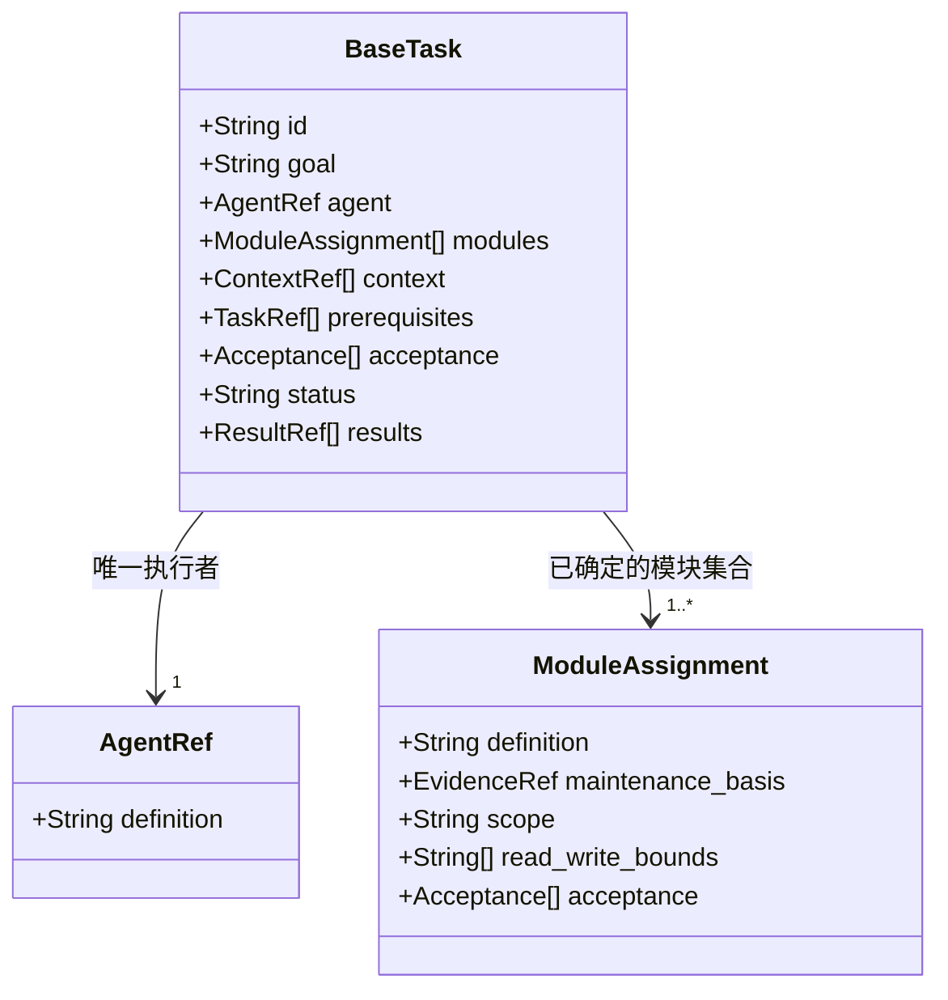

# BaseTask：单一任务抽象

author：linan

字段语义与分组规则见 [单一任务设计](task-spec.md)。类图表达逻辑结构，不代表新的调度服务或执行循环。

任务通过 [execute(task)](#execution) 委派给一个 subagent，返回 TaskResult；执行完成与 CBIM AI 助理验收完成分开处理。执行接口规定派发版本及上下文的具体交接内容。



- 每个模块都必须由任务中唯一的 Agent 维护，逐项核实依据；模块集合不可为空或重复。
- context 承载必要知识、决定和产物基线，可以引用其他模块，但不授予修改权。
- prerequisites 表达任务之间的前置关系，由 CBIM AI 助理调度，不由AI 成员 自行派生整套需求流程。
- acceptance 同时覆盖模块内结果与任务整体结果；results 关联实际产物、验证证据、未完成项和阻塞。
- 不设置 work_cycle；执行者按派发上下文使用宿主默认 loop，业务与治理策略由调用方提供。

<a id="execution"></a>

## 接口含义

```text
execute(task: Task) → TaskResult
```

CBIM AI 助理将一个已准备就绪的 Task 交给宿主，拉起一个 subagent。该 subagent 按 Task 指定的 Agent 定义和上下文，在已确定的模块集合与工作区内使用默认 loop 工作，直到完成或出错，再将结果返回 CBIM AI 助理。

一次调用对应一个 Task 的一次执行，不为每个模块分别启动 subagent。Agent 定义描述 AI 成员的专业能力，subagent 是该 AI 成员本次任务的宿主执行实例；角色称谓与运行实例分开表达。任务分组与维护要求以 [单一任务设计](task-spec.md) 为准。

派发必须提供并确认执行者读取本地 Agent 定义、工作原则和必要专业 Skill 的绑定版本，不依赖宿主伙伴身份。宿主不支持 subagent 时返回 launch_failed 或 blocked，不声称已执行。

这是自然语言接口契约，不限定编程语言或要求部署函数。宿主可以用异步派发、消息和等待实现，但启动回执、执行句柄或进度消息均不是最终 TaskResult。不另行抽象 start、inspect、cancel、resume，也不定义内部 loop。

## 输入：Task

传入本次派发时确定的任务版本。下列名称用于说明输入结构，可以由结构化数据或内容等价的任务消息承载。

| 字段 | 类型 | 要求 |
|---|---|---|
| id | string | 需求内唯一的 Task 标识 |
| revision | string | 本次任务绑定版本；与可取回的任务内容及知识基线关联，不能只靠版本文字证明内容一致 |
| goal | string | 本任务要得到的可验证结果，包含分析或实施的边界 |
| agent | AgentRef | 唯一 Agent 的定义引用；对应工作原则及必要 Skill 可从引用继续读取 |
| modules | ModuleAssignment[] | 至少一个模块且定义引用不重复，全部由该 Agent 维护 |
| context | TaskContext | 必要背景、有效决定、输入产物、知识及产物基线、执行约束 |
| prerequisites | Prerequisite[] | 前置 Task 标识、已验收版本及所提供的产物；没有前置时为空数组 |
| acceptance | Acceptance[] | 非空的整体验收要求，包含必要的模块间衔接验证 |

`AgentRef` 包含 `definition`（Agent 定义文件路径）。每项 `ModuleAssignment` 包含：

- `definition`：模块定义路径。
- `maintenance_basis`：该 Agent 维护此模块的可追溯依据，引用已有知识或有效指定及其范围。
- `scope`：该模块在本次目标中承担的具体工作。
- `workspace`：从 sources 核实的实际工作路径与说明。
- `read_write_bounds`：本次可读、可写及禁止改动的范围；只读任务可写范围为空。
- `acceptance`：该模块的必要验收条件。

`TaskContext` 包含背景与必要决定、可访问的输入引用、知识和产物基线引用、只读依赖、已有授权与执行限制，以及本次唯一 Agent 与全部作业模块声明的完整连接器并集、引用来源、注册表基线、Cindy 插件身份及目标约束。引用必须在 subagent 环境中可解析；缺失条件明确标记，不能依赖 CBIM AI 助理未传递的聊天记忆。分析任务的结论也属于产物，无需强制生成代码或文件。

每项 `Acceptance` 包含任务内唯一的 `id`、应满足的 `expected`、检查方法 `method` 和所需证据 `evidence_required`。模块与整体的验收标识不得混淆，返回时按标识对应。

路径和引用沿用 [任务设计](task-spec.md) 的项目根约定；CBIM AI 助理将它们映射到实际宿主工作区。文件型产物和证据引用标明路径与版本依据，文本型结论可以直接内联。不把整个项目作为默认上下文。

`status`、历史 `results` 属于 CBIM AI 助理的任务管理记录，不作为执行指令。再次派发只携带有关的历史结果、已发生操作和检查点作为 context，不重复已完成的变更。调用一次 execute 不自动授权新的模块、发布动作或额外 subagent 委派。

## 输出：TaskResult

| 字段 | 类型 | 要求 |
|---|---|---|
| task_id、task_revision | string | 必须对应实际执行的输入 Task 与版本 |
| execution_id | string | 本次执行的唯一关联标识，由宿主或 CBIM AI 助理建立；重复派发同一版本时使用新标识 |
| executor | object | `agent_definition` 为专业角色引用；`subagent_id` 为宿主实际执行实例标识，未成功启动时为 null |
| outcome | completed / error | 本次执行完成，或因错误及缺失条件无法完成 |
| summary | string | 实际完成了什么；不得仅写“成功”或“失败” |
| module_results | ModuleResult[] | 正常收到 subagent 回报时覆盖输入全部模块，每个恰好一次 |
| checks | CheckResult[] | 对应整体 acceptance，含模块间验证；未执行的检查明确记录 |
| artifacts | Evidence[] | 整体产物或分析结论，可为空数组；不遗漏实际已产生的交付内容 |
| remaining | string[] | 尚未完成的目标或工作；completed 时为空数组 |
| error | ErrorDetail / null | completed 时为 null；error 时必须说明错误 |
| checkpoint | reference / null | 有可用恢复记录时提供引用；没有时为 null，不伪造 |

`ModuleResult` 包含模块 `definition`、`state`（done / partial / not_started / unknown）、实际变更 `changes`、产物 `artifacts`、模块验收 `checks` 和未完成项 `remaining`。`changes` 说明实际修改、外部操作及其回执；无修改时明确为空，不将建议写成已执行动作。

`CheckResult` 包含 `acceptance_id`、`outcome`（passed / failed / not_run）、实际观察 `observed` 和证据 `evidence`。未运行说明原因；失败保留事实。证据须对应本次实际产物版本，不能用编译成功替代运行验证。

`ErrorDetail` 包含 `kind`、`message`、`affected_modules` 和 `next_step`。kind 可用 input_invalid、launch_failed、context_mismatch、execution_failed、verification_failed、blocked 或 interrupted。next_step 是供 CBIM AI 助理判断的建议，不是自动重试命令。

## 插件注入边界

execute 按 [任务设计](task-spec.md) 汇总声明并注入 subagent。TaskContext 包含 requested_plugins（ghost_id、namespace、引用来源和简短用途）；派发记录包含实际宿主回执与 injection_state（verified / unsupported / unknown）。没有回执不能标为 verified。严格注入或隔离不受宿主支持时返回 error / blocked，不假装已运行。

TaskResult 不维护连接会话和断开回执；连接与认证由 Cindy 负责。验收核对本次实际插件身份、目标资源和操作结果，而非共享连接是否关闭。

## 完成与错误的判定

- `completed`：subagent 已完成输入目标，全部模块的必要工作与本次要求由执行者完成的验收检查通过，返回完整产物和证据。其含义是执行者报告完成，不代表 CBIM AI 助理已验收。
- `error`：输入无效、启动失败、上下文失配、执行失败、必要验证失败或无法执行，或遇到阻塞无法继续。即使部分模块已经完成，整体也返回 error，并保留已完成部分。
- 可在已有范围内修复的问题由 subagent 用默认 loop 继续处理；无修正依据、缺少必要条件或需要扩大范围时返回 error，由 CBIM AI 助理决定后续工作。不因一次中间工具失败立即认定整项任务失败，也不无限重试。
- 若宿主中断或 subagent 无法正常回报，由 CBIM AI 助理根据宿主事实整理 error，不能冒充 subagent 返回。未启动的模块可标 not_started；已经启动但状态无法确认的模块标 unknown，产物未取得不等于没有产生变更。无法重建完整结果时明确剩余未知范围。

## CBIM AI 助理如何调用与接收

1. 按 Task 规则核实维护关系、完整模块集合、工作区、输入基线、前置产物、授权和冲突，准备可供执行者独立理解的上下文。
2. 使用宿主实际支持且允许的能力拉起一个 subagent，传递 Task，并记录本次 execution_id 与实际实例。宿主不能拉起 subagent 时报告 launch_failed；CBIM AI 助理如另行顺序代执行，应如实记录为替代执行，不声称本接口已成功启动 subagent。
3. subagent 核实输入、读取必要定义与知识，使用默认 loop 完成目标与验证，最终按 TaskResult 回报 CBIM AI 助理，不直接接管用户需求或擅自重新拆分整个任务列表。
4. CBIM AI 助理核对结果标识、任务版本、模块覆盖、实际产物与证据。completed 先进入待验证，通过 CBIM AI 助理验收后才将 Task 标为已完成并释放下游；回报缺项或证据不符时不能放行。
5. 收到 error 时保留实际进展，按原因修正上下文、补条件、调整任务或报告阻塞。重新 execute 前核实已发生操作与新旧版本；同一个 task_id 不能保证操作幂等，禁止盲目重复派发。

## 返回场景

| 场景 | 返回及 CBIM AI 助理处理 |
|---|---|
| 两模块及联动检查完成 | completed，带两项 module_results 和整体 checks；CBIM AI 助理验收 |
| 第一模块完成，第二模块的必需工具不可用 | error / blocked，保留第一模块结果和第二模块未完成项 |
| 功能修改完成但必需回归失败 | error / verification_failed，保留变更与失败证据 |
| 输入缺失或宿主未能启动 subagent | error / input_invalid 或 launch_failed，不编造执行产物 |
| 已启动但执行中断、产物状态不明 | error / interrupted，未知项明确标记；核实实际状态后再决定是否重新派发 |

## Team Skill 上下文要求

每次装配 Agent 时，调用入口提供的 Team Skill 解析工具，取得 Agent 自身至 team 根的完整继承清单；按 Agent 规范核实来源与冲突，并将清单及所需正文绑定到任务基线。缺少解析结果或解析失败时不得以 Agent 私有清单替代。Task 不自行选择上层 Skill；共享方法的选择由专业任务需求决定。恢复时重新解析并比较继承链与文件版本，防止 Team 迁移或共享清单更新后沿用旧上下文。
