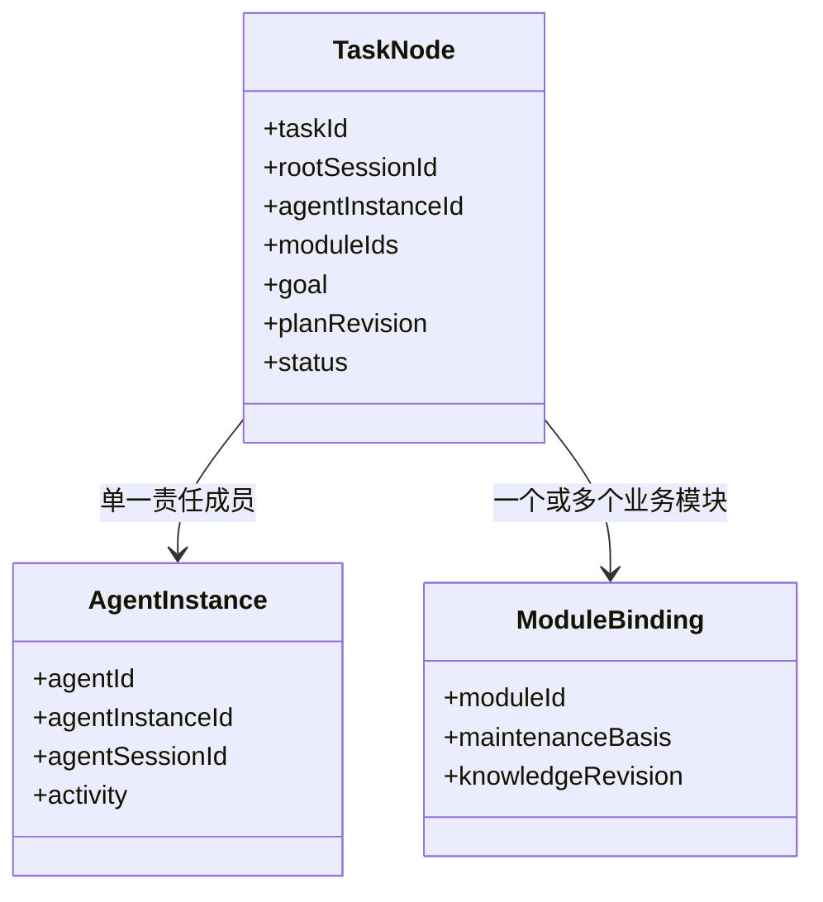

# BaseTask：成员业务任务抽象

author：linan

任务由一个责任成员、一个或多个有维护依据的模块和一个目标构成。Agent 是静态角色定义，AgentInstance 是独立动态成员，拥有自己的逻辑会话；成员共享 CBIM 大脑内核，不是由外部工具临时创建的子代理。

本文描述业务语义。当前已实现的节点、命令、存储和增量事件以 Core 的 TaskNode、DispatchCommand 与 DispatchEvent 类型为准；自动领取消息、启动成员大脑、返回结果和自动验收尚未全部接通。

## 任务边界

- 每个任务只有一个责任成员，其模块集合非空且无重复，逐项核实维护依据；能力相似不能替代维护关系。
- 上下文可引用其他模块，但只读引用不扩大作业或修改范围。
- 任务派发关系从主会话根向下单向展开；任务节点包含责任成员、模块列表和目标。执行依赖是另一类边，不与派发父子关系混为一谈。
- 任务目标、范围、验收要求及知识基线必须可追溯。修改已派发范围保留修订与原因，不让旧执行继续写入新范围。
- 技能定义不授予工具权限，父任务批准不自动成为另一个成员运行的批准。

## 派发与执行契约

派发由 CBIM 内部调度服务完成：核对工作区、主会话、成员实例和模块维护关系，保存任务节点、派发边与待处理消息后返回可靠回执。同一命令重试沿用幂等键，不能因网络或界面重读重复派发。

派发回执表示“任务与消息已持久化”，不表示成员已经读取、开始执行或完成。当前已接通持久入队、成员领取与执行、结果信封及主会话回注；每一步仍须核对实际运行与可靠结算，不能从入队成功推断最终完成。模型只能使用本轮实际注册的工具，不能把设计草案中的名称当作可调用能力。

成员执行按绑定的角色、有效 Skill、模块 Workflow、知识版本和权限，通过统一执行循环推进。一个任务可覆盖多个模块，不为每个模块临时复制成员。缺少必要能力时记录可核查的 gap，不以普通文本“委派”冒充调度成功。

## 上下文与结果

任务上下文至少包括目标、必要决定、责任成员、全部作业模块、逐模块维护依据、读写范围、知识与产物版本、前置输入、验收要求和连接器需求。由内部知识服务返回定义和正文，模型不自行拼接或扫描 `.cbim/`。

连接器需求只是定义引用。实际工具未接入或未获授权时保持缺口，不声明插件已经注入或隔离已经生效。能力定义、运行工具与操作授权必须分别核实。

成员结果应包含实际执行身份与运行、所依据的任务版本、逐模块变更、产物、实际验证、未完成项、阻塞及可用恢复位置。未验证项标明未运行；结果未知先核实已发生副作用，不盲目重放。

执行结束、成员报告完成、交付候选、人工验收分别表达。只有符合当前有效验收条件的结果才能满足下游前置；主 Agent 负责汇总与交付，系统记录不能替代人的最终责任。

中断后保留已发生操作和剩余未知范围。恢复须核对旧运行是否仍在执行、任务修订、知识版本与实际产物，既不重复完成的变更，也不假定停止会回滚副作用。具体基线规则见 [任务知识基线与恢复](task-baseline.md)。
