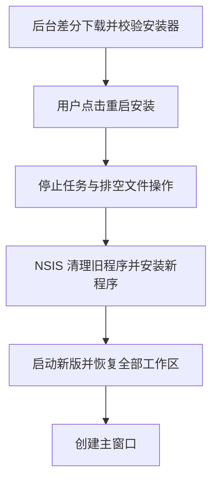
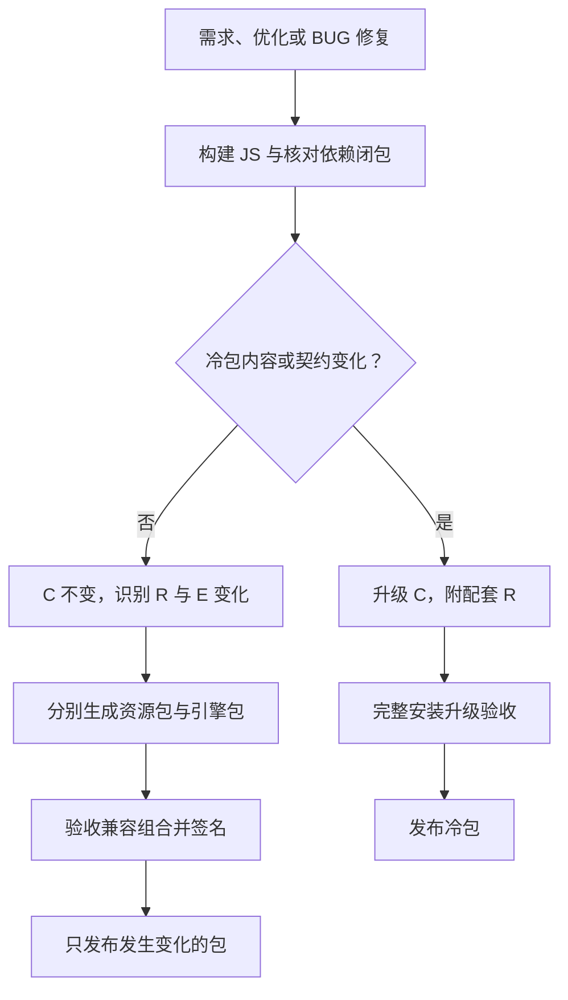
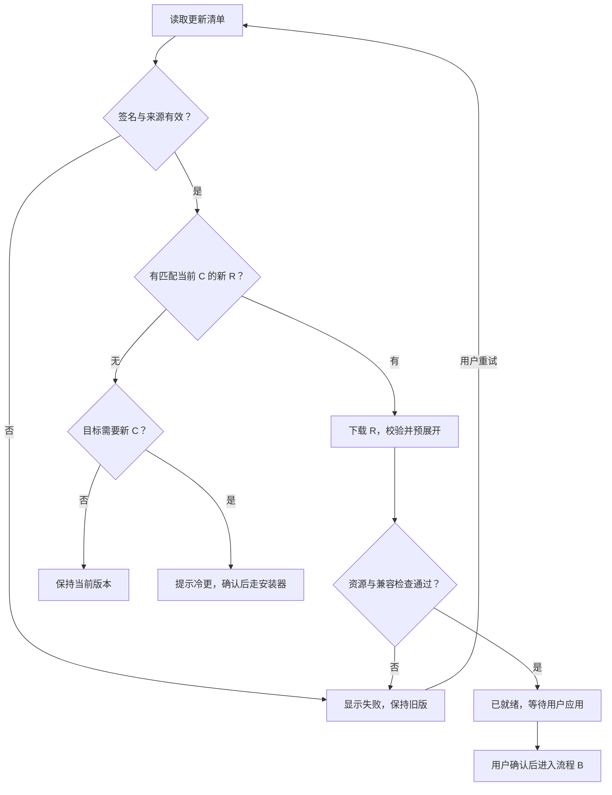
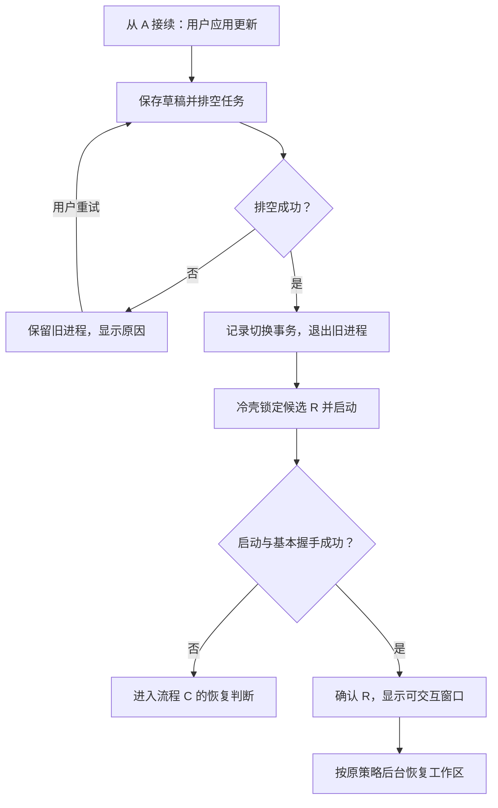
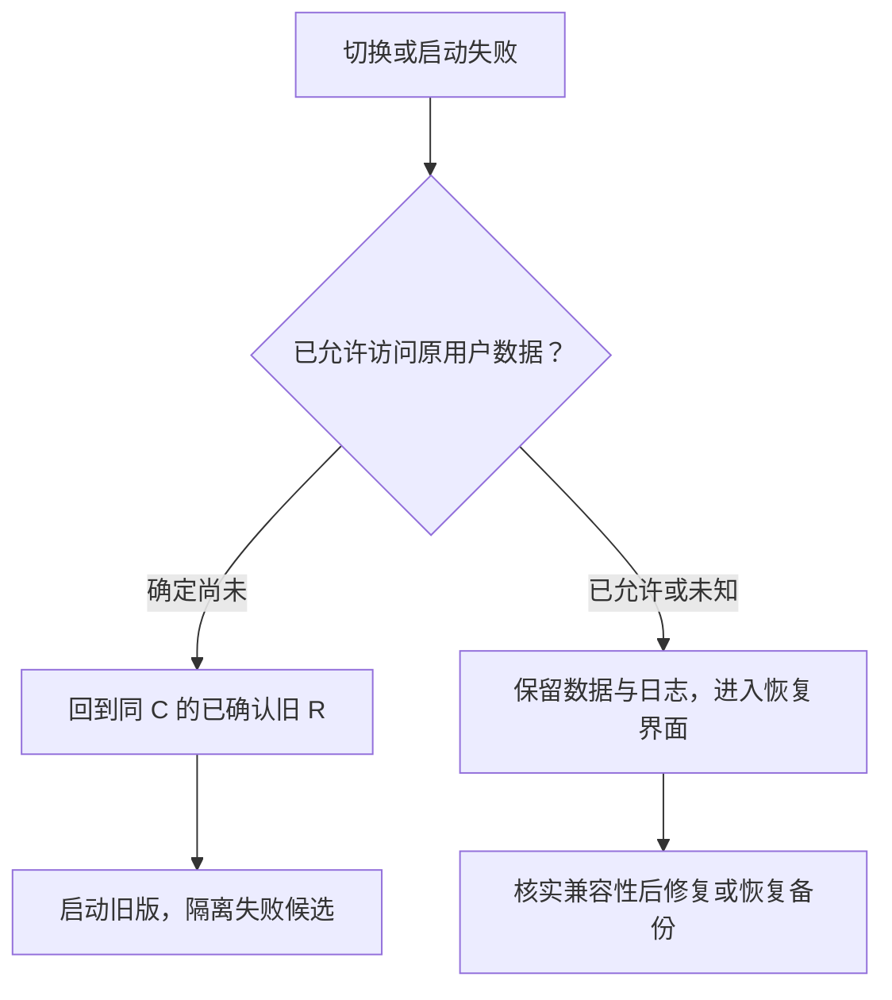
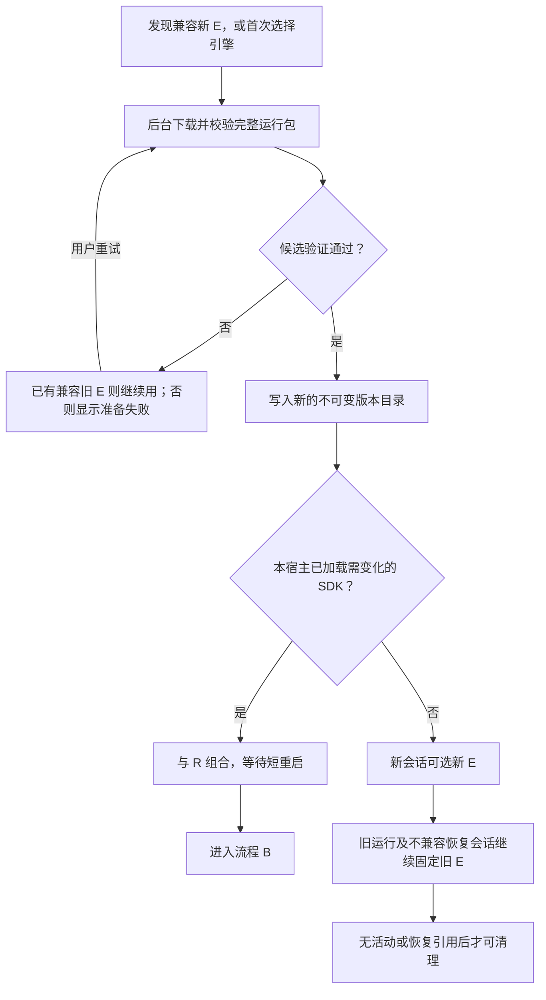

# CBIM 更新设计：冷更基础包、资源 ZIP 与独立引擎包

日期：2026-11-12。状态：**用户已授权实施；C/R/E 首版已接通并完成本地针对性验证，尚未发布或完成正式安装升级验收**。

2026-11-12 实施说明：保留本文的目标设计和调研基线，当前实现以源码契约及 [构建/发布运行说明](desktop-runtime-release.md) 为准。已实现固定 C、签名完整 R ZIP、独立按需 E、后台预展开、显式短重启、窗口优先、C/R 图标进度和保守失败恢复。首版没有文件级差分、独立页面 reload、跨 E 会话自动迁移/旧 E 自动选择或版本缓存回收；E 摘要变化时阻止旧原生会话恢复，保留历史并提示新建对话。以下目标流程中的更宽恢复/兼容能力不作为本次已完成保证。

任务来源：用户要求先设计更新流程、给出流程图、可行性和取舍；随后明确参考游戏热更新，将脚本与资源独立发布，使用冷更 code 版本和热更资源版本，并提出增量 ZIP 免安装替换、Agent 引擎单独下载的组合。业务背景是 CBIM 处于早期，新增需求、优化与 BUG 修复频繁，不希望每次业务迭代都下载安装整个应用。

设计调研基线：`bf283752`，其文件树与 `216a15e2` 无差异；调研开始时为 `92189dd6`，期间出现 0.1.14 发布准备及合并提交，未改变调研时的产品更新、启动或打包实现。以下旧流程分析保留该历史基线，重构后的当前行为见文首实施说明。体积样本单独采用本机已留存的 0.1.13 制品，不将其当作 0.1.14 或未来热更包。

## 1. 结论与术语

推荐采用 **冷更基础包 C + 资源 ZIP 包 R + 独立引擎包 E**。对外产品仍使用 C/R 双版本，E 是各依赖自身的版本。

- C 承载 Electron/Node/Chromium、加载进宿主的原生依赖、最小引导器及更新信任根。
- R 承载编译后的业务 JavaScript、前端、preload、工作进程脚本、纯 JS 依赖及内置业务资源。
- E 承载按平台制作的 Pi / Claude / Codex 引擎运行包。独立 EXE 的机器码变化不必然触发 CBIM 冷更；决定因素是运行边界、宿主 ABI 和适配协议。
- 日常业务变化只发布 R，不制作或运行 NSIS 安装器；C 变化时才发布冷更安装包。
- 首版热更采用后台下载、校验、预展开，然后在用户选择的时机短暂重启应用，整套业务代码一起生效。
- R/E 可以全包或增量传输；先将小型 R 完整压缩、E 单独按需下载，文件级差分作为可加的传输优化。不能把“增量下载”“免安装切换”“运行中无需重启”当成同一件事。
- 后续可为满足兼容条件的纯前端变更加上页面 reload；不把开发态 HMR 或运行中替换任务对象作为第一阶段目标。

本文的“热更”指**无需重新分发和安装基础程序**，不等于所有更新都无进程重启。主进程 TS 业务逻辑编译为 JS 后可以热更；需要重启该 JS 进程，不代表需要重新安装 Electron。

分类按运行产物、依赖闭包和兼容契约决定，不按 `.ts` / `.js` 源文件后缀，也不按需求大小决定。冷更信任根有一个有意的例外：最小引导、验签策略和启动协议即使部分由 JS 实现，也放在 C，避免待验证的资源包决定如何验证自己。这与游戏基础包内保留资源加载器是同类边界。

## 2. 调整前事实与调整价值

调研基线的旧链路：`DesktopUpdates` 后台准备并下载，经用户点击后显示两秒提示，调用 Main 的业务关闭回调，再由 `NsisUpdateInstaller` 执行 `quitAndInstall(true,true)`。启动入口等待 `application.init()` 完成之后才创建窗口；`restore()` 逐个打开全部已登记工作区。

旧流程：



这张图展示成功路径。旧流程已有下载失败重试、普通退出取消安装、排空失败不安装等保护；新设计应保留这些语义。

本轮只读统计的 0.1.13 制品：

| 项目 | 字节 | 换算 / 文件数 |
| --- | ---: | --- |
| `resources/app.asar` | 4,203,407 | 4.01 MiB |
| Pi、Claude、Codex 三套运行环境合计 | 991,888,898 | 945.94 MiB |
| 整个已打包应用目录 | 1,381,221,481 | 1.286 GiB / 21,732 个文件 |

样本：`build/release-013/build/unsigned-20261112-153056-9c5f8d31/CBIM Assistant-win32-x64/`。统计使用 Node `readdirSync/statSync` 递归求和，无写入。上述为压缩前磁盘大小；`app.asar` 不含所有待归入 R 的运行资源，不能直接承诺“以后每次只下载 4 MiB”。

已有 0.1.12 → 0.1.13 的公开验收证明当前差分下载有效：安装包有效传输约 3.10 MiB，重建完整安装器约 374.37 MiB。因此不能把旧流程描述成“每次一定全量下载”。新方案首先减少安装时替换的内容和停机工作量；网络流量是否优于已有差分，必须实测。

当前 Vite 配置将主进程 TS 构建成 JS，显式外置 `electron`、`koffi` 和 Node 内置模块。`forge.config.ts` 将前后端放入应用包，另附多套引擎、koffi 与资源。已有源码分层有利于分析边界，；本次实现已将这些产物拆成 C/R/E。

## 3. C / R 内容边界

| 内容 | 拟归属 | 条件与实例 |
| --- | --- | --- |
| `backend/core`、`scheduler-engine`、Main 业务服务的 TS | R | 发布构建后的 JS；原生接口、冷壳契约仍兼容 |
| React/TSX、CSS、HTML、界面图标 | R | 与配套 preload、后端和渲染资源作为同一版本发布 |
| preload、隔离工人和受控文件工人的 JS | R | 冷壳允许的入口契约保持；全部固定到同一个 R，不能混用新旧脚本 |
| 提示词、产品内置 Skill、规则 Schema、内置说明 | R | 仅更新程序自有资源；不覆盖用户工作区、用户 Skill 或知识数据 |
| 纯 JS npm 依赖 | R | 闭包可在固定 C 运行；不能隐含新增原生模块或运行时下载的二进制 |
| Electron / Chromium / Node、加载进宿主的 `.node` / DLL | C | 包括 koffi 原生实现；宿主原生能力与 ABI 变化走冷更 |
| 独立进程使用的引擎 EXE、脚本和依赖 | E | 与 CBIM 通过已验证的协议通信；按 OS / 架构提供预编译运行包，不因其含机器码就强制升级 C |
| Claude SDK、Pi 工具库等加载进主进程的代码 | E 的宿主桥接部分 | 兼容的 JS 可随 E 更新，但首版与 R 配套选择并短重启；实际加载进主进程的原生模块仍按 C 约束 |
| 最小引导器、更新验签策略、信任根、冷壳能力协议 | C | 少量虽为 JS，仍作为可信基础；其缺陷修复也可能需要一次冷更 |
| EXE 图标、注册协议、快捷方式、安装身份 | C | 属于安装 / 系统集成，而非界面图片 |

修改一个调用 DLL 的 TS 包装器不必自动冷更；替换加载进宿主的 DLL、需要新增冷壳原生能力或破坏既有接口时需要冷更。独立引擎进程私有的 DLL 可随 E 交付，其 ABI 属于该进程的运行环境。新增纯 JS 依赖也不必自动冷更。构建检查必须比较实际依赖闭包与冷包能力指纹，而不是只看 `package.json` 或后缀是否变化。

数据格式不兼容是另一条约束。发布整安装包本身并不能解决数据迁移或回滚问题。第一版 R 只接纳已验证的数据兼容更新；不可逆迁移进入单独的迁移设计与验收，不能偷偷夹在普通热更里，也不能仅靠提高 C 版本就宣称安全。

### 3.1 引擎拆包的当前依据与限制

`scripts/package-pi-runtime.mjs` 现在递归复制生产依赖闭包、保留依赖版本并写清单；没有把三个引擎的源代码编译进 CBIM 的过程。因此可将这些目录改为单独发布的运行包，用户下载、验证、展开后直接使用，不在用户机器执行 `npm install` 或编译器。第三方原生代码的编译仍由上游或制品构建阶段完成，不能理解为二进制不需要构建来源。

| 引擎 | 实际接入 | 拆包可行性与激活边界 |
| --- | --- | --- |
| Codex | `binary.ts` 解析预编译原生文件，`rpc.ts` 启动 `codex app-server` 并通过标准输入输出通信 | 最适合直接分离 E；新会话可选择兼容新 E，运行中的进程继续使用旧目录 |
| Pi | `loop-engine.ts` 用 `process.execPath` 加 `ELECTRON_RUN_AS_NODE=1` 启动 JS RPC 入口 | Pi 文件可独立下载，但依赖当前 Electron 提供的 Node 能力；若新 E 需要更高 Node，须为 E 自带隔离 Node，或升级 C，不能仅换 JS 就保证可用 |
| Claude | 主进程动态导入 Agent SDK，SDK 再启动 CLI / 原生可执行文件 | SDK、CLI 与生产依赖可整体作为 E；首版更换 SDK 要短重启 CBIM，避免同进程模块缓存和 SDK 状态混用 |
| Pi 工具库 | `engines/native-tools.ts` 将 Pi 工具实现导入宿主，Codex 适配也使用它 | 不能认为“不选 Pi 就完全不需要 Pi 相关依赖”；先明确运行依赖，后续可把工具子包从 Pi 完整引擎中独立出来 |

当前还硬编码验证 Pi `1.5.0`、Codex `0.167.0`，并从安装资源目录解析路径。实施需要改为可信 `ResolvedEngineRuntime`：来自校验后的具体版本目录，包含入口、运行环境、依赖、摘要和适配契约。不能直接删除版本检查或接受任意“最新”下载地址。Claude 的工具门禁握手、Codex 功能目录核验以及既有权限和会话身份检查都必须保留。

E 清单同时包含上游版本与本项目打包修订、平台、CPU 架构、运行时要求、依赖文件集合、摘要、签名、许可资料及已验证的适配器范围。外部 EXE 不受 Electron 的 Node ABI 直接约束；进程内 `.node` 仍受实际运行时约束。下载目录只保存程序，`agentHome`、账号、历史、凭据继续归用户数据，不能随 E 替换。

第一版默认绑定一个已验收的 C/R/E 组合。只有协议、工具授权和会话格式兼容已经验证的 E，才可独立改变新会话使用的版本。宿主已加载的 SDK / 工具库按整个应用进程固定版本，待短重启切换；后续如将桥接代码放入专用进程，才进一步放宽宿主重启边界。启动新引擎进程属于进程切换，不属于重新安装 CBIM。

## 4. 双版本规则

示例只是协议示意，不表示决定下一次发行版本：

| 发布事件 | 对外版本 | 产物 |
| --- | --- | --- |
| 首次支持新机制 | C `0.2.0` / R `1` | 冷更安装包，附带可离线启动的 R1 |
| 修复对话 TS 逻辑 | C `0.2.0` / R `2` | R2 资源包及签名清单 |
| 调整前端与任务调度 | C `0.2.0` / R `3` | R3 资源包及签名清单 |
| 升级兼容的独立 Codex EXE | C/R 均可不变 | 新 E 包；通过兼容验收后供新会话使用 |
| 引擎协议变化，同时修改 TS 适配器 | C 不变，R 递增 | R 与所需 E 一起准备并作为已验证组合启用 |
| 升级 Electron 或宿主原生依赖 | C `0.3.0` / R `1` | 新冷包及其配套 R1、引擎兼容清单 |

- 第一版 R 精确绑定一个 C；同一 C 内 R 单调递增，不跨 C 比较 R 的数值。
- `app.getVersion()` 只代表安装的 C，不能继续充当全部业务版本。界面、日志、BUG 反馈和验收记录同时显示 C/R 与资源摘要。
- 制品清单还记录平台、架构、冷包能力指纹、引导协议、资源入口、文件长度与哈希、数据兼容声明和各引擎依赖。普通界面展示 C/R；诊断信息另列 E-pi / E-claude / E-codex 的实际版本与摘要，不创造一个含义不清的第三个全局产品版本号。
- 某个旧 C 可以继续收到针对它验证的 R 更新。只有新版功能确实需要新的冷基础，才要求用户升级 C；不能“发现更高 C 就阻止所有旧 C 热更”。
- 远端不能通过提高 R 绕过 C 匹配。自动回退只允许回到本机同 C 的已确认版本，且满足第 7 节的数据边界，不能把防降级措施整体关闭。

发布分流：



## 5. 技术原理：稳定冷壳加载版本化业务资源

建议的物理布局（拟议，不是现有目录）：

```text
安装目录/
  CBIM Desktop.exe                 Electron 主可执行文件，属于 C
  resources/app.asar               最小冷壳、验签与资源选择入口
  resources/native/               固定 C 的宿主原生依赖
  resources/bundled-resources/     随安装器交付的初始 R
  resources/bundled-engines/       可选的初始 E，按离线分发需求选配

独立更新缓存（按安装身份隔离）/
  resources/<C>/<R>-<digest>/      已验证、只读使用的 JS 与资源目录
  engines/<kind>/<platform>/<E>/  独立引擎运行目录；版本包含打包修订与摘要
  staging/<transaction-id>/       下载 / 展开中的候选
  state/                          当前、上个确认版本、切换日志

~/.cbim/ 或明确配置的 userRoot/    继续保存原用户配置、会话、历史等
业务工作区/                       继续保存原业务文件和 .cbim 知识
```

更新缓存与业务用户目录分离，不能成为业务工程。沿用固定用户身份、应用 ID、单实例语义；自定义 `CBIM_USER_DATA_ROOT` 在热重启和冷安装时都需保留。缓存若采用 LocalAppData，仍必须按实际安装身份隔离，不能让两个 C 安装错误共享一个活动指针。

冷壳在导入业务代码前选择资源版本，校验签名、C/平台/架构、文件摘要和入口白名单。随后从已固定的 R 目录加载业务入口。业务入口、preload、renderer 和工人入口取得同一个 `ResolvedResourceRelease`；跨 `await` 或开新窗口时不得再次读取可能变化的“最新 R”。

第一版使用 ZIP 交付、提前展开到版本目录。资源目录按协议不再原位写入；升级创建新目录、切换小型选择记录，旧目录保留。先不引入硬链接、共享可变 node_modules、按运行目录覆盖或多层差分链。

### 5.1 增量 ZIP 的原理与取舍

“ZIP 解压替换”可以减少安装器工作，但 ZIP 本身不自动具有增量能力，直接往正在运行的目录覆盖还会产生新旧文件混用和文件占用问题。可选传输粒度如下：

| 形式 | 实际下载 | 启用前的工作 |
| --- | --- | --- |
| 整应用 ZIP | 整个打包目录的压缩内容 | 准备全应用、等待退出、替换文件；省掉安装器但仍涉及大运行环境 |
| 文件级增量 ZIP | 新增 / 改变文件，加删除清单、基线摘要和目标清单 | 从已验证基线复制未变文件到新目录，应用补丁并校验完整目标；不能在活动目录直接覆盖 |
| 块级差分 | 文件中改变的字节块 | 重建完整目标文件并校验；进一步节省带宽，但构建、缓存和恢复复杂度更高 |
| 独立 R / E 完整 ZIP | 仅发生变化的资源或引擎包 | 不动其他包；对已经很小的 R，完整下载可能比维护差分更划算 |

文件级增量针对每个包独立制作，记录准确 `baseDigest` 与 `targetDigest`。基线不符、缺文件、差分重建失败时，下载该目标包的完整版本；不因此下载整个 CBIM，也不跳过校验。目标清单定义最终文件集合，删除文件不会残留，未声明文件不能混入。解包前检查路径与容量，完成后验证整个候选；不把增量包直接标记为可运行版本。

第一阶段保留完整目标包作为可靠入口；可在体积证明有收益时加“一跳到目标”的文件差分，不要求补齐历次补丁。`app.asar` 是单文件，里面一段 JS 变动可能使文件级差分下载整个 ASAR；块级算法才可能进一步缩小。新 R 按稳定入口 / 资源分块产出是否划算，以真实包大小为依据，不机械把每个源码文件拆成一个分发文件。

若希望先做改造较少的过渡方案，可以把**整应用的文件增量 ZIP + E 独立下载**作为一致的应用发布单元：匹配新 EXE 与 `app.asar`、校验完整清单，退出后由独立帮助程序替换。它不用重构业务加载入口，但需要处理原生文件占用、安装目录权限、删除清单、回退及 EXE/ASAR 完整性配套；若为安全切换重建完整应用目录，还可能复制数百 MiB 未变框架文件。它仍是整应用版本升级，不自动获得 C/R 隔离。对本次明确要求长期频繁更新业务的目标，推荐拆出 R，避免长期维护过渡更新器和正式更新器两条重叠链路。

即使未来 C 本身用 ZIP 而非 NSIS 更换，Electron 或宿主原生运行环境改变仍属于冷更，只是更换了传输与部署方式。初始安装、快捷方式、卸载、系统集成变化仍由现有安装通道处理。

### 5.2 可信入口

安装内的 `resources/app.asar` 只保存冷壳，热更不改它；业务包不再占用这个特殊主归档路径。理由是 Electron 可将该 ASAR 的完整性摘要绑定到可执行文件；启用后仅换 `app.asar` 会破坏校验。R 使用独立的签名清单和文件摘要验证，不能为热更关闭现有保护，也不能声称外部 R 自动受 ASAR 内嵌摘要保护。需要在实际 Electron 40 打包制品上验证外部入口、preload、worker、CSP 与 native 模块解析。

冷壳中只有少量稳定加载 / 验证能力；Core 和任务规则仍保留在 R，不能因为热更把全部后端冻结到 C。非字面量资源入口加载是一个明确受限的发布边界，不是绕过源码依赖检查的通用豁免。

## 6. 用户更新流程

### A. 后台准备：旧版继续工作



网络、解压与校验都放在旧进程仍可使用时执行。按磁盘空间、CPU/IO 做有界后台工作；缺空间、断网或校验失败不关闭旧程序。就绪含义从“安装器已下载”变为“资源目录已经可直接加载”。

首版下载的是完整 R 包，不是完整应用包。这让 R17 可直接更新到 R23，不需依次执行 R18–R22。若 R 要求新的 E，须先准备好所需引擎组合才能激活；可选且未使用的引擎不阻塞 UI 更新。资源包明显增大后再评估文件级内容缓存或块级差分；现有针对 NSIS EXE 的差分下载器不能未经验证就宣称可以直接复用于新 ZIP 格式。

保留用户授权边界：后台准备不安装；普通退出不自动应用仅处于 ready 的 R。只有本次明确的应用请求可创建持久激活票据，恢复流程必须区别 ready 缓存与已授权但中断的切换。

### B. 短时切换：不执行安装器



“保存草稿”需要显式实现并测试：普通表单和输入框草稿进入原用户数据；不能把目前提示用户保存当作已经拥有自动保存能力。与任务提交相关的事务仍由原所有者提交，不由更新器代写。

不再为了显示提示固定等待两秒。UI 进入切换态之后，实际耗时来自必要的排空、进程重启和资源装载；不能为了快跳过文件工人退出、锁释放或未知结果核实。排空失败可能已停止部分任务，不能把“保留进程”描述成所有任务自动恢复运行。

最小冷壳负责激活票据、进程代际、启动和失败恢复。可用稳定的独立小型帮助进程承接旧进程退出后的监督；它属于 C，不需要每次 R 更新替换。实现前验证 OS 锁、进程退出确认与命名管道认证，不依赖用户可编辑的脚本命令。

新进程先建立基础窗口 / 更新恢复界面，再初始化业务；工作区继续按原恢复策略在后台打开，优先当前工作区及需要及时恢复的自动化。每个工作区未就绪时不接受业务请求。首版不擅自将自动恢复改成纯手动打开，也不因此重放历史任务。

界面应区分“窗口已出现”“资源版本已加载”“工作区可用”。收到匹配事务、PID 代际和资源摘要的真实握手，才报告 R 已应用；仅发现一个进程存活不能代替业务入口握手，更不代表全部业务验收通过。

### C. 失败恢复：代码回退有明确数据边界



原数据边界取保守定义：**不仅是知识 / 调度文件，还包括 Electron 原 userData、localStorage、会话和配置**。冷壳默认禁止候选接触原 profile；必要的资源探测使用独立临时 profile，且可以在后台准备时完成。正式启动接触原 profile 前，先持久记录 `data-access-started`，再放行；状态未知一律按已放行处理。

第一版自动回退仅覆盖选择日志明确证明尚未访问原数据的候选资源校验失败；选择日志缺失或损坏不属于可安全回退条件。本次实现保守地在业务入口导入之前就标记 data-access，业务模块导入异常不自动回退。真实启动打开原数据后发生的失败，进入冷壳的恢复界面，不自动加载旧 R。保留旧代码不等于可以回滚新数据；以后如需扩大自动回退范围，必须为格式和所有写入者提供兼容证据。

候选失败不得形成“启动 → 回退 → 自动再试同一坏 R”的循环。同一摘要隔离到用户明确重试或发布不同候选。缺失 / 损坏的选择记录也不能盲目回到随安装器附带的 R1：仍须核实数据边界，必要时只启动恢复界面。

### D. 独立引擎更新与使用



引擎下载不作为每次显示主窗口的前置条件；本地有满足当前 R 的已验证运行包时直接复用。首次安装未包含所选引擎时，界面明确显示首次准备及进度；网络不可用时不谎报可执行。是否在首个安装器内附带默认引擎，由初装体积与离线需求取舍，不能以拆包掩盖用户首次等待。

每次运行冻结具体 E 路径、摘要、适配器版本与进程身份。E 的选择器只改变未来运行，不修改旧进程的文件；已有原生会话恢复也记录 E 来源，未经会话格式兼容验证不能默默交给新 E。新 E 若已写入历史，回退同样须验证数据兼容，不能把程序包回退等同于会话回退。保留目录引用覆盖运行进程、待恢复会话和已确认恢复点；引用仍在时不做清理。

## 7. 选择记录、信任与兼容约束

1. 冷壳拥有唯一更新状态：已确认 R、准备候选、用户激活票据、切换阶段、数据访问闸门和失败原因。前端只显示状态、发出明确动作，不推断路径或直接修改这些文件。
2. 同一次切换冻结 C/R、摘要、用户目录身份和原进程代际；OS 互斥锁阻止两次切换或旧新进程并发打开同一 profile。不能只凭 PID 数字判断旧进程身份。
3. 选择记录采用同卷临时文件写入、flush、替换和回读，配合有代次 / 校验的日志及上一已确认记录。Windows 文件替换存在部分失败语义，`ReplaceFileW` 的 `REPLACEFILE_WRITE_THROUGH` 标志也不受支持；不能用“调用 rename 一次”代替断电恢复设计。
4. 文件替换结果未知时读取实际记录和事务阶段再决定，不重复执行安装，不自动选择一个可能不兼容的旧版本。日志损坏时进入恢复界面。原子可见性不等于持久化保证。
5. 验证包签名、版本、平台、长度、摘要及入口；解压拒绝目录穿越、绝对路径、链接 / 重解析点、Windows 特殊路径和大小异常。签名清单覆盖文件集合，R 拒绝未声明文件与冷基础载荷；E 可包含明确声明、隔离运行的原生程序。不能只根据扩展名判断二进制依赖的归属。
6. R 是能执行本机操作的发布代码，必须由 C 的信任根验证。首次冷包内置可信根；签名元数据需要版本 / 过期和密钥轮换设计，可采用 TUF 等已有实现。选型和协议测试是实施工作，本文不宣称已接入 TUF。包签名与 Windows Authenticode 是两件事，不能拿文件哈希或项目签名冒充系统可信发布者。
7. 热更构建复用冻结 C 的原生能力，不重新签 CBIM EXE、不改其原生 PE 资源。所有冷包输入与能力指纹都必须保持，否则构建拒绝按 R 发布。E 单独构建 / 打包与验证；其机器码变化不自动改变 C，宿主 ABI 或冷壳能力变化才触发 C。
8. 第一版资源包将 main/preload/renderer/worker/内置规则作为单一兼容单元。内部 IPC 可以随整个 R 一起演进；R 到 C 的加载和原生能力契约不能偷偷改变。
9. 更新缓存不包含凭据，不改写工作区文件。版本目录不是对同一登录用户的恶意代码隔离边界；实现仍需核实本机目录所有权、重解析点与校验到加载之间的约束，不宣称可以抵御已控制该用户账号的攻击者。
10. 清理只在已确认版本正常工作后发生，保留当前 / 上一已确认 R 与未结清事务引用的资源；不清理正在使用的目录。配额不足时先停止准备，不能删除唯一恢复依据。垃圾回收不放进重启关键路径。

## 8. 复用边界与改动入口

| 当前模块 | 可复用内容 | 需要改变 |
| --- | --- | --- |
| `backend/updater/desktop-updates.ts` | 后台检查、候选冻结、显式应用、失败重试的用户语义 | C/R 候选及 preparing/ready/switching/confirmed/recovery 状态；具体验证 / 激活权收敛到冷壳 |
| `backend/updater/nsis-updater.ts` | 既有冷更下载与安装、NSIS 差分 | 保留为 C 通道，不让所有 R 经过它 |
| `backend/updater/desktop-releases.ts` | 固定公开来源、过滤发行通道 | 区分冷包 / 资源包；同 C 选择 R，避免旧客户端误读热包 |
| `bridge/contracts/desktop-updates.ts` | 前后端只读展示契约 | 同时返回 C/R、准备 / 切换 / 失败阶段，不暴露任意执行命令 |
| `main.ts` / `assembly/application.ts` | 真实业务排空、用户路径和工作区恢复语义 | 稳定 bootstrap 与可更新业务入口分开；先显示基础窗口，再恢复工作区 |
| `platform/paths.ts` 及原生解析 | 用户数据与安装路径已分开 | 明确 coldRoot/resourceRoot/userRoot；更新缓存排除在业务工程之外 |
| `loop-engine.ts`、`claude/sdk.ts`、`codex/binary.ts`、`engines/native-tools.ts` | 现有引擎入口、版本核验、进程与工具门禁 | 注入可信 E 路径和兼容组合；保留版本与来源核验，区分宿主 SDK 生命周期与独立进程 |
| Forge / Vite / 发布脚本 | 现有多入口 JS 构建、依赖闭包和制品验收 | 独立 C / R / E 制品；不把业务包重新绑进冷壳 app.asar；禁止热更夹带冷变更 |
| 前端更新 UI 与日志 | 单一更新入口、原草稿上下文 | 显示有效 C/R、后台准备、短重启与恢复结果 |

依赖方向仍为：业务依赖稳定契约；更新器不导入调度 / Core 业务实现。Main 通过窄的生命周期端口负责保存 / 排空。冷壳只负责资源选择、可信执行和恢复，不拥有任务状态、模型凭据或知识事务。

## 9. 与旧方案、Cindy 及其他方案的取舍

| 方案 | 优势 | 劣势 / 代价 | 本次判断 |
| --- | --- | --- | --- |
| 继续 NSIS 整包更新 | 成熟链路；现有真实差分与安装验收可复用 | JS 小修复仍重走大量文件安装；无窗口等待仍需另治 | 保留作 C 通道 |
| Cindy 式应用 ZIP 与独立引擎 | 不走完整卸载重装；引擎缓存可复用 | 核实的 Windows 应用 ZIP 来自完整应用目录；仍有文件替换及启动开销 | 借鉴引擎包、独立更新监督、缓存与恢复 |
| 整应用文件增量 ZIP 与独立 E | 不重做业务加载边界；只传改变的文件；免安装器 | 仍要协调 EXE/ASAR、原生文件锁与安装目录；安全准备可能复制大量未变文件 | 可作较快过渡，但不等于 C/R 热资源系统 |
| C 固定，R ZIP 与独立 E，短重启 | 日常不碰原生基础；引擎不随业务重复分发；新旧 JS 一起生效 | 新增引导器、可信清单、组合兼容测试与缓存；部分更新仍重启进程 | **推荐目标与首版边界**；R 先全包，按收益加差分 |
| 只刷新前端页面 | 纯 UI 改动停顿短，可保留后端任务 | 不能替换已运行的后端逻辑；草稿、订阅与 IPC 兼容另需保障 | 后续有明确收益时扩展 |
| 主进程全面 HMR / 对象热替换 | 理想情况下无重启 | 任务、锁、worker、定时器、闭包及事务状态迁移复杂，错误难复现 | 首版不做 |

相较旧流程，新方案保护 C 的低频基础，把高频需求和修复限制在 R。用户不需要每次更换大型原生文件，旧进程退出后的工作主要是版本选择和启动；下载与展开前移到后台。

代价是包系统复杂度从安装器部分转移到项目：C/R 组合、密钥与信任、缓存、启动恢复及数据兼容都要持续维护。至少保留两份 R 会占额外磁盘，但不必保留两份约 1.29 GiB 的整个应用；实际热包大小仍需拆包后测量。

Cindy 为什么没有采用这套双版本方案：**公开源码不能证明作者的动机**。可确认的是，其 Windows 打包脚本把 `packagedDir/*` 压成 hotfix ZIP，更新器等待退出、解压、备份、覆盖、重启，且已启用 ASAR 完整性相关 fuse；Agent 引擎另有后台下载与可用本地缓存复用。不能把它称为已实现“只下改动文件的应用增量 ZIP”，也不能说其 ZIP 已在退出前展开。完整应用作为一致发布单元可以减少壳 / 资源组合与签名兼容成本，这是技术取舍分析，不是对作者决策的事实断言。相对耗时需同机测量，本文不把可见代码差异当作用户机器上已测出的瓶颈占比。

## 10. 可行性与分步验收

工程判断：**Windows x64 的固定 C、真实 R1→R2 窗口切换已在隔离 Electron 宿主通过；正式安装器、公共网络及完整性能验收未执行**。依据是业务已由 TS 构建为 JS；Electron 可在既有运行环境执行脚本；原生依赖和引擎已有单独打包路径；用户数据已与安装目录分开。最难的工作是冷壳引导、入口 / 路径解耦、版本兼容与可靠恢复，不是 TypeScript 本身。

原设计采用以下迁移顺序。这是方案的切片说明，不是实时待办；本轮已按用户直接授权完成 UI 与 C/R/E 首版，实施和验证边界见开发记录。未实现的扩展不自动成为下一步任务：

1. **建立 C/R/E 基线和体积 / 耗时记录。** 固定每个依赖的运行分类、入口清单、签名信任方案和 ABI；记录 click、drain、exit、launch、shell-ready、workspace-ready。验证 TS 修改产出 R、宿主原生变化被分流、引擎可独立组包，且现有业务行为不变。
2. **交付支持资源加载的首个冷包。** 内置可离线运行的 R1；新冷壳、外部资源路径、窗口和工作区生命周期接通。使用隔离 profile 验证同一个 C 能运行 R1 和 R2；验证原生解析、preload / worker、ASAR / CSP、隔离执行及权限边界。
3. **接通资源和引擎包发布及短时切换。** 前后台语义、版本记录、显式激活、失败隔离和数据访问闸门接通；用真实固定 C 的客户端验证 R1 → R2，不运行安装器、不改 C 文件。分别验证 Codex 新进程切换和 Claude / Pi 宿主依赖的短重启，不把只改下载路径当作拆包完成。
4. **以数据决定是否增加 UI reload 与资源差分。** 只有反复出现纯 UI 更新或资源包明显变大，才引入独立 UI 兼容声明或更细差分。保持全 R 包回退下载能力，不引入必须串行安装每个历史补丁的链。

迁移时，旧客户端只认识 `desktop-vX.Y.Z` 和 EXE，需要先通过原 NSIS 通道完成一次冷更，取得新引导器。之后才可只发 R。保留旧标签与附件，不把热包伪装为原安装 EXE；R 使用独立命名与签名元数据，旧客户端继续忽略它。

首个新 C 还应验证跨冷版本行为：新 C 不加载旧 C 的 R；原用户数据保留；新 C 初始资源不能因资源号较低被误拒；Windows 安装检测、单实例、快捷方式及卸载规则继续正确。

必要验收场景：

- R 热更不改变 C 的文件摘要；断网后可启动已确认资源；跳过多个 R 直接升级成功。
- 下载中断、解压失败、磁盘不足、错误 C / 架构 / 签名、缺依赖与资源被更改均保持旧进程可用。
- 普通退出不应用未授权候选；重复点击不产生两次切换；活动文件操作未排空不强制切换。
- 在下载、预展开、票据写入、退出、指针替换、原数据闸门前后、握手之前分别注入退出 / 崩溃 / 断电模型，核实恢复决策。
- 原 profile 未放行时可以退到同 C 的旧 R；放行或未知时不自动降级；坏 R 不启动循环。
- 前后端 / preload / worker 全部报告同一 C/R；会话、草稿、知识、身份、模型、自动化及业务文件保留；历史任务不重放。
- E 可以使用预编译包，不依赖用户机器的构建工具；断网时已验证且兼容的本地 E 可复用，未准备的可选引擎不阻塞主窗口。
- 引擎更新不中途替换活动运行；旧会话按固定 E 恢复；宿主 SDK 与 E 配套；Pi 工具依赖不会因未选 Pi 而被漏装；不清理被引用版本。
- 若实现增量，核实错误基线、删除文件、包内重命名与重建失败回退到同一目标的完整 R/E；全量目标验证通过前不激活。
- 窗口先出现，但未就绪工作区确实不可执行；需要恢复的自动化没有被遗漏。
- 冷更仍走现有正式 CI、签名模式、隔离安装和公开升级验收；热更采用同样的来源冻结和发布审阅，并针对固定 C 的真实热更新增加验收。

日常研发只测受影响单元；这些真实安装 / 故障 / 跨版本场景放在相应集成与发布阶段，不要求每次资源小修复手工重跑全套。

性能评价必须在同机、同数据、同杀毒 / 缓存条件下比较，分开冷缓存与暖缓存，报告 P50/P95，至少分别记录下载、预展开、任务排空、无窗口间隔与工作区可用时间。期望收益是移除日常 NSIS 文件替换并将资源准备前移；本文不承诺固定秒数或“零等待”。没有原生变更的更新仍可能需要较长任务排空，这不能由热更机制消除。

## 11. 资料、来源与本轮交付边界

最初设计阶段只读核对代码/公开资料并统计留存制品。随后用户明确授权“完成前面优化功能后，按照桌面更新设计重构更新系统”，已完成 UI 切片及 C/R/E 首版；实际验证记录见开发记录。本地隔离宿主成功不等于正式冷包/公开升级通过，本次没有发布、安装或改动用户正在使用的 CBIM/Cindy。

阅读入口：

- 现状：[更新契约](../../src/backend/updater/CONTRACT.md)、[状态机](../../src/backend/updater/desktop-updates.ts)、[NSIS 适配](../../src/backend/updater/nsis-updater.ts)。
- 启动与数据：[Main](../../src/backend/main/main.ts)、[Application](../../src/backend/main/assembly/application.ts)、[Paths](../../src/backend/main/platform/paths.ts)。
- 构建：[Forge](../../forge.config.ts)、[主进程 Vite](../../vite.main.config.ts)、[引擎依赖打包](../../scripts/package-pi-runtime.mjs)、[正式构建](../../scripts/make-desktop.mjs)。
- 引擎：[Pi 装配](../../src/backend/scheduler-engine/assembly/loop-engine.ts)、[Pi RPC 子进程](../../src/backend/engines/pi/rpc.ts)、[Claude SDK 加载](../../src/backend/engines/claude/sdk.ts)、[Codex 二进制解析](../../src/backend/engines/codex/binary.ts)、[宿主 Pi 工具库](../../src/backend/engines/native-tools.ts)。
- 历史流量：[0.1.13 实测报告](../verification/desktop-release-0.1.13-20261112.md)。
- Electron：[原生模块 ABI](https://www.electronjs.org/docs/latest/tutorial/using-native-node-modules)、[ASAR 完整性与 EXE 摘要绑定](https://www.electronjs.org/docs/latest/tutorial/asar-integrity)。
- Windows：[ReplaceFileW 及失败语义](https://learn.microsoft.com/en-us/windows/win32/api/winbase/nf-winbase-replacefilew)、[FlushFileBuffers](https://learn.microsoft.com/en-us/windows/win32/api/fileapi/nf-fileapi-flushfilebuffers)。
- 更新元数据：[TUF 规范](https://theupdateframework.github.io/specification/latest/)，仅作为设计与选型参考。
- Cindy 固定源码 `1fd8a3f6cf3eef18796aadbd138a6fa00602d7ea`：[完整目录 ZIP 打包](https://github.com/makecindy/cindy/blob/1fd8a3f6cf3eef18796aadbd138a6fa00602d7ea/apps/desktop/scripts/package-desktop.mjs#L364)、[Windows 更新器](https://github.com/makecindy/cindy/blob/1fd8a3f6cf3eef18796aadbd138a6fa00602d7ea/apps/desktop/cindy-updater/src-tauri/src/installer.rs)、[ASAR fuse 配置](https://github.com/makecindy/cindy/blob/1fd8a3f6cf3eef18796aadbd138a6fa00602d7ea/apps/desktop/forge.config.ts#L2389)。
- Cindy 引擎：[后台准备](https://github.com/makecindy/cindy/blob/1fd8a3f6cf3eef18796aadbd138a6fa00602d7ea/apps/desktop/src/main/agent-binaries/background-update.ts)、[本地运行环境选择](https://github.com/makecindy/cindy/blob/1fd8a3f6cf3eef18796aadbd138a6fa00602d7ea/apps/desktop/src/main/agent-binaries/index.ts)。

治理记录：设计阶段属于只读专题方案（C2），后续实施涉及加载、执行、持久化与更新信任边界，按 L3 深度维护。用户需求是方案与实施来源；本轮读取公开 Issues 为空，未虚构或新建 Issue。保护 C 的运行环境和更新信任，将业务变化限制到 R；实施保留 UI 独立提交，再接通固定冷壳、R、E、发布工具与针对性验证；维护者从 bootstrap、updater 契约、运行说明和构建分类进入。候选经验为“更新边界依据运行产物、依赖与兼容关系，不依据源文件后缀”，未将其提升为已生效项目规则。
