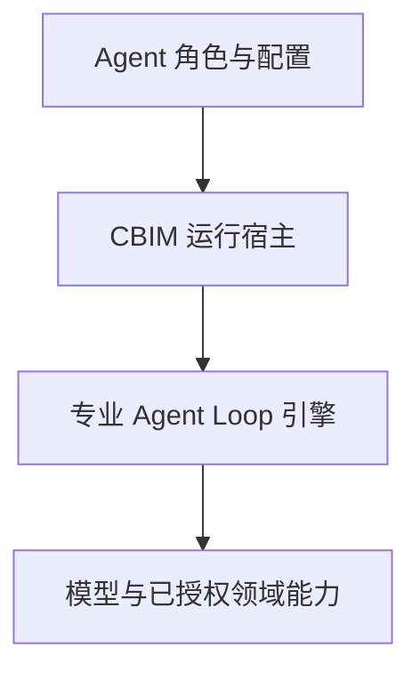

# 专业领域 Agent Loop 引擎：架构调整方案

日期：2026-11-14。分析基线：`develop`，`91f6be2d`。来源：本轮产品设计讨论。

收尾核对到 `f45db507`：新增变化仅在桌面验收脚本、对应测试与开发记录；本轮分析的 `src/` 和引擎打包入口未变化，以上源码结论仍适用。

**状态：用户已授权按顺序实施后续切片，实际完成与验证以开发记录为准。** 实施基线为 `74019e20`，仅调整引擎/模型职责、官方静态清单及消费者；不迁移用户数据，不发布安装包。当前实现见 [引擎契约](../../src/logic/engines/CONTRACT.md)，实际验证见 [开发记录](../development-log.md)。本文保留完整目标设计，不作为实时任务清单；后续实施按用户追加授权逐步提交，本文保留设计依据，不承担实时进度清单。

## 1. 结论与设计边界

保留 Core / Logic / Bridge / View 四层，保留现有任务调度、运行日志、权限、预算、知识事务和停止恢复机制。在 Logic 中建立独立的引擎领域，把目前分散在模型、执行装配和桌面更新中的引擎身份、声明、选型和安装状态归位。

统一对象是**面向特定业务领域的 Agent Loop 引擎**。引擎可封装厂商现成 Loop SDK，也可由开发者实现专业循环；普通模型、工具或 SDK 依赖不自动成为独立引擎。引擎包是引擎实现、声明和固定依赖的发布单位。

本轮产品边界：

- 仅由 CBIM 开发者提供官方引擎；用户从官方列表添加、停用、移除、更新。不建设用户插件 SDK、任意本地包导入、第三方源或插件市场。
- 设置显示引擎擅长的业务、支持模型和当前已配置可用模型；业务标签用于选择，不直接授予业务权限。
- 模型设置独立管理模型；Agent 选择引擎后按该引擎声明筛选各角色所需模型。主对话与主 Agent 设置仍读写同一份配置。
- 引擎独立版本管理；同一完整制品复用缓存，不因桌面基础版本升级重新下载。
- 冷包在引擎边界内只包含通用管理、调度、加载框架和宿主接口，不直接或间接依赖任何具体引擎。官方支持表由开发者用代码静态声明，随可更新 R 资源发布；本机已下载清单是状态数据。兼容既有宿主能力的新增引擎只更新登记代码、R 与引擎包，不得因此重发冷包。
- 记忆引擎是首个非编程领域的验证场景，面向记忆检索、压缩、查询与修改；正式知识仍由 CBIM 知识服务持有。

这是跨模块契约和运行边界调整，评估范围属于专题分析，交付按 L3 深度准备。变化频率没有统计数据；“领域引擎与模型预设会频繁变化、宿主运行契约应尽量稳定”是需求驱动的设计判断。

## 2. 核实的现状及限制

| 已核实事实 | 当前入口 | 对新设计的影响 |
| --- | --- | --- |
| 引擎 ID、显示名、协议选择和 Agent 选型都定义在模型模块；三引擎为固定枚举 | 原 `models/engine.ts`（切片 1 已迁至 [engines](../../src/logic/engines/CONTRACT.md)）、[provider-connections.ts](../../src/logic/models/provider-connections.ts) | 新增引擎会修改模型核心及其多个消费者；引擎身份的归属需要调整 |
| Agent 选型只有一组 `engine/profileId/modelId`；岗位保存单模型快照 | [main-agent-settings.ts](../../src/logic/team/settings/main-agent-settings.ts)、[workspace-member.ts](../../src/logic/team/rules/workspace-member.ts) | 无法完整表达记忆引擎的语言模型与向量模型；配置、岗位采纳和任务冻结必须一起考虑 |
| 模型服务在配置解析中按引擎挑接口；模型 schema 是生成式模型结构 | [llm-profiles.ts](../../src/logic/models/service/llm-profiles.ts)、[config.ts](../../src/logic/models/config.ts) | 不能只加 embedding 模型名；请求协议、字段、能力、测试和计量都需区分 |
| `AgentEngine` 已有 start/run/stop/close，`LoopRuntime` 持有租约、日志、授权、在途工具和终态 | [types.ts](../../src/logic/execution/rules/types.ts)、[runtime.ts](../../src/logic/execution/rules/runtime/runtime.ts) | 已有可复用宿主边界，无需重写任务运行内核；协议仍偏文本和图片 |
| 装配直接导入三种适配器，并用条件分支选择；Codex 显式依赖 Pi 工具包 | [loop-engine.ts](../../src/logic/execution/assembly/loop-engine.ts) | 需要官方注册与依赖解析；安装和卸载不能只看用户直接选中的引擎 |
| E 包主要打包上游依赖；CBIM 适配器源码位于业务资源，Pi/Claude 版本还有代码内校验 | [runtime-packaging.ts](../../scripts/runtime-packaging.ts)、[claude/sdk.ts](../../src/logic/execution/engines/claude/sdk.ts) | 当前“更新依赖 ZIP”不等于完整引擎独立更新；适配器也必须进入引擎发布边界 |
| 清单限定三种引擎及长度 3；冷壳从所选 R 清单解析 E，缓存路径包含 C 版本 | [runtime-manifest.ts](../../src/logic/updates/service/runtime-manifest.ts)、[bootstrap/desktop.ts](../../src/bridge/server/bootstrap/desktop.ts) | 需要通用可信包解析及独立引擎目录；首次改变冷壳必须冷更 |
| 原生会话旁路记录固定 E 摘要和辅助工具摘要，版本不符拒绝恢复 | [runtime-binding.ts](../../src/logic/execution/engines/runtime-binding.ts) | 不能把历史会话绑定简单替换成 latest；迁移须保留精确制品身份 |
| 前端从模型桥导入引擎枚举与兼容函数，模型页的连接测试还要求选择引擎 | [models.ts](../../src/bridge/contracts/models.ts)、[ProviderConnections.tsx](../../src/view/settings/ProviderConnections.tsx)、[Conversation.tsx](../../src/view/conversation/Conversation.tsx) | 引擎目录和选型结果应有独立公开契约；模型连接测试与引擎验证拆开 |
| 请求预算端口固定一个模型，并以生成输出 token 上限预留 | [request-budget.ts](../../src/logic/budget/rules/request-budget.ts) | 多模型与向量请求不能只改 UI；必须保留逐请求预算与未知结算语义 |
| 正式知识已有唯一事务队列、版本和治理规则；本轮检索未发现现成向量索引服务 | [knowledge/storage/CONTRACT.md](../../src/logic/knowledge/storage/CONTRACT.md)、[knowledge-queries.ts](../../src/logic/knowledge/rules/knowledge-queries.ts) | 记忆引擎复用知识服务，向量索引属于新增能力，不应直接接管知识文件写入 |

已阅读本表入口、调用方、相关契约/目录说明、引擎实现入口及 `tests/modules.json`；这是针对引擎演进的局部精读，不是全仓逐行审计。本轮未运行产品测试、在线模型、桌面或发布验证。

本设计稿的 20 处本地文件链接均已核对存在；代码围栏闭合，无行尾空白。上述文档核对不代表架构已实施或运行验收已通过。

## 3. 保留的执行关系

运行关系如下，箭头表示调用，不表示全部源码依赖：

- 主 Agent 的目标调度负责业务目标、派发和结果核实。
- `LoopRuntime` 负责一次运行的生命周期与约束；它不是再实现一套专业模型决策循环。
- 专业引擎驱动模型、工具、观察与下一步决策。现成 SDK 已有 Loop 时适配其生命周期，不叠加同职责循环。
- 引擎报告本轮完成不等于业务验收通过，验收继续由原业务证据与任务规则决定。

保留既有无进展超时、重复工具失败限制、目标累计失败限制、取消与未知结果不重放规则。引擎声明不能修改宿主授权、预算或无限增加重启额度；普通心跳、重复结果不算新进展。

## 4. 建议职责和目录边界

下表是目标结构，目录尚未创建；迁移按真实消费者逐步进行，不一次性搬迁全仓。

| 归属 | 建议承担职责 | 不承担 |
| --- | --- | --- |
| `logic/engines/contracts`（新增） | 引擎身份、版本化运行协议、输入输出与宿主窄端口 | 具体厂商实现、Application、配置存储 |
| `logic/engines/rules`（新增） | 引擎描述、业务标签、模型角色要求、兼容判断 | 凭据解密、联网安装、任务调度 |
| `logic/engines/catalog`（新增） | 开发者代码静态声明的官方支持表，随 R 发布；只登记描述和受信发布通道 | 加载具体 SDK、用户配置注册、远端数据增加引擎 ID |
| `logic/engines/service`（新增） | 消费官方支持表，管理安装版本、依赖和引用；各职责分别封装 | SDK 内部 Loop、知识事务、第二份模型目录 |
| `logic/engines/implementations/<id>`（迁入） | 厂商适配或自研专业 Loop，独立构建为引擎包 | 反向读取宿主源码和其他引擎私有实现 |
| `logic/models`（调整） | 模型身份、连接、能力、各类模型配置及凭据服务 | 具体引擎枚举、Agent 选型所有权 |
| `logic/team/rules`、`team/settings`（调整） | Agent 执行配置、多模型引用、revision 和岗位采纳 | 引擎下载、模型供应商实现 |
| `logic/execution/rules/runtime`（保留） | 运行租约、权限、日志、取消、结算 | 具体引擎型号和领域算法 |
| `logic/execution/assembly`（收窄） | 组合冻结配置、引擎实例与可信宿主能力 | 用中央条件分支维护每种引擎 |
| `logic/updates`（收窄并开放细粒度入口） | C/R 更新及可复用的制品校验、下载、展开、缓存机制 | 专业引擎业务标签、模型兼容策略 |
| `logic/knowledge`（保留并按需扩展） | 正式知识事务与查询；向量索引服务的业务边界 | 专业 Agent 的决策循环 |
| `bridge`、`view`（调整） | 窄 IPC、可信宿主接入；目录、安装与选型界面 | 直接加载引擎包、解析凭据、决定业务兼容规则 |

依赖约束：

1. 模型纯契约不再引用引擎；引擎兼容规则消费模型能力契约。Agent 配置组合引擎与模型引用。
2. 运行协议是叶子契约，不导入 Runtime、Team、Application 或厂商 SDK。宿主把现有 TaskSpec、工具授权等转换为窄的引擎上下文；可复用的现有叶子类型不重复定义。
3. 引擎实现依赖运行协议与自身依赖；知识、文件、预算等通过显式端口注入，不能导入 Application 获得完整服务。
4. 引擎管理通过制品端口复用更新模块；更新模块不反向依赖引擎服务。C/R 日志与 E 安装状态分开，不能混用原资源激活日志。
5. Core 继续只放独立技术机制，不把官方目录、兼容规则或 Agent 配置放进万能基础模块。
6. `Application` 持有引擎管理业务生命周期；冷包的引擎管理/调度框架只依赖通用协议和注入的支持目录接口，不编入具体引擎名单。R 装配代码提供静态支持表；支持表只引用描述和类型，不通过静态导入把适配器、SDK 或厂商依赖带回宿主构建。冷壳负责稳定的验证与可信加载边界。

现有 `EngineCapability` 表示运行时工具能力注入，不能直接改名当作产品中的“引擎能力描述”。建议新描述使用 `EngineDescriptor`，避免混淆授权能力与展示元数据。

## 5. 分开五类数据和状态

| 对象 | 所有者与生效时点 |
| --- | --- |
| `EngineDescriptor` | 开发者随包发布：稳定 ID、业务标签、模型角色、功能、宿主要求；只读声明 |
| `EnginePackageManifest` | 发布链产生：包版本、上游依赖锁、平台、Host API、入口、摘要及签名；固定版本不可覆盖 |
| `EngineInstallation` | 本机引擎管理服务持有：已安装版本、启用状态、当前选择、正在准备与引用；不含 Agent 历史 |
| `AgentExecutionSelection` | Agent 配置持有：引擎选择、各模型角色引用、引擎配置与 revision；主对话不是另一份偏好 |
| `EngineExecutionBinding` | 任务/运行可靠接纳时冻结：确切包摘要、依赖摘要、Host API、模型快照、预设及配置版本；运行中不解析 latest |

UI 中的“未安装、准备中、可用、更新可用、不可兼容、准备失败”是安装/目录事实，不与任务运行状态混合。安装成功、模型匹配、连接验证通过和业务任务通过是不同事实。

保存与启动沿用短事务：固定目录代次和全部模型元信息，在锁外下载/准备不可变包；启动前复核任务身份、取消和该绑定。不能在模型/知识/岗位短锁里等待网络，也不能等下载完再偷偷改选最新包或模型。

## 6. 引擎运行协议的调整

以现有 `AgentEngine` 为起点演进，不一开始推倒重写：

- 保留准备、执行、停止和关闭的生命周期，区分停止已请求与进程/工具真正排空。
- 将纯文本入口逐步演进为文本加受管附件/产物引用；音视频和模型文件通过已有附件/文件边界读取，不把大段二进制塞进运行事件。
- 引擎声明支持的输入输出、原生恢复、用户插入、进度报告等特性；不支持的能力明确禁用，不用空实现假装支持。
- 宿主注入已授权工具、模型请求/预算、产物访问与事件报告端口。引擎只取得本轮需要的能力。
- 引擎报告的输出、进度和工具事实，与宿主持久化的授权、账本、验收结果分开；不接受扩展包自报“已批准”作为授权。
- 每个 Host API 版本有共享契约测试；厂商差异留在包内适配器，自研循环实现同一契约。

首期沿用现有可信代码和原生进程的运行形态，不追加一套通用沙箱/远程执行平台。官方包也必须验签、检查 Host API 和平台要求。包入口只能来自受信目录，不接受工作区、模型或渲染端提供任意加载路径；官方来源不等于已经实现进程安全隔离。

目标加载过程为：核对代码静态支持表并冻结引擎身份与版本 → 根据本机已下载清单找到准确制品 → 校验该制品的官方清单与 Host API → 从固定包入口创建引擎实例。宿主运行框架不根据 Pi、Claude、Codex 或 memory 名称选择实现类；静态支持表登记身份和描述，具体实现仍从独立包加载。迁移期直接注册宿主内置实现类只是过渡，最终支持表不得导入实现类或 SDK。

## 7. 模型能力与多个模型角色

模型目录新增按能力区分的数据结构，先实现生成与 embedding，音视频等型号随真实引擎接入再扩展。生成模型的输出 token 上限、embedding 的维度/输入限制不能互相伪填。连接与凭据按供应商管理，接口按所需模型操作解析，不再把引擎 ID 传入模型核心决定协议。

引擎声明模型角色（slot），例如：

| 引擎 | 模型角色示例 |
| --- | --- |
| 现有编程引擎 | `primary`：已支持的生成模型 |
| 记忆引擎 | `reasoning`：理解与压缩；`embedding`：索引与检索 |

“当前可选模型”由用户启用目录、引擎角色预设、明确协议/能力要求共同决定。同名模型不自动等价；需要供应商/接口与准确模型身份。自定义模型只在包声明的兼容规则允许时匹配，不能仅看接口协议相同就保证全部能力。

支持模型、推荐模型、用户已配置模型、连接已验证模型分别展示。预设匹配结果由一处纯规则计算，保存与启动再次使用同一规则核实，界面不另抄一套条件。

多模型的预算与计量是配套前置工作：每个实际请求绑定自己的模型角色、冻结价格和计量口径，并计入同一目标预算。embedding 请求不伪造生成输出 token；未来按时长或次数计费的模型应有明确口径，未知价格保留未知。仍保留发送前准入、取消、未知结算与结果不可重复交付规则。

## 8. 包内容、版本与缓存

### 包边界

完整包包含 CBIM 引擎适配器/自研 Loop、声明、预设、所需固定依赖与资源。适配器不能在运行时反向 import 宿主 `src/`。宿主工具门禁、正式知识事务和预算账本留在宿主，通过版本化端口访问。

区分包版本、上游 SDK/工具版本和 Host API 版本。兼容条件还包括 CBIM 能力范围、OS/CPU，以及需要时的 Node/Electron/native ABI；不能只比较一个版本字符串。

Codex 当前依赖 Pi 的原生工具实现必须先如实声明和固定。若以后提取共享工具依赖包，可作为内部依赖发布，但不在用户列表中冒充另一个 Agent Loop 引擎。

### 静态支持表与本机已下载清单

根据用户进一步限定，支持哪些引擎由代码静态声明，不采用配置文件，也不由远端目录动态注册。文件名为方案建议：

| 入口 | 谁维护 | 记录什么 | 不代表什么 |
| --- | --- | --- | --- |
| `logic/engines/catalog/supported-engines.ts` | 开发者在仓库中静态声明并 review，随已签名 R 资源构建发布 | 官方支持的稳定引擎 ID、基础业务/显示描述、支持策略和受信发布通道；只导入描述与类型 | 不代表已安装，不导入引擎实现，也不接受用户配置或远端数据新增 ID |
| `downloaded-engines.json` | 本机引擎包管理服务原子写入，存放在受管包目录 | 已完整下载和校验的版本/摘要/相对路径、依赖锁及本机启用与选择信息；允许同引擎多个版本共存 | 不是官方支持来源，不能靠增加记录注册未被代码声明的引擎 |

各包的描述和模型预设也由开发者代码维护，构建生成不可变 manifest，保存入口、完整文件集合、固定依赖和准确预设。manifest、签名与发布版本索引是制品元数据，不是另一份可编辑的支持引擎配置。选型依据所选包版本的描述，不能把最新版预设套到旧包；发布版本索引只能为静态支持表中已有 ID 提供候选版本，不能扩大支持范围。

新增引擎时更新静态登记代码和 R，用户应用新 R 后才能在支持列表看到它；这不要求更新 C，也不自动安装引擎。已登记引擎发布兼容新版本时，可只更新引擎制品和版本索引，无需修改静态支持表或重发 R/C；若支持策略本身改变，则更新对应登记代码。

只有成功校验的完整包才能进入已下载清单，半包仅留在准备状态。原子提交失败后可据官方包 manifest 核实并修复本地索引，不能仅凭目录存在标记可运行。已有运行的引用和恢复身份仍归原任务/会话账本，不以支持表或下载清单代替运行事实。

静态支持表随已验证 R 离线可用；版本查询失败保留支持列表及原安装事实，不把联网失败显示成“无引擎”。R 更新不能覆盖本机启用选择，移除代码登记也不能直接删除在途运行文件。R 的激活仍走原资源日志；引擎下载与激活记录独立，不伪造 C/R 更新。

### 缓存与安装

建议 E 制品缓存使用 `安装及用户身份 / engines / 平台 / packages / 内容摘要`，不再放在 C 版本之下；已安装版本索引通过 engine ID、包版本和摘要引用它。C/R 的状态和缓存策略保持独立。

- 相同版本对应相同不可变制品；清单出现同版本不同摘要时报告发布冲突，不能静默覆盖。
- 完整缓存命中不下载；旧 C 缓存经新清单确认制品身份及必要校验后可复用，不移动正在使用的目录。
- 校验与网络下载是不同阶段，UI 明确区分。仅比较版本号不能把缺文件、下载一半或损坏目录当成可执行包；取消逐文件复检属于另一个性能/完整性取舍，不与“不重复下载”混为一项。
- 新版本先准备和验证，成功后才允许激活。失败保持旧活动版本，重试有界，不在首次对话无限重复下载。
- 停用阻止新的使用；移除须核对运行、已接受任务、依赖包及需保留的会话引用。删除引擎包不删除模型凭据、知识、会话或产物。
- 新任务使用明确激活的版本，原任务继续使用冻结版本。需要宿主重启的 SDK 明确声明并展示，不承诺所有引擎都支持热更新。
- 包回退不等于知识数据或原生历史可降级；须核对对应格式兼容，原生历史不符时保留原拒绝恢复行为。

### 首次迁移与后续免冷更的边界

当前冷壳包含固定三引擎的清单 schema、解析入口和缓存规则。`coldFingerprint` 包含启动器，资源构建在改变它时会报 `COLD_BASE_CHANGED`。因此首次通用化需要一个新的 C 安装版本，不能只发 R。

这次冷更是移除冷壳内具体名单与固化接口的迁移成本，不是以后每新增引擎都冷更。新 C 建立稳定的包验证、加载与 Host API 边界；冷包内无具体引擎支持表、适配器、SDK、依赖锁或型号分支。静态支持表进入可更新 R，已下载清单仅由本机维护，不进入发布制品。

以后新增记忆、建模或音视频引擎，只要满足现有 Host API、平台和通用配置协议，就发布引擎包和包含静态登记的 R，冷包二进制与指纹保持不变。通用调度/加载逻辑无需增加按引擎名称判断的分支。已登记引擎的兼容版本更新仍独立于 R/C。若需要新增宿主能力、平台运行时或签名信任根，才按受影响层更新 R/C。既有冻结包不原地改写；此前“新增引擎时 C/R 均不变”的建议由本节替代。

## 9. 仓库及发布流程

引擎实现放在受架构检查覆盖的 `src/` 中；各引擎的发布描述、依赖锁和构建入口由仓库统一维护，例如归入 `packaging/engines/<id>`。运行时依赖不由用户机器执行任意安装脚本。

推荐统一发布入口接受引擎 ID 和包版本，完成：

1. 核对版本未发布、源码与依赖冻结、包声明及宿主兼容性。
2. 构建该引擎，运行责任单元、共享运行契约和必要的真实 SDK 验证。
3. 验证干净安装、同制品缓存复用、依赖、升级失败保留旧版及历史兼容。
4. 签名并发布不可变制品；确认附件可读、摘要匹配后，再更新该已登记引擎的版本索引。新增引擎另发布包含静态登记代码的 R，不能只更新远端索引注册新 ID。
5. 客户端只对静态支持表中的 ID 发现候选并显示变更，按用户动作更新/激活；失败保留确切状态，索引回退不能重放任务。

独立发布必须增加三项验收：一是依赖/产物检查拒绝静态支持表、引擎实现和厂商运行包进入冷包，不能只删除显式 import 却留下传递依赖；二是在完全相同的冻结 C 上，只更新含新静态登记的 R 和新引擎包，验证发现、安装、配置和运行，C 制品摘要不变；三是在同一 C/R 上更新一个已登记引擎的兼容版本，验证确实只更新引擎包。另验证远端发布索引或本机下载清单不能引入未静态登记的 ID。源码可同仓管理，制品依赖必须分开。

用户界面只显示选择所需信息、当前版本/新版本、变化和操作结果。Host API、摘要等放在详情，不要求用户手工挑 SDK 或编辑 JSON。

## 10. 记忆引擎如何验证抽象

记忆引擎实现“理解请求、检索、判断、压缩/修改、检查结果”的专业循环。语言模型与向量模型由两个角色分别绑定；内部调用仍进入宿主预算和工具授权。

正式知识由现有知识服务写入，保持实例、版本、冲突、治理和原请求回执。向量索引是可重建派生数据，记录知识来源/版本、embedding 模型身份及维度、分块策略和索引代次。

知识写入成功而索引更新失败时，保留知识提交事实，把索引标为待同步；不得把整次操作自动重跑。更换向量模型使用新索引代次，完成后切换，避免混合向量空间。摘要保留来源，不静默覆盖原文。

初期只实现一个完整纵向场景验证包协议与双模型，不同时建设所有建模、视频、音频引擎。专业工具选型、向量存储选型、生产服务商适配尚未完成评估，本文不把它们写成已验证方案。

## 11. 迁移切片与验收

以下是迁移切片和验收边界，不是实时任务清单。各切片已获继续实施授权；下面保留验收边界，落地状态以开发记录及源码契约为准。

| 切片 | 可审阅结果 | 必须保留/验证的行为 |
| --- | --- | --- |
| 1. 引擎身份与描述归位 | 官方静态代码登记替代散落枚举，三个原 ID 保留；模型不再拥有引擎规则 | 三引擎现有选型、接口选择与旧配置读取一致；登记代码不进入冷包 |
| 2. Agent 执行绑定与模型角色 | 引入 V2 配置、多角色快照、模型能力与预算端口；旧单模型映射到 primary | 主对话与主 Agent 同源；多模型原子冻结；旧日志/快照字节和指纹不重写 |
| 3. 运行协议与适配器包边界 | 把三适配器接到统一契约，包可独立构建；宿主能力通过窄端口注入 | 取消、插入、日志失败、未知工具结果、超时、失败限额、原生会话仍按原规则 |
| 4. 官方包生命周期及冷壳迁移 | R 内静态支持表/本机已下载清单、依赖/引用、共享缓存及新 C 通用入口 | 离线命中、跨 C 复用、完整性、失败不换活动版、旧版本继续运行；新增引擎只改 R/E，兼容升级只改 E |
| 5. 三个用户入口接通 | 引擎能力支持列表、模型独立设置、Agent 按模型角色选型 | 展示业务/支持与可用模型；两个主 Agent 配置入口同步；无任意插件入口 |
| 6. 记忆引擎纵向验证 | 一个可独立发布的自研专业 Loop，双模型和知识操作完整贯通 | 知识授权/回执、索引代次、失败不重复提交、真实模型与预算对应 |

迁移只读解释旧数据，不批量重算历史哈希。新结构版本明确写入，旧原生路径和旁路绑定保留；默认 Pi 的历史含义保持。包引用缺失或兼容不明时明确报告，不能默默换引擎、换模型或重建原生会话。持久格式升级后的代码回退须具备兼容读取能力，不能只靠回退 Git 提交。

## 12. 验证范围与维护者入口

本轮只有方案检查，没有执行下列测试；具体实施时依实际切片重新选取，不一次性全跑。

| 变化边界 | 现有验证入口示例 | 需新增的核心行为 |
| --- | --- | --- |
| 引擎与模型选型 | `tests/engine-configuration.test.ts`、`tests/provider-connections.test.ts`、`tests/unit/logic/models/provider-connections.test.ts` | 描述匹配、模型角色、无 embedding 能力不能误入、模型页独立连接测试 |
| 配置与冻结 | `tests/llm.test.ts`、`tests/owner-model-configuration.test.ts` | 主 Agent 配置服务独立单元、V1/V2 兼容、并发配置下多模型一致性 |
| 运行与恢复 | `tests/engine-capabilities.test.ts`、`tests/engine-runtime-binding.test.ts`、`tests/engine-runtime-loader.test.ts`、三引擎各自测试 | 官方实现共同契约、缺能力拒绝、取消准备、更新不换在途版本 |
| 不重放与收束 | `tests/tool-failure-control.test.ts`、`tests/runtime-continuation.test.ts`、`tests/engine-inactivity.test.ts` | 新引擎仍受宿主停止/失败规则约束、迟到进度不复活 |
| 制品与更新 | `tests/runtime-manifest.test.ts`、`tests/runtime-store.test.ts`、`tests/runtime-updates.test.ts` | 静态支持表/下载状态及独立 E manifest、缓存跨 C、同版本冲突、依赖移除、并发准备和失败恢复；C 不变新增引擎、C/R 不变升级已登记引擎 |
| 预算与记忆 | `tests/model-request-budget-usage.test.ts`、`tests/scope-usage-service.test.ts`，知识事务既有责任模块 | embedding 请求计量、同目标双模型预算、知识成功/索引失败不重放 |

新测试按单元、契约、集成登记到 `tests/modules.json`；不以完整 Application 夹具代替单模块测试。真实安装与公开更新需在对应冷更/引擎发布阶段另验，单元通过不能替代它们。改源码时同步所属注释、契约、类图、精确依赖入口及内部动态加载的审核说明。

维护者建议阅读顺序：第 2 节现状入口 → 第 4/5 节职责和数据所有权 → 第 6/7 节协议与模型 → 第 8 节制品和历史兼容 → 第 11/12 节切片与验证。

归档结论：保护现有运行/事务/恢复能力；把新业务循环、模型预设和版本演进集中到官方引擎边界；按契约及真实消费者验证；后续增加引擎从描述、实现和包构建入口开始，新增宿主能力才改变 Host API。当前没有需要额外晋升为通用规则的结论。本文不表示整套方案已完成人工 review 或获准发布；本轮切片 1 的用户授权、实施和验证单独记录，未更新无关 Issue。
