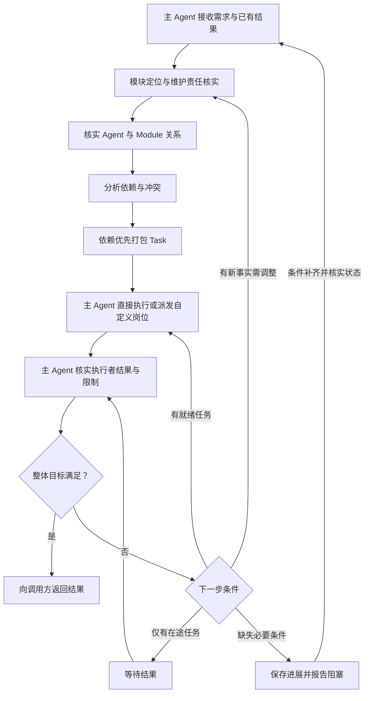

# Task Loop：主 Agent 的任务构建与调度循环

版本：1.0｜author：linan

## 定位与输入输出

Task Loop 只由主 Agent 的主对话通道执行：接收用户需求，借助模块注册表分析拆分，按模块的自定义负责岗位选择委派，否则由主 Agent 直接执行，分析依赖与冲突，打包 Task，组织执行，再根据返回结果决定后续任务，直到需求验收完成或明确受阻。authors 只提供候选线索，不自动成为维护责任。

主 Agent 以团队与技术管理者的工程、架构和结构化思维组织此循环：先核实实际现状与已有证据，明确模块边界、责任、依赖和未知项，再形成目标、范围、验收与交付证据。新增事实只推动必要的渐进调整，并记录理由、影响与验证；重大架构方向、职责变化或高影响操作交由人决定，不能把分析结论当作授权。

主 Agent 默认直接实现、运行命令和验证，同时负责调度与团队业务知识管理。创建模块不必登记岗位；明确配置自定义负责人时，通过真实 ownerSelection 向该岗位派发。独立成员按已分配模块与权限执行并回报，不递归派发；旧 cbim:executor 已退役。所有知识管理使用受控 cbim_ 服务，业务执行遵循 read/ask/execute，运行结束不自动等于业务验收。

仅知识治理的请求可由主 Agent 直接使用知识预览、提交和检查工具完成，不为了管理 `.cbim/` 伪造业务派发节点。read 模式不允许知识写入，ask 需当前请求批准，execute 仍服从身份、版本和知识事务校验；原生文件工具不能替代这些接口。

这是任务协调流程，区别于每个成员的大脑执行循环。一个 Task 的结构与约束见 [单一任务设计](task-spec.md)，派发与执行语义见 [BaseTask 契约](base-task.md#execution)。调用方传入目标、约束、有效决定和验收要求；本循环提供任务构建与调度，返回结果及待决事项，不选择或调用上层流程。

输入是需求、已有授权、模块索引、Agent 索引和模块负责人查询入口，以及已有任务和结果。项目位置由调用方提供，Task 不反向加载项目入口。每轮输出更新后的任务列表、依赖关系、可执行任务和结果判断；最终输出满足需求的产物与证据，或已完成部分、阻塞原因及继续所需条件。简单问答不强制建立任务列表；仅维护 core 或能力定义时使用明确维护对象，不虚构业务模块。

## 1. 理解需求并分拣到模块

CBIM AI 助理用大模型分析用户目标、问题、约束和验收条件，将需求拆成可以定位到模块的子需求。通过模块注册表的 summary 与 id 检索候选，再读取命中模块的定义、边界、必要 DNA、Workflow 与 sources，核实真正负责该工作的模块。

记录“子需求 → 实际作业模块 → 所需结果”，将只读依赖单独列出。一个子需求可以涉及多个模块，一个模块也可以参与多个子需求；此时先形成模块级工作项，不急于按目录生成 Task。

索引只辅助定位，模型判断必须核对实际知识与产物。模块未命中或边界不清时限定调查范围并保留缺口，不猜测归属、不加载全项目替代定位。后续结果揭示新增模块时回到本步骤增量补充。

## 2. 核实维护责任并匹配执行 Agent

使用模块查询的 execution.groups 核实分工：execution=main 表示默认由主 Agent 在原会话执行；execution=member 且 selection 有效才派发给对应自定义岗位。未指定岗位不是阻塞，不创建虚拟登记。自定义岗位暂停、来源或模型失效须说明真实问题，不能回退绕过。authors 仅是历史来源，不参与真人维护门禁。

需要新的专业分工时，可查询自定义 Agent 与 Skill，形成明确岗位配置建议；是否改动分工仍受授权约束，不因为没有自定义 Agent 就阻塞当前实现。

汇总本轮关系：

| 关系项 | 记录内容 |
|---|---|
| 子需求与模块 | 目标、模块定义、实际工作范围及验收结果 |
| 当前分工 | 主 Agent 默认执行，或已配置自定义负责岗位的实际选择与缺口 |
| 模块与 Agent | 主 Agent 或已登记自定义岗位、适用性及未解决缺口 |
| Agent 与模块集合 | 本轮该 Agent 将承担的模块及工作项，不自动扩大到其全部维护范围 |

这是本轮分析视图，不修改正式维护关系。执行者可自行查询这些环境事实以理解工作，但角色选择与新任务派发由主 Agent 负责。

## 3. 分析模块拓扑与执行依赖

结合模块层级、overview 类图所声明的人工确认架构规范与约束、实际引用证据和产物需求，分析本轮工作项的依赖。区分三种关系：

- 模块父子关系与业务依赖用于理解结构，不能直接当成执行顺序。
- 必须先取得或验收某个产物的关系形成执行前置边，记为 `A → B`，含义是 A 通过验收后 B 才能执行。每条边写明所需产物、版本和放行条件；已有有效产物可满足前置，无需为了静态依赖重复创建任务。
- 共享文件、资源、服务和环境形成冲突约束；即使没有业务依赖，也可能需要串行或唯一写入者。

从全部作业模块与只读依赖的实际读写范围检查冲突。没有明确的架构声明不等于实现无依赖；实际引用与架构约束冲突时记录偏差，不自动修改约束，也不能把所有静态引用都转成任务前置。

发现执行依赖环时，先判断是否把静态关系误当成前置；真实循环则考虑分离契约确认、基础产物或阶段性交付。无法解开时报告具体环和缺失决定，继续无关任务，不假装已得到拓扑顺序。

## 4. 依赖优先地打包 Task

以模块工作项及其依赖图为输入，按依赖顺序和共同验收目标打包：

1. 同一 Agent 维护的一个或多个模块可以组合成 Task，前提是共同服务于一个可验收目标，维护依据、范围与执行条件均成立。
2. 不同负责维护的 AI 成员 的工作必须分成不同 Task。相同 Agent 的独立目标或处于不同依赖阶段的工作也可以拆开；不为了凑齐同一 Agent 的模块而延迟上游产物或吞掉外部依赖。
3. 将工作项依赖映射成 Task 前置：Task 内的衔接随上下文交给执行者，Task 间的依赖保留在任务列表。每个工作项必须有明确承接，不能遗漏或重复承担同一写入责任。
4. 打包后重新检查 Task 图是否有环。即使原工作项图无环，错误合并也可能产生环，此时拆开跨阶段 Task；不能因为AI 成员 相同就合并。
5. 为每个 Task 写入标识与版本、唯一 Agent、完整模块集合、维护依据、工作区和读写边界、必要上下文与基线、前置产物、模块内与整体的验收条件。

例如：A 维护 M1、M3，B 维护 M2，且执行依赖是 `M1 → M2 → M3`。应形成 `Task(A, M1) → Task(B, M2) → Task(A, M3)`；不能把 M1、M3 合成一个 Task，否则会出现它既等待 B 又阻塞 B 的依赖环。

上述 Task 间连线是结果依赖，不是执行者之间派工。每个正式任务的派发边都从当前主会话根出发；主 Agent 收到新结果或求助后可从根追加后续节点，再连接真实前置。不能将执行者的内部步骤、求助或返回结果画成它自行创建的子任务，也不增加返回根的反向边。

## 5. 执行就绪任务

从尚未执行的任务中选出前置均已验收、输入有效且无未解决冲突的就绪集合。前置未满足的任务等待；互无依赖且实际文件、资源与环境互不干扰的就绪任务，可在内部调度已实现且获授权的并发能力内执行，其余按依赖及冲突约束顺序执行。

默认工作直接在主会话完成，不给自己派发独立成员任务。只有配置了自定义负责岗位的工作才通过 cbim_dispatch_task 创建成员实例，固定模块上下文、岗位与模型。派发落盘只代表入队；主轮结束释放占用后，协调器按依赖启动成员并回注结果。正式目标中的主 Agent 工作可用 main-execution 引用当前主运行真实原生工具回执；不能用它冒充成员候选、Workflow 专属验证或人工接受。

一次用户任务开启一个调度周期，跨多次主模型回合、成员执行和结果回传。只有整轮完成、失败或停止才关闭周期；执行实例释放而任务图、证据与历史保留，主会话和主实例继续存在。周期由可信调度创建，模型不提供 scopeId；重启只恢复记录并中断遗留周期，不自动重放任务。

执行 Agent 在目标模块范围内自行探索、调用工具、验证和修正，不扩大任务目标或再委派其他人。需要帮助时返回证据、影响范围和所需条件；当前尚无专门的执行者求助/答复、挂起/唤醒协议，不伪造已发送求助或等待中的同事。运行时当前仍以权限与工作区门禁控制实际访问，不能把模块范围指引说成已实现文件级隔离。

可登记带前置的等待任务，但不提前执行缺少输入的下游。主 Agent 持续跟踪真实任务，避免重复派发。当前确定性依赖门禁按同计划版本的 result_ready 候选放行，并冻结该候选到下游；候选尚未业务验收。某项前置要求人工或额外业务验收时，应先核实并取得对应决定，再由主 Agent 派发后续任务，不能假设运行时已实现这类验收门禁。

## 6. 接收结果并决定下一轮

CBIM AI 助理收到 TaskResult 后核对任务版本、实际执行者、模块覆盖、产物与证据；执行者报告 completed 仍先进入待验证。核实工具身份、真实运行回执与操作证据，不把文字声明当作执行或隔离已经生效。逐模块及任务内联动验证通过后，才将 Task 标记为已完成并满足下游前置。

| 结果或变化 | CBIM AI 助理的下一步 |
|---|---|
| Task 验收通过，仍有就绪任务 | 保留结果，返回步骤 5 执行新就绪任务 |
| 发现新子需求、模块或边界错误 | 返回步骤 1，增量调整受影响范围 |
| Agent 不适用或维护关系失效 | 返回步骤 2 重新匹配并核实 |
| 出现新依赖、冲突或需要拆分合并 | 返回步骤 3～4 重算关系与 Task |
| 执行出错且已有明确修正办法 | 保留已发生操作，修正上下文与必要基线后回到步骤 4～5；重新调用使用新的执行关联标识 |
| 部分模块完成、其余失败或受阻 | 保存局部进展，整个 Task 不标完成；确需独立交付时显式拆分并重验依赖 |
| 需要知识或架构决定 | 返回问题类型、证据、阻塞范围和所需决定，由调用方安排后续处理；无关任务继续 |
| 需求全部验收条件已满足 | 向调用方返回整体结果与证据，不再构建无关任务 |

下一轮由主 Agent 处理受影响的工作项和下游，保留仍有效的结果。当前已支持从根追加后续节点；需要更改在途范围或执行者时，先停止受影响执行、核实已有产物和知识，再登记明确的新任务，不直接篡改旧任务或假称已实现原地重派/重试。按 [基线与恢复规则](task-baseline.md) 保留新旧绑定和证据。

## 等待、阻塞与退出

- 没有就绪任务但有在途任务：等待结果后进入步骤 6，不重复派发。
- 没有就绪或在途任务，需求仍未满足：列出缺失输入、维护归属、依赖环、工具或必要决定，保留检查点并向用户报告阻塞。相同条件下不空转循环。
- 用户取消时停止相关调度，按内部运行时能力处理在途执行并说明实际已发生的变化，不宣称自动回滚。
- 恢复时先核实任务列表、在途执行状态、已发生操作与知识版本，再从适用步骤继续；不因会话重启重建并重复执行整个列表。

## 循环示意

示意图描述主调度流程，不是任务图的派发边。成员执行、候选回传、结构化求助、安全用户等待与显式补充、未启动撤销/单条前置替换已经接通。求助是本轮终态交接，后续由主调度创建新任务；不能恢复原求助运行。执行者递归派发不属于目标能力。

可靠的有界文件任务支持同任务最多16个检查点、17个运行；每段最多预约并消费一次，只能继续最新未消费段。执行成员正常关闭后，程序核实各段文件来源、累计最新基线、日志、知识及原生历史，再保存 checkpointed 并释放资源。主调度 cbim_dispatch_resume 只预约待领信封；主轮结束后重新核实范围、权限、预算及准入，新 run 继续同 task/实例/会话，旧交付证据清除。检查点与待续请求均是未完任务，不能当完成；需跨重启保留时必须以明确 memberPause 清单进入持久等待，用户明确继续后再次核实。仅成功单文件 read/write/edit 与列名维护工具符合资格；命令、动态扫描、额外知识查询、失败或未知来源不能混入。停止和关闭封存历史，读取及重启不自动重放；已消费检查点保持只读。

周期额度的缺省模式仍为运行间软限额。显式逐请求模式将主轮、成员、重试及自动摘要的每次实际请求纳入同一可靠账本：发送前保守预留，完整协议用量落盘后结算；缺用量或恢复遗留保持未知和占用。等待补充及成员领取前先核可用容量，但预检不代替每次 HTTP 发送的原子预留。设置只影响未来新目标，本地估价不等于供应商账单；查询不恢复请求，预算拒绝不代替业务验收或授权。

完整人工验收、任意次数停泊、跨重启恢复与未知外部副作用恢复仍待后续。具体取消、恢复与派发错误处理以当前内部接口和真实回执为准，不把流程图或模型自述当已执行事实。

## Team Skill 上下文要求

每次装配 Agent 时，调用入口提供的 Team Skill 解析工具，取得 Agent 自身至 team 根的完整继承清单；按 Agent 规范核实来源与冲突，并将清单及所需正文绑定到任务基线。缺少解析结果或解析失败时不得以 Agent 私有清单替代。Task 不自行选择上层 Skill；共享方法的选择由专业任务需求决定。恢复时重新解析并比较继承链与文件版本，防止 Team 迁移或共享清单更新后沿用旧上下文。
