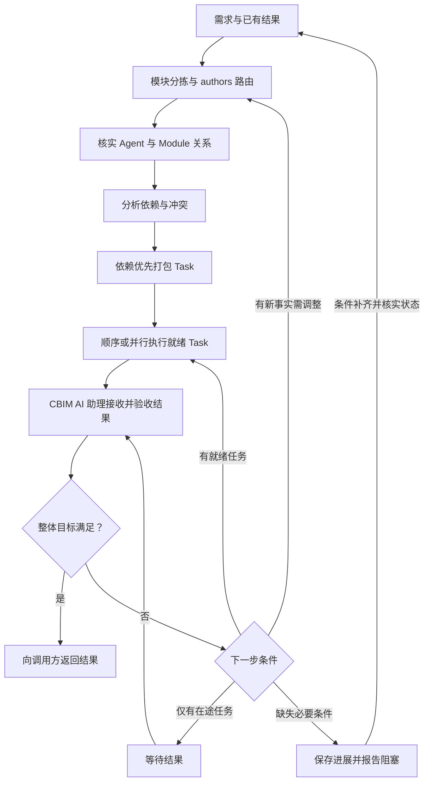

# Task Loop：CBIM AI 助理的任务构建循环

版本：1.0｜author：linan

## 定位与输入输出

Task Loop 由 CBIM AI 助理执行：接收用户需求，借助模块注册表分析拆分，通过模块 authors 匹配 Agent，汇总 Agent 与 Module 的关系，分析拓扑与依赖，依赖优先地打包 Task，组织顺序或并行执行，根据返回结果更新任务并继续下一轮，直到需求验收完成或明确受阻。

这是任务协调流程，区别于每个成员的大脑执行循环。一个 Task 的结构与约束见 [单一任务设计](task-spec.md)，派发与执行语义见 [BaseTask 契约](base-task.md#execution)。调用方传入目标、约束、有效决定和验收要求；本循环提供任务构建与调度，返回结果及待决事项，不选择或调用上层流程。

输入是需求、已有授权、模块索引、Agent 索引和人员花名册的可访问位置，以及已有任务和结果。项目位置由调用方提供，Task 不反向加载项目入口。每轮输出更新后的任务列表、依赖关系、可执行任务和结果判断；最终输出满足需求的产物与证据，或已完成部分、阻塞原因及继续所需条件。简单问答不强制建立任务列表；仅维护 core 或能力定义时使用明确维护对象，不虚构业务模块。

## 1. 理解需求并分拣到模块

CBIM AI 助理用大模型分析用户目标、问题、约束和验收条件，将需求拆成可以定位到模块的子需求。通过模块注册表的 summary 与 id 检索候选，再读取命中模块的定义、边界、必要 DNA、Workflow 与 sources，核实真正负责该工作的模块。

记录“子需求 → 实际作业模块 → 所需结果”，将只读依赖单独列出。一个子需求可以涉及多个模块，一个模块也可以参与多个子需求；此时先形成模块级工作项，不急于按目录生成 Task。

索引只辅助定位，模型判断必须核对实际知识与产物。模块未命中或边界不清时限定调查范围并保留缺口，不猜测归属、不加载全项目替代定位。后续结果揭示新增模块时回到本步骤增量补充。

## 2. 根据 authors 匹配具体 Agent

使用调用方传入的索引与花名册进行路由：模块 `authors` 是真人 id，经人员花名册找到共同 team，再从该 Team 的直属及子树 Agent 索引筛选候选，读取 Agent 定义、工作原则和必要专业 Skill，核实其能力与任务适配性。authors 不直接等于 Agent id，作者所在组也不等于唯一执行者。

作者未知、组归属冲突或组内无合适能力时，按工作内容扩大到其他候选组检索、核实能力并说明缺口。匹配后按 Task 设计逐模块核实维护依据与有效授权；能力匹配不能代替维护关系，归属未核实的工作项不作为可派发任务。

汇总本轮关系：

| 关系项 | 记录内容 |
|---|---|
| 子需求与模块 | 目标、模块定义、实际工作范围及验收结果 |
| authors 路由 | 作者、候选组及实际匹配依据；未知或回退检索须说明 |
| 模块与 Agent | 选定的唯一AI 成员、维护依据、适用性及未解决缺口 |
| Agent 与模块集合 | 本轮该 Agent 将承担的模块及工作项，不自动扩大到其全部维护范围 |

这是本轮分析视图，不新增长期维护关系注册表。

## 3. 分析模块拓扑与执行依赖

结合模块层级、overview 类图所声明的人工确认架构规范与约束、实际引用证据和产物需求，分析本轮工作项的依赖。区分三种关系：

- 模块父子关系与业务依赖用于理解结构，不能直接当成执行顺序。
- 必须先取得或验收某个产物的关系形成执行前置边，记为 `A → B`，含义是 A 通过验收后 B 才能执行。每条边写明所需产物、版本和放行条件；已有有效产物可满足前置，无需为了静态依赖重复创建任务。
- 共享文件、资源、服务和环境形成冲突约束；即使没有业务依赖，也可能需要串行或唯一写入者。

从全部作业模块与只读依赖的实际读写范围检查冲突。没有明确的架构声明不等于实现无依赖；实际引用与架构约束冲突时记录偏差，不自动修改约束，也不能把所有静态引用都转成任务前置。

发现执行依赖环时，先判断是否把静态关系误当成前置；真实循环则考虑分离契约确认、基础产物或阶段性交付。无法解开时报告具体环和缺失决定，继续无关任务，不假装已得到拓扑顺序。

## 4. 依赖优先地打包 Task

以模块工作项及其依赖图为输入，按依赖顺序和共同验收目标打包：

1. 同一 Agent 维护的一个或多个模块可以组合成 Task，前提是共同服务于一个可验收目标，维护依据、范围与执行条件均成立。
2. 不同负责维护的 AI 成员 的工作必须分成不同 Task。相同 Agent 的独立目标或处于不同依赖阶段的工作也可以拆开；不为了凑齐同一 Agent 的模块而延迟上游产物或吞掉外部依赖。
3. 将工作项依赖映射成 Task 前置：Task 内的衔接随上下文交给执行者，Task 间的依赖保留在任务列表。每个工作项必须有明确承接，不能遗漏或重复承担同一写入责任。
4. 打包后重新检查 Task 图是否有环。即使原工作项图无环，错误合并也可能产生环，此时拆开跨阶段 Task；不能因为AI 成员 相同就合并。
5. 为每个 Task 写入标识与版本、唯一 Agent、完整模块集合、维护依据、工作区和读写边界、必要上下文与基线、前置产物、模块内与整体的验收条件。

例如：A 维护 M1、M3，B 维护 M2，且执行依赖是 `M1 → M2 → M3`。应形成 `Task(A, M1) → Task(B, M2) → Task(A, M3)`；不能把 M1、M3 合成一个 Task，否则会出现它既等待 B 又阻塞 B 的依赖环。

## 5. 执行就绪任务

从尚未执行的任务中选出前置均已验收、输入有效且无未解决冲突的就绪集合。前置未满足的任务等待；互无依赖且实际文件、资源与环境互不干扰的就绪任务，可在内部调度已实现且获授权的并发能力内执行，其余按依赖及冲突约束顺序执行。

每个 Task 通过内部调度绑定一个责任 AgentInstance 和完整模块上下文，记录知识基线、连接器需求与任务修订。派发节点和待处理消息落盘后才能报告入队；当前成员收件箱自动执行尚未接通，入队不能说成已经启动大脑。实际工具或成员执行能力缺失时报告缺口，不伪造结果。

只派发就绪任务，不预先启动尚未取得必要输入的下游。某项结果返回并验收后即可释放新的就绪任务，不要求等待整批无关任务全部结束。CBIM AI 助理持续跟踪在途任务，避免同一 Task 被重复派发。

## 6. 接收结果并决定下一轮

CBIM AI 助理收到 TaskResult 后核对任务版本、实际执行者、模块覆盖、产物与证据；执行者报告 completed 仍先进入待验证。核实工具身份、真实运行回执与操作证据，不把文字声明当作执行或隔离已经生效。逐模块及任务内联动验证通过后，才将 Task 标记为已完成并满足下游前置。

| 结果或变化 | CBIM AI 助理的下一步 |
|---|---|
| Task 验收通过，仍有就绪任务 | 保留结果，返回步骤 5 执行新就绪任务 |
| 发现新子需求、模块或边界错误 | 返回步骤 1，增量调整受影响范围 |
| Agent 不适用或维护关系失效 | 返回步骤 2 重新匹配并核实 |
| 出现新依赖、冲突或需要拆分合并 | 返回步骤 3～4 重算关系与 Task |
| 执行出错且已有明确修正办法 | 保留已发生操作，修正上下文与必要基线后回到步骤 4～5；重新调用使用新的执行关联标识 |
| 部分模块完成、其余失败或受阻 | 保存局部进展，整个 Task 不标完成；确需独立交付时显式拆分并重验依赖 |
| 需要知识或架构决定 | 返回问题类型、证据、阻塞范围和所需决定，由调用方安排后续处理；无关任务继续 |
| 需求全部验收条件已满足 | 向调用方返回整体结果与证据，不再构建无关任务 |

下一轮只更新受影响的工作项、Task 和下游。保留已完成且仍有效的结果；对在途任务改变范围或执行者前，先停止受影响写入并交接，不让旧版本继续写入新范围。按 [基线与恢复规则](task-baseline.md) 保留新旧绑定和证据。

## 等待、阻塞与退出

- 没有就绪任务但有在途任务：等待结果后进入步骤 6，不重复派发。
- 没有就绪或在途任务，需求仍未满足：列出缺失输入、维护归属、依赖环、工具或必要决定，保留检查点并向用户报告阻塞。相同条件下不空转循环。
- 用户取消时停止相关调度，按内部运行时能力处理在途执行并说明实际已发生的变化，不宣称自动回滚。
- 恢复时先核实任务列表、在途执行状态、已发生操作与知识版本，再从适用步骤继续；不因会话重启重建并重复执行整个列表。

## 循环示意

示意图概括主线；具体回到哪一步及取消、恢复、派发错误的处理以上文为准。本文件描述 CBIM AI 助理的执行约定，不代表成员执行、自动验收与递归协作闭环已经全部接通。

## Team Skill 上下文要求

每次装配 Agent 时，调用入口提供的 Team Skill 解析工具，取得 Agent 自身至 team 根的完整继承清单；按 Agent 规范核实来源与冲突，并将清单及所需正文绑定到任务基线。缺少解析结果或解析失败时不得以 Agent 私有清单替代。Task 不自行选择上层 Skill；共享方法的选择由专业任务需求决定。恢复时重新解析并比较继承链与文件版本，防止 Team 迁移或共享清单更新后沿用旧上下文。
