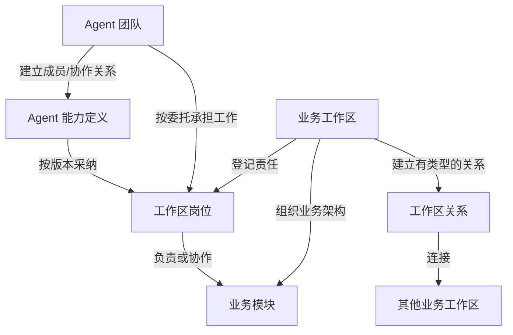
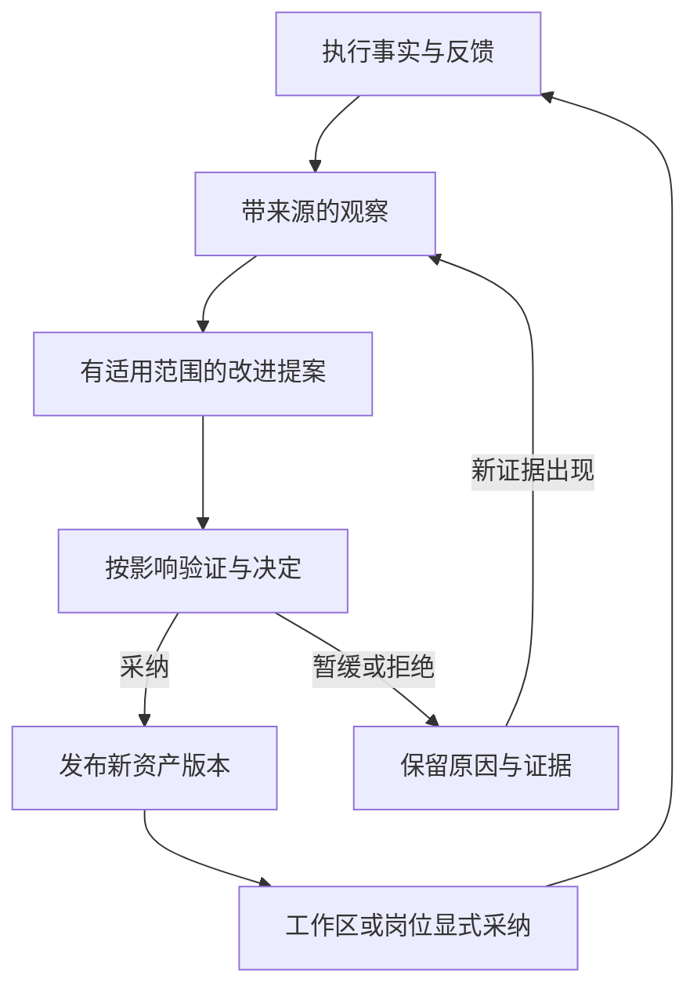

# CBIM 本地 AI 团队开发：核心模型与运行规则

日期：2026-11-12。状态：**目标设计第一版，供 review；尚未实现或批准为产品运行规则。**

来源：用户明确 CBIM 是“Agent 团队 + 业务工作区网络”，并进一步限定当前产品面向单人或少数人，不需要 Cindy、联网和大型团队能力，先全力打通全自动 AI Native 团队开发工作流。本文据此收敛当前模型；“工作区网络”在首阶段表达本地业务关系，不引入分布式平台。

本文属于人类阅读的设计材料，不改变内置 Skill、授权、Schema、状态机或目录布局。代码现状仍由 `src/` 的契约与实现说明。首次核对基线为 `95458460`；工作区另有进行中的更新器/运行包改动，不将其当作本方案已落地的证据。

## 0. 当前产品范围与唯一优先目标

**面向单人或几个人使用的本地 AI Native 工具，让 AI 团队自动完成从目标到可验证交付的开发闭环。** 少数真人是工具使用者；AI 团队可按实际任务组合专业能力，不要求先建设多人组织管理平台。

本阶段围绕以下闭环建设：

> 接收目标与成功标准 → 读取相关业务架构和知识 → 形成计划与分工 → 自动执行与协调 → 自动 review 和验证 → 按问题返工 → 汇总交付证据 → 沉淀可复用成果。

当前保留：本地工作区/模块、Agent 能力与岗位、目标/任务/运行、真实工具与产物、协作通信、预算、失败恢复和知识沉淀。优先复用已有执行引擎与 CBIM 适配，不以重写通用 Agent Loop 为目标。

当前不建设：Cindy 接入或 fork、云端业务平台、联网协作、跨设备调度、大型团队/企业组织体系、联邦身份和分布式事务。也不为这些未来能力预先增加服务、通用框架或配置门槛。既有外围功能不因本次方向收敛自动删除，但不再作为本阶段新增建设的主线。

用户“不需要联网”的要求不被放宽为必须依赖在线服务。当前规划不新增网络前提；引擎安装、模型推理和工具在验收环境中的网络需求须如实记录。现有在线模型配置不能证明已经支持完全离线，本轮也不擅自扩展为本地模型替换工程。

### 全自动闭环的完成判据

| 判据 | 必须观察到的结果 |
| --- | --- |
| 从真实目标开始 | 给出目标、范围和成功标准后，系统能自行定位上下文、分工和启动工作；不依赖人手工派每一步 |
| 协作产生实际成果 | 多个专业角色完成真实改动、审阅或验证，通过明确任务和产物协作；不能只展示多 Agent 对话 |
| 自动验证与返工 | 在已授权范围内自动 review、检查与修复；验证失败能定位问题、回到相应执行者并再次验证，不以一次模型回答结束 |
| 有界自主推进 | 依赖等待、可恢复故障和普通协调自动处理；只在缺少必要信息、权限/资源不足或无法解决的业务冲突时带具体原因请求人介入 |
| 中断可恢复 | 重启或执行中断后保留任务、产物和证据，核实未知副作用后继续，不丢工作也不盲目重做 |
| 可检查的交付 | 输出实际产物、修改范围、验证证据和未完成项；在既定验收约定内自动判定，不要求人逐步骤确认 |
| 沉淀支持下一次工作 | 有价值的方法和业务知识形成有来源的资产，后续任务能实际复用，减少重复分析和上下文消耗 |

这些是产品验收目标，不宣称现有功能已全部通过。后续开发按真实闭环中的缺口选择任务；外围能力只有直接阻塞这条闭环时才进入当前范围。本文不另建实时开发待办。

## 1. 产品定义与判断标准

**CBIM 组织有能力的 Agent 团队，在有业务架构、组织责任和资源边界的工作区网络中共同完成目标，并把工作经验转为可复用能力与业务资产。**

能力与业务独立：通用方法随 Agent/Skill 复用，项目事实与约定归业务工作区；二者在岗位、任务和运行中显式绑定。Workflow 是可复用的业务协作方法，允许存在未被固定流程覆盖的探索、临时协作和新业务。工具、MCP、连接器、插件提供能力或业务接入，不充当团队/工作区网络的唯一组织模型。

评价产品时看四个结果：目标能否可靠交付；团队能否按实际能力与责任协作；业务架构是否仍可理解和演进；后续工作是否因沉淀而减少重复理解、返工和资源消耗。

## 2. 六个建模视角

| 视角 | 回答什么 | 主要关系 |
| --- | --- | --- |
| 能力 | 谁会做什么，方法和工具有哪些要求？ | Agent、Skill、能力版本、执行能力要求 |
| 组织 | 谁属于哪个团队、担任什么岗位、对谁负责？ | Team、成员关系、岗位、责任委托 |
| 业务架构 | 在什么工作区内，维护哪些业务对象与契约？ | Workspace、Module、资源、负责人、业务依赖 |
| 本地工作区关系 | 本地业务范围之间如何依赖、协作和复用？ | 显式的工作区/模块关系；不要求联网 |
| 工作与执行 | 当前目标如何拆解、协调、执行并验收？ | Goal、WorkItem、Assignment、Run、Evidence、Acceptance |
| 成长 | 哪些实践值得复用，怎样进入能力与业务知识？ | 观察、改进提案、验证、资产版本、采纳与退役 |

这些视角可以交叉，不必压成同一棵树。一个团队可服务多个工作区；一个工作区可接纳多个团队；同一能力定义可形成多个岗位。物理目录、进程和设备属于执行映射，不能替代业务身份。

## 3. 核心对象与身份

下列名称用于概念讨论，不声明当前已有同名类型或接口。ID 采用什么编码留给实现；跨工作区引用必须包含所属范围和版本依据，不能仅凭显示名称或相同路径认定同一对象。

| 对象 | 定义与主要内容 | 身份/生命周期 |
| --- | --- | --- |
| Agent 能力定义 | 专业能力、方法、Skill 引用、工具要求与适用边界 | `agentId + definitionRevision`；独立于项目和模型会话 |
| Team | 持续或临时的协作组织；成员关系、目标范围、协调规则和责任分配 | `teamId`；团队解散不删除工作与交付历史 |
| 工作区岗位 | Agent 在某工作区承担的角色、能力采纳版本和责任范围 | `workspaceId + memberId`；暂停/退休与一次运行结束分别管理 |
| Workspace | 有自身业务架构、目标、资源、知识和组织责任的业务上下文 | `workspaceId`；可绑定多个执行位置，身份不由路径或主机决定 |
| Module | 工作区内有职责、契约和维护责任的业务单元 | `workspaceId + moduleId + revision`；程序、美术、策划、QA 都适用 |
| WorkspaceRelation | 两个工作区就依赖、能力供给、委托或知识交换建立的关系 | `relationId + revision`；方向、范围、参与方与撤销规则明确 |
| Goal | 希望达成的业务结果及成功标准、资源限制、责任归属 | `goalId`；可产生多个任务和计划修订 |
| WorkItem | 可分派、协作和验收的具体工作；输入、交付物、依赖与验收约定 | `workItemId + planRevision`；返工不抹去原交付 |
| Assignment | 某次工作由谁、在哪个范围、按哪个版本承担 | `assignmentId + epoch`；绑定岗位/团队、授权和资源预留 |
| Run | 某次实际执行尝试；宿主、引擎、会话和工具事件的关联 | `runId`；重试是可追溯的新尝试，不能覆盖旧记录 |
| Evidence / Acceptance | 产物及验证事实；按约定作出的接受、拒绝或补充证据决定 | 独立记录身份，绑定产物版本、输入依据、工作项和决定者 |
| KnowledgeAsset | 可复用 Skill、Workflow、模块知识、组织方法或能力实现 | `assetId + revision`；来源、适用范围、验证和采纳记录明确 |

身份关系的关键限制：

- Agent 定义、岗位、临时执行实例、模型会话分别标识。同一 Agent 的多岗位可以有不同项目适配；同一岗位可有多次执行，但不能用模型上下文覆盖长期责任。
- 团队成员关系与工作区岗位分开。加入团队不自动获得全部工作区资源；担任岗位也不自动证明当前具备运行权限或工具凭据。
- 工作区不是操作系统目录、Git 仓库或 Cindy 会话的别名。它可以映射这些执行资源，但引用和权限必须显式建立。
- 网络关系、任务、事件分别拥有标识。跨工作区消息保留发送方、接收方、关联工作、命令 ID 和版本，不把同名任务当成同一任务。

## 4. 团队与工作区的组合

这是领域关系图，不是源码导入图。团队组织可以分层，工作区之间可以相互提供不同能力；是否采用树形组织、固定负责人或临时协调者，是有明确适用范围的组织策略。当前代码中的主协调者模式是已有实现，不据此把所有未来组织都限定成唯一主 Agent。

工作区内需要同时表达业务结构和组织结构：模块依赖说明工作对象如何配合；岗位/责任说明由谁维护、谁决定变更、谁接收交付。两者通过责任关系相连，不要求节点一一对应。

### 4.1 工作区网络中的关系

| 关系类型 | 语义 | 不自动产生的权利 |
| --- | --- | --- |
| 业务依赖 | 本工作区依赖另一工作区的已约定产物/服务版本 | 修改对方内部实现、代替对方验收 |
| 能力供给 | 另一工作区/团队可提供某种能力，声明输入输出和可用条件 | 立即启动对方 Agent 或占用资源 |
| 委托协作 | 双方接受一个有范围、交付、成本及取消约定的工作 | 委托方直接写被委托方的权威状态 |
| 知识/资产共享 | 可发现、引用、提议采纳某个版本的资产 | 递归公开全部知识、自动安装或覆盖接收方版本 |

每条关系至少描述参与方、方向、可见范围、适用模块/能力、版本依据、允许操作、预算承担者、交付接收方、失效与撤销规则。只记录本关系所需的授权引用，不复制宿主凭据。

同一对工作区可存在多种关系，分别修订和撤销。A 能访问 B、B 能访问 C，不代表 A 能访问 C。撤销关系阻止新的使用；已运行或已交付工作按照原委托处理停止、结算和历史保留，不能假装副作用被撤回。

**关系网络允许合法的往返协作；当前计划中的硬前置依赖必须可执行。** 首版采用无环的硬依赖图；需要反复协商的业务用有终止条件、预算和版本的迭代轮次表达。源码模块依赖继续遵守项目的有向无环要求，三种图不能混用同一条规则。

## 5. 自由调度、协调与协作

自由调度意味着在已授予的职责、目标和资源范围内，Agent 可主动发现工作、提出计划、请求能力、委托、认领、协商和改进，不要求事先列完所有 Workflow。下列机制支持这种自由，同时使系统可解释和可恢复。

### 5.1 组织策略与确定性运行机制

首阶段从现有主协调者与专业成员机制出发，打通自动分工、求助、审阅与返工。负责人派发、主动认领、协商和临时组队是允许的组织形式，不要求先实现完整策略平台。决策进入可信状态提交入口时，核对责任、授权、版本、前置条件和资源后登记。

Agent 可承担协调职责，但业务状态由明确所有者持久化。模型建议、会话标题、工具返回“成功”均不能直接改写无关业务状态。常规已授权工作不逐步重复请求批准；超出委托范围的决定转交相应负责人。

### 5.2 一次协作的运行顺序

1. **受理目标。** 记录发起方、所属工作区、结果标准、预算和权限范围；允许先探索，探索结果本身也可作为交付物。
2. **定位与发现。** 按业务模块、岗位与已建立的网络关系寻找能力；先读索引，再取相关版本的知识，不把整个网络全文塞进上下文。
3. **协商与计划。** 明确参与者、输入输出、硬依赖、责任、交付接收方和资源份额。无适用 Workflow 时形成有界计划；Workflow 可引用复用，不能自动扩大授权。
4. **接受分派。** 工作所属方冻结版本与验收约定；执行方接受委托并预留资源。认领必须通过并发校验，竞争失败者不得启动副作用。
5. **执行与协作。** 按 Assignment 启动 Run。可以请求帮助、交付中间产物、发现新依赖或提出改计划；涉及运行范围变化时形成新修订，不静默改变原约定。
6. **交付与验收。** 提交产物定位、版本和验证证据；由约定的接收方/验证规则判定。程序检查可自动承担已定义的验收，组织策略决定何时需要人或独立 reviewer。
7. **结算与沉淀。** 汇总实际资源消耗、失败与协作反馈，释放占用；有价值的改进形成资产候选，经适当验证与采纳进入后续工作。

发现外部依赖时，执行者可提出跨工作区委托；被委托方可接受、拒绝或给出调整建议。委托接收与原业务任务完成是两件不同的事实。关系网络与组织层级不要求每条业务消息都经过唯一中央主 Agent。

### 5.3 状态规则：业务、执行、验收分别记录

建议首版工作状态为 `proposed → ready → active → submitted → accepted`。它是目标设计命名，不迁移现有状态字段。

| 情形 | 业务状态处理 | 执行/证据处理 |
| --- | --- | --- |
| 等待依赖、资源或协调 | `ready/active → blocked`，记录原因和恢复条件 | 不把等待计作已完成；恢复前核版本及占用 |
| Run 正常结束 | 按产物条件决定是否可 `submitted` | 正常结束只说明该次执行结束 |
| 交付被拒绝 | `submitted → ready/blocked`，记录返工修订 | 原产物、意见、Run 和成本保留 |
| 请求停止 | 记录 `cancel_requested` | 等待执行端回执；超时保持未知，不直接写 cancelled |
| 确认停止 | 按剩余副作用/产物记录 `cancelled` 或后续处置 | 已完成的写入、费用和审计不被删除 |
| 已知执行失败 | 根据可恢复性记录 blocked/failed 或新尝试 | 失败原因和已知副作用明确 |
| 断线/超时、结果不明 | 暂停依赖该结果的后续动作 | Run 记录 unknown/interrupted，先查询和核实，禁止盲目重放 |

已验收成果如需修改，建立关联的新工作或修订记录；保留原验收依据。局部任务接受并不等于整个 Goal 达成，Goal 要按自己的成功标准聚合验收。

### 5.4 并发、预算与责任

- **一个写入决定有一个权威提交点。** 一个工作项可有多个贡献者，但一个 Assignment 代次内的执行/提交权必须清楚；可并行的贡献用不同任务或明确的变更范围表达。
- **租约失效不证明旧执行已停止。** 使用代次/隔离令牌拒绝迟到写入；外部系统无法提供隔离写入时，在核实旧副作用前不重派可能重复的工作。
- **共享资源按真实冲突保护。** 同一模块的并行变更须有基线、提交屏障或可合并机制；一个 worktree 或独立进程不自动隔离外部服务和业务状态。
- **预算有承担者。** 父目标分配给委托的预算须预留，避免每个子任务都把总额度当自己的额度。计量未知继续占用或显式核销，模型自报不得凭空返还额度。
- **循环委托可诊断。** 记录委托链与未完成义务，限制无界递归；协商死锁进入负责人的协调入口，不允许无限互等或悄悄丢掉前置约定。
- **外部身份沿真实账号执行。** 网络可见、团队成员、拥有工具说明和持有某次执行许可分别核实；跨工作区不传播未授权的凭据和私人上下文。

## 6. 跨工作区协作与状态所有权

本阶段仅讨论本机受管理的工作区之间的业务协作。每个工作区拥有自己的任务、成员、知识和提交记录；本地协调服务按显式关系定位能力与产物，无需网络目录服务或联邦身份。一个目标可先在一个工作区内完成，不强制拆成多个工作区。

委托方拥有业务要求和接收决定；承接方拥有执行与交付事实，通过关联 ID 对应。尽量使用现有本地持久化和事务能力保证分派、占用与状态提交，避免为了抽象上的工作区独立而引入消息服务或分布式事务。

命令的幂等键、预期版本和执行代次仍有必要：本机也会崩溃、重启和收到迟到结果。执行启动前保存意图，保存接受/执行关联与结果；无法原子覆盖的进程或文件副作用，通过查询原运行和产物核实，而非重复派工。

写入已发生而回执丢失时，先查询原命令或目标资源，无法确认则保留未知并请求处置。补偿是另一个有权限、有结果的业务动作。跨设备/服务的消息投递、分布式对账及多组织权限，留到真实联网需求出现后另行设计。

## 7. 成长与沉淀

成长覆盖三类资产：Agent 的专业方法与能力组合、团队的分工/协作方法、工作区的业务知识与架构。完整循环为：

一次成功执行可以形成观察，不能单凭成功次数证明通用能力提升。记录任务条件、工具/模型版本、成本、失败与人的反馈，区分方法改进、环境变化和偶然成功。

共享资产发布与接收方采纳分离；同一 Asset 的不同版本可并存。活动任务继续使用冻结的版本，除非通过明确修订换版。私有记忆用于个人工作辅助，不能直接升级为团队约束；“成长”也不隐含必须训练模型权重。

低影响改进可由已有授权的自动验证与采纳策略处理；公共契约、权限或组织责任变化由相应所有者决定。保留观察、拒绝或暂缓也是有效沉淀，不强制每个任务新增 Skill、Workflow 或模块。

## 8. 一条完整业务场景

示例：一个人使用本机 CBIM 交付“背包扩容”。程序、美术、QA 是参与工作的 AI 专业角色，可在同一工作区的不同模块协作；已有独立本地业务工作区时再通过显式关系委托，不要求先建立三个工作区。

1. 玩法工作区建立目标和结果标准，查询现有背包模块、负责岗位与外部能力供给关系。
2. 程序成员认领逻辑工作；协调者向美术、QA 发出不同委托。对方按自己的组织策略安排成员，委托方无须知道其全部内部组织。
3. 图标依既有资源契约交付，可与逻辑开发并行；QA 的最终验证依赖特定构建和资源版本。沟通网络可以往返，硬前置依赖仍明确可执行。
4. 美术执行进程中断：原 Run 结果未知，核实原运行与图标文件，不重复生成或覆盖。程序可继续不依赖该结果的部分，依赖图标的整体验收保持等待。
5. 各工作区提交自己的交付证据；玩法工作区按目标标准接受整合成果。QA 报告和模型回合完成均不能自动替代全部业务验收。
6. 对重复遇到的图标规格失配形成契约改进提案；验证后发布新资源规范版本，相关工作区决定何时采纳，历史交付不被改写。

## 9. 与当前实现的对应及缺口

本轮源码可达性、闭环调用链和文档清理结论见 [现状审计](verification/local-ai-workflow-audit-20261112.md)。本节保留模型到代码的导航，不把目标模型当作实现清单。未完成源码或运行证据核实的目标能力明确列为待设计/验证。

| 目标概念 | 已有可复用基础 | 尚不能据此宣称的能力 |
| --- | --- | --- |
| Agent 与岗位分离 | [workspace-member.ts](../src/logic/team/rules/workspace-member.ts) 有岗位身份、采纳快照及暂停/退休语义 | 全网统一身份、跨工作区团队组织与自主协商 |
| 业务架构与责任 | [workspace 契约](../src/logic/workspace/rules/CONTRACT.md)、[根业务范围](../src/logic/workspace/rules/project-root.ts) | 工作区网络关系、跨工作区交付协议已经成立 |
| 执行身份与事件 | [member-run.ts](../src/logic/execution/rules/member-run.ts)、[执行类型](../src/logic/execution/rules/types.ts) 区分任务、运行、租约及原生会话 | 所有宿主均提供等价身份、事件重放和停止保证 |
| 任务、证据与预算 | [后端模块导航](../src/logic/BOUNDARIES.md) 指向现有规则、编排及存储 | 跨工作区预算原子预留、分布式结算或全球事务 |
| 能力组织 | [能力侧现状](capability/README.md) 以分组和 Agent 定义检索，主协调者组织工作 | 已有嵌套 Team、团队自治或联邦调度运行模型 |
| 成长与共享 | [现有 CBIM 理论](../docs/02-CBIM架构设计理论.md) 区分能力、业务和个人记忆 | 已有完整的观察→验证→版本发布→采纳闭环 |

目标 Workspace 与现有工作区标识/本地目录的映射需要单独迁移方案。本文不重定义历史 `workspaceId`、`AgentInstance`、`Scope`，也不把当前路径 ID 自动升级为网络全局 ID。

## 10. 设计取舍与 review 入口

已经来自用户的方向：Agent 团队、业务工作区网络、自由调度协作、成长沉淀是产品核心；工具/MCP/插件等是能力或业务扩展机制。

本版提出的运行约定：关系分类型、按工作区拥有状态、受权范围内自治、版本化委托、幂等恢复、业务验收与执行结束分开。它们是可审阅建议，尚未成为已部署保证。首阶段使用足以支持本地自动开发闭环的具体策略，不先建设全网组织、发现、策略配置与结算平台。

四问：保护能力与业务独立及既有执行证据；让业务协作与执行引擎差异分别留在对应边界；以第 0 节完成判据和第 8 节真实交付场景检验；后续实施优先修通目标→协作→验证→返工→交付链路。第五问候选：无新增开发强制规则，本版不修改产品内置运行规范。Cindy 承载路线已停止，冗余分析草案已清除。

范围归档：C2 架构专题设计、L3 核心模型讨论，执行事实核对、方案和材料交付；不进入代码迁移。文档可读/链接核对不等于产品运行验证，更不代表人工 review 已通过。后续实施以明确任务/Issue 为来源，本文不维护实时待办。
