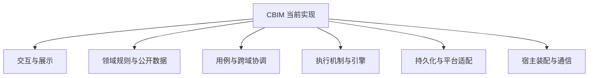
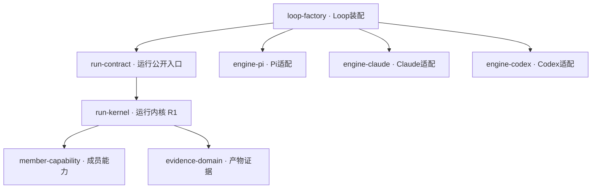
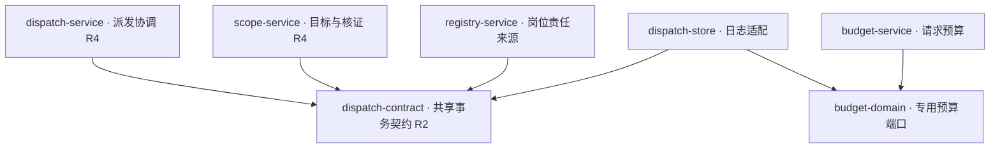

# CBIM · V&B 第一轮架构 review

> 历史快照：正文中的目录、完成状态与验证数字保留记录日期的事实，不是当前实现清单。四层迁移后的现状请看 [源码契约](../../src/CONTRACT.md) 和 [Logic 边界](../../src/logic/BOUNDARIES.md)。

日期：2026-11-12。源码基线：`3f249cf88523ced1fa764e82d1e264be7d5473e7`，产品版本 0.1.9。

[打开交互模块图与完整源码映射](cbim-vb-architecture-review-20261112.html)。HTML 内嵌全部映射、静态边、证据和源码快照，可离线查看，无 CDN 依赖。

## 范围与方法

本轮由用户明确要求绘制当前模块总图、源码映射及边界/依赖热点。采用 [SEI Views and Beyond](https://www.sei.cmu.edu/library/views-and-beyond-collection/) 的模块分解/使用关系与源码分配视角；业务能力与模块采用参与关系。职责角色用于导航，不是新的允许依赖层级。

全 src 静态解析、文件头/符号与目录契约索引；针对装配、运行、任务事务、界面与更新链路阅读关键实现。不是全仓逐行审计或运行验收。 本轮只做分析和报告；不修改产品实现、不移动目录、不创建/推进 Issue、不自动启用新规则。工作区既有发布/恢复记录保留。

全 src：668 文件（621 脚本/声明 + 47 样式），3075 条静态引用。按职责组织 74 个 review 单元，全部文件唯一归属；450 对跨单元依赖。**review 单元是当前实现的分析分组，并不宣称每组已具备独立、封闭、无环的模块契约。**

现有扫描：1296 个维护脚本、6682 条引用；文件环/未解析/未登记动态加载/分层违规/既有逻辑规则违规均为 0。专门逻辑边界覆盖 40/621 个 src 脚本；其余仍受物理层与文件无环规则约束，不等于无检查。此次只读扫描是取证，不是产品测试或全量回归。

## 阅读主图

树形缩进表示职责归组；业务系统标签表示参与关系；A → B 只表示 A 源码引用 B（包含类型和重导出）。运行时调用、返回和回调另看场景，不能从此箭头推导进程流。单文件扇出按不同 src 目标文件计数；扇入按不同 src 引用方计数，不包括 npm 外部依赖。

交互页提供：业务能力总览 → 职责模块树 → 所选模块的全部入/出依赖及逐边证据 → 唯一源码归属和离线全文。没有用一张缩小巨图塞入所有连线。跨图使用同一 module ID。

此图的线仅为分组。完整模块及源码见下表，依赖见交互页。

## 重点依赖图

以下每条线均有真实静态引用；图省略其他边，完整入/出关系在交互页按节点展开。类型引用也计入。

## 业务能力与模块参与映射

一个单元可参与多个业务；共享通信、基础原语和宿主能力单独列为共享组，不复制业务所有权。此映射为明确业务职责的首轮主参与范围，不是传递依赖闭包。

- **会话与任务协作**：`ui-shell`、`ui-conversation`、`ui-tasks`、`ui-execution-view`、`people-rules`、`workspace-rules`、`file-domain`、`evidence-domain`、`dispatch-contract`、`task-domain`、`run-kernel`、`member-capability`、`engine-native`、`run-contract`、`context-service`、`interaction-service`、`tool-adapters`、`loop-factory`、`admission-service`、`execution-service`、`dispatch-service`、`scope-service`、`file-service`、`effect-reader`、`dispatch-store`、`run-store`、`chat-material`、`isolation-platform`、`file-platform`。

- **知识与工程模型**：`ui-shell`、`ui-knowledge`、`ui-workspace`、`ui-execution-view`、`ui-diagnostics`、`knowledge-model`、`knowledge-rules`、`workspace-rules`、`dispatch-contract`、`context-service`、`tool-adapters`、`loop-factory`、`registry-service`、`effect-reader`、`knowledge-store`、`dispatch-store`。

- **团队与模块责任**：`ui-shell`、`ui-workspace`、`ui-team`、`ui-execution-view`、`knowledge-model`、`history-contract`、`people-rules`、`workspace-rules`、`dispatch-contract`、`context-service`、`tool-adapters`、`loop-factory`、`monitor-service`、`dispatch-service`、`registry-service`、`effect-reader`、`dispatch-store`、`run-store`。

- **自动化**：`ui-shell`、`ui-automation`、`automation-domain`、`automation-service`、`automation-store`。

- **知识治理**：`ui-shell`、`ui-governance`、`governance-domain`、`tool-adapters`、`loop-factory`、`effect-reader`、`governance-service`、`knowledge-store`。

- **资源共享与导入**：`ui-shell`、`ui-resources`、`knowledge-rules`、`connector-domain`、`tool-adapters`、`loop-factory`、`resources-service`、`knowledge-store`、`chat-material`。

- **反馈连接**：`ui-shell`、`ui-settings`、`connector-domain`、`tool-adapters`、`loop-factory`、`feedback-service`。

- **网页读取与搜索**：`ui-shell`、`ui-settings`、`connector-domain`、`tool-adapters`、`loop-factory`、`web-service`、`settings-store`。

- **模型配置与运行**：`ui-shell`、`ui-settings`、`budget-domain`、`engine-pi`、`engine-claude`、`engine-codex`、`model-contract`、`model-transport`、`run-kernel`、`engine-native`、`run-contract`、`loop-factory`、`budget-service`、`model-settings`。

- **运行监管与预算**：`ui-shell`、`ui-tasks`、`ui-settings`、`ui-runtime`、`history-contract`、`budget-domain`、`dispatch-contract`、`model-contract`、`model-transport`、`run-contract`、`runtime-contract`、`admission-service`、`monitor-service`、`budget-service`、`settings-store`、`dispatch-store`、`run-store`。

- **软件更新**：`ui-shell`、`ui-updates`、`updates-service`。

- **共享机制与宿主**：`ui-components`、`tool-policy`、`foundation`、`workspace-host`、`host-platform`、`ipc-contract`、`preload`、`ipc-router`、`app-assembly`。

## 模块与源码分配

下表列目录定位；完整文件级唯一归属在 HTML 中，不能把表中的目录前缀误当整目录独占。例如 knowledge-model 跨三个目录，brain 则拆为协议、内核、成员能力和三个引擎适配。每个节点展示当前导出符号；这些符号并不自动等于经过治理确认的公共入口。

### 交互与展示

| 单元 | 职责与状态所有者 | 源码定位 |
|---|---|---|
| `ui-shell` · 桌面外壳 | 工作区导航、页签、账号菜单和页面装配。 状态：窗口内导航与页签；业务事实来自桥接查询。 | 11 文件；`frontend` `frontend/shell` |
| `ui-conversation` · 对话界面与交互控制 | 输入、附件、队列、主会话与内联目标/任务展示。 状态：草稿、选择和请求状态；不拥有派发与运行权威状态。 | 26 文件；`frontend/conversation` |
| `ui-tasks` · 任务与证据界面 | 任务图、周期、恢复、人工意见、受控操作和证据面板。 状态：当前选择及后端投影；任务完成/恢复由服务裁决。 | 92 文件；`frontend/tasks` |
| `ui-knowledge` · 知识编辑界面 | 定义表单、文件预览、预览差异与显式提交。 状态：编辑草稿；正式知识归知识事务存储。 | 10 文件；`frontend/knowledge` |
| `ui-workspace` · 工程与责任界面 | 工程模块/Workflow 导航及负责人控制面。 状态：展示与待提交选择；责任头归派发日志。 | 8 文件；`frontend/workspace` |
| `ui-team` · 团队与岗位界面 | 静态团队、岗位登记、能力采纳与角色会话历史。 状态：表单、所选角色与历史页；岗位不等于运行实例。 | 14 文件；`frontend/team` |
| `ui-automation` · 自动化界面 | 配置自动化定义、查看列表及触发历史。 状态：表单和历史投影；调度器拥有触发状态。 | 3 文件；`frontend/automation` |
| `ui-governance` · 治理审阅界面 | 保护、提案、人工决定与单独实施的桌面交互。 状态：待提交决定和展示状态；批准与应用分别提交。 | 6 文件；`frontend/governance` |
| `ui-resources` · 资源仓库界面 | 仓库浏览、共享和静态知识包发布/应用。 状态：桌面选择；内容定义不代表授权。 | 7 文件；`frontend/resources` |
| `ui-settings` · 设置界面 | 模型、仓库连接、预算、并发与反馈设置。 状态：编辑草稿；凭据/策略由本机服务保存。 | 9 文件；`frontend/settings` |
| `ui-runtime` · 运行总览界面 | 只读全局运行、准入与已报告消耗。 状态：只读投影；不持有名额或租约。 | 6 文件；`frontend/runtime` |
| `ui-updates` · 更新界面 | 统一轮询更新状态，后台预下载后提示用户确认重启。 状态：App 持有窗口内更新投影；真实更新状态归 updater。 | 3 文件；`frontend/updates` |
| `ui-execution-view` · 公共执行展示 | 共享消息、Markdown、工具轨道、工作状态及问答展示。 状态：局部展示状态；不反向拥有页面业务状态。 | 13 文件；`frontend/execution-view` |
| `ui-components` · 公共界面组件 | 图标、模型选择及公共控件。 状态：控件状态；不持有后端服务。 | 9 文件；`frontend/components` |
| `ui-diagnostics` · 知识诊断界面 | 工作区与知识校验的只读诊断。 状态：展示快照；不隐式修复。 | 2 文件；`frontend/diagnostics` |

### 领域规则与公开数据

| 单元 | 职责与状态所有者 | 源码定位 |
|---|---|---|
| `knowledge-model` · 知识快照与领域读模型 | 以同一校验快照提供 Team、BusinessWorkspace 与正文读取。 状态：纯快照，没有持久化写入口。 | 6 文件；`backend/core/knowledge` `backend/core/team` `backend/core/workspace` |
| `knowledge-rules` · 知识校验与对象规划 | 知识校验、只读查询、对象/知识包规划、刷新与端口；Builtins 仍有资料读取。 状态：计划与快照通过端口保存；正式写入交由知识队列。 | 16 文件；`backend/core/knowledge` |
| `history-contract` · 角色履历契约 | 静态角色与 Session/Run 的只读归档及索引端口。 状态：正文归运行日志；索引只保存引用和摘要。 | 2 文件；`backend/core/team` |
| `people-rules` · 岗位与执行身份规则 | 长期岗位、来源采纳、负责人选择、执行实例与历史绑定规则。 状态：纯规则；长期岗位、执行实例和原生会话有不同身份。 | 10 文件；`backend/core/team` |
| `workspace-rules` · 模块与 Workflow 规则 | 来源代次、责任规则、冻结执行范围与 JSON/CSV/PNG 验证协议。 状态：纯声明/规则；文件字节、来源写入和平台句柄不由此拥有。 | 14 文件；`backend/core/workspace` |
| `budget-domain` · 请求与周期预算规则 | 请求预算状态、纯投影、不变量及专用读写端口。 状态：不可变预算事实由共享日志保存；不自行发网。 | 7 文件；`backend/core/tasks` |
| `file-domain` · 受控文件与隔离协议 | 受控替换、删除/移动、范围执行和原隔离资源核实协议及纯不变量。 状态：只记录阶段和身份；真实字节、进程与句柄由平台拥有。 | 8 文件；`backend/core/tasks` |
| `evidence-domain` · 产物与 Workflow 证据规则 | 单文件/完整清单、验证、进度与交付的可信证据重建及成员工具包装。 状态：canonical 事实派生证明；成功工具回包不等于业务接受。 | 15 文件；`backend/core/tasks` |
| `dispatch-contract` · 共享调度状态与事务契约 | 工作区跨域 DispatchState/Mutation/Store：图、邮箱、身份、来源、阶段和预算。 状态：声明唯一日志的原子提交边界；对消费者的权限宽度仍需 review。 | 1 文件；`backend/core/tasks` |
| `task-domain` · 目标、任务图与恢复规则 | 图/周期、等待、检查点、人工意见、核实/重规划及重放不变量。 状态：领域状态由 Store/canonical 保存；此组仍是较宽的 review 分组。 | 79 文件；`backend/core/tasks` |
| `automation-domain` · 自动化定义与日程规则 | 定义、触发记录及按时区计算下次时刻。 状态：纯协议和计算；不执行模型、不持有时钟。 | 2 文件；`backend/core/automation` |
| `governance-domain` · 知识治理规则 | 保护、提案、决定与模型治理能力的纯协议。 状态：声明权限与回执；批准不自动应用。 | 4 文件；`backend/core/governance` |
| `connector-domain` · 连接与资源能力契约 | 链接器定义、仓库只读能力、反馈与网页端口。 状态：定义不是授权；令牌由本机适配拥有。 | 6 文件；`backend/core/connectors` |
| `model-contract` · 模型配置与预算端口 | 模型能力、引擎选择、配置快照和请求账本的窄端口。 状态：无凭据持久化；运行时只使用已冻结快照。 | 5 文件；`backend/core/brain/llm` |
| `run-contract` · 运行协议与计量 | 引擎/运行接口、日志端口、身份绑定、历史选取与消耗纯投影。 状态：声明事实与映射；index 仍重导出 runtime，应区分类型与实现入口。 | 13 文件；`backend/core/brain` |
| `runtime-contract` · 监管与准入协议 | 全局监管投影、准入与周期计量协议。 状态：只描述公开事实，不拥有全局运行槽。 | 4 文件；`backend/core/runtime` |

### 用例与跨域协调

| 单元 | 职责与状态所有者 | 源码定位 |
|---|---|---|
| `automation-service` · 自动化触发与业务接入 | 唯一工作区调度器和 Main 业务端口；持久触发意图、不重放未知结果。 状态：调度器拥有定义触发状态；正式执行委托已有协作入口。 | 2 文件；`backend/main` `backend/scheduler-engine/automation` |
| `context-service` · 执行上下文冻结 | 从知识与岗位冻结角色、模块、Workflow、能力和来源。 状态：每次准备得到快照，不代替领取时再核实。 | 4 文件；`backend/scheduler-engine/context` |
| `interaction-service` · 审批、提问与消息队列 | 进程内审批/问题与待执行消息；主 Agent 行为指引也在本组。 状态：问题/批准随运行，队列记录用户发送时的权限/模型。 | 4 文件；`backend/scheduler-engine/conversation` |
| `tool-adapters` · 模型业务工具适配 | 将可信领域端口转换为发现、分类、Schema 与一次调用。 状态：只持本轮能力绑定；不自行产生授权或重放写命令。 | 16 文件；`backend/scheduler-engine/tools` |
| `loop-factory` · Loop 与业务能力装配 | createWorkspaceLoop 选择引擎，装配权限、知识、岗位、治理与外部工具。 状态：每次运行工厂持已捕获能力；兼有业务指引拼接。 | 1 文件；`backend/scheduler-engine/execution` |
| `admission-service` · 全局准入与工作区租约 | 全局名额、FIFO 等待与工作区读写占用的联合领取。 状态：GlobalRunAdmission 属应用；WorkspaceExecutionLease 属工作区。 | 4 文件；`backend/main` `backend/scheduler-engine/execution` `backend/scheduler-engine/runtime` |
| `monitor-service` · 监管投影与角色履历 | 已提交调度事实、canonical 公开事件及角色历史查询。 状态：派生缓存/索引；非权威任务完成状态。 | 4 文件；`backend/scheduler-engine/execution` `backend/scheduler-engine/runtime` |
| `budget-service` · 预算准入与统计服务 | 逐请求预留/结算、周期准入及只读用量报告。 状态：请求服务用专用端口；周期跨域准入仍需要协调。 | 3 文件；`backend/scheduler-engine/execution` |
| `execution-service` · 主运行与成员执行管理 | 主会话接续/排队、成员领取/结算、检查点和真实引擎关闭。 状态：活动 handle/停止信号；权威领取与结算仍通过唯一 Store。 | 9 文件；`backend/scheduler-engine/execution` |
| `dispatch-service` · 任务派发与协作协调 | 计划/派发、负责人核实、自动协作批次和候选回注。 状态：进程内批次和调度；提交必须核原周期/知识/模型快照。 | 3 文件；`backend/scheduler-engine/execution` |
| `scope-service` · 目标状态与核证恢复服务 | 目标/等待/人工意见、依赖变更、异常影响核实、恢复与重规划。 状态：修改通过 Store；文件和日志核证在明确只读端口完成。 | 24 文件；`backend/scheduler-engine/execution` |
| `registry-service` · 岗位、责任与来源协调 | 长期岗位/模块责任/来源代次和真实主工具绑定。 状态：权威头来自同一 DispatchStore；采用知识→模型→Store 的相关锁序。 | 5 文件；`backend/main/workspace` |
| `file-service` · 受控操作与原资源核实服务 | 受控写、删除/移动、原隔离资源观察与显式清理。 状态：只持原运行证据和私有身份；未知状态不能自动重放。 | 3 文件；`backend/main/workspace` |
| `effect-reader` · 跨域持久事实读取 | 读取原知识事务、治理/责任记录，为影响观察提供有界事实。 状态：只读原事实；不把未查到解释为未执行。 | 2 文件；`backend/main/workspace` |
| `governance-service` · 知识保护与治理实施 | 保护/观察/提案/决定/应用和主运行窄端口。 状态：治理账本保存意图；真实实施共用知识事务队列。 | 3 文件；`backend/main/governance` `backend/main/persistence/governance` |

### 执行机制与引擎

| 单元 | 职责与状态所有者 | 源码定位 |
|---|---|---|
| `tool-policy` · 工具契约与授权策略 | Schema、发现、结果、回执、取消恢复及工具副作用决策。 状态：调用事实由 runtime 写日志；策略中仍有具体业务工具分类。 | 12 文件；`backend/core/policy` `backend/core/tools` |
| `engine-pi` · Pi 引擎适配 | Pi 进程/RPC、内部工具桥、运行配置与请求代理启动。 状态：拥有本轮 Pi 进程和原生会话生命周期。 | 5 文件；`backend/core/brain/pi` |
| `engine-claude` · Claude 引擎适配 | SDK 加载、Query 生命周期、原生工具和事件转换。 状态：拥有本轮 SDK/原生会话；运行事实交公共日志。 | 3 文件；`backend/core/brain/claude` |
| `engine-codex` · Codex 引擎适配 | App Server 进程、双向 RPC、线程/轮次、工具及代理。 状态：拥有本轮子进程与真实线程身份。 | 6 文件；`backend/core/brain/codex` |
| `run-kernel` · 运行生命周期内核 | 租约、授权先落盘、工具门禁、插入、停止、排空与终态。 状态：持活动运行和在途操作；同时直接装配多种成员专属能力。 | 1 文件；`backend/core/brain` |
| `member-capability` · 成员运行能力与短期门闩 | 文件采集、完整清单、验证、检查点、受控操作和范围执行。 状态：短期门闩绑定单个真实运行；长期事实交 canonical/Store。 | 8 文件；`backend/core/brain` |

### 持久化与平台适配

| 单元 | 职责与状态所有者 | 源码定位 |
|---|---|---|
| `foundation` · 基础原语与文件能力 | 错误、哈希、序列化、标识、路径端口及基础文件 IO。 状态：无业务状态；files.ts 含实际 IO，整个目录不能当纯领域。 | 6 文件；`backend/core/foundation` |
| `model-transport` · 模型请求代理与用量解析 | 本机请求代理、供应商协议与真实 HTTP 尝试计量。 状态：持本轮代理/令牌；发送意图和终态通过预算端口可靠记录。 | 2 文件；`backend/core/brain/llm` |
| `engine-native` · 宿主管理的原生工具 | 为宿主管理引擎复用 Pi 的文件/命令工具实现。 状态：工具副作用仍受公共授权与取消约束。 | 1 文件；`backend/core/brain` |
| `feedback-service` · GitHub 反馈与连接 | 设备登录、加密凭据、固定仓库提交及原提交核实。 状态：应用持连接和私有提交意图账本；未知 POST 不重放。 | 3 文件；`backend/main/resources` |
| `web-service` · 公开网页与搜索 | 公开地址传输、网页解析、robots、缓存、限速与搜索。 状态：应用级缓存/限速；密钥单独保存。 | 2 文件；`backend/main/platform` `backend/main/resources` |
| `resources-service` · 资源仓库与知识包服务 | 仓库文件、HTTP 共享、工作区授权、资源包预览/应用。 状态：仓库定义、共享授权与知识提交分开；仍需复核入口职责。 | 7 文件；`backend/main/resources` |
| `knowledge-store` · 知识物理事务与恢复 | 知识读取、对象计划、串行提交、journal 与崩溃恢复。 状态：正式知识文件/journal；与治理和来源端口握手。 | 6 文件；`backend/main/persistence/knowledge` |
| `model-settings` · 模型配置持久化 | 供应商凭据/能力配置与主 Agent 选型。 状态：本机加密配置及串行版本；公开快照不含密钥。 | 2 文件；`backend/main/persistence/settings` |
| `settings-store` · 预算、并发与搜索设置 | 保存版本化策略与加密搜索设置。 状态：策略在新运行/周期生效；不修改旧运行事实。 | 3 文件；`backend/main/persistence/settings` |
| `dispatch-store` · 唯一调度日志及预算适配 | FileDispatchStore 可靠追加、重放、幂等、联合不变量；窄预算投影仍在原事务内。 状态：工作区唯一权威调度日志；共享存储不等于每个消费者需完整端口。 | 2 文件；`backend/main/persistence/tasks` |
| `run-store` · 运行日志与历史索引 | canonical 事件、摘要恢复、运行目录及角色派生索引。 状态：运行日志先落盘再发布；索引不替代原日志。 | 3 文件；`backend/main/persistence/tasks` |
| `automation-store` · 自动化定义与记录保存 | 工作区自动化的私有持久化实现。 状态：由唯一调度器串行写入，持工程锁。 | 1 文件；`backend/main/persistence/tasks` |
| `chat-material` · 显式资料导入与附件快照 | 文件/图片/目录/网页/已授权仓库资料的明确导入和取消。 状态：importId 与原工作区绑定；已保存快照不会自动发送或重新联网。 | 3 文件；`backend/main/persistence/tasks` |
| `isolation-platform` · 隔离进程与残留资源平台 | Win32 隔离启动、原进程/Job/目录身份、持久记录与核实回收。 状态：真实子进程与资源；进程退出不自动证明文件已解除占用。 | 6 文件；`backend/main/persistence/tasks` `backend/main/platform` |
| `file-platform` · 受控文件、产物读取与验证平台 | 专用 utility 文件工人、Win32 句柄、冻结范围读取、清单与同字节验证。 状态：拥有物理文件句柄/短期子进程；操作生命周期通过服务和 runtime 连接。 | 9 文件；`backend/main/platform` |
| `host-platform` · 通用本机平台 | 路径、系统锁、凭据、终端、原生历史与原生工具前置保护。 状态：拥有各自系统资源；工具 guard 是前置策略，不是 OS 沙箱。 | 6 文件；`backend/main/platform` |
| `updates-service` · 独立更新子系统 | 固定 Release 来源、后台预下载、校验与确认后的 NSIS 安装。 状态：唯一更新状态机；业务排空由 Main 注入，更新器不认识业务实现。 | 5 文件；`backend/updater` |

### 宿主装配与通信

| 单元 | 职责与状态所有者 | 源码定位 |
|---|---|---|
| `workspace-host` · 工作区身份与生命周期 | 登记、路径身份、锁、知识监听与唯一 Store 的打开/关闭。 状态：拥有工作区实例和关闭顺序；不同业务状态委托各存储/服务。 | 3 文件；`backend/main/workspace` |
| `ipc-contract` · 桌面 IPC 与公开 DTO | 操作到请求/响应映射、边界校验及 Core 公开类型/纯函数转接。 状态：无服务实例/句柄；不是独立进程或业务状态持有者。 | 44 文件；`bridge/contracts` |
| `preload` · 安全桥传输 | 固定 window.cbim.call 与系统 File 导入。 状态：位于 Renderer 的隔离上下文；不是独立运行进程。 | 1 文件；`bridge/preload` |
| `ipc-router` · 可信桌面路由 | 请求解析、按业务分发、本机提交来源注入。 状态：不拥有业务事实；服务继续负责领域校验。 | 13 文件；`backend/main/ipc` |
| `app-assembly` · 应用与执行服务装配 | Electron/CLI 入口、Application、主/成员工厂和履历装配。 状态：应用/窗口/工作区服务实例、启动/关闭顺序；高扇出有装配理由。 | 7 文件；`backend/main` `backend/main/commands` |

## 边界与依赖热点

“先审/随后”是本次 review 阅读顺序，不是故障等级或实时开发排期。事实与判断分开；没有使用行数或引用数直接裁定模块好坏。

### R1 · 运行内核仍直接组织成员专属能力（边界混合，先审）

**源码事实：** runtime.ts 直接依赖 41 个 src 文件，并分别创建采集、完整清单、检查点、受控文件和范围执行能力；停止路径也逐项认识这些能力。

**架构判断：** 通用生命周期与成员业务装配仍在同一文件交织；改变成员能力可能影响授权、排空和终态的稳定代码。

**已有边界与限制：** 能力类、engine-tools 与 prepareRunValidation 已被提取；这不是“没有封装”，也不能仅凭数量判定缺陷。

**Review 入口：** 先核对通用运行契约与能力生命周期契约能否覆盖现有停止/未知副作用语义，再判断是否值得迁移一个真实能力。

- `src/backend/core/brain/runtime.ts:61`
- `src/backend/core/brain/runtime.ts:301`
- `src/backend/core/brain/runtime.ts:375`

### R2 · 共享 Store 的事务边界明确，消费者能力仍偏宽（契约过宽，先审）

**源码事实：** dispatch-storage.ts 被 72 个不同 src 文件直接引用（含类型）；DispatchState 同时暴露任务/运行、岗位、责任、来源、文件阶段和请求预算。

**架构判断：** 新增一个领域附录会触及共用状态/提交协议。风险在消费者拿到的能力面，而不是唯一日志本身。

**已有边界与限制：** 事务原子性、幂等与重放依赖共享日志；请求预算已通过 RequestBudgetStore 和原事务内投影收窄。不能直接拆成多个数据库。

**Review 入口：** 按真实只读/独立提交消费者逐个核对最小端口；跨域原子命令保留明确协调者和同一提交屏障。

- `src/backend/core/tasks/dispatch-storage.ts:40`
- `src/backend/core/tasks/dispatch-storage.ts:128`
- `src/backend/main/persistence/tasks/request-budget-store.ts:16`

### R3 · Loop 工厂同时选择引擎、装配业务并拼接指引（装配集中，随后）

**源码事实：** loop-engine.ts 直接依赖 51 个 src 文件，是当前最大的文件扇出；createEngine 绑定调度、岗位、责任和治理工具，并组合多段业务指引。

**架构判断：** 作为工厂，高扇出有理由；但引擎选择和业务工具/指引变化在同一入口相遇，scheduler-engine 不能被理解为纯调度算法。

**已有边界与限制：** createWorkspaceLoop 本来就是组合点；不能以减边为目标把依赖藏入全局注册表。

**Review 入口：** 先区分工厂的稳定参数、引擎适配选择与业务能力清单，核对新增能力的实际改动范围。

- `src/backend/scheduler-engine/execution/loop-engine.ts:104`
- `src/backend/scheduler-engine/execution/loop-engine.ts:245`

### R4 · 任务派发与目标服务是多个事实源的汇合处（跨域协调集中，先审）

**源码事实：** dispatch-service.ts 直接依赖 44 个 src 文件，scope-goal-service.ts 依赖 36 个；领取/目标审阅涉及知识、模型、负责人、图、日志与文件证据。

**架构判断：** 这些是实际跨域用例。应 review 决策和状态归属，避免每个服务各自重新解释证据/锁序；静态扇出不能证明重复规则。

**已有边界与限制：** 联合校验和原子提交有业务需要，很多证据规则已提取为纯函数；本轮未用变更历史证明变化传播频率。

**Review 入口：** 选“派发→领取→结算”和“人工接受→继续”两条场景，核对每项决策唯一归属及读取/提交屏障。

- `src/backend/scheduler-engine/execution/dispatch-service.ts:64`
- `src/backend/scheduler-engine/execution/scope-goal-service.ts:69`
- `src/backend/scheduler-engine/execution/owner-execution-service.ts:31`

### R5 · 对话页面聚合多个业务的交互控制（界面协调集中，随后）

**源码事实：** Conversation.tsx 直接依赖 37 个 src 文件，并使用任务图/目标、自动化、主 Agent 选型和外壳页签契约。

**架构判断：** 页面组合正常；但输入/队列、目标接续与页面导航共处，需要确认组件与控制状态的边界。

**已有边界与限制：** 公共执行展示已经独立，且有明确入口约束；不能把所有跨页面引用一律认定为循环。

**Review 入口：** 以“输入排队”和“等待后继续”为变化场景，先定位状态所有者，再决定是否有独立控制器值得提取。

- `src/frontend/conversation/Conversation.tsx:65`
- `src/frontend/conversation/Conversation.tsx:29`

### R6 · 目录层不能直接当成完整逻辑模块边界（目录语义与治理覆盖，先审）

**源码事实：** core 同时包含领域、运行和 SDK/进程适配；main 同时包含装配、业务服务、存储和平台。Team/BusinessWorkspace 读模型跨 knowledge/team/workspace 目录，已有专门逻辑边界。

**架构判断：** 物理层允许依赖较粗。文件 DAG 通过不表示每个 review 模块有公共入口保护；当前归组还需结合真实变更继续确认。

**已有边界与限制：** 已有 knowledge-read-models、request-budget、execution-view 等边界约束；本图的新 ID 只是分析标识，不自动成为生效规则。

**Review 入口：** 保留已验证的边界，优先明确上述热点的公开入口与源码归属；本轮不移动目录、不启用新阻断规则。

- `scripts/architecture-boundaries.mjs:19`
- `scripts/check-dependencies.mjs:15`
- `src/backend/main/application.ts:60`

## 分组后互达，尚不能认定独立模块边界

源文件图无环，但把不同类型/服务/规则归为较大的 review 单元后出现互达。以下是聚合图强连通组，说明这些分组尚未收敛成单向的独立模块边界；不能称为已证明的文件循环，也不能仅以合并节点消除问题。HTML 中可点进各边查看相反方向分别来自哪些文件。

1. `knowledge-rules` ↔ `member-capability` ↔ `run-kernel` ↔ `run-contract` ↔ `evidence-domain` ↔ `file-domain` ↔ `connector-domain` ↔ `tool-policy` ↔ `workspace-rules` ↔ `dispatch-contract` ↔ `budget-domain` ↔ `model-contract` ↔ `people-rules` ↔ `task-domain`（列举同组成员，**不表示列表相邻者均有直接边**）。

2. `ui-workspace` ↔ `ui-team`（列举同组成员，**不表示列表相邻者均有直接边**）。

3. `ui-conversation` ↔ `ui-shell`（列举同组成员，**不表示列表相邻者均有直接边**）。

4. `budget-service` ↔ `scope-service` ↔ `execution-service` ↔ `dispatch-service`（列举同组成员，**不表示列表相邻者均有直接边**）。

5. `governance-service` ↔ `workspace-host`（列举同组成员，**不表示列表相邻者均有直接边**）。

## 工程与运行位置（源码分配）

| 源码角色/入口 | 构建与运行分配 |
|---|---|
| frontend/main.tsx → shell/App | main_window Renderer |
| bridge/preload/preload.ts | 独立 preload 构建，位于 Renderer 隔离上下文，不是独立进程 |
| bridge/contracts、Core 公开类型/纯函数 | 共享源码；类型引用不代表运行加载 |
| backend/main/main.ts | Electron Main 应用装配 |
| core / scheduler-engine / main 服务 | 主要作为 Main 内库使用；不是按目录启动独立服务 |
| main/platform/controlled-file-child.ts | 独立构建的 Electron utility 文件工人 |
| main/platform/isolated-node.ts | 单独构建的平台导出模块；其内部启动隔离 Node，模块本身不等于独立服务 |
| brain/pi、claude、codex | 主宿主适配与各自原生进程/SDK 边界；不可把整个目录画成单一运行进程 |
| main/commands/loop-cli.ts | 开发 CLI，复用应用能力；不自动拥有桌面全部能力 |

证据：`forge.config.ts` 的 VitePlugin build/renderer entries，`main.ts` 的 BrowserWindow/preload 装配，平台 transport 和各引擎实现。运行交互总图、部署图与全面场景验证留待后续独立视图，本轮不声称完成。

## 一条已走读的业务链：用户确认更新

`ui-updates/useSoftwareUpdates.act` → `preload` 的 `cbim:call` → `main.ts` 可信更新路由 → `DesktopUpdates.install`。仅 ready 可进入 installing；正常排空由 Main 注入的 beforeInstall 调用 `Application.shutdown`；之后 `NsisUpdateInstaller.install` 才调用 quitAndInstall。后台检查/预下载不调用排空。

状态归属：窗口只持展示投影；DesktopUpdates 持更新状态；Application 持业务服务/工作区生命周期；安装器持下载校验状态。失败返回 ready 并保留错误，不等于升级成功；新进程实际版本需另行验收。此处是静态调用链走读，未实际下载、安装或重启。

## 正常的高连接与已有正面边界

- Application 是装配根，直接引用 41 个 src 文件有组合职责依据，不能仅凭扇出定为过密。
- foundation/errors.ts 被 202 个 src 文件使用，低层错误原语高扇入是复用证据，不自动是问题。
- 请求预算已用窄端口接入原串行事务；知识查询与只读快照独立；execution-view 已有专门入口约束；updater 不反向导入业务运行实现。这些边界应在后续演进中保留。

## 维护者决策与下一步入口

保护的稳定能力：可信授权、日志先落盘、事务原子性、幂等、未知结果不重放、停止排空，以及已有窄契约。变化点首先审查成员能力装配、跨域状态读写权限和用例协调。这里只给 review 入口，不生成新实时待办。

建议先读 R1/R2 的接口与状态，再沿 R4 的领取/结算链核对；R3/R5 依变化证据决定是否值得拆分。后续涉及代码时，验证由实际迁移的消费者确定，不能把此次静态扫描当作行为验证。新规则候选：本图映射若经维护者认可，再择已收敛边界固化入口检查；本轮不自动生效。

## 生成与验证记录

- `node test-results/vb-review-20261112/scan.mjs`：重新扫描当前基线，保留源文件哈希、AST 引用和导出符号索引。
- `node test-results/vb-review-20261112/model.mjs`：根据已核实职责映射源码，拒绝未分配文件/空单元；聚合边保留每条原始引用。
- `node test-results/vb-review-20261112/build.mjs`：生成本报告和离线交互图。
- 页面和数据核对结果见交付时追加的验证段。未运行产品单元、类型检查、全量回归、构建或安装验收。

原始扫描/构图辅助文件保存在被忽略的 `test-results/vb-review-20261112/`；可持久 review 的结论、全部映射和证据均包含在此 Markdown 和 HTML 快照中。

### 交付前页面与数据核对

- `node test-results/vb-review-20261112/verify.mjs`：320 px 浅色、390 px 深色、900 px 浅色全部通过；每种尺寸核对 74 个单元的文件数和依赖对数、11 项业务筛选、搜索、热点筛选、展开/折叠、逐边证据、源码第 40 行定位及 JSON 导出。无横向溢出、页面错误或外部请求。
- 嵌入 JSON 与模型完全一致；668 文件唯一归属，全部跨单元原始引用均归入对应边；引用路径/行号有效，源文件哈希与当前清单一致。
- 页面测试初次等待“折叠树内节点可见”而超时；节点已生成，改为等待节点挂载后继续行为检查。页面未因此改动。初版 SVG 把多条边写在同一路径，视觉核对发现只有末条有箭头，随后分成独立边并补上已存在的聚合回边；补充核对见视觉记录。
- 取证基线 `3f249cf8`；验证期间 HEAD 前进到 `d4f753cc`。`git diff 3f249cf8 HEAD -- src scripts/check-dependencies.mjs scripts/architecture-boundaries.mjs forge.config.ts` 为空，全部源码哈希/清单一致，保留原冻结基线。
- 原始页面结果：`test-results/vb-review-20261112/verification.json`；截图保存在同目录。仅验证本次资料与页面，不运行产品测试、类型检查、构建或升级。

- `node test-results/vb-review-20261112/visual.mjs`：修正 SVG 后，对 320/390/900 px 的独立箭头、聚合回边、最终验证说明与溢出再核对通过，最终截图见 `final-graphs-*`。未重复运行已通过的全部映射行为检查。
