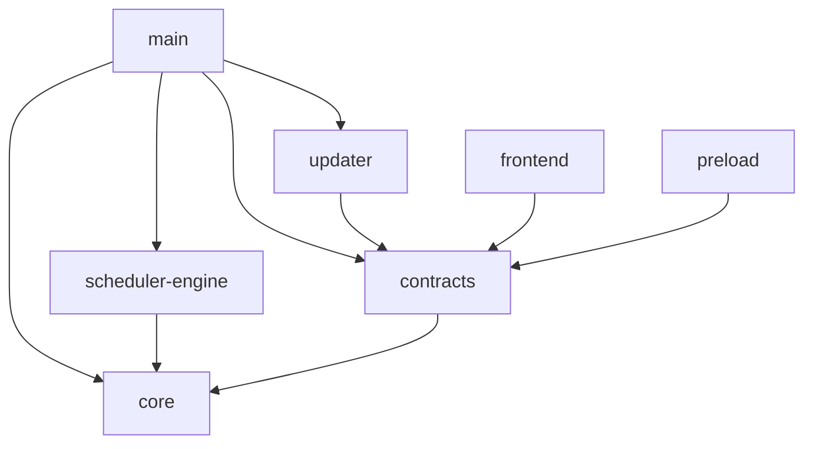

# CBIM 全项目架构 review 快照

> 导航维护说明（2026-11-14）：正文保留当时的路径、结论与验证边界；可点击源码链接已更新到当前归属，仅供导航，不作为历史版本证据。未留存的阶段入口另行注明，不伪造源码或制品归档。

日期：2026-11-12。源码基线：0.1.9 / `c46ea7e7526a053d43e08477b77e201d7aa50e30`。

[交互总览](project-architecture-review-20261112.html)：离线单文件，完整模块树、全部 src 内部引用证据、搜索与 JSON 导出。

## 图例与范围

- 树形缩进表示归属，不表示依赖。A → B 表示 A 引用 B，包含类型和 re-export；运行调用另列。
- 扫描全仓 1295 个 JS/TS 文件、6680 条引用：文件级循环、未解析引用、未登记动态加载及分层/逻辑边界违规均为 0。
- src 共 58 个目录，668 个代码及样式文件（621 个脚本/声明，47 个样式），3075 条内部引用。
- 数字按含子目录统计；目录聚合双向依赖不等于文件循环；文件无环也不代表模块已解耦。
- 使用现有 auditDependencies 的 AST/解析结果；未进行产品测试、运行验证或逐行审计。第三方与运行期注入不属于本地静态边。

## 全部跨层依赖

| 使用方 → 被依赖方 | 引用记录数 |
|---|---:|
| backend/main → backend/core | 322 |
| backend/main → backend/scheduler-engine | 49 |
| backend/main → bridge/contracts | 33 |
| backend/main → backend/updater | 4 |
| backend/scheduler-engine → backend/core | 618 |
| backend/updater → bridge/contracts | 3 |
| bridge/contracts → backend/core | 159 |
| bridge/preload → bridge/contracts | 1 |
| frontend → bridge/contracts | 233 |

## 完整源码模块树

- `src/` **668**：产品源码；以下 7 个物理依赖层共同组成桌面应用
  - `backend/` **404**：本机后端分组，不是一个单独依赖层
    - `core/` **236**：领域规则、执行协议、通用运行循环及引擎适配；不是纯领域层
      - `automation/` **2**：自动化数据/存储端口与日程计算
      - `brain/` **44**：运行循环、事件、计量、工具能力与引擎协议；本层另有 23 个直接文件
        - `claude/` **3**：Claude Agent SDK 与原生会话适配
        - `codex/` **6**：Codex App Server、RPC 与线程/轮次适配
        - `llm/` **7**：模型能力与配置端口、请求预算传输和用量解析
        - `pi/` **5**：Pi 引擎协议、桥接、工具门禁与会话适配
      - `connectors/` **6**：连接器定义及 GitHub 反馈纯协议
      - `foundation/` **6**：错误、JSON、标识、序列化、路径端口和文件原语
      - `governance/` **4**：知识治理协议、保护规则与工具投影
      - `knowledge/` **19**：知识快照、校验、读模型、对象规划与内置资料读取
      - `policy/` **2**：统一工具权限与副作用决策
      - `runtime/` **4**：全局监管投影、周期、计量与准入协议
      - `tasks/` **110**：任务/图/周期/证据/恢复/存储端口等领域协议和规则
      - `team/` **13**：团队、Agent、岗位、执行身份与履历契约
      - `tools/` **10**：工具 Schema、能力、效果、回执与严格问答
      - `workspace/` **16**：工程、模块、Workflow、责任及执行范围规则
    - `main/` **91**：Electron 入口、应用装配与本机适配；本层另有 8 个直接文件
      - `commands/` **1**：CLI 入口，复用 Application
      - `governance/` **2**：模块知识治理服务与可信操作适配
      - `ipc/` **13**：按业务组解析并分发应用操作
      - `persistence/` **22**：文件存储、事务与配置适配
        - `governance/` **1**：私有治理提案、决定与原命令记录
        - `knowledge/` **6**：知识文件、事务日志、恢复与对象存储
        - `settings/` **5**：模型密钥、并发、预算与网页设置
        - `tasks/` **10**：派发账本、运行日志、履历、附件与隔离记录
      - `platform/` **21**：路径、系统锁、凭据、终端、Win32 与子进程边界
      - `resources/` **11**：资源仓库、授权连接、网页读取与 GitHub 反馈
      - `workspace/` **13**：工作区生命周期、来源/岗位/责任、文件与隔离资源服务
    - `scheduler-engine/` **72**：工作区会话与执行编排，只向 Core 依赖
      - `automation/` **1**：自动化定义调度、持久触发与不重放规则
      - `context/` **4**：冻结角色、知识、岗位、模块与 Workflow 上下文
      - `conversation/` **4**：主 Agent 指引、提问、审批与消息队列
      - `execution/` **44**：主/成员运行、派发、预算、证据、停止与处置
      - `runtime/` **3**：全局监管、角色履历与并发准入
      - `tools/` **16**：把知识、派发、问答与反馈能力注册为模型工具
    - `updater/` **5**：独立桌面更新状态机、Release 查询与 NSIS 适配
  - `bridge/` **45**：通信边界分组，区分共享契约与实际 IPC 传输
    - `contracts/` **44**：公开 DTO、IPC 请求/响应配对及纯校验
    - `preload/` **1**：通过 contextBridge 暴露固定 window.cbim API
  - `frontend/` **219**：React 界面；仅导入自身与 bridge/contracts；本层另有 1 个直接文件
    - `automation/` **3**：工作区自动化配置、列表和历史
    - `components/` **9**：通用组件、图标与引擎/模型选择
    - `conversation/` **26**：主对话、输入、附件、队列与目标摘要
    - `diagnostics/` **2**：工作区及知识校验的只读诊断
    - `execution-view/` **13**：共享消息、工具轨道、状态与输入展示
    - `governance/` **6**：模块知识治理的审阅、决定与回执界面
    - `knowledge/` **10**：知识表单、预览、来源与静态编辑组件
    - `resources/` **7**：资源仓库查看、静态包发布与应用
    - `runtime/` **6**：只读全局运行、准入与消耗视图
    - `settings/` **9**：模型、仓库、反馈连接、并发及预算配置
    - `shell/` **10**：应用入口、工作区导航、页签与页面装配
    - `tasks/` **92**：任务图、成员执行、证据、检查点与恢复界面
    - `team/` **14**：团队/Agent/岗位及角色会话履历
    - `updates/` **3**：更新状态、版本日志、下载与安装界面
    - `workspace/` **8**：工程/模块/Workflow 图及责任关系界面

## 各模块直接依赖

以下按目录归属汇总，不丢弃跨组引用。本层直接文件用“本层文件”表示。父层表将子孙目录聚合；交互页可查看精确文件与行号。只列存在的依赖；静态依赖不包含 CSS 选择器关联或运行期 IPC。

### src/backend/core

| 依赖方向 | 引用数 | 一条源码证据 |
|---|---:|---|
| brain → foundation | 23 | `src/backend/core/brain/artifact-capture.ts:7` → `src/backend/core/foundation/errors.ts` |
| brain → tasks | 67 | `src/backend/core/brain/artifact-capture.ts:8` → `src/backend/core/tasks/artifact-tools.ts` |
| brain → tools | 18 | `src/backend/core/brain/claude/tools.ts:8` → `src/backend/core/tools/outcome.ts` |
| brain → team | 3 | `src/backend/core/brain/llm/request-budget-transport.ts:13` → `src/backend/core/team/workspace-member-rules.ts` |
| brain → workspace | 9 | `src/backend/core/brain/output-manifest-capture.ts:10` → `src/backend/core/workspace/artifact-scope.ts` |
| brain → policy | 2 | `src/backend/core/brain/runtime.ts:53` → `src/backend/core/policy/tool-policy.ts` |
| connectors → tools | 2 | `src/backend/core/connectors/github-feedback.ts:7` → `src/backend/core/tools/scope-schema.ts` |
| governance → foundation | 5 | `src/backend/core/governance/module-governance-feedback.ts:6` → `src/backend/core/foundation/errors.ts` |
| knowledge → foundation | 18 | `src/backend/core/knowledge/builtins.ts:8` → `src/backend/core/foundation/errors.ts` |
| knowledge → connectors | 1 | `src/backend/core/knowledge/knowledge.ts:6` → `src/backend/core/connectors/registry.ts` |
| knowledge → workspace | 6 | `src/backend/core/knowledge/knowledge.ts:12` → `src/backend/core/workspace/workflow-contract.ts` |
| knowledge → brain | 1 | `src/backend/core/knowledge/object-contract.ts:8` → `src/backend/core/brain/llm/engine.ts` |
| knowledge → team | 1 | `src/backend/core/knowledge/read-models.ts:6` → `src/backend/core/team/model.ts` |
| policy → tools | 2 | `src/backend/core/policy/tool-policy.ts:11` → `src/backend/core/tools/types.ts` |
| policy → governance | 1 | `src/backend/core/policy/tool-policy.ts:13` → `src/backend/core/governance/module-governance-tools.ts` |
| policy → workspace | 1 | `src/backend/core/policy/tool-policy.ts:14` → `src/backend/core/workspace/module-ownership-tool-policy.ts` |
| policy → team | 1 | `src/backend/core/policy/tool-policy.ts:15` → `src/backend/core/team/workspace-member-tools.ts` |
| policy → connectors | 1 | `src/backend/core/policy/tool-policy.ts:17` → `src/backend/core/connectors/github-feedback.ts` |
| runtime → tasks | 2 | `src/backend/core/runtime/runtime-scope.ts:6` → `src/backend/core/tasks/dispatch-scope.ts` |
| runtime → brain | 4 | `src/backend/core/runtime/types.ts:6` → `src/backend/core/brain/types.ts` |
| runtime → team | 1 | `src/backend/core/runtime/types.ts:9` → `src/backend/core/team/agent-types.ts` |
| tasks → foundation | 62 | `src/backend/core/tasks/artifact-evidence.ts:10` → `src/backend/core/foundation/errors.ts` |
| tasks → tools | 23 | `src/backend/core/tasks/artifact-evidence.ts:12` → `src/backend/core/tools/scope-schema.ts` |
| tasks → workspace | 33 | `src/backend/core/tasks/artifact-transition-evidence.ts:9` → `src/backend/core/workspace/artifact-scope.ts` |
| tasks → team | 41 | `src/backend/core/tasks/automatic-execution-rules.ts:7` → `src/backend/core/team/automatic-execution.ts` |
| tasks → brain | 8 | `src/backend/core/tasks/dispatch-execution.ts:6` → `src/backend/core/brain/member-run.ts` |
| tasks → policy | 1 | `src/backend/core/tasks/dispatch-execution.ts:8` → `src/backend/core/policy/types.ts` |
| tasks → knowledge | 1 | `src/backend/core/tasks/effect-observation.ts:11` → `src/backend/core/knowledge/knowledge-write-observation.ts` |
| tasks → governance | 3 | `src/backend/core/tasks/persistent-write-input.ts:7` → `src/backend/core/governance/module-governance-tools.ts` |
| team → brain | 4 | `src/backend/core/team/agent-runtime.ts:6` → `src/backend/core/brain/llm/engine.ts` |
| team → workspace | 9 | `src/backend/core/team/automatic-execution.ts:8` → `src/backend/core/workspace/project-root.ts` |
| team → foundation | 5 | `src/backend/core/team/member-execution-rules.ts:5` → `src/backend/core/foundation/errors.ts` |
| team → knowledge | 2 | `src/backend/core/team/model.ts:7` → `src/backend/core/knowledge/snapshot.ts` |
| team → tasks | 2 | `src/backend/core/team/session-history-storage.ts:6` → `src/backend/core/tasks/types.ts` |
| tools → policy | 1 | `src/backend/core/tools/native-tools.ts:7` → `src/backend/core/policy/tool-policy.ts` |
| tools → brain | 1 | `src/backend/core/tools/native-tools.ts:8` → `src/backend/core/brain/llm/engine.ts` |
| tools → foundation | 4 | `src/backend/core/tools/outcome.ts:5` → `src/backend/core/foundation/errors.ts` |
| tools → connectors | 1 | `src/backend/core/tools/scope-schema.ts:7` → `src/backend/core/connectors/definition.ts` |
| workspace → foundation | 11 | `src/backend/core/workspace/csv-validation-schema.ts:7` → `src/backend/core/foundation/errors.ts` |
| workspace → knowledge | 2 | `src/backend/core/workspace/model.ts:7` → `src/backend/core/knowledge/snapshot.ts` |
| workspace → team | 5 | `src/backend/core/workspace/module-ownership-rules.ts:9` → `src/backend/core/team/workspace-member-rules.ts` |
| workspace → tools | 1 | `src/backend/core/workspace/module-ownership-tool-policy.ts:5` → `src/backend/core/tools/types.ts` |

### src/backend/core/brain

| 依赖方向 | 引用数 | 一条源码证据 |
|---|---:|---|
| claude → 本层文件 | 7 | `src/backend/core/brain/claude/engine.ts:9` → `src/backend/core/brain/types.ts` |
| claude → llm | 3 | `src/backend/core/brain/claude/engine.ts:10` → `src/backend/core/brain/llm/ports.ts` |
| codex → 本层文件 | 8 | `src/backend/core/brain/codex/engine.ts:8` → `src/backend/core/brain/types.ts` |
| codex → llm | 6 | `src/backend/core/brain/codex/engine.ts:9` → `src/backend/core/brain/llm/ports.ts` |
| pi → 本层文件 | 9 | `src/backend/core/brain/pi/bridge.ts:10` → `src/backend/core/brain/types.ts` |
| pi → llm | 4 | `src/backend/core/brain/pi/engine.ts:21` → `src/backend/core/brain/llm/ports.ts` |

### src/backend/main

| 依赖方向 | 引用数 | 一条源码证据 |
|---|---:|---|
| 本层文件 → persistence | 19 | `src/backend/main/agent-history.ts:10` → `src/backend/main/persistence/tasks/agent-history.ts` |
| 本层文件 → resources | 6 | `src/backend/main/application.ts:20` → `src/backend/main/resources/web-service.ts` |
| 本层文件 → platform | 14 | `src/backend/main/application.ts:22` → `src/backend/main/platform/controlled-file-protocol.ts` |
| 本层文件 → workspace | 21 | `src/backend/main/application.ts:24` → `src/backend/main/workspace/controlled-files.ts` |
| 本层文件 → ipc | 2 | `src/backend/main/application.ts:26` → `src/backend/main/ipc/dispatch.ts` |
| commands → platform | 1 | `src/backend/main/commands/loop-cli.ts:7` → `src/backend/main/platform/paths.ts` |
| commands → 本层文件 | 1 | `src/backend/main/commands/loop-cli.ts:8` → `src/backend/main/application.ts` |
| 本层文件 → governance | 1 | `src/backend/main/execution.ts:32` → `src/backend/main/governance/main-governance-tools.ts` |
| governance → workspace | 1 | `src/backend/main/governance/main-governance-tools.ts:16` → `src/backend/main/workspace/workspace.ts` |
| governance → persistence | 2 | `src/backend/main/governance/module-governance.ts:15` → `src/backend/main/persistence/governance/module-governance-store.ts` |
| ipc → persistence | 8 | `src/backend/main/ipc/chat-handlers.ts:9` → `src/backend/main/persistence/tasks/chat-inputs.ts` |
| ipc → resources | 4 | `src/backend/main/ipc/resources-handlers.ts:8` → `src/backend/main/resources/workspace-packages.ts` |
| ipc → 本层文件 | 1 | `src/backend/main/ipc/services.ts:11` → `src/backend/main/automation.ts` |
| ipc → workspace | 7 | `src/backend/main/ipc/services.ts:12` → `src/backend/main/workspace/catalog.ts` |
| ipc → platform | 1 | `src/backend/main/ipc/services.ts:14` → `src/backend/main/platform/paths.ts` |
| ipc → governance | 1 | `src/backend/main/ipc/services.ts:20` → `src/backend/main/governance/module-governance.ts` |
| persistence → resources | 1 | `src/backend/main/persistence/tasks/chat-material-imports.ts:10` → `src/backend/main/resources/repository-connections.ts` |
| persistence → platform | 1 | `src/backend/main/persistence/tasks/isolation-records.ts:12` → `src/backend/main/platform/isolation-record.ts` |
| resources → platform | 5 | `src/backend/main/resources/github-feedback-auth.ts:13` → `src/backend/main/platform/locking.ts` |
| resources → persistence | 1 | `src/backend/main/resources/web-service.ts:11` → `src/backend/main/persistence/settings/web-settings.ts` |
| workspace → platform | 9 | `src/backend/main/workspace/artifact-transitions.ts:9` → `src/backend/main/platform/controlled-file-protocol.ts` |
| workspace → persistence | 9 | `src/backend/main/workspace/isolated-executions.ts:19` → `src/backend/main/persistence/tasks/isolation-records.ts` |
| workspace → governance | 1 | `src/backend/main/workspace/workspace.ts:18` → `src/backend/main/governance/module-governance.ts` |

### src/backend/main/persistence

| 依赖方向 | 引用数 | 一条源码证据 |
|---|---:|---|

### src/backend/scheduler-engine

| 依赖方向 | 引用数 | 一条源码证据 |
|---|---:|---|
| context → conversation | 2 | `src/backend/scheduler-engine/context/dispatch-context.ts:16` → `src/backend/scheduler-engine/conversation/main-agent.ts` |
| execution → tools | 15 | `src/backend/scheduler-engine/execution/auto-collaboration.ts:34` → `src/backend/scheduler-engine/tools/dispatch-tools.ts` |
| execution → context | 14 | `src/backend/scheduler-engine/execution/dispatch-service.ts:12` → `src/backend/scheduler-engine/context/automatic-context.ts` |
| execution → conversation | 7 | `src/backend/scheduler-engine/execution/execution-manager.ts:10` → `src/backend/scheduler-engine/conversation/message-queue.ts` |
| runtime → execution | 1 | `src/backend/scheduler-engine/runtime/agent-history.ts:16` → `src/backend/scheduler-engine/execution/public-run-events.ts` |

### src/frontend

| 依赖方向 | 引用数 | 一条源码证据 |
|---|---:|---|
| conversation → components | 6 | `src/frontend/conversation/AttachmentMenu.tsx:7` → `src/frontend/components/Icon.tsx` |
| conversation → shell | 2 | `src/frontend/conversation/Conversation.tsx:25` → `src/frontend/shell/tabs.ts` |
| conversation → automation | 1 | `src/frontend/conversation/Conversation.tsx:28` → `src/frontend/automation/AutomationView.tsx` |
| conversation → tasks | 16 | `src/frontend/conversation/Conversation.tsx:29` → `src/frontend/tasks/SessionTaskView.tsx` |
| conversation → execution-view | 6 | `src/frontend/conversation/Conversation.tsx:33` → `src/frontend/execution-view/MessageQueue.tsx` |
| conversation → team | 1 | `src/frontend/conversation/Conversation.tsx:40` → `src/frontend/team/useMainAgentSettings.ts` |
| execution-view → components | 3 | `src/frontend/execution-view/ComposerAttachments.tsx:9` → `src/frontend/components/Icon.tsx` |
| knowledge → components | 2 | `src/frontend/knowledge/ArchitectureEditor.tsx:9` → `src/frontend/components/EngineModelPicker.tsx` |
| knowledge → execution-view | 1 | `src/frontend/knowledge/KnowledgeFilePreview.tsx:7` → `src/frontend/execution-view/MarkdownMessage.tsx` |
| 本层文件 → shell | 1 | `src/frontend/main.tsx:6` → `src/frontend/shell/App.tsx` |
| resources → knowledge | 1 | `src/frontend/resources/WorkspaceResourceTransfer.tsx:10` → `src/frontend/knowledge/static-owners.ts` |
| runtime → tasks | 1 | `src/frontend/runtime/RuntimeOverview.tsx:9` → `src/frontend/tasks/useAdmission.ts` |
| settings → tasks | 1 | `src/frontend/settings/AdmissionSettings.tsx:7` → `src/frontend/tasks/useAdmission.ts` |
| shell → resources | 1 | `src/frontend/shell/App.tsx:13` → `src/frontend/resources/ResourceRepositoryView.tsx` |
| shell → settings | 1 | `src/frontend/shell/App.tsx:14` → `src/frontend/settings/SettingsView.tsx` |
| shell → updates | 2 | `src/frontend/shell/App.tsx:15` → `src/frontend/updates/SoftwareUpdates.tsx` |
| shell → conversation | 3 | `src/frontend/shell/App.tsx:17` → `src/frontend/conversation/conversation-activity.ts` |
| shell → components | 7 | `src/frontend/shell/App.tsx:23` → `src/frontend/components/Icon.tsx` |
| shell → runtime | 3 | `src/frontend/shell/App.tsx:33` → `src/frontend/runtime/RuntimeOverview.tsx` |
| shell → team | 1 | `src/frontend/shell/ExtensionArea.tsx:8` → `src/frontend/team/TeamView.tsx` |
| shell → workspace | 1 | `src/frontend/shell/ExtensionArea.tsx:9` → `src/frontend/workspace/WorkspaceView.tsx` |
| shell → automation | 1 | `src/frontend/shell/ExtensionArea.tsx:10` → `src/frontend/automation/AutomationView.tsx` |
| shell → diagnostics | 1 | `src/frontend/shell/ExtensionArea.tsx:11` → `src/frontend/diagnostics/WorkspaceDiagnostics.tsx` |
| tasks → components | 7 | `src/frontend/tasks/DispatchGraph.tsx:8` → `src/frontend/components/Icon.tsx` |
| tasks → execution-view | 8 | `src/frontend/tasks/MemberRunTranscript.tsx:7` → `src/frontend/execution-view/transcript.ts` |
| team → tasks | 3 | `src/frontend/team/AgentSessionHistory.tsx:9` → `src/frontend/tasks/MemberRunTranscript.tsx` |
| team → execution-view | 3 | `src/frontend/team/AgentSessionHistory.tsx:10` → `src/frontend/execution-view/transcript.ts` |
| team → components | 3 | `src/frontend/team/MainAgentEditor.tsx:9` → `src/frontend/components/EngineModelPicker.tsx` |
| team → knowledge | 7 | `src/frontend/team/TeamView.tsx:10` → `src/frontend/knowledge/KnowledgeFileTree.tsx` |
| team → resources | 1 | `src/frontend/team/TeamView.tsx:15` → `src/frontend/resources/WorkspaceResourceTransfer.tsx` |
| team → workspace | 1 | `src/frontend/team/WorkspaceMembers.tsx:15` → `src/frontend/workspace/ModuleOwnershipPanel.tsx` |
| updates → components | 1 | `src/frontend/updates/SoftwareUpdates.tsx:7` → `src/frontend/components/Icon.tsx` |
| workspace → team | 5 | `src/frontend/workspace/InlineModuleOwner.tsx:10` → `src/frontend/team/workspace-member-state.ts` |
| workspace → components | 3 | `src/frontend/workspace/InlineModuleOwner.tsx:13` → `src/frontend/components/Icon.tsx` |
| workspace → knowledge | 6 | `src/frontend/workspace/ModuleOwnershipDetail.tsx:6` → `src/frontend/knowledge/KnowledgeSourceDetails.tsx` |
| workspace → resources | 1 | `src/frontend/workspace/WorkspaceView.tsx:16` → `src/frontend/resources/WorkspaceResourceTransfer.tsx` |
| workspace → governance | 1 | `src/frontend/workspace/WorkspaceView.tsx:17` → `src/frontend/governance/ModuleGovernancePanel.tsx` |

### src/bridge

| 依赖方向 | 引用数 | 一条源码证据 |
|---|---:|---|
| preload → contracts | 1 | `src/bridge/preload/preload.ts:6` → `src/bridge/contracts/workspace.ts` |

## 工程支撑树

- `tests/`：单元、集成、平台及桌面验收；测试依赖产品代码，不属于产品运行依赖层
- `scripts/`：依赖/架构检查、打包、签名、安装升级验收及网站构建
- `.github/workflows/`：PR 验证、桌面验收和官网发布流水线
- `packaging/、branding/、legal/`：安装更新辅助资源、品牌与许可
- `website/`：官网与下载信息；独立静态站点，不是桌面 React 渲染层
- `design/`：架构规范、方案、发布与验证记录，以及产品运行资料和 Schema
- `docs/`：01–04 概念设计；不是当前实现的权威清单
- `.agents/、.claude/、.codex/`：本仓库开发 Skill 的多宿主入口，不等于产品内置 Skill
- `根目录配置`：package.json、Vite/Forge/Builder、TypeScript、Vitest 与 AGENTS.md
- `.vite/、build/、test-results/、node_modules/`：.gitignore 管理的产物、证据或依赖；不作为业务模块

Forge 复制 design/docs/legal 等资源；内置流程以 `src/backend/core/knowledge/builtins.ts` 的白名单为准。开发 Skill 与产品内置 Skill 是不同入口。website 是独立官网。Vite/Forge 构建 Main、preload、renderer、受控文件工人与隔离 Node 入口；NSIS/签名由发布配置处理。

## 运行链路与状态归属

1. `frontend/main.tsx → shell/App.tsx` 装配 React；页面通过 `window.cbim` 调用 preload 固定桥。
2. `bridge/preload/preload.ts` 使用 `cbim:call / cbim:drop`；`backend/main/main.ts` 核对发送方、解析请求，分流桌面更新/终端/原生选择器等操作，其余交 `Application.dispatch → ipc/dispatch`。
3. `Application` 装配 Workspace、共享 FileDispatchStore、执行与资源服务；scheduler 编排主/成员执行，`execution/loop-engine.ts` 选择三种引擎，`core/brain` 执行循环与工具门禁。
4. 文件、网络和持久化能力通过 Main 注入端口参与运行；回调可以进入适配实现，但 scheduler 不静态导入 Main。
5. 工程 `.cbim/` 保存可移植知识；用户目录 `~/.cbim/` 或显式 userRoot 保存本机配置及按工程身份分区的日志、账本、治理与缓存。Workspace 管理实例与锁，FileDispatchStore 统一相关事务，UI/监管读模型是投影。
6. 受控文件通过独立 Electron utility 工人执行；Win32 LPAC/Job 隔离 Node 是另一个平台入口。进程退出、句柄释放和持久结算分别核实。更新通过 Main 注入关闭回调等待正常排空。

## Review 关注点

- **Core 内部边界**：brain ↔ tasks、team ↔ workspace、policy ↔ tools 存在目录聚合双向依赖。需结合具体文件判断契约归属；本次文件图无环。
- **Core 的实际范围**：core/brain 内含三种引擎适配，foundation/files 和 knowledge/builtins 直接使用文件系统。Core 不能整体视作无外部依赖的纯业务内核。
- **前端共享边界**：shell ↔ conversation、team ↔ workspace 仍双向引用；runtime 和 settings 都从 tasks 读取 useAdmission。值得 review 共享契约/状态入口是否放在合适模块。
- **任务职责集中**：core/tasks 有 110 个文件、frontend/tasks 有 92 个代码/样式文件；执行编排集中于 scheduler-engine/execution 的 44 个文件。数量只帮助定位阅读重点，不单独证明职责违规。
- **现有说明有滞后**：contracts 的目录说明还写 172 项 IPC，不能把旧文档计数当作本次事实。Core 总览的“查询编排归 context”也需区分 context 的用例准备与实际 core/knowledge/knowledge-queries.ts 查询服务。
- **隔离恢复的 review 入口**：frontend/tasks → IPC → main/workspace/isolated-executions → platform/isolation-recovery-win32 与 persistence/tasks/isolation-records。此前失败根因报告保留，本轮不实施修复。

## 阅读入口

- [源码总览](../../src/ARCHITECTURE.md) 与各目录 ARCHITECTURE/CONTRACT；旧描述遇到冲突以代码为准。
- [桌面装配](../../src/bridge/server/main.ts)、[Application](../../src/logic/application/application.ts)、[Workspace](../../src/logic/workspace/service/workspace.ts)。
- [共享 IPC](../../src/bridge/contracts/ipc-call.ts)、[preload](../../src/bridge/preload/preload.ts)、[循环装配](../../src/logic/execution/assembly/loop-engine.ts)。
- [隔离恢复根因](isolation-recovery-rootcause-20261112.md)；本轮没有修复或重跑该专项。

## 交付验证

本次调用现有 `auditDependencies` 做只读扫描，原始 JSON 保存在被忽略的 `test-results/architecture-review-20261112/`，交互页已内嵌 src 全部引用。图与树对照该快照生成。

- `node test-results/architecture-review-20261112/scan.mjs`：依赖扫描通过，上述数量与基线一致。
- `node test-results/architecture-review-20261112/verify.mjs`：独立无头 Edge 在 320 px 浅色、390 px 深色、900 px 浅色通过。逐一核对 58 个模块的三个依赖方向、搜索、证据展开、完整 JSON 下载、源码路径与 Markdown 链接；无横向溢出、无页面异常。
- 首次页面检查在异步 `details` 展开事件触发前读取列表，断言过早；验证脚本改为等待首条证据后通过，页面本身未因此修改。
- 页面验证结果：`test-results/architecture-review-20261112/page-verification.json`。未运行产品测试、类型检查、构建或安装验收；这些不属于本次只读架构 review。
