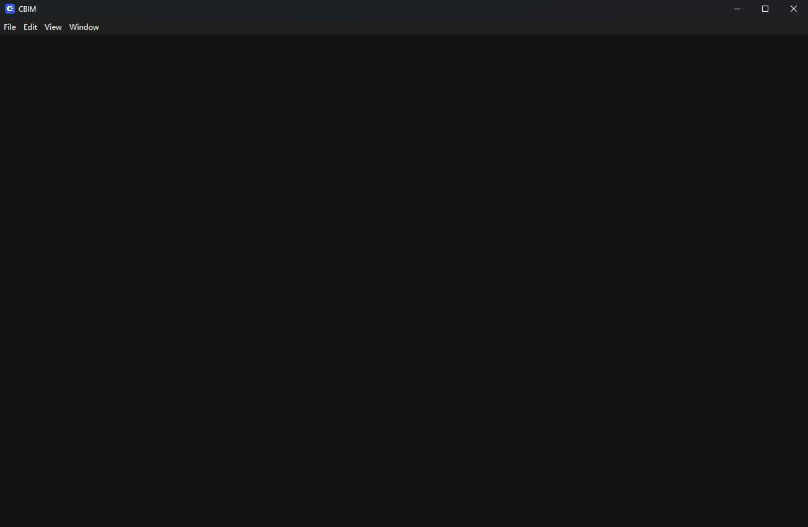

# 2026-11-15 真实桌面验收尝试

## 结论

**未通过桌面验收，逐页检查尚未完成。** 当前桌面窗口截图为空白，辅助功能树只返回原生菜单；只读启动诊断确认生产资源已加载、欢迎页 DOM 和 `window.cbim` 存在。不能据此判定界面可见或可操作，也不能直接断言产品页面代码没有渲染。窗口呈现、捕获与交互会话的具体原因尚未确定。

用户直接要求逐页验收并记录。本次查询开放 Issues 仅有无关 #65，未修改工单。已有未提交代码保留，没有使用已安装旧版本替代当前代码验收。

## 环境与执行

- 操作电脑 LINAN-XDT；查看任务的另一台电脑 NAN-LI。桌面驱动 0.38.0，权限检查返回 Windows `not_required`。
- 当前已安装实例为 `C:\CBIM\CBIM Desktop\CBIM Desktop.exe --updated`，不作为本次改动验收对象，未修改该实例或用户资料。
- 先以 `CBIM_USER_DATA_ROOT=test-results/ux-desktop-profile` 启动 `pnpm start`，主进程、preload 及工人入口构建成功，出现真实 Electron 窗口；窗口截图为空白。
- 随后使用仓库 `scripts/runtime-build.ts` 的 `buildRuntimeCode` 构建全部当前入口及生产 renderer 到 `test-results/ux-desktop-app/.vite`，沿用 `desktopBuilds` 与 Forge 配置。通过仓库 Electron 启动该独立目录，使用相同隔离 profile、真实后端和 preload；没有 IPC 模拟、没有修改生产 CSP、没有启用远程调试或发起模型任务。
- 这是本地生产代码的 Electron 验收实例，不是已签名安装包、升级或发布验收。复制设计资源和品牌资源用于本地装配，依赖指向本仓库 node_modules。
- 临时准备脚本首次使用 `.ts` 顶层 await 被 CJS 转换拒绝，改为 `.mts` 后构建成功。这是验收脚本错误，不归为产品缺陷。
- 临时只读启动观察器记录 `dom-ready`、`did-finish-load`；读取欢迎页 DOM、脚本来源与桥接对象确认 React 页面实际存在。观察器不点击页面、不调用业务 IPC，不作为可视验收替代。
- 加 `--disable-gpu --force-renderer-accessibility` 做一次显示诊断后，截图与控件树仍无页面内容。这些仅为本次启动参数，未修改产品设置或源码。
- 最后通过正式桌面工具前台点击验收窗口标题栏，返回 `foreground_unavailable: Windows did not activate exact target HWND 0x51a0418 (actual foreground HWND 0x581f7a); no mouse input was sent`。随后停止桌面输入，未绕过工具改用系统注入或自动点击脚本。

## 检查结果与范围

| 检查面 | 本次实际结果 |
| --- | --- |
| 当前源码桌面启动、窗口身份 | 成功创建真实 Electron 窗口；与已安装旧实例区分 |
| 生产资源、preload 与欢迎页 | 加载事件和只读 DOM 检查成功；可视和交互验收受阻 |
| 欢迎页、项目导航、设置与资源页 | 未能可靠操作，未验收 |
| 主对话、话题、成员对话、办公室、任务图与任务详情 | 未进入，未验收 |
| 人工决定、阻塞恢复、变更与验证证据 | 未进入，未验收；无真实任务状态样本 |
| 团队架构、岗位、成员履历 | 未进入，未验收 |
| 业务架构、知识、模块责任与治理 | 未进入，未验收 |
| 自动化列表、编辑与历史 | 未进入，未验收 |
| 运行管理、连接、资源应用、诊断 | 未进入，未验收 |
| 模型、额度、网页和反馈连接设置 | 未进入，未验收；未使用凭据或真实连接 |
| 终端、浏览器、版本更新 | 未进入，未验收；未执行命令或安装更新 |
| 动效、Tooltip、键盘焦点、200% 缩放和读屏 | 未完成桌面验证 |

不把此前单元测试、SSR 或隔离浏览器检查计入本轮桌面通过数。本轮没有任何一页获得完整的可视与交互验收通过结论。

## 实施状态澄清

- 42 页评审原型和设计文档覆盖不等于 42 页生产功能完成。此前记录的 34 个原有操作面是累计设计归属与视觉改动范围，不是 34 页全部行为验收通过。
- 图标、统一样式、公共提示/模态、局部草稿保护、团队与业务架构布局、办公室/图/列表切换及八个页面延迟入口已有代码和专项验证；逐页是否满足完整设计仍需实际操作核实。
- 设计明确标记的 7 个聚合/扩展提案仍应单独核对，不能包含在“已实现”结论中；真实人员邀请/评论/交接、集中待办、全局搜索等未作为已完成生产能力交付。
- 本次没有修改产品源码、提交、安装或发布。详细历史实现范围见 [原有界面实施记录](ux-completion-20261115.md)，分包结果见 [分包验证](ux-bundle-20261115.md)。

继续验收的前提是恢复该电脑可捕获、可交互的桌面会话并查清空白捕获原因。先验证欢迎页真实可见和导航可操作，再逐页记录截图、操作、预期与实际结果；不能在当前阻塞下补填通过项。
