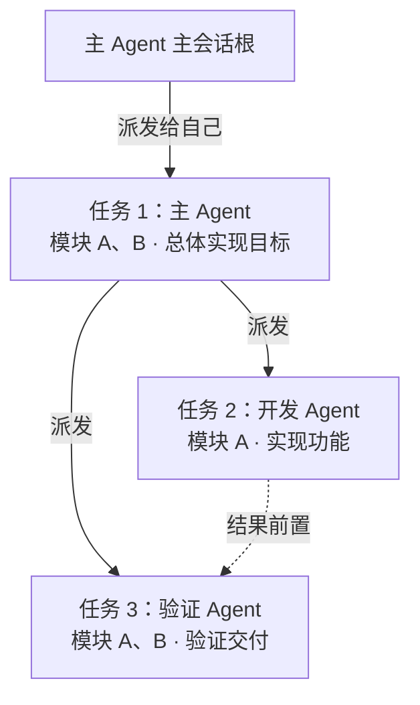

# 虚拟成员与任务派发图契约 v1

日期：2026-11-06。第一步已落地：创建成员身份与独立逻辑通道、从主会话可靠派发任务、读取原子图增量并在重开后恢复。任务目前仅排队/等待，不启动成员大脑、不自动执行、不提供任务图渲染。本文与各模块 `CONTRACT.md` 分开记录已实现范围及后续契约。

## 第一条闭环的实际入口

Application 的 IPC 路由已接通，现有 `window.cbim.call(action, args)` 可调用；无需配置模型或远端服务器。所有命令携带明确工作区/主会话，不读取当前选中项来猜测目标。

| Action | 参数 | 实际结果 |
| --- | --- | --- |
| `dispatch.open` | workspaceId、rootSessionId、commandId | 创建或复用主成员与根通道，首次发布 graph.created |
| `dispatch.memberCreate` | 上述字段加 agentId | 从真实团队定义注册成员，复用稳定实例，返回本图 Session |
| `dispatch.task` | 上述身份、commandId、expectedParentRevision、task | 核实角色和多模块，原子保存任务、边、pending 消息与批次 |
| `dispatch.graphSnapshot` | `{identity:{workspaceId,rootSessionId}}` | 当前主会话的完整图；读取不会创建图 |
| `dispatch.graphDelta` | `{identity,cursor?,limit?}` | noop / delta / reset；limit 按原子批次，默认100，上限500 |

`dispatch.task.task` 字段为 `assigneeAgentId、moduleIds、goal、acceptance:[{id,text}]、prerequisites:[{taskId,expectedPlanRevision}]`。首次 parentRevision 为根的实际 revision，不能用 graph seq 替代。同一命令重发沿用 commandId；同键异参拒绝，新的任务使用新 commandId。当前只支持可信桌面入口从根派发，模型派发工具及自定义成员的递归派发尚未开放。

成员注册产生持久化 `agentInstanceId / agentSessionId`，不会伪造 Pi 原生 Session 或运行进程。多个主会话复用同一成员实例，各持自己的逻辑通道；公开注册回执的活动和通道列表只描述本图。

模块必须有显式 `maintenance` 声明及花名册中的维护人。现有无声明模块不自动迁移、不影响旧知识查询；派发返回 `MAINTAINER_UNCONFIRMED`，可经已有知识文件 preview/commit 补齐。作者不自动视为维护人。Workflow 默认采用各模块清单首项，空清单明确记录通用流程及原因。

运行数据保存在应用用户目录的 `<workspaceId>/dispatch/dispatch.jsonl`，哈希链事务日志同时保存成员、Session、任务图、信封和幂等回执；目标工程 `.cbim/` 只保存正式知识。软件重启不更换已有成员、通道、streamId 或 seq。完整损坏记录拒绝恢复，未完成崩溃尾部可截断；写入结果不明时关闭写链，重开后以原 commandId 查询，不盲目重发。

本阶段未实现：完整执行上下文正文快照、权限快照、原生 Session/成员执行槽、inbox 消费、结果回传、取消/重试状态机、模型调度工具和前端任务图。队列启动前必须补齐执行上下文与基线复核，不能把仅保存的知识版本当作完整可恢复上下文。

本步验证：类型检查通过；47 个测试文件、174 项测试通过，其中新增成员/知识/图/事务测试 22 项。215 个维护代码文件的 586 条依赖（包含类型引用）无循环；47 份目录架构文档无漂移，文档链接检查通过。闭环测试走真实 Application 入口与临时项目文件存储，验证并发入队、同角色跨会话隔离、重启身份/游标连续、去重、写失败核实及关闭竞态；没有用这些测试宣称已完成多成员模型执行。未打包新版 EXE。

## 核心约定

应用级 `GlobalRuntimeManager` 已接入成员/任务事务、现有 Loop 和对话队列，汇总所有接入工作区的动态活动、任务压力及已报告 token 消费。它是可重建的监管索引，不替代工作区事务权威，也不代表邮箱执行已实现；具体数据口径、恢复和 IPC 见[全局动态实例与任务监管](global-runtime-management.md)。

CBIM Agent 是 Team 内的静态虚拟角色定义，AgentInstance 是独立动态成员实例，共用同一 Brain / LoopEngine。内置主 Agent 是默认助手，自定义角色通过配置、原则、Skill 和默认工作指引形成差异；不建两套内核，也不采用父进程拥有一次性 subagent 的身份模型。

成员收到用户或其他成员的请求，先分析、定位业务模块、核对维护责任，再选择所需成员（包括自己），形成可派发 Task。普通交流可以得出“无需业务执行”的结论，直接回答；不能因此编造模块。执行任务必须有一个责任 Agent、一个或多个已核实维护关系的模块、明确目标与验收要求。

主 Agent 的每个会话拥有一张完整派发图。根是会话锚点，自己执行也创建任务节点；后续任务无论在哪个成员的 Session 中执行，都继承最初 `rootSessionId`。一个 Agent 可以在同一图中出现多个任务节点，但它们不是多个角色实例。

## 身份与权威来源

| 标识 | 含义／所有者 |
| --- | --- |
| workspaceId | 工作区边界，由应用解析真实路径产生 |
| teamId | 当前工作区 Team 根身份，不跨工作区复用 |
| agentId | 角色定义，主 Agent 固定为 `cbim:main`，自定义角色来自团队注册表 |
| agentInstanceId | 当前工作区中持久化的成员实例身份；进程重启不自动换人 |
| agentSessionId | 成员独立上下文通道身份；一个实例可以管理隔离通道，首版串行执行 |
| rootSessionId | 主 Agent 会话及整张派发图的归属；不是所有主 Agent 对话共用的 Session |
| taskId | 新模型下的业务任务节点；重试不换 taskId |
| runId | 一次真实执行尝试；重试产生新 runId |
| messageId / replyTo | 消息及其回复关联，接收确认不代表执行完成 |
| commandId | 调度请求幂等键，由可信入口产生；重试沿用，同键异参拒绝 |
| streamId / seq | 图事件流及已提交原子批次序号，正常重启保持连续 |

现有 `TaskSpec.taskId` 兼作对话线程和 Pi session ID，不能静默解释为新的业务 taskId。当前 `TaskProgress.steps` 是任务内步骤，不自动升级成跨角色派发节点。新增契约采用显式版本与映射表接入；旧对话、日志、审批和排队先保持原协议。

## 模块分工与入口

| 模块 | 本次确定的职责与契约 |
| --- | --- |
| [core/tasks](../src/backend/core/tasks/CONTRACT.md) | TaskNode、GraphEdge、原子事件批次、Snapshot / Delta、DAG 不变量 |
| [core/team](../src/backend/core/team/CONTRACT.md) | 虚拟角色实例、独立 Session、成员状态与邮箱消息 |
| [core/workspace](../src/backend/core/workspace/CONTRACT.md) | 模块维护关系、真人责任与本模块 Workflow 边界 |
| [core/brain](../src/backend/core/brain/CONTRACT.md) | 同一 Loop 驱动各角色；任务身份和原生会话解耦、执行事件端口 |
| [scheduler-engine/context](../src/backend/scheduler-engine/context/CONTRACT.md) | 核对角色与多模块维护关系，冻结知识及权限基线 |
| [scheduler-engine/execution](../src/backend/scheduler-engine/execution/CONTRACT.md) | 派发、依赖检查、成员互斥、消息投递、恢复与结果汇总 |
| [scheduler-engine/tools](../src/backend/scheduler-engine/tools/CONTRACT.md) | 模型调度工具适配，模型只能提出请求，不能签发状态与权限 |
| [main/persistence/tasks](../src/backend/main/persistence/tasks/CONTRACT.md) | 调度事务、事件流、幂等索引、outbox / inbox 与恢复 |
| [bridge/contracts](../src/bridge/contracts/CONTRACT.md) | 公开增量 DTO、IPC 路由约定及错误语义 |
| [frontend/tasks](../src/frontend/tasks/CONTRACT.md) | 主会话任务图增量消费；当前不实现节点渲染 |

依赖仍为 `main → scheduler-engine → core`；frontend 只依赖 bridge/contracts。成员通信走调度端口，不让一个 Agent 直接修改另一个 Agent 的 Session、任务或权限。

## 两张关系的区别

这是目标结构示例，不是当前运行中的任务。任务 1 等待任务 2/3 的有效结果时，等待记录留在节点，不另画返回边；消息回传负责唤醒。任务 2 和任务 3 的身份始终归这张主会话图，实际运行各用对应成员的独立 Session。

- 任务图展示派发边 `parent → child` 与执行依赖边 `prerequisite → dependent`，两种边合并必须无环。
- 父任务等待子任务结果放在 `awaitedChildren`，同时固定子任务的计划版本，不能再画 `child → parent`，否则和派发边天然成环。内部另检验实际等待关系无环，防止显示图无环但执行双方互等。
- 结果、澄清、异常通过消息返回，更新原任务节点，不添加反向图边。
- 成员组织树用于角色归属与 Skill 继承；任务图用于当前会话的执行流转，不能按组织层级推断派发关系。

## 增量读取约定

首次读取 Snapshot；后续提交 `workspaceId + rootSessionId + streamId + seq`，服务只返回已经提交的变化批次。响应分为 `noop`（无变化）、`delta`（连续原子批次）、`reset`（同图新快照）。每批对象为完整新快照，整批应用后才推进游标；断档补读、重复去重、切换会话丢弃旧响应。正常重启保持 streamId 与 seq。

GraphChange v1 只有 `root.upserted / task.upserted / edge.upserted / agent.upserted`，不硬删历史节点。事件是调度事实，不包含聊天全文或私有思考；消息正文、工具证据与原生执行日志仍分别保存，按授权引用。

## 实施顺序与验收边界

1. 在 Core 实现可验证的身份、节点、状态、DAG 和增量协议；先用纯函数测试拒绝环、跨图引用和过期版本。
2. 在 main 落调度事务存储，在调度层实现命令幂等、消息去重与恢复；验证“持久化成功再发布、崩溃不盲重放”。
3. 封装成员实例与 Session 管理，接入同一个 Pi 内核；验证同成员串行、不同成员隔离、自派发不会因等待自己而死锁。
4. 接模型工具和主 Agent 会话入口，验证两成员协作、继续派发、结果回传、停止与恢复；权限不得因跨成员而扩大。
5. 最后再实现主会话任务图渲染及组织节点状态展示，消费既定 Snapshot / Delta，不从聊天文字猜状态。

不能以“任务已被收件箱接收”“模型回合结束”或“交付候选已返回”代替业务验收。首版串行同成员执行不宣称复杂并发编辑已安全；模块范围重叠的写任务在调度层串行，命令作用域未知时保守按工作区写冲突处理，外部编辑仍需版本及产物核验。

本次新增上述内部服务与 IPC action，未新增模型工具或多 Agent 大脑执行能力，也没有修改用户实际工作区知识。测试仅创建隔离临时项目。具体协议见模块附录；附录随 `node scripts/source-architecture.mjs` 纳入对应 `ARCHITECTURE.md`，当前实现类图与后续目标关系分开。
