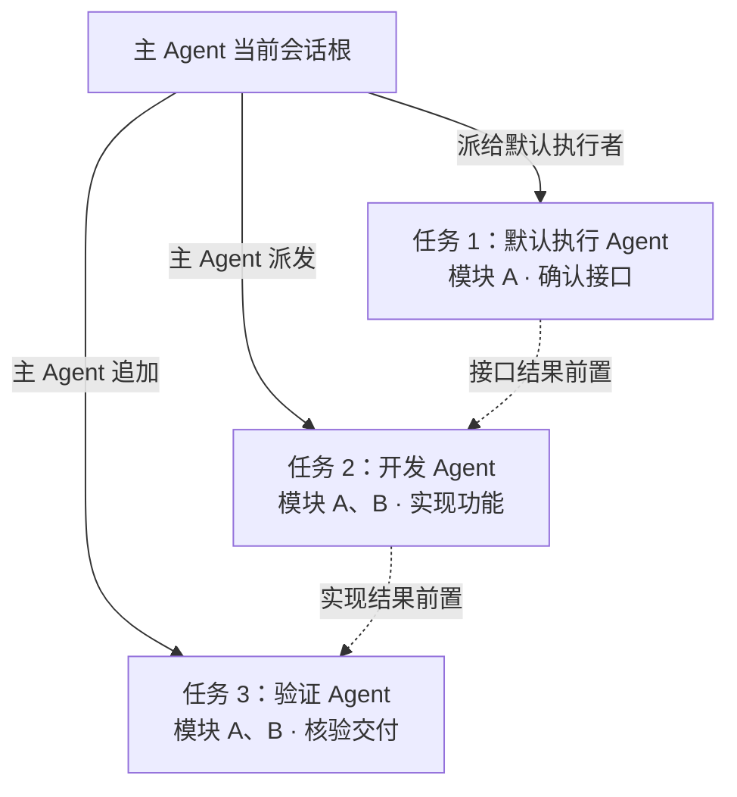

# 虚拟成员与任务派发图契约 v1

本文描述正式团队协作与派发。Auto 默认允许主会话直接实现和验证，项目根始终可查询，不以团队治理作为开工前置；Team 与 Auto 的显式委派继续遵守下文计划、责任及审阅协议。详见[成员执行模式](member-execution.md#自动与团队模式)。根范围查询不创建长期责任，也不放宽权限或人工验收。

本文规定主 Agent 的调度与团队业务知识管理职责、执行 Agent 的业务实现边界，以及主会话任务图的身份与增量协议。当前已经接通成员登记、派发事务、独立 Pi 执行、结果回注和任务图展示；完整状态机和业务验收的缺口见文末。开发状态以 [路线图](../design/tool-architecture-roadmap.md) 为准。

## 主调度与独立执行

CBIM Agent 是 Team 中的静态虚拟角色定义，AgentInstance 是动态成员实例。所有角色共用同一 Brain / LoopEngine；角色配置、工作原则、Skill 和本次运行职责决定其行为。实例不采用父进程拥有一次性 subagent 的身份模型。

主 Agent 是具备工程思维、架构思维和结构化思维的团队与技术管理者：先核实项目现状，再明确模块边界、维护责任和依赖；把目标、范围、验收和所需证据结构化后派发。治理根据真实结果逐步演进，优先解决当前可证明的问题，保留取舍与验证依据。跨模块重大调整、责任变化和高影响决定交给人判断，不以模型自行推断替代授权。

| 角色 | 职责 | 调度边界 |
| --- | --- | --- |
| 主 Agent（`cbim:main`） | 与用户交流、管理团队与业务知识、组织任务与依赖、核实结果并决定后续工作 | 当前主会话唯一的调度者；可通过知识服务管理 `.cbim/`，Team 不直接执行业务；Auto 按本轮权限直接实现和验证 |
| 执行 Agent | 独立理解已派发目标，按需探索 Team 环境、专业知识和相关依赖，在目标模块范围内实现、验证并返回证据与限制 | 不创建或派发其他成员任务；发现新工作、越界需求或需要帮助时向主 Agent 返回，由主 Agent 决定后续节点 |

“独立”包括各自的运行状态、模型推理过程和上下文，不表示拥有调度权限。私有思维过程不作为任务图或实时详情的公开内容；界面展示状态、公开回复、工具过程、证据与结果。没有合适自定义角色时，主 Agent 派给内置静态默认执行角色 `cbim:executor`；它创建独立执行实例，不能以主实例替代。

普通问答、定位分析与受控知识治理不强制生成业务 Task。主 Agent 可经 `cbim_` 内部知识接口查询、增删改团队角色、Skill、模块、Workflow 和架构说明；写入仍按 read/ask/execute 权限及事务校验处理，不能直接读写 `.cbim/` 文件。Team 的业务修改与验证必须派发；Auto 主会话按权限提供原生 write/edit/bash。正式执行任务明确责任 Agent、实际模块、维护责任、目标及验收要求；执行者不可扩大目标、模块或授权。

## 当前入口与实际行为

可信桌面通过 `window.cbim.call(action, args)` 接入内部服务，所有命令显式指定工作区与主会话。普通主对话启动时由后端 `conversationBinding` 登记实例和根图，不要求用户先手工建图。

| Action | 参数 | 实际结果 |
| --- | --- | --- |
| `dispatch.open` | workspaceId、rootSessionId、commandId | 创建或复用图根及主实例的任务通道，首次发布 graph.created |
| `dispatch.memberCreate` | 上述字段加 agentId | 从真实角色定义登记实例与本图任务通道，不启动模型 |
| `dispatch.task` | 上述身份、commandId、expectedParentRevision、task | 核实角色与模块，原子保存任务、派发边、pending 信封及图批次 |
| `dispatch.graphSnapshot` | `{identity:{workspaceId,rootSessionId}}` | 当前主会话完整图；只读不会建图 |
| `dispatch.graphDelta` | `{identity,cursor?,limit?}` | noop / delta / reset；limit 按原子批次，默认 100、上限 500 |

`dispatch.task.task` 字段为 `assigneeAgentId、moduleIds、goal、acceptance:[{id,text}]、prerequisites:[{taskId,expectedPlanRevision}]`。parentRevision 使用根节点实际 revision，不用 graph seq 代替。同键同参返回已提交结果，同键异参拒绝。

主对话 Loop 提供 `cbim_dispatch_task` 和 `cbim_dispatch_inspect`。执行角色可指定，缺省为 `cbim:executor`；`cbim:main` 派发和新启动均被拒绝。模型只提交角色、目标、模块和验收；实例、根会话、周期、调用幂等键及权限来自可信运行入口。派发成功只表示入队。主轮结束并释放占用后，自动协调器启动本轮关联任务，读取真实结果，再以内部数据消息续接原主会话。执行 Agent 的 Loop 不装配派发工具；由主 Agent 接收结果后追加后续任务，不建设执行成员递归派发能力。

一次用户任务对应一个调度周期 `DispatchScope`，经历多次主 LLM 回合、成员执行和结果回传；单次 LLM 回合结束不关闭周期。每个派发 Task 创建一个新的执行实例，同一静态角色也不跨任务共享实例。整轮完成、失败或停止后，先结算在途运行，再原子关闭周期、取消尚未执行的任务并释放全部执行实例。主会话和主实例、图节点、运行和证据保留。当前每周期最多 500 个派发节点，保证关闭事实能在一个图事务中提交。

模块不再要求真人花名册或 maintenance。Team 派发使用工作区岗位与模块负责人，并核对能力、模型、来源、权限和 Workflow；authors 只作来源说明，不自动赋予责任。历史 maintenance 与任务维护字段只作兼容记录。模块 Workflow 从自身清单选择，空清单明确记录通用流程及原因。主对话仍可在结构无效时诊断，正式派发执行完整有效知识与岗位检查。

## 身份与权威来源

| 标识 | 含义／所有者 |
| --- | --- |
| workspaceId | 工作区边界，由应用解析真实路径产生 |
| teamId | 当前工作区 Team 根身份 |
| agentId | 静态角色；内置主调度为 `cbim:main`，默认执行为 `cbim:executor` |
| agentInstanceId | 动态成员身份；主实例长期保留，执行实例按周期任务创建 |
| mainRootSessionId | 主实例所属主会话；不同主会话各有主实例 |
| scopeId / executionScopeId | 用户任务周期及执行实例所属周期，可信入口生成 |
| executionTaskId / lifecycle | 执行实例固定任务；active→released，不复活历史实例 |
| agentSessionId | 独立上下文通道；按 rootSessionId 与用途区分 |
| purpose | `conversation` 承载主对话，`task` 承载正式执行及图根收件；旧缺省按 task 处理 |
| rootSessionId | 当前主对话与整张派发图的归属，不是全团队公共会话 |
| taskId | 正式业务任务节点身份；与主对话线程标识分开理解 |
| runId | 一次执行尝试；不会把模型回合结束当作业务验收 |
| messageId / replyTo | 派发与结果信封关联；确认收件不代表验收 |
| commandId | 可信入口生成的请求幂等键 |
| streamId / seq | 图事件流和已提交原子批次序号，正常重启保持连续 |

同一主会话的图根和普通对话引用同一个主实例；图根的 task 用途通道保留收发信封身份，conversation 承载对话、调度和受控知识治理，Auto 还可按本轮权限直接实现与验证；实例身份本身不是写入授权。执行实例使用自己的独立通道。同实例运行串行，不同实例只读可并行，可能写入的运行仍独占工作区。运行期间审批不因角色交接而继承。

旧图可能已共享一个未填写 `mainRootSessionId` 的主实例。恢复时保持旧根引用、通道和原生日志，不自动迁移；这些历史图仍共享实例占用，新主会话不复用该历史实例。旧主执行图可以读取，但不可新启动。旧无 scope 的显式登记/派发仍兼容原实例规则，新自动流程统一使用周期实例。旧 `TaskSpec.taskId` 在普通聊天中仍代表对话线程；现有 `TaskProgress.steps` 是单任务内部步骤，不自动升级为派发节点。

运行数据保存在用户目录的 `<workspaceId>/dispatch/dispatch.jsonl`，哈希链事务日志保存周期、成员、通道、图、信封、运行与幂等回执；`.cbim/` 只保存正式知识。完整损坏记录拒绝恢复，未完成崩溃尾部可截断；写入结果不明时关闭写链，重开后核实原命令，不盲重放。重启先结算不确定运行，再把旧 active 周期标为 interrupted 并释放执行实例；不自动启动历史队列或重新消费结果。

## 静态角色的 Session 历史

执行履历归属 `workspaceId + agentId` 标识的静态角色；角色下按真实 `agentSessionId` 展示独立 Session，再列出该 Session 的任务与运行尝试。同一主角色的多个主会话各有自己的 Session 和主实例；默认执行角色、自定义执行角色跨主会话或周期承担任务时，也保留各自的执行通道，不能把历史聚合解释为合并模型上下文。

周期结束释放执行实例不会删除履历。删除静态角色定义后，仍可从归档角色入口查看其已记录的 Session、目标、模块、历史配置版本、公开过程与结果；查询不要求当前角色定义仍存在，也不因当前知识校验失败而改写历史归属。角色名称和配置以运行时记录为准，同路径重新创建角色不能覆盖旧运行的配置事实。

`agentHistory.roles / sessions / runs / events` 是只读接口。查询身份依次收紧为工作区、静态角色、Session、任务和运行；列表使用限定查询范围的分页游标，详情使用运行事件游标。详情通过公开事件投影提供回复、工具名称与状态、任务进度及验证结果，不返回原生 Session 路径、冻结知识正文、原始工具参数或结果，也不公开私有思维。读取不能启动模型、批准操作、确认信封或恢复任务。

运行日志和派发事务仍是事实来源；用户目录中的角色历史索引可由它们恢复，不写入项目 `.cbim/`，也不随人才市场静态配置导出。旧日志只有明确 `agentId` 而没有动态绑定时，使用标记为 `legacy` 的历史分组；不从原生路径、当前角色或最新实例猜测 `agentSessionId`、实例和根会话。连静态角色身份也缺失的日志不猜归属，报告诊断并保留原文件。

## 主会话任务图

这是关系示例，不是当前运行中的任务。所有派发边从主会话根指向任务节点；任务之间只表达真实执行依赖。主 Agent 收到结果、求助或新事实后，可以从根继续追加节点及必要依赖。执行 Agent 返回结果或限制不会自行生成下级任务。

- 派发边 `root → task` 与依赖边 `prerequisite → dependent` 合并必须无环。组织树不决定派发关系。
- 结果、问题与异常通过运行记录和信封返回，不绘制 `task → root` 的反向图边。
- 一个静态 Agent 角色可承担多个任务节点，每项任务各自实例化；节点不是额外静态角色。图中的模块、目标、执行者、状态与证据必须对应真实记录。
- `awaitedChildren` 是现有协议保留字段，当前不启用成员递归派发或父子任务等待；不能据它生成执行者子树。

## 增量与活动状态

首次读取 Snapshot，后续提交 `workspaceId + rootSessionId + streamId + seq`。服务只返回已提交批次：`noop` 无变化，`delta` 连续变更，`reset` 同图新快照。每批对象是完整新快照，整批应用后推进游标；断档补读、重复去重、切换会话丢弃旧响应。

GraphChange v1 为 `root.upserted / task.upserted / edge.upserted / agent.upserted`，不硬删历史。主对话与任务视图订阅成员的公开增量，节点可查看成员实时详情；私有思维和原生会话文件不进入公开图。

成员的 `idle / working / waiting / communicating` 来自已记录的运行、依赖和通信事实。普通聊天的活动由真实 Loop 事件覆盖到已登记主实例；正式任务保存领取、执行和终态。当前 `waiting` 包含任务前置未满足等事实，不代表已实现执行者间的自主求助、挂起和唤醒协议。成员结果仍是交付候选，`result_ready` 不等于业务验收。

## 实现边界与模块分工

已接通同一内核的主调度对话与独立成员执行，新增默认执行角色、用户任务周期、执行实例释放；有冻结知识、通道互斥、图增量、候选回传和主对话接续。尚未实现完整业务验收状态机、执行者求助/答复的持久化协议、自动异常重试恢复或按模块文件范围隔离的写入机制。执行者须遵守已分配模块范围，现有确定性门禁仍以权限、工作区和知识事务为边界，不能把提示词约束说成文件级隔离。

任务依赖目前按同计划版本的 `result_ready` 候选放行，并把实际候选冻结到下游；需要额外人工或业务验收的依赖，须先核实该条件，不把候选自动说成已经验收。取消不回滚已发生操作，重启不自动重放；一次模型成功也不代表完整 Workflow 状态机已完成。

| 模块 | 职责与契约 |
| --- | --- |
| [core/tasks](../src/backend/core/tasks/CONTRACT.md) | TaskNode、边、原子批次、DAG 与执行不变量 |
| [core/team](../src/backend/core/team/CONTRACT.md) | 静态角色、动态实例、隔离通道与成员状态 |
| [core/workspace](../src/backend/core/workspace/CONTRACT.md) | 模块维护责任与 Workflow 边界 |
| [core/brain](../src/backend/core/brain/CONTRACT.md) | 同一 Loop、主对话与成员身份、原生执行事件 |
| [scheduler-engine/context](../src/backend/scheduler-engine/context/CONTRACT.md) | 角色与模块核验、知识冻结和启动复核 |
| [scheduler-engine/execution](../src/backend/scheduler-engine/execution/CONTRACT.md) | 主调度、成员执行、互斥、消息与结果接续 |
| [scheduler-engine/tools](../src/backend/scheduler-engine/tools/CONTRACT.md) | 主 Agent 派发工具与各运行工具门禁 |
| [main/persistence/tasks](../src/backend/main/persistence/tasks/CONTRACT.md) | 调度事务、运行日志与恢复 |
| [bridge/contracts](../src/bridge/contracts/CONTRACT.md) | 公开 DTO 与 IPC 边界 |
| [frontend/tasks](../src/frontend/tasks/CONTRACT.md) | 当前会话任务图、成员公开详情与增量消费 |

依赖保持 `main → scheduler-engine → core`，frontend 只依赖 bridge/contracts。成员不能直接修改他人的 Session、任务或权限。全局监控是可重建索引，具体口径见 [全局动态实例与任务监管](global-runtime-management.md)，不替代工作区事务权威。
