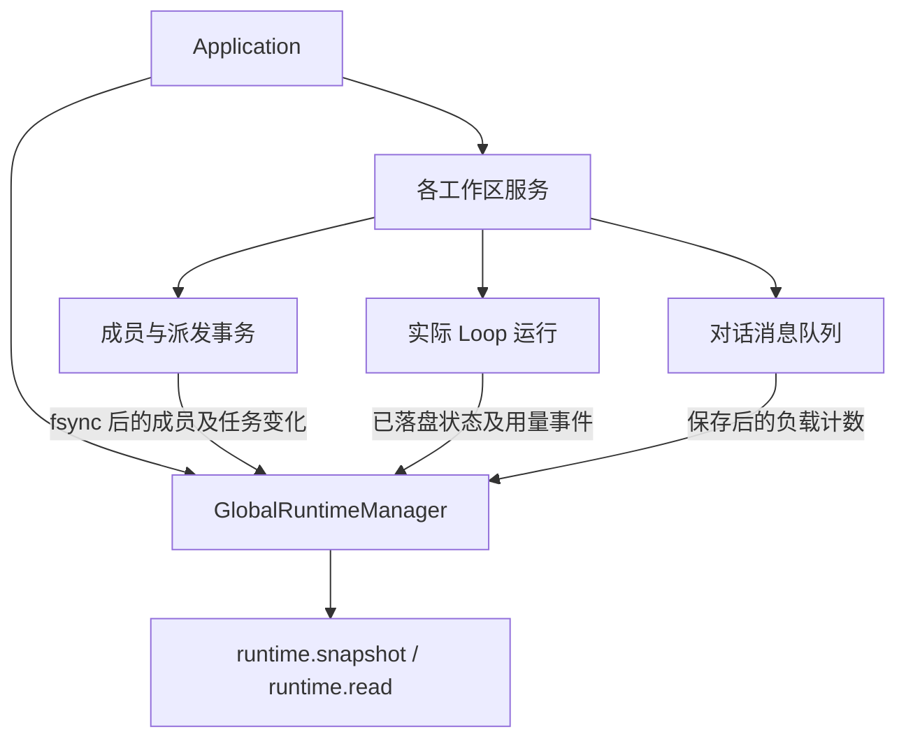

# 全局动态实例与任务监管

2026-11-07：已接入应用、工作区生命周期、派发事务、主对话实例、成员执行和对话队列。每个新主 session 拥有独立主调度实例，对话与图根共享身份；执行者随本轮任务实例化，调度周期结束后释放，历史仍可查看。统计来自真实落盘事件，全局预算调度和监控页面尚未实现。成员调用流程见[成员执行与结果回传](member-execution.md)。

## 身份与职责

Agent 是静态角色定义，包含职责、原则与 Skill。AgentInstance 是某工作区中登记的动态成员，持有独立 Session 通道和活动状态。实例身份可持久恢复；进程不是成员身份，一个角色也不等于一次 Task。

`Application.runtime` 持有应用内唯一的 `GlobalRuntimeManager`，从所有已登记并打开的工作区接收事实，统一管理运行索引。工作区内的事务日志和运行日志仍是权威数据；全局索引可重建，不另写一份数据库。切换工作区不改变索引归属。



依赖仍为 `main → scheduler-engine → core`；公开类型由 `bridge/contracts/runtime.ts` 提供。前端没有全局管理器写权限。

| 数据 | 身份和边界 |
| --- | --- |
| 动态成员 | workspaceId + agentInstanceId；保留角色 ID、Session 数、活动、等待任务和通信引用 |
| 派发任务 | workspaceId + rootSessionId + taskId，source=dispatch / binding=instance |
| 旧 Loop 任务 | workspaceId + taskId，source=loop / binding=role-only；TaskSpec 没有成员实例 ID，不按角色名猜绑定 |
| 主会话实例 | 每个新 rootSessionId 一个主实例，conversationBinding 固定实例和对话通道；source=loop / binding=instance，普通聊天不变成正式业务节点 |
| 执行轮次 | workspaceId + taskId + runId；恢复、重复回调不重复累计 |
| 成员执行绑定 | run.started / RunSummary 的 memberBinding 固定实例、成员通道、主会话、任务、轮次与租约代际；归属原派发任务，不生成第二个 Loop 任务 |
| 主会话结果接续 | 原聊天 taskId 下新增 runId，source 记录回注批次与结果消息；成员成本仍归其派发运行，主续跑成本计入实际主轮，不重复累加原会话历史 |
| 监管代际 | 每次工作区重新接入产生 epoch；与持久化 leaseEpoch 不同，不签发执行租约 |

## 人员、负载和消耗

- 成员保留 idle / working / waiting / communicating。执行实例另有 `lifecycle=active/released` 和任务/周期归属，released 仅保留历史，不计入当前实例数或活跃压力。主实例随 session 保留。历史活动设置 `activityCurrent=false`，不能因旧记录写着 working 就宣称现在忙碌。
- 压力分列实际活动 run、排队派发任务、等待依赖、阻塞、待投递信封，以及待发送/暂停/已占用的对话消息。Task、Run、信封和消息不相加成虚假并发数。排队和信封数包含已关闭工作区的已知未完成记录；能否运行以 availability 为准。
- 待投递仅计算 `delivery=pending`；领取后的 assignment 和确认收件后的 result 保留审计记录，但不再增加 pendingOutbox。
- token 是真实 run 已报告消费之和，区分 input、output、cacheRead、cacheWrite、reasoning。reasoning 已包含在 output 时不重复加入总数。累计消费不是上下文占用或模型容量。
- 同轮 `run-usage` 汇总代替逐消息用量。失败、取消、中断前的已知消费保留；未上报不能推定免费。
- `costPartial / unpricedRuns / unreportedRuns` 表达计价缺口；已知费用不宣称是完整账单。
- 监管不返回聊天/工具正文、私有思考、知识内容、绝对 Session 路径或密钥。详细目标与证据仍从原任务接口读取。

当前已有每成员的执行占用及工作区执行互斥策略；它们由执行服务管理，监管索引不签发执行权。工作区 `AutoCollaboration` 只推进本进程主会话委派，在主轮和成员均释放占用后交接，不是跨工作区的公平调度器。没有跨成员公平调度、每日预算或超预算中断。工作区校验与索引维护任务独立于成员业务任务，不伪装为 Agent Task/Run。

## 恢复与实时接入

1. 工作区持锁后装配服务，建立绑定 epoch 的观察者。
2. 先订阅对话和成员落盘事件，再恢复派发日志、两套运行历史和队列。先将未结束成员领取转为 interrupted 并收口占用，再关闭遗留调度周期及释放执行实例；不重新启动模型，队列沿用恢复暂停规则。
3. 后续只接收持久化事实，不按秒扫描日志。流式正文片段只推进内部去重序号，不推动监管版本。
4. 关闭先阻止新操作，排空运行与事务，再解绑观察者、标记 closed；旧 epoch 回调忽略。
5. 日志损坏、身份错误或事件缺口记录 issues，`complete=false`。已知数字只是可读取部分。工作区打不开标记 unavailable；重新打开从权威日志核实。

`runtime.read` 是带版本的快照协议：内部增量接入，外部无变化返回 noop，有变化返回新快照；不是任务图的 batch delta。首次不传游标，后续传 `{streamId,revision}`；应用重启换 streamId。读取只访问内存，没有变化时不复制全部任务。

```ts
await window.cbim.call('runtime.snapshot');
await window.cbim.call('runtime.read', {cursor: {streamId, revision}});
```

## 后续边界

成员执行已接通固定上下文、独立 Pi 通道、用户选定权限、领取与结果回传。正式任务按 memberBinding 归属实例与任务，不再生成第二个 Loop 任务；主聊天及续跑按 conversationBinding 归属同一主实例，用量按真实 run 只计一次。mainRootSessionId 在空闲时保留会话归属，activeConversation 仅在当前生命周期的真实 running 事件中出现，恢复或关闭不伪造活跃。旧日志无绑定仍为 role-only，不按 agentId 猜测。异常通道暂拒续接，重启只收口记录，不重建协作批次；结果确认不表示验收。

团队组织节点已接入只读 Session 历史，按静态角色查看多个主会话或执行通道的公开记录，删除定义后仍可从「历史角色」查询。历史服务和全局监管共用落盘事实接入，另存可恢复的角色索引；不搬移原日志、不合并模型上下文，也不因查询而增加当前执行压力。历史页面使用手动刷新，详见 [Agent 的 Session 执行历史](agent-session-history.md)。

全局监控页面、成员启动表单及从组织节点主动发起成员聊天尚未接入。主 Agent 已可调用派发工具，协调器执行当前批次并将候选或真实失败状态作为 custom 数据注入原主会话；不继承一次性免确认批准、不污染用户队列。没有成员递归派发、全局公平消费邮箱或预算调度。

验证范围由 `tests/global-runtime.test.ts`、`tests/application-runtime.test.ts` 及成员执行集成测试覆盖，包括增量订阅、成员归属、消费去重、邮箱领取、关闭与恢复。本步另通过 `tests/application-collaboration-pi.test.ts` 验证真实 Pi 的主派发、成员执行、回注及审批/队列/停止边界；供应商为本机可控响应，不等同于真实供应商任务能力或打包 UI 验证。旧版 Windows 构建 `20261106-181923` 的证据见[构建测试报告](build-test-20261106-181923.md)，该历史构建不代表已经包含本阶段成员执行代码。
