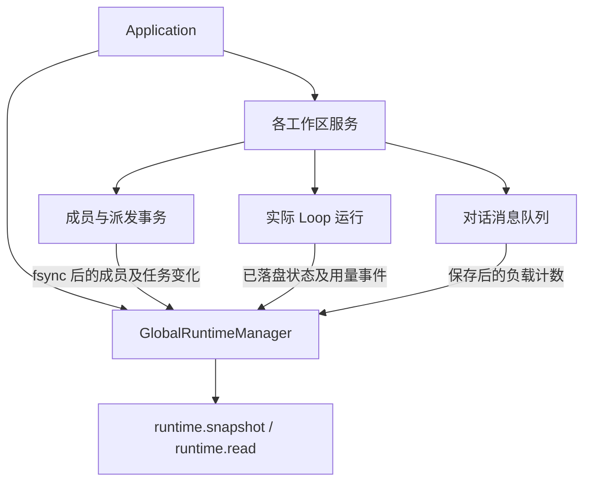

# 全局动态实例与任务监管

2026-11-06：已接入应用、工作区生命周期、派发事务、既有 Loop 和对话队列。本文记录实际能力；成员邮箱消费、多成员执行和全局预算调度仍未实现。

## 身份与职责

Agent 是静态角色定义，包含职责、原则与 Skill。AgentInstance 是某工作区中登记的动态成员，持有独立 Session 通道和活动状态。实例身份可持久恢复；进程不是成员身份，一个角色也不等于一次 Task。

`Application.runtime` 持有应用内唯一的 `GlobalRuntimeManager`，从所有已登记并打开的工作区接收事实，统一管理运行索引。工作区内的事务日志和运行日志仍是权威数据；全局索引可重建，不另写一份数据库。切换工作区不改变索引归属。



依赖仍为 `main → scheduler-engine → core`；公开类型由 `bridge/contracts/runtime.ts` 提供。前端没有全局管理器写权限。

| 数据 | 身份和边界 |
| --- | --- |
| 动态成员 | workspaceId + agentInstanceId；保留角色 ID、Session 数、活动、等待任务和通信引用 |
| 派发任务 | workspaceId + rootSessionId + taskId，source=dispatch / binding=instance |
| 旧 Loop 任务 | workspaceId + taskId，source=loop / binding=role-only；TaskSpec 没有成员实例 ID，不按角色名猜绑定 |
| 执行轮次 | workspaceId + taskId + runId；恢复、重复回调不重复累计 |
| 监管代际 | 每次工作区重新接入产生 epoch；与持久化 leaseEpoch 不同，不签发执行租约 |

## 人员、负载和消耗

- 成员保留 idle / working / waiting / communicating。历史活动设置 `activityCurrent=false`，不能因旧记录写着 working 就宣称现在忙碌；新事务更新当前投影，关闭后不再计为活跃人员。
- 压力分列实际活动 run、排队派发任务、等待依赖、阻塞、待投递信封，以及待发送/暂停/已占用的对话消息。Task、Run、信封和消息不相加成虚假并发数。排队和信封数包含已关闭工作区的已知未完成记录；能否运行以 availability 为准。
- token 是真实 run 已报告消费之和，区分 input、output、cacheRead、cacheWrite、reasoning。reasoning 已包含在 output 时不重复加入总数。累计消费不是上下文占用或模型容量。
- 同轮 `run-usage` 汇总代替逐消息用量。失败、取消、中断前的已知消费保留；未上报不能推定免费。
- `costPartial / unpricedRuns / unreportedRuns` 表达计价缺口；已知费用不宣称是完整账单。
- 监管不返回聊天/工具正文、私有思考、知识内容、绝对 Session 路径或密钥。详细目标与证据仍从原任务接口读取。

当前没有自动限流、并发配额、每日预算或超预算中断。工作区校验与索引维护任务独立于成员业务任务，不伪装为 Agent Task/Run。

## 恢复与实时接入

1. 工作区持锁后装配服务，建立绑定 epoch 的观察者。
2. 一次性恢复派发日志、运行历史和队列。历史不重新启动模型；队列沿用恢复暂停规则。
3. 后续只接收持久化事实，不按秒扫描日志。流式正文片段只推进内部去重序号，不推动监管版本。
4. 关闭先阻止新操作，排空运行与事务，再解绑观察者、标记 closed；旧 epoch 回调忽略。
5. 日志损坏、身份错误或事件缺口记录 issues，`complete=false`。已知数字只是可读取部分。工作区打不开标记 unavailable；重新打开从权威日志核实。

`runtime.read` 是带版本的快照协议：内部增量接入，外部无变化返回 noop，有变化返回新快照；不是任务图的 batch delta。首次不传游标，后续传 `{streamId,revision}`；应用重启换 streamId。读取只访问内存，没有变化时不复制全部任务。

```ts
await window.cbim.call('runtime.snapshot');
await window.cbim.call('runtime.read', {cursor: {streamId, revision}});
```

## 后续边界

目前成员任务仍停留在待投递/排队状态；成员执行槽、冻结上下文、权限快照、邮箱消费、结果回传和取消/恢复尚待接入。真实 agentInstanceId/taskId/runId 关联后才能提供成员维度计费，不能把旧对话 agentId 猜成实例。

全局监控页面和组织节点渲染尚未接入。本阶段提供后端和 IPC 数据入口；控制引擎集成测试验证订阅、持久化、队列与恢复，不等同于真实供应商或多成员协作验证。

源码验证：类型检查通过，51 个测试文件、199 项测试全部通过（新增 25 项）。当时 225 个维护文件的 631 条依赖包含类型引用，零循环；49 个源码目录架构文档已同步。后续已构建 Windows EXE `20261106-181923` 并完成打包验证，见[构建测试报告](build-test-20261106-181923.md)。
