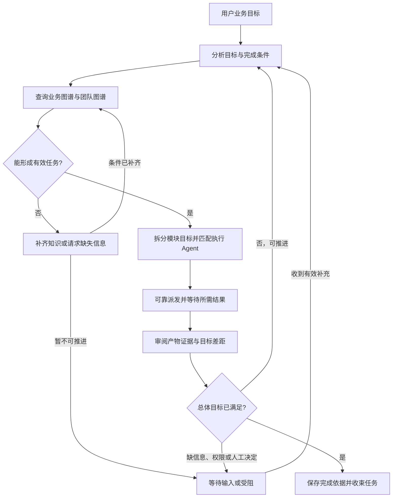

# 主 Agent 的目标调度循环

本文区分整体目标设计与已实现部分。当前已接入真实输入、版本化目标计划、结构化证据审阅及成功结束门禁；保留活动周期的用户等待/恢复、人工验收入口、产物指纹和全局预算仍需后续实现。

## 两个层次的循环

主 Agent 借助 LLM 理解需求、拆解目标、匹配业务模块和执行角色、审阅证据，调度引擎负责可靠执行这些决策。外层围绕用户整体目标持续运行，底层每个执行 Agent 的大脑循环负责分配任务的具体实现。

| 层次 | 驱动依据 | 工作内容 | 完成依据 |
| --- | --- | --- | --- |
| 主 Agent 调度循环 | 用户目标、业务图谱、团队图谱、任务图和结果证据 | 分析、定位、拆解、派工、等待、审阅、补证或返工 | 总体目标的条件满足，所需人工决定已取得，关联运行已安全收束 |
| 执行 Agent 大脑循环 | 分配的目标、模块边界、自身及继承 Skill、本模块 Workflow | 在授权范围内探索、调用工具、实现、运行验证、提交结果 | 本次执行收尾并返回真实结果或缺口；不是自动判定整体业务完成 |

两层共用大脑内核。外层增加的是目标级控制与团队协作语义，不重写 Pi，也不依赖主 Agent 自由遍历项目后亲自完成业务。LLM 提出下一步决策，调度服务核对身份、图谱版本、依赖、授权和实际状态，再提交事实。

## 目标流程

实际测试、构建、浏览器验证等仍由执行 Agent 完成。主 Agent 的“验证结果”指对照完成条件审阅真实产物、工具回执、验证结论与限制；缺少实测证据时创建验证任务，可按需要匹配另一执行角色复核。主 Agent 继续保留受控团队/业务知识治理能力，但不直接执行业务。

## 图谱驱动的职责

1. **业务图谱决定对象与边界。** 定位真实 Module，按需读取模块知识、依赖、维护责任和自身 Workflow，识别目标覆盖范围以及需要分开处理的工作。
2. **团队图谱决定可调用能力。** 查询实际 Agent 及有效 Skill，按任务需求匹配角色；不以角色名称或作者记录代替能力、维护责任和授权核验。没有合适自定义角色时使用内置默认执行 Agent，它仍受模块与责任检查约束。
3. **任务图记录执行事实。** 一个节点包含执行实例、目标模块列表、任务目标与验收要求。静态两图属于工作区，任务图属于主会话，当前周期通过 `scopeId` 区分本轮目标。
4. **结果反馈驱动重规划。** 新发现的缺口、失败、依赖和证据改变下一轮计划；记录调整原因与影响，保留已有任务和结果，不把旧候选改写成通过。

循环发生在调度决策中；可视任务图仍是单向无环图。返工可由主调度增加有来源关联的新任务，不绘制指回祖先的执行依赖，不授予执行者递归派发权。

图谱缺失时，主 Agent 可在授权范围内通过知识服务核实并补齐定义；缺少事实、维护责任或用户决定时明确等待或受阻。不能为保持循环而伪造模块、角色、负责人，或退化为主 Agent 直接执行业务。执行 Agent 仍可在被分配范围内自主探索方法。

## 目标级状态与持久化边界

外层循环需要区别“分析、派发、等待成员、评估结果、重规划、等待用户、受阻、完成、取消、中断”。这些是目标级状态，不替代成员 idle/working/waiting/communicating，也不等于单次 LLM run 状态。

沿用稳定身份，避免另造平行会话：

- `rootSessionId`：长期主会话及任务图；主实例与图根相同。
- `scopeId`：本轮用户任务/总体目标的调度周期；跨多次主模型调用、执行者运行和结果回注。
- `taskId/runId`：执行节点及具体运行尝试；原始记录保留在所属静态 Agent 的 Session 履历。

每个目标周期需要可靠保存：本轮真实用户输入与约束、目标版本、完成条件、已解析的模块/能力及知识版本、计划版本、等待的任务及结果版本、已审阅证据、当前差距、下一步决策及原因、最终完成依据。上述整体协议分步实现，不能把初始输入保存视为目标已分析或已完成。

`DispatchScope.goal` 从 `revision:1` 和 `input:{message,attachmentIds}` 开始：保留本轮原文及受管附件标识，输入创建后不可覆盖，不存图片字节。时间沿用周期 `createdAt`。旧日志没有 `goal` 时保持缺省，不用会话首次目标猜填历史；成员结果回注不创建或修改用户目标。

目前计划及审阅共用派发事务日志，每次决策递增 `goal.revision`，历史版本保留。计划保存整体目标、约束、验收项、真实角色与模块选择及知识版本；审阅记录逐项结果、证据引用、缺口、替代任务和下一步决定。`complete` 只是等待主运行结束后核验的请求；阻塞原因独立保留，不能用修改原输入或重写过去的结果解除。

内部入口是 `cbim_goal_inspect`、`cbim_goal_plan` 和 `cbim_goal_review`。工作区、周期、主会话及运行身份由后端绑定；模型不能选择其他人的周期、输入自己的日志路径或提供伪造运行摘要。计划中的必需人工项不能被重规划删除或降级；当前没有可信人工签署入口，因此包含这类未确认项的目标不能成功结束。

特别是同一主会话中的第二次及后续用户任务：不能沿用第一次对话的 `TaskSpec.goal` 作为新目标。普通队列消息开始新周期，当前任务中的补充应明确归入原周期并修订目标；成员回注属于结果数据，不生成新用户目标或新授权。

等待由调度服务持久保存依赖并监听真实事件；主模型可结束当前调用、释放执行槽。收到有效结果后进入下一轮评估，不能把模型调用结束当作外层目标结束，也不让模型反复轮询日志空转。

已实现成员终态的事件驱动回注及多批次重规划。`blocked/awaiting_user` 已能记录审阅决定，但当前会安全收束为失败并暂停用户队列；尚未保持一个活动周期等待后续用户答复。后续需接明确的恢复输入，不把这段目标设计误当成现有交互。

界面以会话为范围查询目标摘要和选中详情，与任务图共享读取屏障、使用独立增量游标。计划、审阅、阻塞和关闭变化不推进任务图游标，避免审阅使自己的图基线失效。对话与根详情区分成员执行、完成申请待复核、真实目标完成和普通对话结束；历史目标选择不改变当前任务的发送/停止对象，成员执行期间仍可排队和停止。

## 完成、受阻与停止

**整体任务只有在目标完成条件满足后才能成功结束。** 完成决策必须引用当前目标版本和有效证据；调度服务至少核验必要工作有交付、证据归属与版本正确、无必须完成的未解决项、无在途副作用、必须的人工决定已取得。模型文字“完成了”、一次正常回复、队列为空或不再派工都不是充分依据。

可验证的事实由程序检查；业务语义由主 Agent 结合证据判断，仍需要人的审美、方向或验收决定时保持待确认。不要求每次普通任务都额外人工审批，也不以模型判断伪造必须的人工批准。

- 未达目标且可推进：生成补证、修复、集成验证或重新拆解任务，进入下一轮。
- 缺信息、权限或前置：保留未满足项，等待真实输入；不可自行扩大权限。
- 多轮没有进展、耗尽运行预算或发生异常：转为明确受阻/中断，不无条件耗 token 重试，也不伪装成功。
- 用户取消或应用退出：按实际结算停止并保留证据；取消不是完成，停止不是回滚，重开不自动重放未知副作用。
- 普通交流、讨论和已回答的知识问答：不强迫创建业务执行节点。业务目标的完成门禁应与普通对话回合分开。

外层周期成功收束后释放其执行实例，保留主实例、任务图和静态 Agent 的历史记录。

当前硬限制为每周期最多 32 次实际主调度运行、64 次计划/审阅决策；这不是全局 token/费用预算。一次主运行内部仍由 Pi 管理工具轮次和超时。缺少有效审阅、失败任务未被真实新任务补做、证据过期或主运行未结算时暂停队列并保留原因，不以无限自动补问规避失败。

证据校验从原始日志检查当前任务候选、计划版本、成功工具回执及实际返回哈希。成员证据必须匹配当前知识基线；主知识证据仅接受本轮真实知识提交。派发、计划及审阅回执不能自证产物完成。主运行结束后再次核对图版本、知识版本和后续副作用；这些校验不等同于业务文件内容指纹，也不是知识与调度两套存储之间的原子事务。证据与业务要求的语义关联仍由主 Agent 审阅，必要人工判断仍归人。

## 现有实现与差距

| 核实位置 | 已实现 | 与目标循环的差距 |
| --- | --- | --- |
| [main-agent.ts](../src/backend/scheduler-engine/conversation/main-agent.ts) | 图谱查询、目标计划、证据审阅和返工指引 | 在线模型的自主拆解与语义判断质量仍须真实业务验证 |
| [auto-collaboration.ts](../src/backend/scheduler-engine/execution/auto-collaboration.ts) | 多批次派发/回注；主运行结算后校验完成门禁，失败暂停队列，限制自动运行次数 | 尚无保留活动周期的等待用户/显式恢复协议及全局预算 |
| [scope-goal-service.ts](../src/backend/scheduler-engine/execution/scope-goal-service.ts) | 真实图谱计划、版本化审阅、日志证据、失败任务替代及完成复核 | 没有业务产物指纹、跨存储原子锁和人工验收入口 |
| [dispatch-scope.ts](../src/backend/core/tasks/dispatch-scope.ts) | 周期及原始输入保留；通过 goal 保存计划/审阅 | 生命周期 closed 仍不等于真人业务验收 |
| [execution-manager.ts](../src/backend/scheduler-engine/execution/execution-manager.ts) | 主会话、队列、续聊和可信结果回注；`starting` 接收本轮真实 message | TaskSpec 保持会话身份，周期输入独立保存；原周期追加要求与目标修订仍待实现 |
| [member-state.ts](../src/backend/scheduler-engine/execution/member-state.ts) | 核实成员计划、回执和结构化交付候选 | 候选标为未验收，不包含总体目标是否已满足的决定 |

目前已经能沿目标计划派工、依据证据再规划并经过门禁结束；完整等待恢复、人工验收和预算仍按[开发路线图](../design/tool-architecture-roadmap.md)继续推进。本文件维护设计及边界，实际验证以对应开发记录和报告为准。
