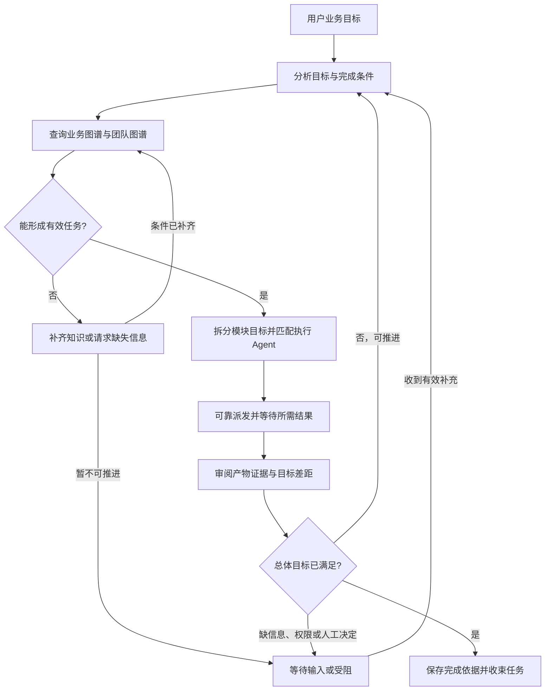

# 主 Agent 的目标调度循环

这是经产品方向确认的目标设计。现有派发、成员执行、回注和周期管理可复用，完整的目标评估与完成门禁尚未实现；本文不宣称新增了运行能力。

## 两个层次的循环

主 Agent 借助 LLM 理解需求、拆解目标、匹配业务模块和执行角色、审阅证据，调度引擎负责可靠执行这些决策。外层围绕用户整体目标持续运行，底层每个执行 Agent 的大脑循环负责分配任务的具体实现。

| 层次 | 驱动依据 | 工作内容 | 完成依据 |
| --- | --- | --- | --- |
| 主 Agent 调度循环 | 用户目标、业务图谱、团队图谱、任务图和结果证据 | 分析、定位、拆解、派工、等待、审阅、补证或返工 | 总体目标的条件满足，所需人工决定已取得，关联运行已安全收束 |
| 执行 Agent 大脑循环 | 分配的目标、模块边界、自身及继承 Skill、本模块 Workflow | 在授权范围内探索、调用工具、实现、运行验证、提交结果 | 本次执行收尾并返回真实结果或缺口；不是自动判定整体业务完成 |

两层共用大脑内核。外层增加的是目标级控制与团队协作语义，不重写 Pi，也不依赖主 Agent 自由遍历项目后亲自完成业务。LLM 提出下一步决策，调度服务核对身份、图谱版本、依赖、授权和实际状态，再提交事实。

## 目标流程

实际测试、构建、浏览器验证等仍由执行 Agent 完成。主 Agent 的“验证结果”指对照完成条件审阅真实产物、工具回执、验证结论与限制；缺少实测证据时创建验证任务，可按需要匹配另一执行角色复核。主 Agent 继续保留受控团队/业务知识治理能力，但不直接执行业务。

## 图谱驱动的职责

1. **业务图谱决定对象与边界。** 定位真实 Module，按需读取模块知识、依赖、维护责任和自身 Workflow，识别目标覆盖范围以及需要分开处理的工作。
2. **团队图谱决定可调用能力。** 查询实际 Agent 及有效 Skill，按任务需求匹配角色；不以角色名称或作者记录代替能力、维护责任和授权核验。没有合适自定义角色时使用内置默认执行 Agent，它仍受模块与责任检查约束。
3. **任务图记录执行事实。** 一个节点包含执行实例、目标模块列表、任务目标与验收要求。静态两图属于工作区，任务图属于主会话，当前周期通过 `scopeId` 区分本轮目标。
4. **结果反馈驱动重规划。** 新发现的缺口、失败、依赖和证据改变下一轮计划；记录调整原因与影响，保留已有任务和结果，不把旧候选改写成通过。

循环发生在调度决策中；可视任务图仍是单向无环图。返工可由主调度增加有来源关联的新任务，不绘制指回祖先的执行依赖，不授予执行者递归派发权。

图谱缺失时，主 Agent 可在授权范围内通过知识服务核实并补齐定义；缺少事实、维护责任或用户决定时明确等待或受阻。不能为保持循环而伪造模块、角色、负责人，或退化为主 Agent 直接执行业务。执行 Agent 仍可在被分配范围内自主探索方法。

## 目标级状态与持久化边界（待实现）

外层循环需要区别“分析、派发、等待成员、评估结果、重规划、等待用户、受阻、完成、取消、中断”。这些是目标级状态，不替代成员 idle/working/waiting/communicating，也不等于单次 LLM run 状态。

沿用稳定身份，避免另造平行会话：

- `rootSessionId`：长期主会话及任务图；主实例与图根相同。
- `scopeId`：本轮用户任务/总体目标的调度周期；跨多次主模型调用、执行者运行和结果回注。
- `taskId/runId`：执行节点及具体运行尝试；原始记录保留在所属静态 Agent 的 Session 履历。

每个目标周期需要可靠保存：本轮真实用户输入与约束、目标版本、完成条件、已解析的模块/能力及知识版本、计划版本、等待的任务及结果版本、已审阅证据、当前差距、下一步决策及原因、最终完成依据。以上是待实现字段语义，不是已提供的 API。

特别是同一主会话中的第二次及后续用户任务：不能沿用第一次对话的 `TaskSpec.goal` 作为新目标。普通队列消息开始新周期，当前任务中的补充应明确归入原周期并修订目标；成员回注属于结果数据，不生成新用户目标或新授权。

等待由调度服务持久保存依赖并监听真实事件；主模型可结束当前调用、释放执行槽。收到有效结果后进入下一轮评估，不能把模型调用结束当作外层目标结束，也不让模型反复轮询日志空转。

## 完成、受阻与停止

**整体任务只有在目标完成条件满足后才能成功结束。** 完成决策必须引用当前目标版本和有效证据；调度服务至少核验必要工作有交付、证据归属与版本正确、无必须完成的未解决项、无在途副作用、必须的人工决定已取得。模型文字“完成了”、一次正常回复、队列为空或不再派工都不是充分依据。

可验证的事实由程序检查；业务语义由主 Agent 结合证据判断，仍需要人的审美、方向或验收决定时保持待确认。不要求每次普通任务都额外人工审批，也不以模型判断伪造必须的人工批准。

- 未达目标且可推进：生成补证、修复、集成验证或重新拆解任务，进入下一轮。
- 缺信息、权限或前置：保留未满足项，等待真实输入；不可自行扩大权限。
- 多轮没有进展、耗尽运行预算或发生异常：转为明确受阻/中断，不无条件耗 token 重试，也不伪装成功。
- 用户取消或应用退出：按实际结算停止并保留证据；取消不是完成，停止不是回滚，重开不自动重放未知副作用。
- 普通交流、讨论和已回答的知识问答：不强迫创建业务执行节点。业务目标的完成门禁应与普通对话回合分开。

外层周期成功收束后释放其执行实例，保留主实例、任务图和静态 Agent 的历史记录。

## 现有实现与差距

| 核实位置 | 已实现 | 与目标循环的差距 |
| --- | --- | --- |
| [main-agent.ts](../src/backend/scheduler-engine/conversation/main-agent.ts) | 图谱查询、模块/角色匹配、证据审阅与后续派工指引 | 主要是提示词约定，未持久化完整目标决策与评估状态 |
| [auto-collaboration.ts](../src/backend/scheduler-engine/execution/auto-collaboration.ts) | 主轮派发后启动成员、等待真实结算、回注同一主会话；可跨多批次 | `settled` 在主轮 completed、无未决工具且没有新派工时结束周期，没有整体目标完成门禁 |
| [dispatch-scope.ts](../src/backend/core/tasks/dispatch-scope.ts) | 周期 active/closed 与结束原因；释放实例后保留历史 | 没有周期级目标、验收清单、重规划与等待评估状态；closed 不代表验收 |
| [execution-manager.ts](../src/backend/scheduler-engine/execution/execution-manager.ts) | 主会话、队列、续聊和可信结果回注 | `starting` 未单独传入本轮用户 message；续聊复用旧 TaskSpec，不能直接作为新周期目标 |
| [member-state.ts](../src/backend/scheduler-engine/execution/member-state.ts) | 核实成员计划、回执和结构化交付候选 | 候选标为未验收，不包含总体目标是否已满足的决定 |

因此当前具备外层循环的派工/回注基础，但还不是完整的目标驱动调度循环。实施顺序与验证条件见[开发路线图](../design/tool-architecture-roadmap.md)，本文件只维护设计依据。
