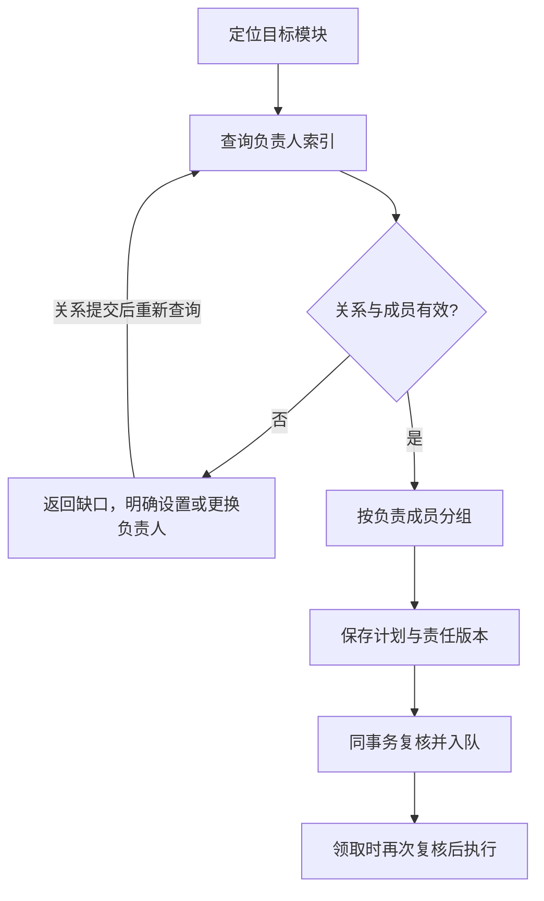

# 工作区成员与模块负责人索引

当前业务派发同时支持用户选择的 Auto 与 Team；下文岗位协议仍适用于已登记负责人，自动无负责人／无模块的独立兜底及边界见[成员执行模式](member-execution.md#自动与团队模式)。兜底不创建长期责任或放宽权限／人工验收。


日期：2026-11-07。状态：设计方案，待实施。本文定义用户确认的“能力抽象 → 工作区岗位适配 → 模块负责人 → 主 Agent 派发”关系；下文新增字段、工具和行为均为目标契约，不表示当前产品已经支持。实施切片与验收见[开发计划](../design/task/module-owner-index.md)，实时进度以[路线图](../design/tool-architecture-roadmap.md)为准。

## 1. 设计目标与边界

Agent 是与具体项目业务无关的能力单位，保存技术栈、专业领域、工作原则与专业 Skill。加入工作区后形成长期项目成员，承担岗位职责并拥有独立模型配置、适配和工作上下文。Module 保存业务知识、契约与 Workflow，并明确显示负责它的工作区成员。主 Agent 日常按模块负责人索引派发，能力匹配用于成员加入、分配岗位、补充协作或调整责任。

第一版采用以下明确规则：

- 每个模块最多一个当前主责成员；未分配是可展示的配置状态，但不能派发该模块的正式业务任务。一个成员可以负责多个模块。
- 负责人引用同工作区的稳定 `memberId`，不引用角色名称、模板路径、临时运行实例或真人 ID。能力与业务保持多对多的组合能力，主责唯一不表示禁止其他专业协作。
- 父模块负责人不自动成为子模块负责人。可预览后批量设置，但每个模块都保存自己的明确关系与版本。
- 模块作者 `authors`、真人维护声明 `maintenance.maintainerPersonIds`、AI 主责成员分别记录，互不推导。设置负责人不增加工具权限或代替人工验收。
- 负责人更换改变当前项目分工，不反向修改通用 Agent 定义，也不改写历史任务的责任和证据。

## 2. 身份与配置

| 对象 | 标识与职责 | 生命周期 |
| --- | --- | --- |
| Agent 能力定义 | `agentId` 与定义版本；技术栈、专业领域、原则、Skill | 可跨项目复用，不保存具体模块责任 |
| WorkspaceMember | `memberId`；绑定能力来源、岗位适配、模型策略与配置版本 | 工作区级长期成员，不随用户目标关闭而删除 |
| ModuleOwnership | `bindingId + revision`；模块到当前 `ownerMemberId` 的关系 | 可明确更换、解除、退役；历史保留 |
| Task | `taskId`；本次目标、模块集合、负责成员与责任快照 | 独立结算，不随当前负责人变化改名换人 |
| AgentInstance / Session / Run | 执行实例、逻辑通道与一次实际运行 | 运行资源与项目成员身份分开管理 |

`WorkspaceMember` 的最小记录包含：`memberId`、`agentId`、`definitionRef`、`revision`、`displayName`、`position`、`adaptation`、`runtimePolicy`、`state`、创建与变更记录。`definitionRef` 保存能力来源身份、受控登记的来源代次、已采纳内容指纹/版本及快照引用；`agentId` 是定位路径，不能单独证明来源连续性。成员配置版本、能力定义版本和当前知识版本分别记录。`state` 为 `active / suspended / retired`；暂停成员保留职责但不能领取新工作，已退休成员不能重新作为负责人，恢复岗位应显式创建新成员。

`memberId` 由系统生成，永不分配给另一个人设；同一能力定义可以适配成不同项目成员。改名、明确升级同一能力定义、修改模型绑定不改变成员身份，但提升配置版本；模板内容变化先标为待采纳，明确采纳后更新 definitionRef，不自动覆盖长期成员。改绑为另一能力定义须新建成员并办理责任转移，防止在旧身份下替换职业与证据来源。

`adaptation` 保存岗位、项目工作约定及引用，不复制模块正文。专业 Skill 来自该成员绑定的 Agent，实际共享 Skill 清单及来源可见；项目适配不能反向污染能力资产。`runtimePolicy` 仅保存模型配置引用和无凭据策略，密钥留在应用模型配置服务；主聊天选择的模型不自动覆盖成员配置。运行冻结实际模型、Skill、Workflow、成员配置及权限。

模型配置服务可以独立更新 profile，不能假设这些更新都会提升成员 revision。因此查询/计划记录预期 `profileRevision` 或无凭据有效配置指纹；派发及领取重新解析并比较，变化时返回 `MEMBER_CONFIG_CHANGED`，要求重新规划确认，不能沿用旧计划静默换模型。取得执行许可时冻结解析后的配置，运行工厂直接使用这份配置，不再次读取默认值。凭据轮换独立处理，密钥不进入指纹、索引或任务公开日志；不可用时报告启动失败，不暗中降级。

当前代码的 `AgentInstance` 仍按任务/周期创建与释放。第一阶段新增稳定项目成员，并在任务与运行中记录其引用；该步骤本身不宣称已经实现长期原生会话或跨重启恢复。后续持久运行实例继续关联这个 `memberId`，不需要重建负责人关系。

## 3. 唯一权威与模块上的负责人标记

**模块领域视图明确提供 `ownership.ownerMemberId`；唯一权威保存在工作区级责任登记。** 不把同一关系再写入 `module.json`、成员的模块清单或某个主会话任务图。

建议扩展现有工作区 `DispatchStore`，增加 `workspaceMembers`、`moduleOwnerships` 和只追加的 `ownershipChanges`。这些是独立于 `rootSessionId / scopeId` 的工作区登记；现有 `members` 仍表示运行实例，不能用旧数据猜测新成员。登记与任务派发、领取共享同一个串行事务域。存储协议需显式兼容旧日志，不直接重写已保存事实。

`ModuleOwnership` 的权威记录至少包含 `bindingId`、`moduleId`、受控登记的模块代次、`ownerMemberId`（允许空）、`revision`、`state: active / retired` 及最后变更审计引用。登记独立维护 `registryCursor`，不能复用某张任务图的游标；同一模块代次最多一条 active 关系。来源代次用于区分受控删除/重建，外部文件事件的检测限制见第 8 节。

选择这个位置有两个原因：

1. 派发、领取与换人能够在同一事务中比较责任版本，避免查询后换人、旧成员又成功领取的竞争。
2. 当前 `knowledgeRevision` 是知识文件整体基线。把负责人写入 `module.json` 会因纯分工调整改变知识版本，使原有候选与检查点失效。责任版本独立后，换人不改业务知识基线；正文、Skill 或 Workflow 的真正变更仍按既有规则复核。

责任登记与业务知识仍是两个存储边界；本方案不宣称知识内容、任务日志和文件系统已具有跨存储原子性。模块存在、知识有效性等检查仍需执行现有冻结与启动复核，无法确认时拒绝执行。

以下为模块详情的示例投影，不是直接写入 `module.json` 的新字段：

```json
{
  "moduleId": ".cbim/workspace/client/inventory",
  "ownership": {
    "bindingId": "ownership_inventory",
    "revision": 4,
    "ownerMemberId": "member_client_a",
    "ownerName": "客户端岗位 A",
    "memberRevision": 2,
    "status": "assigned"
  }
}
```

`ownerName` 与 `status` 是投影，不是另一份可编辑事实。没有关系时返回 `unassigned`；成员暂停/退休、能力定义缺失、模块失效或登记无法核实时返回相应问题，不能回退到最近使用过的负责人。解除关系保留原 `bindingId` 并递增 `revision`、将负责人置空；再次指派仍提升版本，防止 A → B → A 后旧请求意外生效。

正向索引 `moduleId → ownerMemberId` 和反向索引 `memberId → moduleIds` 都由登记派生。索引携带提交游标，允许重建；派发与领取从事务中的权威记录复核，不能以缓存命中代替。显示名称变化不重绑模块。

## 4. 主 Agent 查负责人派发



建议新增主 Agent 只读入口 `cbim_module_owner_inspect`，按明确的 `moduleIds` 返回每个模块的关系版本、成员身份/配置版本、问题及同负责人分组。查询不创建成员、设置责任或启动模型。现有模块列表和详情也显示同一投影。

正式派发继续使用 `cbim_dispatch_task`，新协议由主 Agent 提交模块、目标、验收项、前置依赖，以及刚查询到的 `expectedOwners`；真实负责人由后端解析。`expectedOwners` 逐模块包含 `moduleId / bindingId / revision / ownerMemberId`，并携带预期成员配置版本，不能把自由填写的 `assigneeAgentId` 当作新的路由权威。

派发规则：

1. 先定位真实模块，查询责任登记，核实真人维护关系、成员状态及能力来源。
2. 负责人相同且服务于同一个验收目标的模块可以合成一项任务；不同负责人的模块拆成独立任务，由主 Agent 建立前置依赖，不能任取一个成员承担全部模块。
3. 目标计划的分配同时绑定 `memberId`、模块责任版本和成员配置版本；派发必须匹配这份计划。索引或配置变化时返回冲突，重新查询并修订计划，不静默把任务换给另一个成员。
4. 派发事务保存任务、责任快照、派发信封及回执。领取事务再核对责任与成员版本，并冻结运行配置和业务知识。并发名额、权限、依赖候选和工作区写锁继续生效。
5. 已有负责人但能力不足、模型不可用或忙碌时，返回明确原因或正常排队，不偷偷改派默认执行者。未分配也不回退到 authors、最近执行者或 `cbim:executor`。确需默认执行能力时，先把它登记为项目成员并明确建立责任关系。

快照至少记录 `memberId`、`memberRevision`、逐模块 `bindingId/revision/ownerMemberId`、任务关联的 `agentId` 和能力版本；运行再冻结实际模型、有效 Skill、Workflow、知识版本与权限。历史任务展示这份快照，不关联当前负责人后覆盖旧署名。

第一版的正式任务由主责成员承担。其他专业审阅可以落在有明确负责人的 QA 等模块，或待后续引入明确的协作责任授权；不能通过任填 assignee 绕开负责人。成员直接通信与协作任务另行设计，不由本索引自动开放。

## 5. 设置与更换负责人

首次设置、更换、解除采用同一种版本化关系变更。用户通过模块详情操作，主 Agent 可在已有知识治理授权内发起同一流程；是否需要审批仍由当前 read/ask/execute 及责任变更策略判断。模型不能伪造用户身份、确认记录或借更换负责人扩大权限。

建议提供 `cbim_module_owner_change_preview` 与 `cbim_module_owner_change_commit` 两个入口：

1. 预览校验目标成员、模块及当前关系，列出前后负责人、配置差别和受影响任务分类，并返回 `expectedImpactDigest`。
2. 提交携带稳定命令、预期关系版本、旧负责人、新成员及其版本、影响摘要和原因。
3. 在同一派发事务内重读、重算影响摘要；版本或影响发生变化则明确冲突，返回刷新信息，不扩大修改范围。
4. 原子保存关系新版本、不可变审计和回执，再发布索引变化。新任务立即按新负责人解析；查看回执本身不启动任何模型。

示例服务层提交体如下，工作区和真实操作者身份由运行入口注入。命令键由可信桌面或工具运行上下文生成，示例不等于允许模型填写操作者或自由覆盖幂等身份：

```json
{
  "commandId": "owner_change_inventory_04",
  "moduleId": ".cbim/workspace/client/inventory",
  "expectedBindingId": "ownership_inventory",
  "expectedRevision": 4,
  "expectedOwnerMemberId": "member_client_a",
  "nextOwnerMemberId": "member_client_b",
  "expectedNextMemberRevision": 1,
  "expectedImpactDigest": "preview-returned-digest",
  "reason": "客户端岗位调整，后续库存模块工作交给成员 B",
  "mode": "future_assignments"
}
```

首次指派使用“无既有关系”的明确预期，不能以缺省版本覆盖已有关系；解除关系时新负责人为空并显式选择解除操作。时间、审计 ID、可信操作者及新版本由服务生成。相同命令同参数返回原回执，同命令不同参数拒绝；未知提交结果只查询原命令，不另造 ID 重做。

审计包含前后负责人、前后版本、操作者来源、原因、提交时间、预览和提交时的影响依据。单次更换只改变责任关系，不顺带修改成员模型、业务知识、任务执行者或任务状态。多模块批量调整后续可以复用事务，一次列明全部目标及版本，不能隐式处理子模块。

## 6. 更换时存量任务怎么办

第一版只支持 `future_assignments`。它保证后续派发走新负责人，同时阻止尚未领取的旧责任进入新的执行段；它不代表“旧任务全部自动转交”。

| 任务状态 | 更换后行为 |
| --- | --- |
| 尚未派发 | 查询并派给新负责人 |
| queued / waiting，尚未领取 | 保留原任务和负责人快照；领取时返回 `OWNER_CHANGED`，界面显示“负责人已变更，待处理”，不改变其历史状态伪装取消或成功 |
| starting / running，领取已提交 | 当前这一段运行按原身份收尾；停止、失败与结算记录仍归原成员，不自动撤销已经发生的操作 |
| checkpointed，或恢复预约尚未领取 | 保留原检查点；预约和实际恢复都核验当前责任，新负责人不能使用旧成员会话，旧成员失去当前责任时也不能直接开始下一段 |
| 已完成、失败、取消、封存 | 记录与证据不改；当前模块负责人另行显示，历史仍可追溯 |

“换人”和“领取”由同一个提交点裁决：换人先提交则旧领取失败；领取先提交则该段成为原成员的在途工作。若领取发生在预览与提交之间，更换提交返回影响已变化，刷新后再决定，不能悄悄把用户看到的待办变成在途工作。恢复预约通过不等于允许执行，实际恢复领取时必须重查。

旧成员已有有效结果不会仅因换人自动变成失败；结果仍按原任务和知识证据审阅。新派工计划需匹配当前责任，但历史完成判断使用当时冻结的责任事实。尚未处理的旧待办或检查点仍属于未完工作，不能靠更换负责人绕过目标完成门禁。

需要交接旧任务时：主 Agent 先核实旧工作、显式撤销可撤销待办或安全停止需要交接的运行，再给新成员创建关联旧任务的接替任务。保留前置/后继和替代关系，重新规划与审阅，不把旧任务 assignee 原地改成新成员。不具备安全取消或依赖修订能力时报告待交接，不能宣称已经移交。原生会话、旧审批和执行权限不随岗位转移。

检查点交接另需在实施切片 D 增加**显式放弃暂停任务**协议，当前检查点能力不具备这条路径：仅在原任务无已领取执行、所有工具结果明确时，按任务/检查点/预约版本原子撤销未领取恢复信封，追加 `abandoned_by_handoff` 处置记录，将任务按有原因的取消结算，并提升租约代次使迟到恢复失效。检查点原文保持不可变，不把放弃记录成“已恢复”或“已完成”。已有依赖后继保持阻塞，直到主 Agent 明确安排替代任务并完成现有门禁允许的前置修订；不能自动去掉依赖。放弃与恢复领取竞争，领取先成功则放弃拒绝，须走在途停止核实。放弃后的失败/取消责任仍须由真实接替结果满足整体目标，不能仅删除待办凑成成功。

在上述放弃协议及必要依赖交接尚未实现前，更换负责人可以成功，但旧 checkpoint 只能显示待交接；需要结束原目标时只能显式关闭旧周期、保留历史，再开启新目标。不得把“新建了接替任务”报告为原周期已经可以完成。

本设计不新增“允许旧负责人无限续跑”的豁免。以后如需允许其完成指定遗留任务，应另建有范围、期限及审批依据的继续执行许可，不能以更换操作默认授权。

## 7. 页面与主会话体验

- 模块列表显示负责人姓名、岗位、关系状态；详情显示成员入口、责任版本、变更历史以及“设置／更换／解除负责人”。真人维护人与作者另列，标签不得混用。
- 更换预览列出新派发、未领取、在途、暂停及历史任务的不同影响。提交后展示已保存回执和待交接清单，不把“更换成功”显示成“所有任务已移交”。
- 成员详情反查负责模块，显示自身模型与 Skill、项目岗位适配、待办和历史。反查列表只读，不产生另一套责任编辑源。
- 主 Agent 查不到有效负责人时，在会话中说明缺少哪一项，能按已有授权准备设置方案；选择明确后由受控提交生效。没有必要的授权时保持未分配。
- 工作区责任全局共享，不同主会话能看到相同负责人。任务正文和控制权仍遵循原会话范围；跨会话影响只展示有权限的详情，不能借更换负责人接管另一个会话的停止或恢复权限。

## 8. 删除、迁移与失效处理

成员退休前必须显式转移或解除仍负责的模块，并核实在途运行；保留成员身份与履历。暂停成员不删除关系，查询显示暂停并拒绝新领取。成员模型绑定或已采纳 Skill 配置变化提升成员配置版本；外部 profile 原地变化另以 profile 修订/指纹检查。旧运行不被热替换，新运行按现有配置与检查点兼容性复核。

模块删除/移动、能力定义删除/重建、工作区重建必须检查引用。受控 CRUD/导入应登记对象来源代次并在删除/重建时退役旧代次；新增引用校验及变更意图，过程中登记待核实并阻止新领取，失败或崩溃后先核实知识提交与登记回执，再显式收束，不能靠跨存储双写宣称原子。受控同路径新建须新建绑定并明确确认，不能接管旧关系。模板路径被另一份能力占用也不能静默继承旧成员配置。

外部文件变更只对可观察的缺失、版本/内容变化和来源冲突作检查，无法确认连续性时标为失效并要求重新确认。路径与哈希无法识别“两次读取之间删除后原样重建且没有留下事件”的情况，本设计不承诺检测这种不可观察事实；来源代次也不能替代完整文件系统审计。

能力包和业务模板继续只导出各自定义，不携带工作区成员 ID、模型连接身份、负责人关系、会话或授权。完整项目迁移是另一种操作，必须显式迁移或重映射成员和关系；仅复制 `.cbim/` 不等于复制本机项目岗位登记。该限制需在导入/导出界面说明。

旧工作区默认得到空的负责人登记，模块标为未分配；不得从 authors、历史 assignee 或同名角色静默补齐。迁移预览可以把这些作为候选依据，由明确操作绑定后生效。启用新路由后所有新正式派发入口（包括显式 IPC）统一走负责人校验；旧只按 `assigneeAgentId` 派发的写入口不能成为旁路。旧运行和日志按旧协议读取并先安全收束，不能伪造责任快照。

## 9. 实现边界与错误契约

建议将成员、责任、快照及变更不变量置于 Core；调度引擎负责查询组合、预览、事务变更和派发/领取核验；Main 提供落盘、模型配置及可信身份；Bridge 提供公开投影，Frontend 展示模块负责人和交接影响。Core 不反向依赖调度器，业务知识层通过注入端口或上层查询组合关联责任，不导入执行实现。

新增查询结果同时携带 `knowledgeRevision` 和责任登记游标，不将二者伪装成同一原子快照。只读索引重建、列表加载或回执查询不会派发任务、产生授权或恢复运行。

拟定业务错误：`MODULE_OWNER_UNASSIGNED`、`MODULE_OWNER_INVALID`、`OWNER_REVISION_CONFLICT`、`OWNER_IMPACT_CHANGED`、`OWNER_CHANGED`、`MEMBER_CONFIG_CHANGED`、`MEMBER_UNAVAILABLE`、`MULTIPLE_MODULE_OWNERS`。错误返回相关模块、原预期与当前公开版本，以及需要重新查询、重新规划或交接的具体对象；不泄露原生会话文件、密钥或其他会话私有正文。

## 10. 当前基础与验收入口

当前 [模块维护关系](../src/backend/core/workspace/maintenance.ts) 只有真人维护声明；[成员登记](../src/backend/scheduler-engine/execution/agent-manager.ts) 仍创建任务级运行实例；[派发入口](../src/backend/scheduler-engine/execution/dispatch-service.ts) 由调用方选择角色；[成员模型装配](../src/backend/main/member-dispatch.ts) 已具备解析单独模型的基础。工作区成员及负责人索引需新增，不能把现有字段改名后宣称已完成。

工作区正在推进的成员检查点限定同一活动周期、原任务、原实例及原生会话。负责人更换不能把检查点转给新成员，也不自动提供跨重启恢复。本文不改变这项工作的完成状态。

完整验收需覆盖明确指派、多模块分组、负责人更换、派发/领取竞争、检查点恢复竞争、幂等与重启恢复投影、成员独立配置及旧记录迁移。逐步验收清单见[模块负责人索引实施计划](../design/task/module-owner-index.md)。
