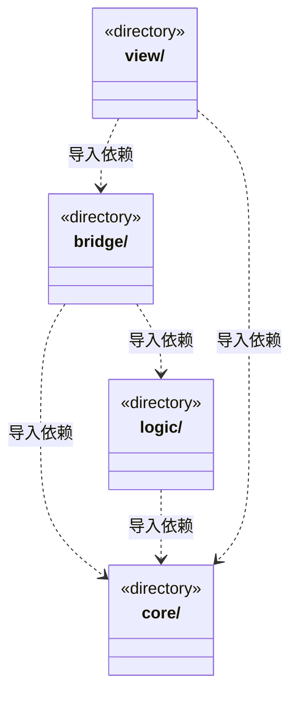

# src 架构

## 目录定位

Core 提供独立基础机制，Logic 持有业务规则/状态/运行，Bridge 负责通信与可信宿主，View 持有页面交互；旧后端/前端源码已迁出。类型边同样无环，具体私有入口继续收紧。

本文描述当前实现。通过分析目录边界后维护的 [源码架构脚本](../scripts/source-architecture.mjs) 同步清单和声明；代码变更时仍须核对职责、关键成员与关系。

## 代码清单

本层无直接代码文件。

## 架构类图

各图中的同名节点表示同一目录边界；跨组及完整直接依赖如下（无边不代表继承）：

- `bridge` → `logic`：导入。
- `bridge` → `core`：导入。
- `logic` → `core`：导入。
- `view` → `bridge`：导入。
- `view` → `core`：导入。

## 子目录导航

- [bridge/](bridge/ARCHITECTURE.md)：通信契约、可信服务端和 preload；业务状态归 Logic，平台技术机制归 Core 独立入口。
- [core/](core/ARCHITECTURE.md)：四层架构的共享基础公共层：utility 提供便携算法与数据结构，platform 隔离运行环境；不依赖业务、桥接或视图。前端比较和后端指纹适配组合相同排序实现，业务策略留在消费者。
- [logic/](logic/ARCHITECTURE.md)：业务规则、运行编排、存储与平台实现按领域组织；Application 统一持有真实生命周期，业务不依赖 Bridge/View/Electron。
- [view/](view/ARCHITECTURE.md)：React 桌面界面。页面消费 Bridge 通信契约、共享 Core 和自身视图适配；视图基础库不反向引用页面或通信契约，不依赖 Logic 服务、调度或主进程实现。

每次修改本目录代码，同步维护文件头、关键契约说明及本图。未实现的治理、证据验收和自动编排能力不列入当前类图。

## 设计契约 v1 与落地范围

以下内容区分已接通能力与后续设计；以各节的实现状态为准，不将目标图当作现状图。维护源：[CONTRACT.md](CONTRACT.md)；生成类图时同步附加，勿直接修改本附录。

# Core、Logic、Bridge、View

四层源码迁移已完成。旧 backend/frontend/foundations 源码目录已经退出，当前实现按以下职责维护。

| 层 | 职责与修改入口 |
| --- | --- |
| [Core](core/ARCHITECTURE.md) | utility、错误与 JSON、文件/网页/锁/加密等技术机制；便携与 Node/Electron 入口分开，不依赖业务 |
| [Logic](logic/ARCHITECTURE.md) | 领域规则、业务数据、运行编排、存储和业务平台实现；Application 持有唯一业务生命周期 |
| [Bridge](bridge/ARCHITECTURE.md) | 通信契约、IPC/CLI/桌面服务端与 preload；适配 Logic，不持有第二套业务状态 |
| [View](view/ARCHITECTURE.md) | React 页面、交互状态及视图专属适配；仅经 Bridge 通信，可组合便携 Core |

依赖箭头从使用者指向被使用者。Core 不依赖其余三层；Logic 不导入 Bridge/View/Electron；View 与通信客户端不得加载 Node/Electron。Bridge contracts 只具名转接已登记的纯业务契约，不能暴露服务、凭据或平台入口。preload 是当前真实客户端实现，没有为目录完整预建 client 或 browser 模块。

跨模块使用 index.ts 或已经登记的细粒度公开文件。类型边也必须无环；不创建全域 barrel 强行合并纯契约和运行实现。规则不能依赖运行服务，具体引擎仅由 execution/assembly 选择，普通服务不得反向读取 Application。

业务语义与状态归属保持：派发、知识和文件事务沿用原一致性边界；取消不代表物理操作退出，未知写入不自动重放。文件无环与目录迁移不等于依赖密集模块已全部拆分；后续治理从 [业务边界](logic/BOUNDARIES.md) 与具体模块契约进入。

设计与切片依据见 [四层设计](../design/four-layer-architecture.md)，实际验证见 [开发记录](../design/development-log.md)。本地模块通过不代表全量 CI、制品、安装或发布验收通过。

## 文档维护入口

CONTRACT.md 是人工维护的模块职责、行为不变量与消费边界；ARCHITECTURE.md 展示真实文件清单、声明和依赖，并由 scripts/source-architecture.mjs 附加同目录契约。先修契约及生成器目录说明，再重新生成，不能只编辑附录。架构检查可发现生成漂移，不能证明职责描述准确；必须对照实际导入、状态所有者和消费者核实。历史验证另留在 design，不能当成当前实现或最新测试结果。
