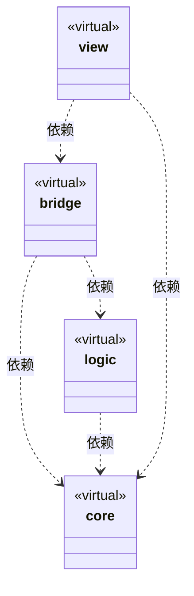

# src 架构

## 设计意图

工程按 Core、Logic、Bridge、View 四层组合：基础机制支撑业务，宿主桥接业务入口，视图通过通信契约交互。每一层封装自己的实现，沿子模块入口逐层理解系统。

## 主要组成

本层由下列子模块组合，每个子模块作为独立的虚拟类封装参与本层协作。

<!-- architecture:generated:start -->

## 架构关系

标注为 `virtual` 的节点是直接子模块的虚拟类封装；内部设计沿下方入口阅读。

## 子模块

| 虚拟封装 | 整体职责 |
| --- | --- |
| [bridge](bridge/ARCHITECTURE.md) | 连接业务应用与桌面宿主。通信契约、页面安全桥和可信服务端分别封装，业务状态与生命周期交给 Logic，平台技术机制使用 Core。 |
| [core](core/ARCHITECTURE.md) | 提供不依赖业务的共享技术机制。便携工具、通用端口与平台实现分别封装，由消费者选择入口并持有业务策略；错误与 JSON 适配保留统一的基础协议。 |
| [logic](logic/ARCHITECTURE.md) | 按领域组合业务规则、运行编排和存储服务，由 Application 统一装配和持有生命周期。各领域通过明确契约协作，业务不反向依赖 Bridge、View 或 Electron。 |
| [view](view/ARCHITECTURE.md) | 以 React 页面和交互状态呈现工作区业务。shell 组织应用布局，各页面通过 Bridge 契约访问服务，共享展示与视图基础能力独立封装，不直接持有后端业务对象。 |

<!-- architecture:generated:end -->
