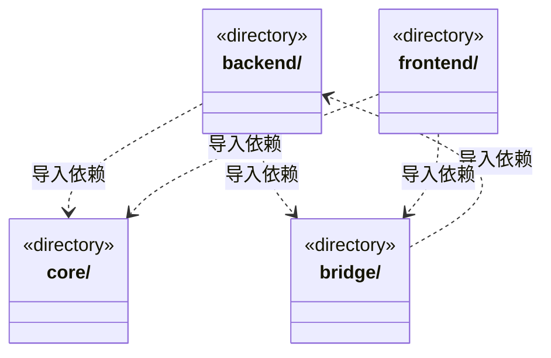

# src 架构

## 目录定位

当前共享 Core 已建立于 src/core，backend/frontend 仍保留原业务与视图实现，bridge 为通信边界。目标 Logic/View 尚未整体迁移；公共机制通过 Core 公开入口共享，不开放前后端业务互引。

本文描述当前实现。通过分析目录边界后维护的 [源码架构脚本](../scripts/source-architecture.mjs) 同步清单和声明；代码变更时仍须核对职责、关键成员与关系。

## 代码清单

本层无直接代码文件。

## 架构类图

各图中的同名节点表示同一目录边界；跨组及完整直接依赖如下（无边不代表继承）：

- `backend` → `core`：导入。
- `backend` → `bridge`：导入。
- `bridge` → `backend`：导入。
- `frontend` → `bridge`：导入。
- `frontend` → `core`：导入。

## 子目录导航

- [backend/](backend/ARCHITECTURE.md)：本机后端：core 持有领域规则和执行契约；engines 实现具体模型引擎；scheduler-engine 编排任务与装配引擎；main 管理平台、存储和应用入口；updater 独立更新。Core 不导入具体引擎或上层；目录聚合图的双向关系不等于文件循环。
- [bridge/](bridge/ARCHITECTURE.md)：前后端通信边界：contracts 声明公开数据，preload 提供 Electron 安全桥。契约可重导出 Core 公开类型和纯函数，不暴露后端服务、凭据和存储实现。
- [core/](core/ARCHITECTURE.md)：四层架构的共享基础公共层：utility 提供便携算法与数据结构，platform 隔离运行环境；不依赖业务、桥接或视图。前端比较和后端指纹适配组合相同排序实现，业务策略留在消费者。
- [frontend/](frontend/ARCHITECTURE.md)：React 桌面界面。业务消费通信 contracts、自身组件及前端 foundations 的公开入口；前端基础库不反向引用页面或通信契约，不依赖后端公共库、调度或主进程实现。

每次修改本目录代码，同步维护文件头、关键契约说明及本图。未实现的治理、证据验收和自动编排能力不列入当前类图。

## 设计契约 v1 与落地范围

以下内容区分已接通能力与后续设计；以各节的实现状态为准，不将目标图当作现状图。维护源：[CONTRACT.md](CONTRACT.md)；生成类图时同步附加，勿直接修改本附录。

# 当前架构与迁移边界

已建立共享 core：便携 utility 与独立 Node 摘要。旧 backend 暂承载后端业务，frontend 暂承载视图，bridge 保持原通信实现；尚未整体改名为 logic/view。

Core 不依赖其余层，前后端通过公开入口共享同一技术契约。平台依赖按环境隔离，View/前端不允许 Node/Electron。旧 backend/core 是领域规则与执行机制，不等同于共享 core。

目标四层和后续切片见 [四层架构设计](../design/four-layer-architecture.md)，实际 Core 边界见 [Core 契约](core/CONTRACT.md)。新目标目录的依赖规则已启用；旧目录保留细粒度限制，尤其 Bridge 现有纯领域契约重导出是迁移期结构，不宣称目标已全部实现。
