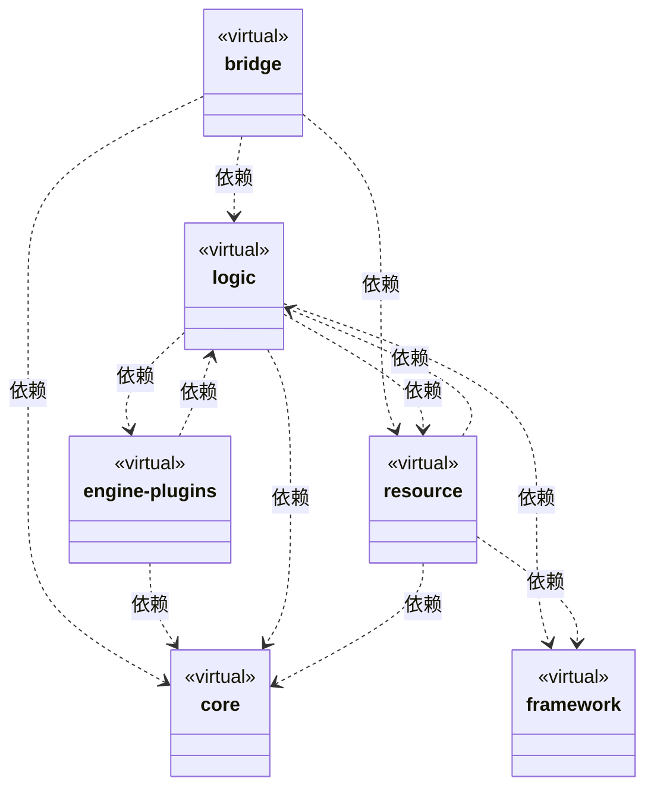
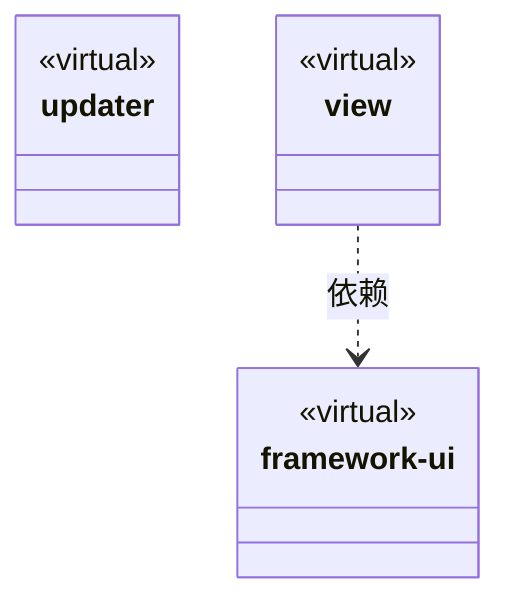

# src 架构

## 设计意图

将独立技术机制、业务决策、可信宿主和界面分为 Core、Logic、Bridge、View 四层，使平台替换、业务演进和交互调整各有明确的修改边界。

一次桌面请求由 View 经 Bridge 的受限通信入口进入 Logic，业务使用 Core 的技术能力；返回数据与事件沿通信边界展示。Logic 拥有业务状态与应用生命周期，Bridge 拥有窗口和宿主资源，View 只维护展示与交互状态。源码依赖方向与运行时请求／回包方向分别理解。

本层是纯组合容器，各直接子目录分别作为虚拟封装。当前仍有部分下层目录混放直接实现与子模块，具体差距记录在各自文档中，不能把这张四层图理解为全部目录已经完成纯容器迁移。架构判断依据 [工程结构规范](../ainative/docs/06-架构设计原则和工程结构规范.md)；产品目标与未落地方案沿 [设计导航](https://github.com/nan023062/cbim/blob/7dcff4142e09fdac1a670438bd3081d6c0341f23/design/README.md) 阅读。

## 主要组成

本层没有直接产品实现，由下方子模块组成；每个直接子模块作为一个虚拟封装，只在本层呈现整体职责与协作。

当前桌面入口为 `index.html → view/main.ts`。历史 View 实现及其专属测试已退役；共享界面控件归 framework-ui，任务与项目状态由 logic/projects 管理。历史 Logic 实现及其专属宿主、测试已退役；当前连接器运行时和引擎协议保留在 logic，独立引擎实现仍归 engine-plugins。

## 阅读方式

先读本层设计意图，再沿虚拟子模块下钻到类与源码。下方关系图的“依赖”表示实际源码引用（包含类型引用），不表示调用顺序或资源所有权；继承／实现只对应真实声明。复杂图的跨图连接仍属于同一模型。类定位由人工维护，关系与导航辅助生成。

测试集中在根 `tests/` 并镜像源码路径，工程工具在 `scripts/`；它们不参与产品虚拟类组合。当前实现只在各层本文件维护，源码注释表达具体调用契约，不再另设文件清单或接口说明副本。

<!-- architecture:generated:start -->

## 架构关系

标注为 `virtual` 的节点是直接子模块的虚拟类封装；内部设计沿下方入口阅读。

### 关系组 1：logic

### 关系组 2：updater

### 跨图协作

按引用方归并目标，保留全部跨图关系；分图只用于阅读，不表示新增模块或依赖边界。

| 引用方 | 关系 | 目标 |
| --- | --- | --- |
| [bridge](bridge/ARCHITECTURE.md)（图 1） | 依赖 | [updater](updater/ARCHITECTURE.md)（图 2） |
| [logic](logic/ARCHITECTURE.md)（图 1） | 依赖 | [updater](updater/ARCHITECTURE.md)（图 2） |
| [view](view/ARCHITECTURE.md)（图 2） | 依赖 | [bridge](bridge/ARCHITECTURE.md)（图 1） |

## 子模块

| 虚拟封装 | 整体职责 |
| --- | --- |
| [bridge](bridge/ARCHITECTURE.md) | 把桌面宿主与业务应用连接起来，同时限制页面可触达的能力。通信数据、安全桥和可信服务端分别封装，业务规则与权威状态留在 Logic。 |
| [core](core/ARCHITECTURE.md) | 提供不认识工作区、Agent 或任务身份的技术机制，让业务在明确端口上组合算法、文件、网络和平台能力。 |
| [engine-plugins](engine-plugins/ARCHITECTURE.md) | 将不同供应商和专业循环适配到统一执行协议，隔离会话、工具和传输差异。 |
| [framework](framework/ARCHITECTURE.md) | Framework 定义 CBIM 的模型能力与 Agent 引擎协议，供 Logic 装配。引擎按能力选择模型；模型目录独立于引擎。 |
| [framework-ui](framework-ui/ARCHITECTURE.md) | 为桌面页面提供不含业务状态的 React 控件、可见性生命周期和窗口列表。页面通过属性传入内容与交互回调；此层不读取 Bridge、业务服务或项目数据。 |
| [logic](logic/ARCHITECTURE.md) | 为当前桌面视图提供业务用例。历史 Logic 实现已退役，当前业务目录已统一命名为 src/logic。当前调用仍需的连接器生命周期和引擎协议迁入本层，旧调度、存储及未接入的服务不再保留。协议目录中的类型与纯规则用于兼容独立引擎包，不表示旧产品能力仍在运行。 |
| [resource](resource/ARCHITECTURE.md) | Resource 拥有可共享的资产定义和当前用户的本机资源。公共入口导出的 `resourceInventory` 按这两种范围登记资产。 |
| [updater](updater/ARCHITECTURE.md) | 桌面宿主通过更新器准备 Windows 安装包。确认安装且业务退出准备完成后，更新器调用 electron-updater，将文件替换和应用重启交给独立 NSIS 安装进程。版本检查和下载期间，适配器在宿主进程内运行。 |
| [view](view/ARCHITECTURE.md) | 桌面主框架管理项目、Office 对话和页面导航，通过受限宿主接口读写项目与运行状态。index.html 只挂载本目录入口；旧 src/view 已整体退役，不再保留兼容渲染路径。 |

<!-- architecture:generated:end -->
