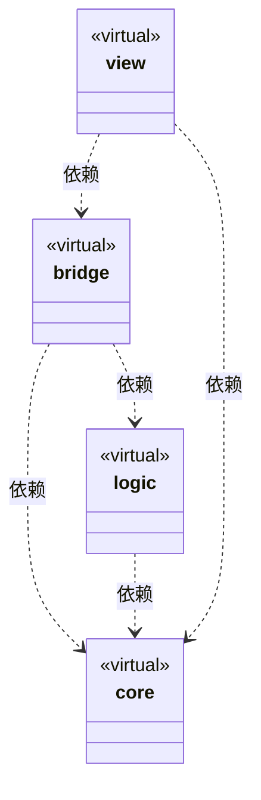

# src 架构

## 设计意图

将独立技术机制、业务决策、可信宿主和界面分为 Core、Logic、Bridge、View 四层，使平台替换、业务演进和交互调整各有明确的修改边界。

一次桌面请求由 View 经 Bridge 的受限通信入口进入 Logic，业务使用 Core 的技术能力；返回数据与事件沿通信边界展示。Logic 拥有业务状态与应用生命周期，Bridge 拥有窗口和宿主资源，View 只维护展示与交互状态。源码依赖方向与运行时请求／回包方向分别理解。

本层是纯组合容器，四个子目录分别作为虚拟封装。当前仍有部分下层目录混放直接实现与子模块，具体差距记录在各自文档中，不能把这张四层图理解为全部目录已经完成纯容器迁移。架构判断依据 [工程结构规范](../ainative/docs/06-架构设计原则和工程结构规范.md)；产品目标与未落地方案沿 [设计导航](../design/README.md) 阅读。

## 主要组成

本层没有直接产品实现，由下方子模块组成；每个直接子模块作为一个虚拟封装，只在本层呈现整体职责与协作。

## 阅读方式

先读本层设计意图，再沿虚拟子模块下钻到类与源码。下方关系图的“依赖”表示实际源码引用（包含类型引用），不表示调用顺序或资源所有权；继承／实现只对应真实声明。复杂图的跨图连接仍属于同一模型。类定位由人工维护，关系与导航辅助生成。

测试集中在根 `tests/` 并镜像源码路径，工程工具在 `scripts/`；它们不参与产品虚拟类组合。当前实现只在各层本文件维护，源码注释表达具体调用契约，不再另设文件清单或接口说明副本。

<!-- architecture:generated:start -->

## 架构关系

标注为 `virtual` 的节点是直接子模块的虚拟类封装；内部设计沿下方入口阅读。

## 子模块

| 虚拟封装 | 整体职责 |
| --- | --- |
| [bridge](bridge/ARCHITECTURE.md) | 把桌面宿主与业务应用连接起来，同时限制页面可触达的能力。通信数据、安全桥和可信服务端分别封装，业务规则与权威状态留在 Logic。 |
| [core](core/ARCHITECTURE.md) | 提供不认识工作区、Agent 或任务身份的技术机制，让业务在明确端口上组合算法、文件、网络和平台能力。 |
| [logic](logic/ARCHITECTURE.md) | 按领域组织业务事实、规则和运行服务，以统一应用生命周期连接各领域，使业务不依赖窗口、IPC 或 Electron。 |
| [view](view/ARCHITECTURE.md) | 以页面、局部控制器和共享展示组件呈现业务事实，让界面变化与后端状态机保持独立。 |

<!-- architecture:generated:end -->
