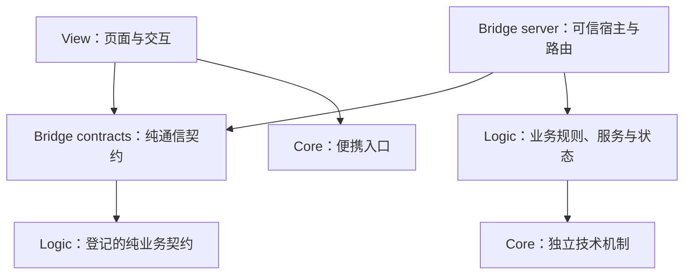
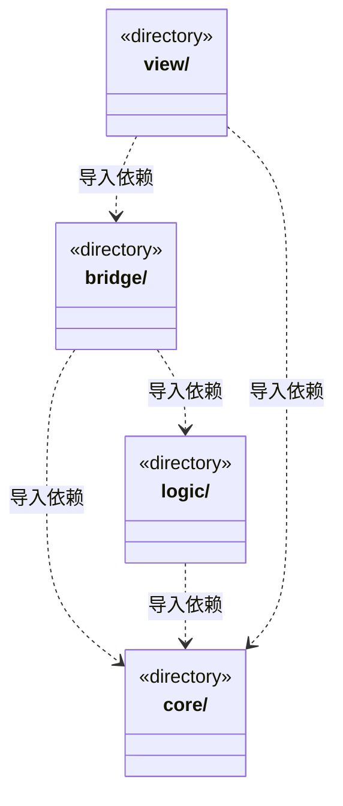

# src 架构

本目录只维护这一份说明。设计与契约直接编辑本文；文件清单、类图和导航由 [架构脚本](../scripts/source-architecture.mjs) 更新，生成区域之外的人工说明会保留。

## 封装意图

Core 提供独立基础机制，Logic 持有业务规则/状态/运行，Bridge 负责通信与可信宿主，View 持有页面交互；旧后端/前端源码已迁出。类型边同样无环，具体私有入口继续收紧。

## 类与模块的设计意图

本层没有直接源码声明，负责组合下级封装；各子系统的类、状态与公开入口见本文的[子目录导航](#子目录导航)。

## 接口设计契约

### Core、Logic、Bridge、View

四层源码迁移已完成。旧 backend/frontend/foundations 源码目录已经退出，当前实现按以下职责维护。

首次阅读从 [源码阅读路线](ARCHITECTURE.md#reading) 开始：先建立四层地图，再沿发送消息、运行与持久化路径进入具体封装。

| 层 | 职责与修改入口 |
| --- | --- |
| [Core](core/ARCHITECTURE.md) | utility、错误与 JSON、文件/网页/锁/加密等技术机制；便携与 Node/Electron 入口分开，不依赖业务 |
| [Logic](logic/ARCHITECTURE.md) | 领域规则、业务数据、运行编排、存储和业务平台实现；Application 持有唯一业务生命周期 |
| [Bridge](bridge/ARCHITECTURE.md) | 通信契约、IPC/CLI/桌面服务端与 preload；适配 Logic，不持有第二套业务状态 |
| [View](view/ARCHITECTURE.md) | React 页面、交互状态及视图专属适配；仅经 Bridge 通信，可组合便携 Core |

依赖箭头从使用者指向被使用者。Core 不依赖其余三层；Logic 不导入 Bridge/View/Electron；View 与通信客户端不得加载 Node/Electron。Bridge contracts 只具名转接已登记的纯业务契约，不能暴露服务、凭据或平台入口。preload 是当前真实客户端实现，没有为目录完整预建 client 或 browser 模块。

跨模块使用 index.ts 或已经登记的细粒度公开文件。类型边也必须无环；不创建全域 barrel 强行合并纯契约和运行实现。规则不能依赖运行服务，具体引擎仅由 execution/assembly 选择，普通服务不得反向读取 Application。

业务语义与状态归属保持：派发、知识和文件事务沿用原一致性边界；取消不代表物理操作退出，未知写入不自动重放。文件无环与目录迁移不等于依赖密集模块已全部拆分；后续治理从 [业务边界](logic/ARCHITECTURE.md#boundaries) 与具体模块契约进入。

设计与切片依据见 [四层设计](../design/four-layer-architecture.md)，实际验证见 [开发记录](../design/development-log.md)。本地模块通过不代表全量 CI、制品、安装或发布验收通过。

#### 文档维护入口

源码导入区遵守 [阅读规范](../docs/05-工程文件组织与代码阅读设计.md)：静态 import 集中在文件头说明之后，与正文空一行。导入先后、正文执行顺序及动态加载位置分别核对；排版不代替模块边界和副作用分析。

源码通过成员顺序、访问修饰符、空行和中文说明表达结构，不使用折叠分区注释。方法、字段及属性的命名和排版以阅读规范为准；规范约定不等于所有存量成员的命名迁移、语义注释和业务边界均已完成人工整理。

源码布局由 `pnpm format:source` 统一重排，`pnpm check:source-format` 与 CI 检查同一规则：独立语句间空一行，同一语句的参数、链式表达式、数组及普通对象属性等续行不插空；块内首尾不加空行，独立函数与相邻成员之间仍空一行，大括号不能抵消成员分隔；静态导入、声明头与可安全合并的箭头函数保持单行。字符串、模板、JSX 文本及注释原文保留，必要的多行范围按语法报告，可用 `pnpm check:source-format --json` 查看位置和原因。格式器除编辑词法间隙外，仅允许作用域中性的单语句 if 包裹块增删：单行普通执行体省略大括号并紧接条件，多行执行体加 Allman 块，保留作用域、自动分号插入与 else 归属所需的块。写入前核对忽略这些包裹块后的语法树、其余词法内容与幂等性；不改变状态所有权、调用顺序、依赖或成员命名，不据此宣称业务语义注释已全部完善。

项目方法声明使用 PascalCase，由 `pnpm check:method-names` 检查类、接口、类型字面量及对象方法。浏览器存储、Node 流、Electron 端口、React 生命周期以及已发布 EngineAdapter protocol=1 的包边界保留原契约名称；例外在检查器逐项登记，不能泛化到普通业务方法。函数值实现方法契约时同名；普通函数、字段和访问器仍遵守各自规则。更名只调整调用标识，不改变持久化字段、IPC 操作名或引擎包版本；仍须核对动态调用、运行包兼容与受影响行为。

ARCHITECTURE.md 是本目录唯一说明，人工维护封装意图、类设计意图、行为不变量与消费边界；scripts/source-architecture.mjs 只更新标记区域中的真实文件清单、声明、依赖和导航，保留其他正文。先核实并修改本文契约，再同步生成区，不维护额外的说明文件。架构检查可发现生成漂移，不能证明职责描述准确；必须对照实际导入、状态所有者和消费者核实。历史验证另留在 design，不能当成当前实现或最新测试结果。

多参数调用（含 new 构造调用）是否分行由维护者按阅读需要选择，格式器不预设数量阈值。已分行的同级调用参数逐项对齐；左圆括号与首参数、参数彼此之间、末参数与右圆括号之间均不加空行。该布局不拆开必须单行的方法声明、导出声明与完整箭头函数；参数顺序、内容和求值保持原样。

### 源码阅读路线

先从四层边界和一条实际操作路径建立整体认识，再进入具体业务。这里说明当前代码的职责与修改入口；目录清单、声明及业务不变量均见各层唯一的 `ARCHITECTURE.md`。

#### 第一轮：建立四层地图

| 顺序 | 阅读入口 | 要回答的问题 |
| --- | --- | --- |
| 1 | [四层契约](ARCHITECTURE.md#contract) → [源码总览](ARCHITECTURE.md) | 技术机制、业务状态、宿主通信和页面分别归谁？ |
| 2 | [Core](core/ARCHITECTURE.md) → [共享工具契约](core/utility/ARCHITECTURE.md#contract) | 哪些能力不认识业务？静态算法与有状态对象怎样区分？ |
| 3 | [Logic](logic/ARCHITECTURE.md) → [业务修改入口](logic/ARCHITECTURE.md#boundaries) | 一项业务规则、状态和副作用分别在哪个封装？ |
| 4 | [应用生命周期](logic/application/ARCHITECTURE.md#contract) → [Application](logic/application/application.ts) | 谁创建并持有服务？工作区如何打开、退役和关闭？ |
| 5 | [Bridge](bridge/ARCHITECTURE.md) → [IPC 契约](bridge/contracts/ipc-call.ts) | 请求如何跨进程并完成解析？哪些端口只能由可信宿主注入？ |
| 6 | [View](view/ARCHITECTURE.md) → [App](view/shell/App.tsx) | 页面怎样选择工作区、组织会话并调用已有业务端口？ |

目录是系统封装，子目录不是子类。`index.ts` 与已登记的细粒度入口表达消费边界；仅仅位于相邻目录不代表允许互相导入。类型引用也受单向依赖约束。

下面表示允许方向的概览，细粒度许可仍以对应契约和依赖检查为准；箭头不表示运行事件的返回方向。

#### 第二轮：跟一次发送消息

以下是普通桌面会话的入口链。新会话、排队输入和历史续接由不同操作承接，不能从界面“发送成功”推断模型已经完成业务。

1. [view/main.tsx](view/main.tsx) 挂载 [App](view/shell/App.tsx)。进入 [Conversation](view/conversation/Conversation.tsx) 的 `send`，先看工作区、任务、运行和模型选择，再看分支：新会话调用 `loop.chat`；已有会话按状态调用 `loop.enqueue` 或 `loop.resume`；安全等待交给续接控制器。
2. [preload](bridge/preload/preload.ts) 将固定调用转交 `cbim:call`。[桌面入口](bridge/server/main.ts) 核实调用窗口与请求；[Bridge Application](bridge/server/application.ts) 只增加 `Dispatch`，业务生命周期仍属于 Logic。
3. [loop-handlers.ts](bridge/server/ipc/loop-handlers.ts) 把已经解析的请求交给明确工作区的执行服务；附件正文与图片通过 `ChatInputs` 和 `Application.ChatOptions` 处理。路由不持有第二套任务状态。
4. [WorkspaceExecutionManager](logic/conversation/runtime/execution-manager.ts) 管理主会话活动运行、排队、续接和启动准备；`Launch` 选择可信 `executionModel`。新协议与旧日志恢复分支在此有实际区别，阅读时不要合并理解。
5. [createExecutionManager](logic/application/assembly/execution.ts) 注入工作区、模型快照、租约及业务端口；新 Agent 调用协议在 [agent-calls.ts](logic/application/assembly/agent-calls.ts) 装配。具体引擎由 [loop-engine.ts](logic/execution/assembly/loop-engine.ts) 选择并组合。
6. [LoopRuntime](logic/execution/rules/runtime/runtime.ts) 执行工具授权、事件记录、取消与排空；[FileRunStorage](logic/execution/storage/run-storage.ts) 和 [RunJournal](logic/execution/storage/run-journal.ts) 维护真实运行日志。页面通过 `loop.threadView` 等读取结果，不由界面缓存替代执行事实。

要理解一次子 Agent 调用，在第 5 步继续读 [Agent 契约](logic/agents/ARCHITECTURE.md#contract)、[Agent 对象](logic/agents/agent.ts)、[AgentCallScheduler](logic/execution/assembly/agent-call-scheduler.ts) 和 [AgentCallExchange](logic/agents/exchange.ts)。调度器保存父子调用与等待关联，子运行仍复用 `LoopRuntime`；结果返回直接调用方。当前问答等待是进程内状态，重启后未知执行不会自动重放。

#### 第三轮：找状态与资源的所有者

| 状态或资源 | 所有者与入口 | 阅读时保留的边界 |
| --- | --- | --- |
| 应用服务和已打开工作区 | [Application](logic/application/application.ts) | `open` 合并并发打开；`stop` 关闭单工作区；`shutdown` 关闭应用。Bridge 不复制这些集合。 |
| 工程身份、锁与知识事务 | [Workspace](logic/workspace/service/workspace.ts)、[知识存储](logic/knowledge/storage/ARCHITECTURE.md) | 先核实路径和锁，再恢复存储；知识变更走其原事务。 |
| 业务派发、作用域与原命令回执 | [DispatchStore 契约](logic/dispatch/storage/ARCHITECTURE.md#contract)、[FileDispatchStore](logic/dispatch/storage/dispatch-store.ts) | 同工作区共享一个存储及原子提交边界，不能按目录拆成彼此独立的写入账本。 |
| 主会话队列与活动执行 | [会话契约](logic/conversation/runtime/ARCHITECTURE.md#contract) | 受理、执行、停止、业务通过是不同状态；查询旧回执不代表重新执行。 |
| 实际运行名额与工作区租约 | [准入控制](logic/execution/admission/ARCHITECTURE.md#contract) | 真实退出和排空后才归还占用；只读监控快照不能改变名额。 |
| 模型与引擎选择 | [模型契约](logic/models/ARCHITECTURE.md#contract)、[引擎契约](logic/engines/ARCHITECTURE.md#contract) | 模型目录、引擎包管理与每次执行的冻结选择分别负责，不把凭据交给 View。 |
| 运行日志与历史索引 | [运行存储](logic/execution/storage/ARCHITECTURE.md#contract)、[历史服务](logic/history/service/ARCHITECTURE.md#contract) | 日志保存执行事实，索引用于定位；索引不替代日志正文与原身份。 |
| 受控文件及隔离资源 | [文件操作契约](logic/file-operations/service/ARCHITECTURE.md#contract) | 物理操作可能在取消后仍未退出；未知写入结果不自动重发或回滚。 |
| 页面草稿、选择与加载状态 | [会话视图契约](view/conversation/ARCHITECTURE.md#contract) | 属于当前交互上下文，不是业务授权、运行结果或持久事实。 |

#### 按变化选择修改入口

| 变化 | 先读这里 | 应保持的边界 |
| --- | --- | --- |
| 文本、JSON、字节、队列等通用机制 | [core/utility](core/utility/ARCHITECTURE.md#contract) | 按能力封装；不加入工作区、任务或页面策略。有实例状态的队列和请求表保持实例类。 |
| 页面操作与结果展示 | [view](view/ARCHITECTURE.md#contract)、目标页面目录 | React 组件和 Hook 保留框架形式；仅经类型化 Bridge 请求业务。 |
| 新增或调整通信操作 | [bridge/contracts](bridge/contracts/ARCHITECTURE.md#contract)、[IPC 路由](bridge/server/ipc/ARCHITECTURE.md#contract) | 请求／响应配对、运行时解析和真实业务端口一起核对，不向 View 暴露服务实例。 |
| 执行协议或引擎实现 | [执行装配](logic/execution/assembly/ARCHITECTURE.md#contract)、[引擎端口](logic/execution/ports/ARCHITECTURE.md#contract) | 具体实现只在装配点选择；运行服务依赖协议，不能由规则反向读取 Application。 |
| Agent 调用、等待和结果回传 | [Agent 契约](logic/agents/ARCHITECTURE.md#contract)、[Agent 调用装配](logic/application/assembly/agent-calls.ts) | 身份与等待属于原调用链；准入、预算和运行循环复用现有服务。 |
| 业务规则、知识或文件影响 | [业务边界](logic/ARCHITECTURE.md#boundaries)、[调度契约](logic/ARCHITECTURE.md#scheduling) | 先找权威状态和事务，再改业务入口；模型回合完成不等于业务验收通过。 |
| 更新和桌面启动 | [更新契约](logic/updates/ARCHITECTURE.md#contract)、[冷启动契约](bridge/server/bootstrap/ARCHITECTURE.md#contract) | 固定宿主、活动版本和业务资源边界独立，保留用户数据及原恢复语义。 |

这些是当前代码中可核实的职责和扩展位置，不表示所有接口已经稳定，也不表示所有存量源码均已按阅读规范完成整理。依赖较密集的 Application、执行装配和派发服务仍需围绕真实变化原因逐片分析；不能仅因文件大或名称相近就拆分。

#### 怎样使用目录文档

- `ARCHITECTURE.md`：本目录唯一说明；人工维护封装理由、状态与资源所有权、调用契约及扩展边界，生成区域维护全部直接文件、当前声明、静态依赖和子目录导航。父目录只展开本层边界，子目录内部继续下钻；同名类的分图合起来阅读。
- 源码文件头与成员注释：对照实现理解具体决策、失败与释放语义。静态工具使用 `XxxUtils.Method()`；有独立生命周期的对象使用实例；接口、React 组件和宿主入口保留各自形式。
- 验证：按实际变更选择 [测试模块归属](../tests/modules.json) 中相关单元和边界测试。只读或纯文档整理不需要运行产品测试；生成器的一致性检查不能代替代码语义 review。

当前整理切片及实际验证记在 [开发记录](../design/development-log.md)。该记录是历史证据，实时开发清单仍在 GitHub Issues。

## 开闭边界

已说明的稳定能力、变化位置和扩展约束见[按变化选择修改入口](#reading-按变化选择修改入口)，不重复维护第二份正文。

<!-- architecture:generated:start -->

## 文件清单

| 文件 | 形式 | 当前职责 |
| --- | --- | --- |
| [ARCHITECTURE.md](ARCHITECTURE.md) | 说明文档 | 本目录的文件清单、真实声明、依赖与子封装导航。 |

本层无直接代码文件。

## 架构类图

成员标记：`+` 公开、`-` 私有、`#` 受保护、`$` 静态；构造函数单独列出。文档和资源仅在文件清单中导航，不作为代码节点。

各图中的同名节点表示同一目录边界；跨组及完整直接依赖如下（无边不代表继承）：

- `bridge` → `logic`：导入。
- `bridge` → `core`：导入。
- `logic` → `core`：导入。
- `view` → `bridge`：导入。
- `view` → `core`：导入。

## 子目录导航

- [bridge/](bridge/ARCHITECTURE.md)：通信契约、可信服务端和 preload；业务状态归 Logic，平台技术机制归 Core 独立入口。
- [core/](core/ARCHITECTURE.md)：四层架构的共享基础公共层：utility 提供便携算法与数据结构，platform 隔离运行环境；不依赖业务、桥接或视图。前端比较和后端指纹适配组合相同排序实现，业务策略留在消费者。
- [logic/](logic/ARCHITECTURE.md)：业务规则、运行编排、存储与平台实现按领域组织；Application 统一持有真实生命周期，业务不依赖 Bridge/View/Electron。
- [view/](view/ARCHITECTURE.md)：React 桌面界面。页面消费 Bridge 通信契约、共享 Core 和自身视图适配；视图基础库不反向引用页面或通信契约，不依赖 Logic 服务、调度或主进程实现。

每次修改本目录代码，同步维护文件头、关键契约说明及本图。未实现的治理、证据验收和自动编排能力不列入当前类图。

<!-- architecture:generated:end -->
