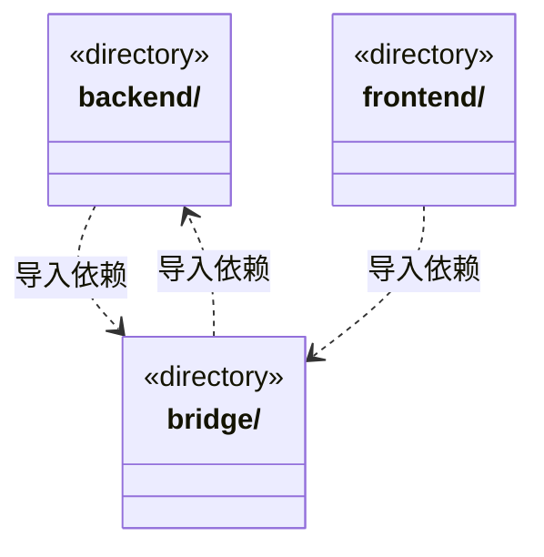

# src 架构

## 目录定位

应用按前端视图层 frontend 与本机后端逻辑层 backend 分组，bridge 是连接两层的通信边界，不是第三个业务层。目录聚合中的 backend 与 bridge 双向箭头分别来自 main 消费契约、契约重导出 Core 公开类型，不代表文件循环。

本文描述当前实现。通过分析目录边界后维护的 [源码架构脚本](../scripts/source-architecture.mjs) 同步清单和声明；代码变更时仍须核对职责、关键成员与关系。

## 代码清单

本层无直接代码文件。

## 架构类图

各图中的同名节点表示同一目录边界；跨组及完整直接依赖如下（无边不代表继承）：

- `backend` → `bridge`：导入。
- `bridge` → `backend`：导入。
- `frontend` → `bridge`：导入。

## 子目录导航

- [backend/](backend/ARCHITECTURE.md)：本机后端：core 持有领域规则和执行契约；engines 实现具体模型引擎；scheduler-engine 编排任务与装配引擎；main 管理平台、存储和应用入口；updater 独立更新。Core 不导入具体引擎或上层；目录聚合图的双向关系不等于文件循环。
- [bridge/](bridge/ARCHITECTURE.md)：前后端通信边界：contracts 声明公开数据，preload 提供 Electron 安全桥。契约可重导出 Core 公开类型和纯函数，不暴露后端服务、凭据和存储实现。
- [frontend/](frontend/ARCHITECTURE.md)：React 桌面界面。只消费 contracts 和自身组件，不导入调度或主进程实现。

每次修改本目录代码，同步维护文件头、关键契约说明及本图。未实现的治理、证据验收和自动编排能力不列入当前类图。
