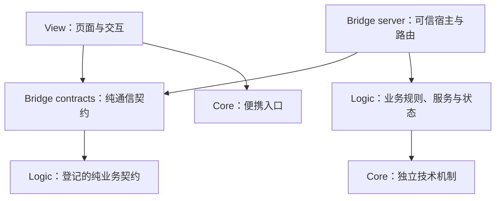

# 源码阅读路线

先从四层边界和一条实际操作路径建立整体认识，再进入具体业务。这里说明当前代码的职责与修改入口；目录清单和声明见各层 `ARCHITECTURE.md`，业务不变量见对应 `CONTRACT.md`。

## 第一轮：建立四层地图

| 顺序 | 阅读入口 | 要回答的问题 |
| --- | --- | --- |
| 1 | [四层契约](CONTRACT.md) → [源码总览](ARCHITECTURE.md) | 技术机制、业务状态、宿主通信和页面分别归谁？ |
| 2 | [Core](core/ARCHITECTURE.md) → [共享工具契约](core/utility/CONTRACT.md) | 哪些能力不认识业务？静态算法与有状态对象怎样区分？ |
| 3 | [Logic](logic/ARCHITECTURE.md) → [业务修改入口](logic/BOUNDARIES.md) | 一项业务规则、状态和副作用分别在哪个封装？ |
| 4 | [应用生命周期](logic/application/CONTRACT.md) → [Application](logic/application/application.ts) | 谁创建并持有服务？工作区如何打开、退役和关闭？ |
| 5 | [Bridge](bridge/ARCHITECTURE.md) → [IPC 契约](bridge/contracts/ipc-call.ts) | 请求如何跨进程并完成解析？哪些端口只能由可信宿主注入？ |
| 6 | [View](view/ARCHITECTURE.md) → [App](view/shell/App.tsx) | 页面怎样选择工作区、组织会话并调用已有业务端口？ |

目录是系统封装，子目录不是子类。`index.ts` 与已登记的细粒度入口表达消费边界；仅仅位于相邻目录不代表允许互相导入。类型引用也受单向依赖约束。

下面表示允许方向的概览，细粒度许可仍以对应契约和依赖检查为准；箭头不表示运行事件的返回方向。

## 第二轮：跟一次发送消息

以下是普通桌面会话的入口链。新会话、排队输入和历史续接由不同操作承接，不能从界面“发送成功”推断模型已经完成业务。

1. [view/main.tsx](view/main.tsx) 挂载 [App](view/shell/App.tsx)。进入 [Conversation](view/conversation/Conversation.tsx) 的 `send`，先看工作区、任务、运行和模型选择，再看分支：新会话调用 `loop.chat`；已有会话按状态调用 `loop.enqueue` 或 `loop.resume`；安全等待交给续接控制器。
2. [preload](bridge/preload/preload.ts) 将固定调用转交 `cbim:call`。[桌面入口](bridge/server/main.ts) 核实调用窗口与请求；[Bridge Application](bridge/server/application.ts) 只增加 `Dispatch`，业务生命周期仍属于 Logic。
3. [loop-handlers.ts](bridge/server/ipc/loop-handlers.ts) 把已经解析的请求交给明确工作区的执行服务；附件正文与图片通过 `ChatInputs` 和 `Application.ChatOptions` 处理。路由不持有第二套任务状态。
4. [WorkspaceExecutionManager](logic/conversation/runtime/execution-manager.ts) 管理主会话活动运行、排队、续接和启动准备；`Launch` 选择可信 `executionModel`。新协议与旧日志恢复分支在此有实际区别，阅读时不要合并理解。
5. [createExecutionManager](logic/application/assembly/execution.ts) 注入工作区、模型快照、租约及业务端口；新 Agent 调用协议在 [agent-calls.ts](logic/application/assembly/agent-calls.ts) 装配。具体引擎由 [loop-engine.ts](logic/execution/assembly/loop-engine.ts) 选择并组合。
6. [LoopRuntime](logic/execution/rules/runtime/runtime.ts) 执行工具授权、事件记录、取消与排空；[FileRunStorage](logic/execution/storage/run-storage.ts) 和 [RunJournal](logic/execution/storage/run-journal.ts) 维护真实运行日志。页面通过 `loop.threadView` 等读取结果，不由界面缓存替代执行事实。

要理解一次子 Agent 调用，在第 5 步继续读 [Agent 契约](logic/agents/CONTRACT.md)、[Agent 对象](logic/agents/agent.ts)、[AgentCallScheduler](logic/execution/assembly/agent-call-scheduler.ts) 和 [AgentCallExchange](logic/agents/exchange.ts)。调度器保存父子调用与等待关联，子运行仍复用 `LoopRuntime`；结果返回直接调用方。当前问答等待是进程内状态，重启后未知执行不会自动重放。

## 第三轮：找状态与资源的所有者

| 状态或资源 | 所有者与入口 | 阅读时保留的边界 |
| --- | --- | --- |
| 应用服务和已打开工作区 | [Application](logic/application/application.ts) | `open` 合并并发打开；`stop` 关闭单工作区；`shutdown` 关闭应用。Bridge 不复制这些集合。 |
| 工程身份、锁与知识事务 | [Workspace](logic/workspace/service/workspace.ts)、[知识存储](logic/knowledge/storage/ARCHITECTURE.md) | 先核实路径和锁，再恢复存储；知识变更走其原事务。 |
| 业务派发、作用域与原命令回执 | [DispatchStore 契约](logic/dispatch/storage/CONTRACT.md)、[FileDispatchStore](logic/dispatch/storage/dispatch-store.ts) | 同工作区共享一个存储及原子提交边界，不能按目录拆成彼此独立的写入账本。 |
| 主会话队列与活动执行 | [会话契约](logic/conversation/runtime/CONTRACT.md) | 受理、执行、停止、业务通过是不同状态；查询旧回执不代表重新执行。 |
| 实际运行名额与工作区租约 | [准入控制](logic/execution/admission/CONTRACT.md) | 真实退出和排空后才归还占用；只读监控快照不能改变名额。 |
| 模型与引擎选择 | [模型契约](logic/models/CONTRACT.md)、[引擎契约](logic/engines/CONTRACT.md) | 模型目录、引擎包管理与每次执行的冻结选择分别负责，不把凭据交给 View。 |
| 运行日志与历史索引 | [运行存储](logic/execution/storage/CONTRACT.md)、[历史服务](logic/history/service/CONTRACT.md) | 日志保存执行事实，索引用于定位；索引不替代日志正文与原身份。 |
| 受控文件及隔离资源 | [文件操作契约](logic/file-operations/service/CONTRACT.md) | 物理操作可能在取消后仍未退出；未知写入结果不自动重发或回滚。 |
| 页面草稿、选择与加载状态 | [会话视图契约](view/conversation/CONTRACT.md) | 属于当前交互上下文，不是业务授权、运行结果或持久事实。 |

## 按变化选择修改入口

| 变化 | 先读这里 | 应保持的边界 |
| --- | --- | --- |
| 文本、JSON、字节、队列等通用机制 | [core/utility](core/utility/CONTRACT.md) | 按能力封装；不加入工作区、任务或页面策略。有实例状态的队列和请求表保持实例类。 |
| 页面操作与结果展示 | [view](view/CONTRACT.md)、目标页面目录 | React 组件和 Hook 保留框架形式；仅经类型化 Bridge 请求业务。 |
| 新增或调整通信操作 | [bridge/contracts](bridge/contracts/CONTRACT.md)、[IPC 路由](bridge/server/ipc/CONTRACT.md) | 请求／响应配对、运行时解析和真实业务端口一起核对，不向 View 暴露服务实例。 |
| 执行协议或引擎实现 | [执行装配](logic/execution/assembly/CONTRACT.md)、[引擎端口](logic/execution/ports/CONTRACT.md) | 具体实现只在装配点选择；运行服务依赖协议，不能由规则反向读取 Application。 |
| Agent 调用、等待和结果回传 | [Agent 契约](logic/agents/CONTRACT.md)、[Agent 调用装配](logic/application/assembly/agent-calls.ts) | 身份与等待属于原调用链；准入、预算和运行循环复用现有服务。 |
| 业务规则、知识或文件影响 | [业务边界](logic/BOUNDARIES.md)、[调度契约](logic/SCHEDULING.md) | 先找权威状态和事务，再改业务入口；模型回合完成不等于业务验收通过。 |
| 更新和桌面启动 | [更新契约](logic/updates/CONTRACT.md)、[冷启动契约](bridge/server/bootstrap/CONTRACT.md) | 固定宿主、活动版本和业务资源边界独立，保留用户数据及原恢复语义。 |

这些是当前代码中可核实的职责和扩展位置，不表示所有接口已经稳定，也不表示所有存量源码均已按阅读规范完成整理。依赖较密集的 Application、执行装配和派发服务仍需围绕真实变化原因逐片分析；不能仅因文件大或名称相近就拆分。

## 怎样使用目录文档

- `ARCHITECTURE.md`：完整直接文件清单、当前声明、静态依赖和子目录导航。父目录只展开本层边界，子目录内部继续下钻；同名类的分图合起来阅读。
- `CONTRACT.md`：人工维护的封装理由、状态与资源所有权、调用契约和扩展边界。其内容由生成器附加到同目录架构文档，不直接修改生成附录。
- 源码文件头与成员注释：对照实现理解具体决策、失败与释放语义。静态工具使用 `XxxUtils.Method()`；有独立生命周期的对象使用实例；接口、React 组件和宿主入口保留各自形式。
- 验证：按实际变更选择 [测试模块归属](../tests/modules.json) 中相关单元和边界测试。只读或纯文档整理不需要运行产品测试；生成器的一致性检查不能代替代码语义 review。

当前整理切片及实际验证记在 [开发记录](../design/development-log.md)。该记录是历史证据，实时开发清单仍在 GitHub Issues。
