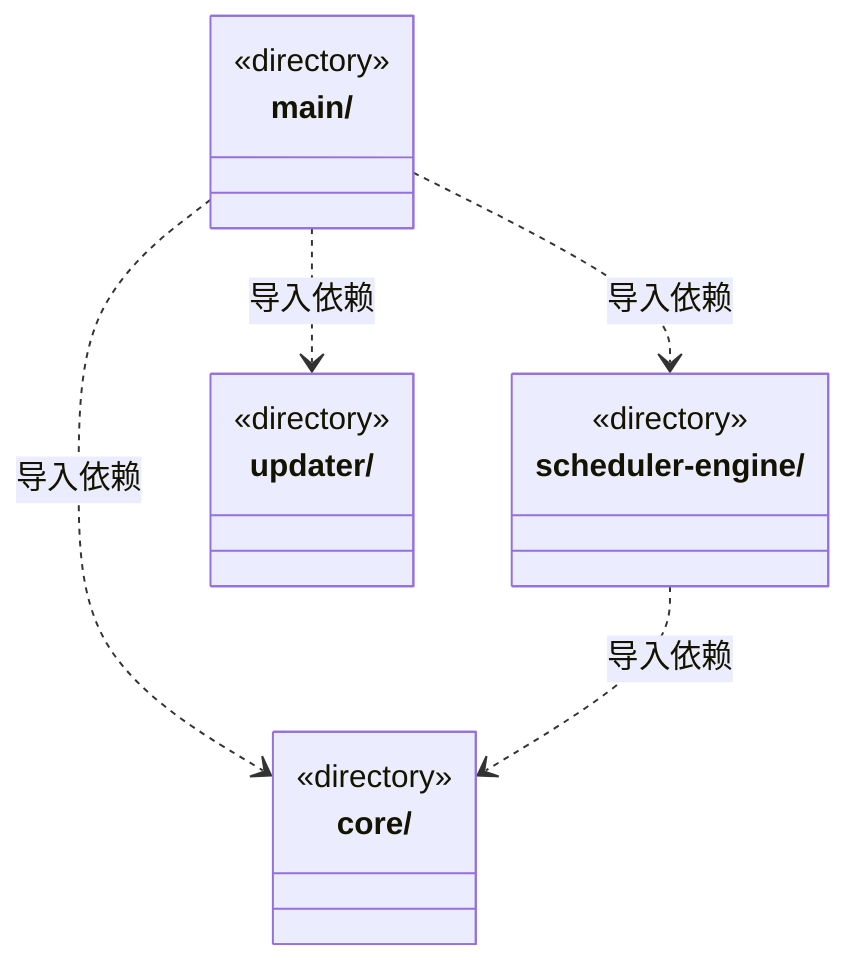

# src/backend 架构

## 目录定位

本机后端逻辑层：main 装配平台与服务，scheduler-engine 协调执行，core 提供领域与大脑能力。updater 是独立更新子系统，不依赖运行时、调度或反馈服务；主程序只调用它。后端不导入前端界面。

本文描述当前实现。通过分析目录边界后维护的 [源码架构脚本](../../scripts/source-architecture.mjs) 同步清单和声明；代码变更时仍须核对职责、关键成员与关系。

## 代码清单

本层无直接代码文件。

## 架构类图

各图中的同名节点表示同一目录边界；跨组及完整直接依赖如下（无边不代表继承）：

- `main` → `core`：导入。
- `main` → `scheduler-engine`：导入。
- `main` → `updater`：导入。
- `scheduler-engine` → `core`：导入。

## 子目录导航

- [core/](core/ARCHITECTURE.md)：核心领域与通用执行契约。大脑、团队、业务模块、知识和工具各自维护语义；不导入 main、调度、IPC 或界面。知识快照与固定领域视图保持单向依赖，跨域知识查询编排归 scheduler-engine/context；其他目录聚合双向箭头仍须按真实契约区分，不代表文件级循环或全模块已解耦。
- [main/](main/ARCHITECTURE.md)：Electron 入口与应用装配。显式资料导入共用应用级取消表，关闭撤销在途读取，原生选择迟到不落新会话。应用单例持有全局准入和持久策略，主/成员共享许可；工作区代际退役撤销等待，已有运行真实退出才释放。注入可信身份及证据，重启不执行历史票据或等待周期。 可信桌面提交注入本机明确操作来源，选定文件核实共用只读租约与平台端口。 member-dispatch 为请求预算注入窄 Store，底层跨领域事务继续统一持有。 正式安装版调用独立updater，主Frame固定IPC与正常排空后显式安装；启动前恢复更新重启的用户目录，开发和便携包不自动联网。 agent-history 独立组合历史服务与canonical读取，只接收工作区身份、目录和存活断言；工作区持锁初始化及排空关闭顺序保持。 工作区唯一账本装配岗位模型端口；明确拒绝旧直接业务启动，原聊天和知识治理保持独立。 原 canonical 历史端口独立装配给交接处置，不开新的模型或原生运行入口。 原命令核实只装配已打开工作区的 canonical 和唯一账本，不隐式启动、初始化或恢复。 影响服务装配已打开工作区端口，真实本机处置身份不由模型或 IPC 参数指定。 影响观察注入原知识事务窄读取端口，不向调度层开放写入或恢复方法。 装配独立文件 utility 及唯一工作区服务；原运行释放前确认物理操作排空，缺少平台能力时不装配可写工具。 11项原生操作按契约解析并配对成功值，主Frame和安装门禁先行。
- [scheduler-engine/](scheduler-engine/ARCHITECTURE.md)：工作区调度。装配团队上下文与模型工具，协调会话、运行、用户问题和队列；只依赖自身及 Core。
- [updater/](updater/ARCHITECTURE.md)：独立桌面更新子系统：公开 Release 读取、稳定版本筛选、每分钟检查及用户发起的下载/自动安装状态机和 NSIS 适配均在此目录。只依赖公开更新契约及系统/第三方库，不导入 main、scheduler-engine 或 core/runtime；通过关闭回调等待主程序排空。安装包缓存独立于运行数据。

[返回上层](../ARCHITECTURE.md)。

每次修改本目录代码，同步维护文件头、关键契约说明及本图。未实现的治理、证据验收和自动编排能力不列入当前类图。
