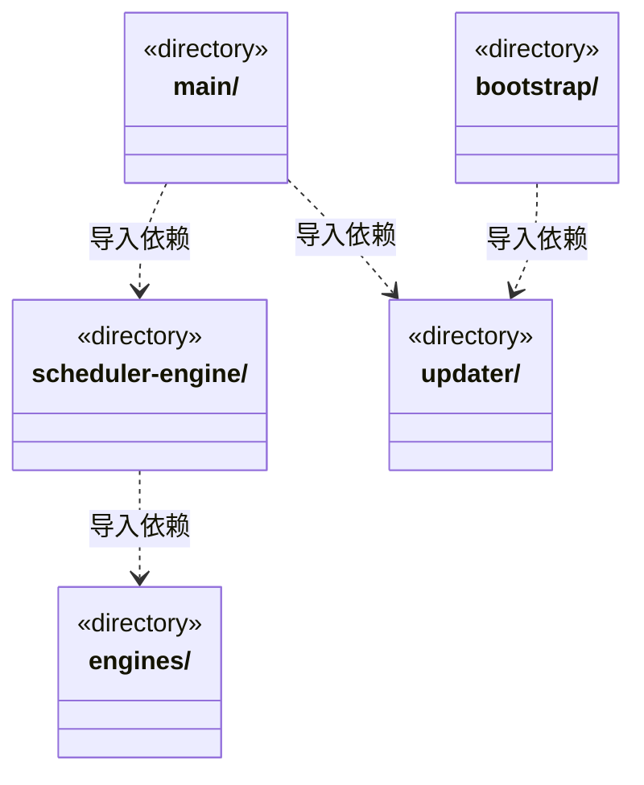
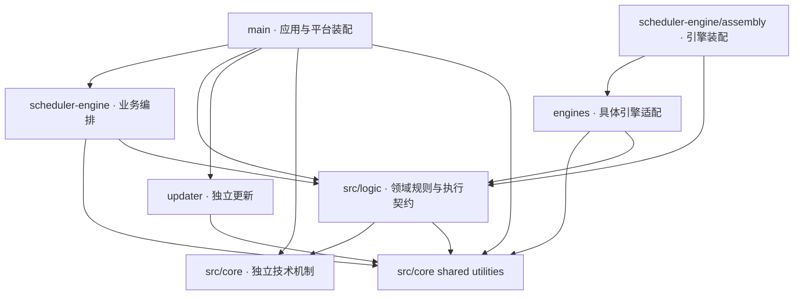

# src/backend 架构

## 目录定位

待迁移宿主服务、调度编排、引擎与启动更新；领域规则已迁入 Logic，共享技术机制归 Core。

本文描述当前实现。通过分析目录边界后维护的 [源码架构脚本](../../scripts/source-architecture.mjs) 同步清单和声明；代码变更时仍须核对职责、关键成员与关系。

## 代码清单

本层无直接代码文件。

## 架构类图

各图中的同名节点表示同一目录边界；跨组及完整直接依赖如下（无边不代表继承）：

- `bootstrap` → `updater`：导入。
- `main` → `scheduler-engine`：导入。
- `main` → `updater`：导入。
- `scheduler-engine` → `engines`：导入。

## 子目录导航

- [bootstrap/](bootstrap/ARCHITECTURE.md)：固定冷壳入口：先验证同 C 的签名资源集合，再放行候选访问原 profile；独立选择日志、单实例、失败恢复及按需引擎下载由冷壳持有。计算式 main.js 装载保留可审计的源码依赖边。
- [engines/](engines/ARCHITECTURE.md)：具体引擎适配边界：Pi、Claude、Codex 及其共享 HTTP 预算传输和原生工具加载。依赖 Core 的引擎/模型契约，由 scheduler-engine/assembly 选择并注入；不持有任务派发与应用存储。 runtime-binding 在 agentHome 固定原生会话的 E 摘要；包变化时拒绝无兼容依据的恢复，历史不删除、不自动迁移。 可组合 utility 通用入口的分帧与在途集合，不依赖其 Node 入口或其他基础方案。
- [main/](main/ARCHITECTURE.md)：Electron 入口与应用装配。显式资料导入共用应用级取消表，关闭撤销在途读取，原生选择迟到不落新会话。应用单例持有全局准入和持久策略，主/成员共享许可；工作区代际退役撤销等待，已有运行真实退出才释放。注入可信身份及证据，重启不执行历史票据或等待周期。 可信桌面提交注入本机明确操作来源，选定文件核实共用只读租约与平台端口。 member-dispatch 为请求预算注入窄 Store，底层跨领域事务继续统一持有。 正式安装版调用独立updater，主Frame固定IPC与正常排空后显式安装；启动前恢复更新重启的用户目录，开发和便携包不自动联网。 agent-history 独立组合历史服务与canonical读取，只接收工作区身份、目录和存活断言；工作区持锁初始化及排空关闭顺序保持。 工作区唯一账本装配岗位模型端口；明确拒绝旧直接业务启动，原聊天和知识治理保持独立。 原 canonical 历史端口独立装配给交接处置，不开新的模型或原生运行入口。 原命令核实只装配已打开工作区的 canonical 和唯一账本，不隐式启动、初始化或恢复。 影响服务装配已打开工作区端口，真实本机处置身份不由模型或 IPC 参数指定。 影响观察注入原知识事务窄读取端口，不向调度层开放写入或恢复方法。 装配独立文件 utility 及唯一工作区服务；原运行释放前确认物理操作排空，缺少平台能力时不装配可写工具。 11项原生操作按契约解析并配对成功值，主Frame和安装门禁先行。 startDesktop 由固定 bootstrap 调用；初始化应用目录后先加载窗口，再恢复工作区。R 启动确认同时需要页面加载完成和 React 的目录 IPC 成功。
- [scheduler-engine/](scheduler-engine/ARCHITECTURE.md)：工作区调度。装配团队上下文与模型工具，协调会话、运行、用户问题和队列；只依赖自身及 Core。
- [updater/](updater/ARCHITECTURE.md)：独立桌面更新子系统：公开 Release 读取、稳定版本筛选、后台预下载与用户确认重启的状态机和 NSIS 适配均在此目录。只依赖公开更新契约及系统/第三方库，不导入 main、scheduler-engine 或 core/runtime；仅明确安装时通过关闭回调等待主程序排空。安装包缓存独立于运行数据。 C/R 复用一个准备和显式应用状态机；Ed25519 清单、完整 ZIP 文件集合、不可变包缓存和激活日志属于冷壳可信机制。候选一旦接触数据，失败只能恢复，不能自动降级。

[返回上层](../ARCHITECTURE.md)。

每次修改本目录代码，同步维护文件头、关键契约说明及本图。未实现的治理、证据验收和自动编排能力不列入当前类图。

## 设计契约 v1 与落地范围

以下内容区分已接通能力与后续设计；以各节的实现状态为准，不将目标图当作现状图。维护源：[CONTRACT.md](CONTRACT.md)；生成类图时同步附加，勿直接修改本附录。

# 后端模块与源码导航

本图描述源码依赖；箭头从使用方指向被使用方。目录是定位入口，只有明确的职责、公开契约和依赖限制才构成模块边界。`runtime/`、`capabilities/` 等子目录是所属模块内部的职责分区，不据此宣称已经独立解耦。

`Assembly` 是 `Scheduler` 的内部目录。普通编排目录和 Main 不直接引用具体引擎，Main 通过调度装配接入运行能力。Main 和 Updater 还消费 `bridge/contracts`；Bridge 只公开 Core 的契约/纯函数，前端不直接引用后端。

Updater 对共享 Core 的依赖限于 utility 通用公开入口，用于已获准响应的有界字节消费；更新源、GET/跳转、期限、签名和安装状态仍由更新子系统决定，不引入 Main 凭据或服务，也不能使用旧 files/web。

Engines 同样只消费 utility 通用入口：Pi/Codex 组合 LF 拆帧，Codex 组合在途集合。协议、授权、超时、取消与真实进程退出仍由适配器拥有；不能借此依赖其他基础方案或应用服务。

共享 src/core 的 utility、文件、网页、错误与 JSON 适配已经独立。旧 backend/core 已迁至 src/logic 各业务规则与端口；本目录暂留宿主服务、调度、具体引擎和更新启动。

## 按职责定位

| 修改对象 | 规则／契约 | 编排 | 本机实现 |
| --- | --- | --- | --- |
| 模型执行 | [执行规则](../logic/execution/rules/ARCHITECTURE.md)、[预算规则](../logic/budget/rules/ARCHITECTURE.md) | [assembly](scheduler-engine/assembly/ARCHITECTURE.md)、[conversation](scheduler-engine/conversation/ARCHITECTURE.md)、[members](scheduler-engine/members/ARCHITECTURE.md) | [engines](engines/ARCHITECTURE.md)、[run-storage](main/run-storage/ARCHITECTURE.md) |
| 任务与目标 | [tasks](../logic/tasks/rules/ARCHITECTURE.md)、[dispatch](../logic/dispatch/rules/ARCHITECTURE.md) | [dispatch](scheduler-engine/dispatch/ARCHITECTURE.md)、[goals](scheduler-engine/goals/ARCHITECTURE.md) | [dispatch-storage](main/dispatch-storage/ARCHITECTURE.md) |
| 证据与预算 | [evidence](../logic/evidence/rules/ARCHITECTURE.md)、[budget](../logic/budget/rules/ARCHITECTURE.md) | [evidence](scheduler-engine/evidence/ARCHITECTURE.md)、[budget](scheduler-engine/budget/ARCHITECTURE.md) | [evidence](main/evidence/ARCHITECTURE.md)、[预算存储适配](main/dispatch-storage/request-budget-store.ts) |
| 知识与岗位 | [knowledge](../logic/knowledge/rules/ARCHITECTURE.md)、[team](../logic/team/rules/ARCHITECTURE.md)、[workspace](../logic/workspace/rules/ARCHITECTURE.md) | [context](scheduler-engine/context/ARCHITECTURE.md) | [knowledge](main/knowledge/ARCHITECTURE.md)、[registry](main/registry/ARCHITECTURE.md) |
| 文件与隔离执行 | [file-operations](../logic/file-operations/rules/ARCHITECTURE.md) | 由成员能力与应用服务调用 | [file-operations](main/file-operations/ARCHITECTURE.md)、[platform/files](main/platform/files/ARCHITECTURE.md)、[platform/isolation](main/platform/isolation/ARCHITECTURE.md) |
| 履历与资料 | [team 履历契约](../logic/team/rules/ARCHITECTURE.md) | [history](scheduler-engine/history/ARCHITECTURE.md) | [history](main/history/ARCHITECTURE.md)、[materials](main/materials/ARCHITECTURE.md) |

状态归属没有因目录迁移变化：派发事务仍由 FileDispatchStore 原子提交，运行日志仍由 RunStorage 管理，知识写入仍经原文件事务和端口。运行数据位置、IPC 名称与打包输出名保留兼容。

## 维护与限制

先读修改对象的契约和规则，再沿编排读到实际存储或平台副作用。新增引擎主要进入 `engines/<engine>` 与 `scheduler-engine/assembly/loop-engine.ts`；公共引擎契约确需改变时，仍须明确消费者与兼容影响，不能声称增加引擎绝不修改核心。

Logic 规则已禁止依赖具体引擎。LoopRuntime、loop-engine、ScopeGoalService 的依赖密度和共享 DispatchStore 的宽接口仍在；当前聚合目录不等于已完成这些职责拆分。没有足够变更历史证明稳定性的模块仍作为稳定候选，不能以文件位置证明稳定。

源码与依赖图由现有检查器提取；未来 review 先看 Git diff 和受影响模块，再按需要扩大阅读。目录定位与设计理由在契约/生成器中维护，不在每次 review 重新生成全仓源码快照。
