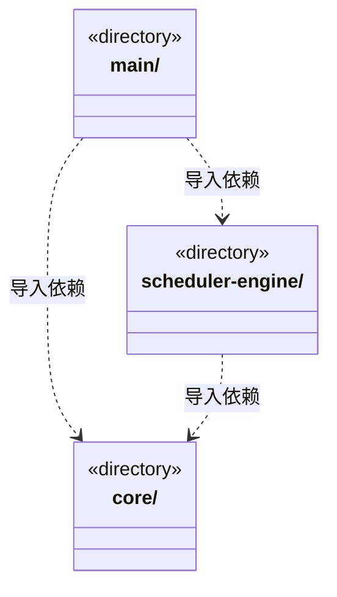

# src/backend 架构

## 目录定位

本机后端逻辑层：main 装配平台与服务，scheduler-engine 协调执行，core 提供领域与大脑能力。调度单向依赖 Core；后端不导入前端界面。

本文描述当前实现。通过分析目录边界后维护的 [源码架构脚本](../../scripts/source-architecture.mjs) 同步清单和声明；代码变更时仍须核对职责、关键成员与关系。

## 代码清单

本层无直接代码文件。

## 架构类图

各图中的同名节点表示同一目录边界；跨组及完整直接依赖如下（无边不代表继承）：

- `main` → `scheduler-engine`：导入。
- `main` → `core`：导入。
- `scheduler-engine` → `core`：导入。

## 子目录导航

- [core/](core/ARCHITECTURE.md)：核心领域与通用执行契约。大脑、团队、业务模块、知识和工具各自维护语义；不导入 main、调度、IPC 或界面。brain/tasks、knowledge/team/workspace 的目录双向箭头来自不同契约文件，不代表文件级循环。
- [main/](main/ARCHITECTURE.md)：Electron 入口与应用装配。显式资料导入共用应用级取消表，关闭撤销在途读取，原生选择迟到不落新会话。应用单例持有全局准入和持久策略，主/成员共享许可；工作区代际退役撤销等待，已有运行真实退出才释放。注入可信身份及证据，重启不执行历史票据或等待周期。 可信桌面提交注入本机明确操作来源，选定文件核实共用只读租约与平台端口。 工作区唯一账本装配岗位模型端口；明确拒绝旧直接业务启动，原聊天和知识治理保持独立。 原 canonical 历史端口独立装配给交接处置，不开新的模型或原生运行入口。
- [scheduler-engine/](scheduler-engine/ARCHITECTURE.md)：工作区调度。装配团队上下文与模型工具，协调会话、运行、用户问题和队列；只依赖自身及 Core。

[返回上层](../ARCHITECTURE.md)。

每次修改本目录代码，同步维护文件头、关键契约说明及本图。未实现的治理、证据验收和自动编排能力不列入当前类图。
