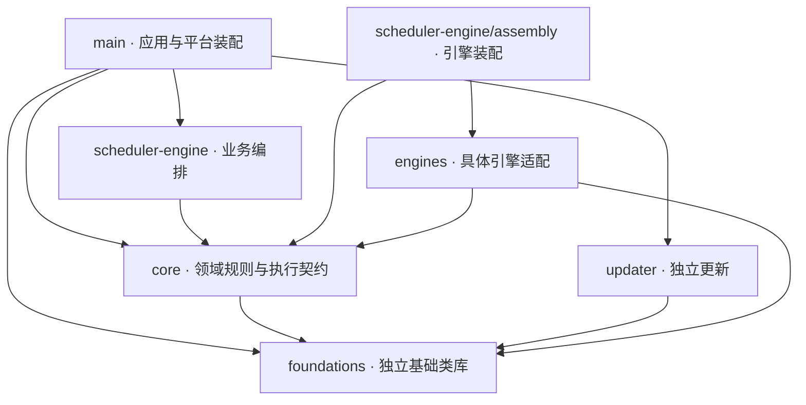

# 后端模块与源码导航

本图描述源码依赖；箭头从使用方指向被使用方。目录是定位入口，只有明确的职责、公开契约和依赖限制才构成模块边界。`runtime/`、`capabilities/` 等子目录是所属模块内部的职责分区，不据此宣称已经独立解耦。

`Assembly` 是 `Scheduler` 的内部目录。普通编排目录和 Main 不直接引用具体引擎，Main 通过调度装配接入运行能力。Main 和 Updater 还消费 `bridge/contracts`；Bridge 只公开 Core 的契约/纯函数，前端不直接引用后端。

Updater 对 foundations 的依赖限于 utility 通用公开入口，用于已获准响应的有界字节消费；更新源、GET/跳转、期限、签名和安装状态仍由更新子系统决定，不引入 Main 凭据或服务。

Engines 同样只消费 utility 通用入口：Pi/Codex 组合 LF 拆帧，Codex 组合在途集合。协议、授权、超时、取消与真实进程退出仍由适配器拥有；不能借此依赖其他基础方案或应用服务。

`foundations` 位于 `src/foundations`，不是 Core 的子模块，不依赖任何其他项目模块；只使用本层、标准库及必要第三方库。Core 知识探测使用文件公开入口；Main 组合网页读取、原子文件和实例串行队列。业务设置、工具注册、锁和事务决策仍留在所属模块。见 [基础类库边界](../foundations/CONTRACT.md)。

## 按职责定位

| 修改对象 | 规则／契约 | 编排 | 本机实现 |
| --- | --- | --- | --- |
| 模型执行 | [core/execution](core/execution/ARCHITECTURE.md)、[core/models](core/models/ARCHITECTURE.md) | [assembly](scheduler-engine/assembly/ARCHITECTURE.md)、[conversation](scheduler-engine/conversation/ARCHITECTURE.md)、[members](scheduler-engine/members/ARCHITECTURE.md) | [engines](engines/ARCHITECTURE.md)、[run-storage](main/run-storage/ARCHITECTURE.md) |
| 任务与目标 | [tasks](core/tasks/ARCHITECTURE.md)、[dispatch](core/dispatch/ARCHITECTURE.md) | [dispatch](scheduler-engine/dispatch/ARCHITECTURE.md)、[goals](scheduler-engine/goals/ARCHITECTURE.md) | [dispatch-storage](main/dispatch-storage/ARCHITECTURE.md) |
| 证据与预算 | [evidence](core/evidence/ARCHITECTURE.md)、[budget](core/budget/ARCHITECTURE.md) | [evidence](scheduler-engine/evidence/ARCHITECTURE.md)、[budget](scheduler-engine/budget/ARCHITECTURE.md) | [evidence](main/evidence/ARCHITECTURE.md)、[预算存储适配](main/dispatch-storage/request-budget-store.ts) |
| 知识与岗位 | [knowledge](core/knowledge/ARCHITECTURE.md)、[team](core/team/ARCHITECTURE.md)、[workspace](core/workspace/ARCHITECTURE.md) | [context](scheduler-engine/context/ARCHITECTURE.md) | [knowledge](main/knowledge/ARCHITECTURE.md)、[registry](main/registry/ARCHITECTURE.md) |
| 文件与隔离执行 | [file-operations](core/file-operations/ARCHITECTURE.md) | 由成员能力与应用服务调用 | [file-operations](main/file-operations/ARCHITECTURE.md)、[platform/files](main/platform/files/ARCHITECTURE.md)、[platform/isolation](main/platform/isolation/ARCHITECTURE.md) |
| 履历与资料 | [team 履历契约](core/team/ARCHITECTURE.md) | [history](scheduler-engine/history/ARCHITECTURE.md) | [history](main/history/ARCHITECTURE.md)、[materials](main/materials/ARCHITECTURE.md) |

状态归属没有因目录迁移变化：派发事务仍由 FileDispatchStore 原子提交，运行日志仍由 RunStorage 管理，知识写入仍经原文件事务和端口。运行数据位置、IPC 名称与打包输出名保留兼容。

## 维护与限制

先读修改对象的契约和规则，再沿编排读到实际存储或平台副作用。新增引擎主要进入 `engines/<engine>` 与 `scheduler-engine/assembly/loop-engine.ts`；公共引擎契约确需改变时，仍须明确消费者与兼容影响，不能声称增加引擎绝不修改核心。

Core 已禁止依赖具体引擎。LoopRuntime、loop-engine、ScopeGoalService 的依赖密度和共享 DispatchStore 的宽接口仍在；当前聚合目录不等于已完成这些职责拆分。没有足够变更历史证明稳定性的模块仍作为稳定候选，不能以文件位置证明稳定。

源码与依赖图由现有检查器提取；未来 review 先看 Git diff 和受影响模块，再按需要扩大阅读。目录定位与设计理由在契约/生成器中维护，不在每次 review 重新生成全仓源码快照。
