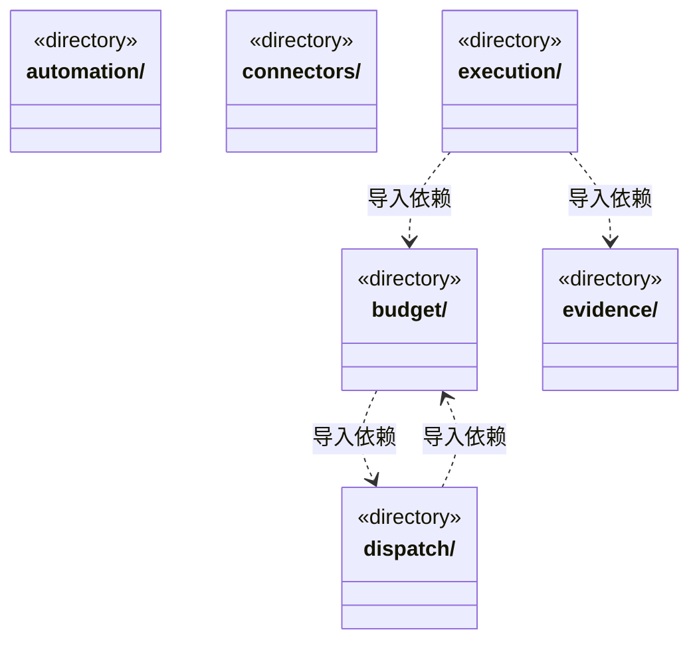
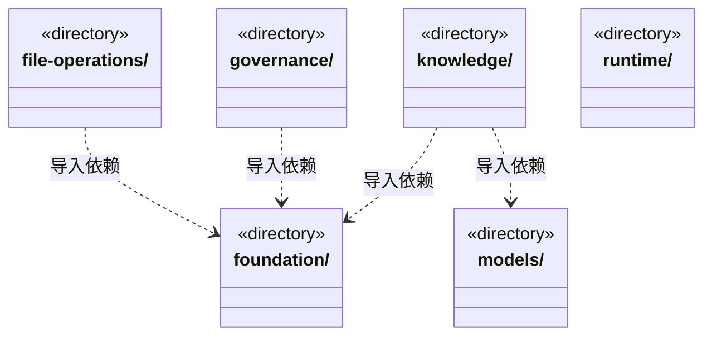
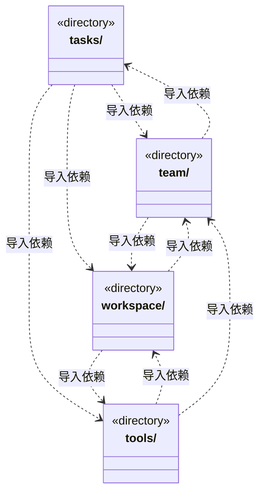

# src/backend/core 架构

## 目录定位

领域规则、存储端口和引擎无关执行机制。按预算、证据、任务、派发、知识、模型及工具职责聚合；execution/runtime 仍是执行模块内部实现，尚未解决该运行内核的依赖密度。禁止反向依赖 engines、scheduler-engine、main 或前端。

本文描述当前实现。通过分析目录边界后维护的 [源码架构脚本](../../../scripts/source-architecture.mjs) 同步清单和声明；代码变更时仍须核对职责、关键成员与关系。

## 代码清单

本层无直接代码文件。

## 架构类图

各图中的同名节点表示同一目录边界；跨组及完整直接依赖如下（无边不代表继承）：

- `budget` → `foundation`：导入。
- `budget` → `team`：导入。
- `budget` → `dispatch`：导入。
- `budget` → `tasks`：导入。
- `connectors` → `tools`：导入。
- `dispatch` → `team`：导入。
- `dispatch` → `tasks`：导入。
- `dispatch` → `workspace`：导入。
- `dispatch` → `file-operations`：导入。
- `dispatch` → `budget`：导入。
- `evidence` → `file-operations`：导入。
- `evidence` → `foundation`：导入。
- `evidence` → `tools`：导入。
- `evidence` → `tasks`：导入。
- `evidence` → `workspace`：导入。
- `execution` → `foundation`：导入。
- `execution` → `evidence`：导入。
- `execution` → `tasks`：导入。
- `execution` → `file-operations`：导入。
- `execution` → `workspace`：导入。
- `execution` → `tools`：导入。
- `execution` → `team`：导入。
- `execution` → `budget`：导入。
- `file-operations` → `foundation`：导入。
- `file-operations` → `workspace`：导入。
- `file-operations` → `evidence`：导入。
- `file-operations` → `dispatch`：导入。
- `file-operations` → `team`：导入。
- `governance` → `foundation`：导入。
- `knowledge` → `foundation`：导入。
- `knowledge` → `connectors`：导入。
- `knowledge` → `workspace`：导入。
- `knowledge` → `models`：导入。
- `models` → `budget`：导入。
- `runtime` → `tasks`：导入。
- `runtime` → `execution`：导入。
- `runtime` → `team`：导入。
- `tasks` → `foundation`：导入。
- `tasks` → `team`：导入。
- `tasks` → `dispatch`：导入。
- `tasks` → `models`：导入。
- `tasks` → `execution`：导入。
- `tasks` → `tools`：导入。
- `tasks` → `budget`：导入。
- `tasks` → `evidence`：导入。
- `tasks` → `knowledge`：导入。
- `tasks` → `file-operations`：导入。
- `tasks` → `workspace`：导入。
- `tasks` → `governance`：导入。
- `team` → `models`：导入。
- `team` → `workspace`：导入。
- `team` → `foundation`：导入。
- `team` → `tasks`：导入。
- `team` → `execution`：导入。
- `tools` → `models`：导入。
- `tools` → `foundation`：导入。
- `tools` → `governance`：导入。
- `tools` → `workspace`：导入。
- `tools` → `team`：导入。
- `tools` → `connectors`：导入。
- `workspace` → `foundation`：导入。
- `workspace` → `team`：导入。
- `workspace` → `tools`：导入。

## 子目录导航

- [automation/](automation/ARCHITECTURE.md)：自动化定义、运行与执行/存储端口及纯时区日程计算，不依赖调度和桌面实现。
- [budget/](budget/ARCHITECTURE.md)：预算领域：Scope 使用量、预占/结算、模型请求规则和存储端口。规则不访问应用文件与具体传输，业务服务在 scheduler-engine/budget。
- [connectors/](connectors/ARCHITECTURE.md)：链接器定义、查询与唯一身份检查；另定义 GitHub 反馈字段、公开登录状态与可信端口，纯协议不发网络请求或授予权限。
- [dispatch/](dispatch/ARCHITECTURE.md)：派发存储及命令端口：保持当前宽存储接口和原子性边界。只是明确接口目录，尚未拆分共享 DispatchStore；任务规则仍在 tasks，编排在 scheduler-engine/dispatch。
- [evidence/](evidence/ARCHITECTURE.md)：证据领域：输出清单、产物、命令/人工/效果观察与完成报告规则。记录、有效性和业务验收分别核实；平台读取在 main/evidence，编排在 scheduler-engine/evidence。
- [execution/](execution/ARCHITECTURE.md)：引擎无关的运行契约与执行入口。runtime、capabilities 是同一执行模块的内部职责分区，不声明为已经独立解耦的子系统；状态、日志和授权语义保持原有契约。具体引擎由上层装配。 EngineRuntimeResolver 是受管引擎已验证包的窄契约；不包含下载实现、活动指针或用户凭据。
- [file-operations/](file-operations/ARCHITECTURE.md)：受控文件操作和隔离执行的冻结协议、规则与恢复状态。平台副作用经端口实现，不因物理目录聚合改变授权、路径校验或证据效力。
- [foundation/](foundation/ARCHITECTURE.md)：少量跨领域基础：错误、序列化、严格 JSON、标识及路径端口。files.ts 是 Node 文件原语，不管理应用目录、事务或账户。 StoragePaths 的可选 protectedRoots 标明安装目录之外的程序缓存，实际路径核验仍归平台。
- [governance/](governance/ARCHITECTURE.md)：模块知识治理的纯协议、保护规则与有界主工具投影。可信来源、冻结意见引用与本机评价独立于正式实施，旧意见替代不改历史，不把治理记录当业务验收。
- [knowledge/](knowledge/ARCHITECTURE.md)：知识快照、校验、领域查询、对象变更和可移植静态包规划。私有v2计划冻结有序操作与整包替换范围，公共变更不能提供来源证明；物理事务与缓存经端口注入。团队能力可独立复用，业务模板必须完整，不携带动态成员或任务。 KnowledgeQueries 只接收 snapshot；KnowledgeRefresh 独立持有身份核实、原回执查询与提交。 read-models.ts 是固定快照读取的公开入口，snapshot 与 Team/BusinessWorkspace 模型属于同一私有实现边界；查询编排不反向进入纯快照契约。 产品反馈 Skill 只读发布两套上下文格式，不包含 GitHub 创建接口。 快照数据与只读访问是独立公共边界；索引刷新通过收窄端口调用原知识事务，不导入团队或模块查询视图。 SourceSnapshotReader 只提供知识队列外层的同版快照，调用方不得在任务事务内反向获取。 原知识工具和事务观察共用实际输入解析，纯摘要区分未查到、持久阶段及不可核实，不返回正文或私有路径。
- [models/](models/ARCHITECTURE.md)：公开模型参数、能力元数据、计量与请求预算端口；实际 HTTP 传输在 backend/engines/transport，配置和加密凭据在 main/models。Core 不认识具体 SDK。
- [runtime/](runtime/ARCHITECTURE.md)：应用级只读监管、真实周期白名单与独立准入契约。周期等待/结算和模型轮次分开，严格传输不补造缺失计量；游标、票据和占用不签发恢复权。
- [tasks/](tasks/ARCHITECTURE.md)：任务计划、派发图、目标与等待。资料清单保留旧文件v1，新增严格v2来源并核同序与字节；快照不等于当前来源或业务验收。依赖追加核实两端及后继未领取、当前计划与真实图，完整审计验证后才放行精确新边；保留原任务/实例，领取时绑定真实结果。运行内补充以pending/accepted/rejected/unknown分开，接受与waiting共享连续输入版本，未知阻止完成。流程选择共用叶子契约，缺省与显式分开匹配，已派发选择不可改写；严格输出区分保存与交付，历史不补造授权或证据。 model-request-budget-storage 只公开请求预算状态、追加命令及准入能力，不授予其它领域写入。 正式协议将目标分配、任务、准备、模型和历史审计相互核对；岗位绑定不可重写，旧在途仅按原事实收束。 检查点显式放弃有独立严格协议与精确联合变更校验；原任务和检查点证据不可重写，纯 ACK 与后续周期释放保持可用。 原主命令核实定义八工具的有界报告；原工具结果、事务保存和业务验收分开，查询回执不能成为交付证据。 主／成员影响来源使用严格联合；观察、不可变处置和新核实／修复引用分别表达，当前文件不补造成功基线或业务验收。纯 scope-public 白名单供主工具与会话详情共用，保留安全恢复来源并隐藏原生上下文。 影响报告的可选知识事务摘要保留原工具状态并参与观察依据；旧处置缺省不补字段。 单文件操作公开协议不含正文备份；私有意图与阶段严格绑定原成员运行和原授权，补偿引用可靠 applied 与真实 before，终态不可改写。 保守产物时序包含外部写，GitHub 回执不能充当文件基线来源。
- [team/](team/ARCHITECTURE.md)：Team、小组、Agent 和父链 Skill 视图、实例及静态角色 Session 履历契约。主实例归主会话，业务实例归周期与任务；履历按角色聚合真实通道，释放或删定义后保留，旧记录不补造实例。另含稳定工作区岗位的严格DTO、采纳快照与不可变登记规则；岗位启用不等于执行许可。 model.ts 是知识读取模块的私有实现，外部通过 knowledge/read-models 访问；岗位与执行状态契约不归读取视图所有。 负责岗位选择、冻结执行绑定、当前来源/能力/模型判定及只读分组发现均为纯契约；同角色多岗位独立。
- [tools/](tools/ARCHITECTURE.md)：工具 Schema、版本、副作用、调用决策、严格提问/答案及回执。提问按原题同序核验，取消与答案排他；during_wait只承诺结束未完成交互。结果只核唯一 JSON 快照，不用解析改写制造成功；历史可读不等于当前业务证据有效。注册、发现及用户回答不授予权限。 原生能力按 Pi/Claude Code/Codex 提供真实预检清单，Codex 由宿主执行既有文件操作，Claude 不宣称独立 ls。 GitHub 反馈使用独立 scope 和 external-write 效果；不把外部提交回执当作业务文件或知识成果。
- [workspace/](workspace/ARCHITECTURE.md)：领域工程、Module、Workflow与稳定岗位责任协议。来源代次和写前屏障由纯规则投影；内容指纹、来源身份、负责人关系分别核实。同负责人明确采纳递增关系版本，不迁移任务；旧缺省记录不补造来源。Workflow验证不自行读文件或签发业务验收。 model.ts 是知识读取模块的私有实现，外部通过 knowledge/read-models 访问；项目根定义仍为独立纯公开契约。 executionScope只收窄原权限，全模块一致冻结，预算合并取小。 主调度的负责人发现按所选模块真实分组，缺口不推测继承或默认负责者。

[返回上层](../ARCHITECTURE.md)。

每次修改本目录代码，同步维护文件头、关键契约说明及本图。未实现的治理、证据验收和自动编排能力不列入当前类图。
