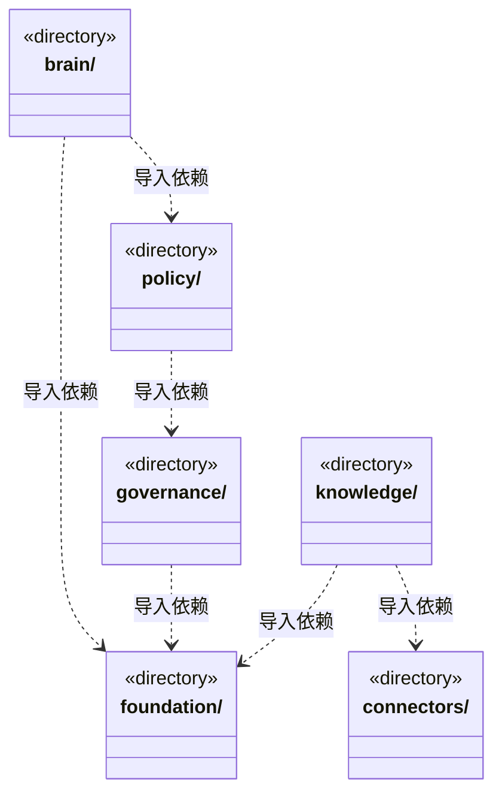
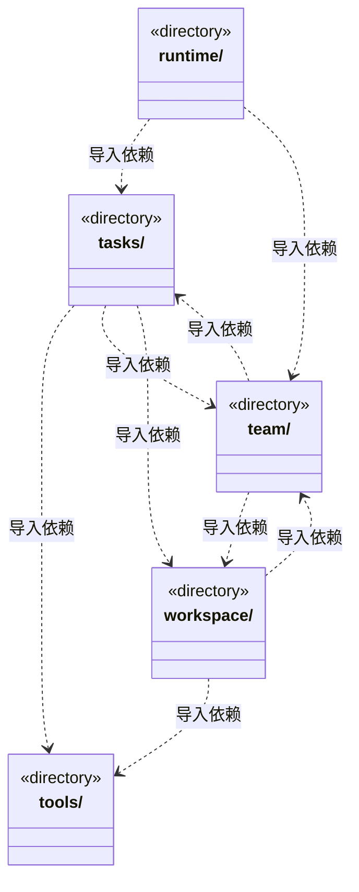

# src/backend/core 架构

## 目录定位

核心领域与通用执行契约。大脑、团队、业务模块、知识和工具各自维护语义；不导入 main、调度、IPC 或界面。brain/tasks、knowledge/team/workspace 的目录双向箭头来自不同契约文件，不代表文件级循环。

本文描述当前实现。通过分析目录边界后维护的 [源码架构脚本](../../../scripts/source-architecture.mjs) 同步清单和声明；代码变更时仍须核对职责、关键成员与关系。

## 代码清单

本层无直接代码文件。

## 架构类图

各图中的同名节点表示同一目录边界；跨组及完整直接依赖如下（无边不代表继承）：

- `brain` → `foundation`：导入。
- `brain` → `tasks`：导入。
- `brain` → `team`：导入。
- `brain` → `tools`：导入。
- `brain` → `workspace`：导入。
- `brain` → `policy`：导入。
- `connectors` → `tools`：导入。
- `governance` → `foundation`：导入。
- `knowledge` → `foundation`：导入。
- `knowledge` → `team`：导入。
- `knowledge` → `workspace`：导入。
- `knowledge` → `connectors`：导入。
- `policy` → `tools`：导入。
- `policy` → `governance`：导入。
- `policy` → `workspace`：导入。
- `runtime` → `tasks`：导入。
- `runtime` → `brain`：导入。
- `runtime` → `team`：导入。
- `tasks` → `foundation`：导入。
- `tasks` → `tools`：导入。
- `tasks` → `team`：导入。
- `tasks` → `brain`：导入。
- `tasks` → `policy`：导入。
- `tasks` → `workspace`：导入。
- `team` → `workspace`：导入。
- `team` → `foundation`：导入。
- `team` → `knowledge`：导入。
- `team` → `tasks`：导入。
- `team` → `brain`：导入。
- `tools` → `policy`：导入。
- `tools` → `foundation`：导入。
- `tools` → `connectors`：导入。
- `workspace` → `foundation`：导入。
- `workspace` → `knowledge`：导入。
- `workspace` → `team`：导入。
- `workspace` → `tools`：导入。

## 子目录导航

- [brain/](brain/ARCHITECTURE.md)：引擎无关的执行循环、事件与计量；运行内补充只由可信入口写绑定scope/run/queue的接收日志，返回真实序号；queued后日志失败保持未知。插入绑定原run和停止信号，原生确认与未知分别记录，结算先排空插入日志。正式成员按冻结Workflow验证JSON指定字节，验证与交付复核各持短锁，前后核版本/知识/停止；checked暂存不等于passed有效证明。求助/检查点保存后结束本轮，文件采集随真实工具结束释放短锁；续执行不借旧证据。 成员的公开任务和原生运行共用冻结岗位绑定，历史缺省可读但不授权应用新领取。
- [connectors/](connectors/ARCHITECTURE.md)：链接器定义、查询与唯一身份检查；当前不执行外部插件。
- [foundation/](foundation/ARCHITECTURE.md)：少量跨领域基础：错误、序列化、严格 JSON、标识及路径端口。files.ts 是 Node 文件原语，不管理应用目录、事务或账户。
- [governance/](governance/ARCHITECTURE.md)：模块知识治理的纯协议、保护规则与有界主工具投影。可信来源、冻结意见引用与本机评价独立于正式实施，旧意见替代不改历史，不把治理记录当业务验收。
- [knowledge/](knowledge/ARCHITECTURE.md)：知识快照、校验、领域查询、对象变更和可移植静态包规划。私有v2计划冻结有序操作与整包替换范围，公共变更不能提供来源证明；物理事务与缓存经端口注入。团队能力可独立复用，业务模板必须完整，不携带动态成员或任务。 SourceSnapshotReader 只提供知识队列外层的同版快照，调用方不得在任务事务内反向获取。
- [policy/](policy/ARCHITECTURE.md)：内部运行的统一授权：业务与知识写入共用 read/ask/execute，平台边界不可豁免；不声称操作系统隔离。
- [runtime/](runtime/ARCHITECTURE.md)：应用级只读监管、真实周期白名单与独立准入契约。周期等待/结算和模型轮次分开，严格传输不补造缺失计量；游标、票据和占用不签发恢复权。
- [tasks/](tasks/ARCHITECTURE.md)：任务计划、派发图、目标与等待。资料清单保留旧文件v1，新增严格v2来源并核同序与字节；快照不等于当前来源或业务验收。依赖追加核实两端及后继未领取、当前计划与真实图，完整审计验证后才放行精确新边；保留原任务/实例，领取时绑定真实结果。运行内补充以pending/accepted/rejected/unknown分开，接受与waiting共享连续输入版本，未知阻止完成。流程选择共用叶子契约，缺省与显式分开匹配，已派发选择不可改写；严格输出区分保存与交付，历史不补造授权或证据。 正式协议将目标分配、任务、准备、模型和历史审计相互核对；岗位绑定不可重写，旧在途仅按原事实收束。 检查点显式放弃有独立严格协议与精确联合变更校验；原任务和检查点证据不可重写，纯 ACK 与后续周期释放保持可用。 原主命令核实定义八工具的有界报告；原工具结果、事务保存和业务验收分开，查询回执不能成为交付证据。
- [team/](team/ARCHITECTURE.md)：Team、小组、Agent 和父链 Skill 视图、实例及静态角色 Session 履历契约。主实例归主会话，业务实例归周期与任务；履历按角色聚合真实通道，释放或删定义后保留，旧记录不补造实例。另含稳定工作区岗位的严格DTO、采纳快照与不可变登记规则；岗位启用不等于执行许可。 负责岗位选择、冻结执行绑定、当前来源/能力/模型判定及只读分组发现均为纯契约；同角色多岗位独立。
- [tools/](tools/ARCHITECTURE.md)：工具 Schema、版本、副作用、调用决策、严格提问/答案及回执。提问按原题同序核验，取消与答案排他；during_wait只承诺结束未完成交互。结果只核唯一 JSON 快照，不用解析改写制造成功；历史可读不等于当前业务证据有效。注册、发现及用户回答不授予权限。
- [workspace/](workspace/ARCHITECTURE.md)：领域工程、Module、Workflow与稳定岗位责任协议。来源代次和写前屏障由纯规则投影；内容指纹、来源身份、负责人关系分别核实。同负责人明确采纳递增关系版本，不迁移任务；旧缺省记录不补造来源。Workflow验证不自行读文件或签发业务验收。 主调度的负责人发现按所选模块真实分组，缺口不推测继承或默认负责者。

[返回上层](../ARCHITECTURE.md)。

每次修改本目录代码，同步维护文件头、关键契约说明及本图。未实现的治理、证据验收和自动编排能力不列入当前类图。
