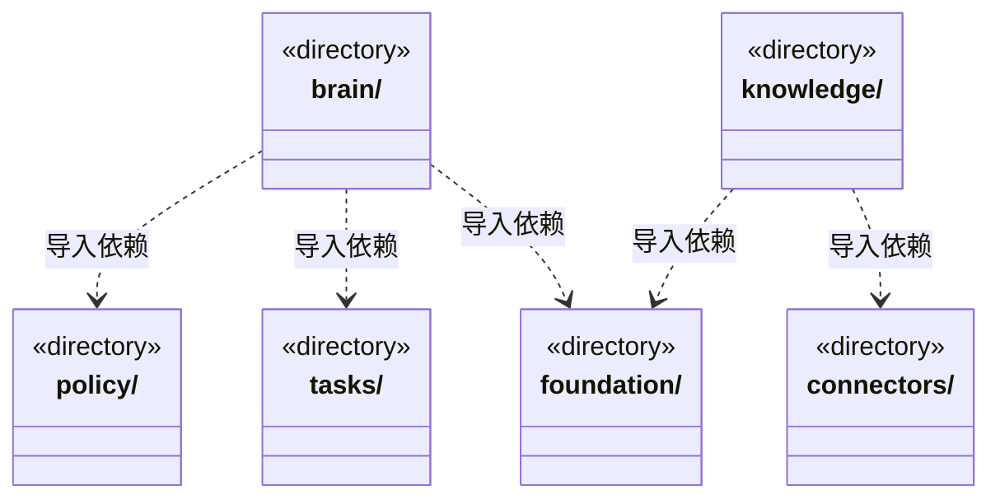
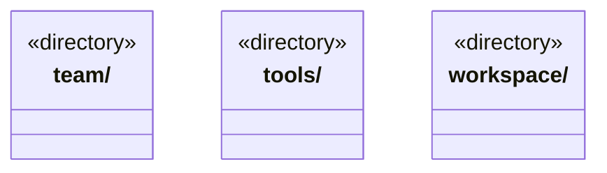

# src/backend/core 架构

## 目录定位

核心领域与通用执行契约。大脑、团队、业务模块、知识和工具各自维护语义；不导入 main、调度、IPC 或界面。

本文描述当前实现。通过分析目录边界后维护的 [源码架构脚本](../../../scripts/source-architecture.mjs) 同步清单和声明；代码变更时仍须核对职责、关键成员与关系。

## 代码清单

本层无直接代码文件。

## 架构类图

各图中的同名节点表示同一目录边界；跨组及完整直接依赖如下（无边不代表继承）：

- `brain` → `foundation`：导入。
- `brain` → `tasks`：导入。
- `brain` → `tools`：导入。
- `brain` → `policy`：导入。
- `knowledge` → `foundation`：导入。
- `knowledge` → `team`：导入。
- `knowledge` → `workspace`：导入。
- `knowledge` → `connectors`：导入。
- `team` → `knowledge`：导入。
- `team` → `foundation`：导入。
- `tools` → `foundation`：导入。
- `workspace` → `knowledge`：导入。
- `workspace` → `foundation`：导入。

## 子目录导航

- [brain/](brain/ARCHITECTURE.md)：与具体模型引擎无关的执行循环及事件契约。通过 RunStorage 注入可靠日志，执行结束不代表业务验收。
- [connectors/](connectors/ARCHITECTURE.md)：链接器定义、查询与唯一身份检查；当前不执行外部插件。
- [foundation/](foundation/ARCHITECTURE.md)：少量跨领域基础：错误、序列化、严格 JSON、标识及路径端口。files.ts 是 Node 文件原语，不管理应用目录、事务或账户。
- [knowledge/](knowledge/ARCHITECTURE.md)：知识快照、校验、领域查询和对象变更规划。物理事务通过 KnowledgeWorkspace 注入，预览缓存通过 ObjectStorage 注入。Team/Workspace 仅依赖本目录的只读快照辅助，不依赖查询门面或工具注册。
- [policy/](policy/ARCHITECTURE.md)：现有对话权限与确认的数据契约。尚未统一知识写开关和原生权限，不将目录存在视为权限重构完成。
- [tasks/](tasks/ARCHITECTURE.md)：任务定义和待执行消息契约。区分 taskId 与 runId；当前不包含业务自动验收或 Workflow 状态机。
- [team/](team/ARCHITECTURE.md)：Team、小组、Agent 和父链 Skill 的只读领域视图；通过版本固定的快照解析，不依赖工作区进程。
- [tools/](tools/ARCHITECTURE.md)：通用工具 Schema、注册表、调用决策和结构化提问契约。注册与发现不授予执行权限。
- [workspace/](workspace/ARCHITECTURE.md)：领域工程、Module 与本模块 Workflow 的只读视图；与 main/workspace 的本机生命周期分开。

[返回上层](../ARCHITECTURE.md)。

每次修改本目录代码，同步维护文件头、关键契约说明及本图。未实现的治理、证据验收和自动编排能力不列入当前类图。
