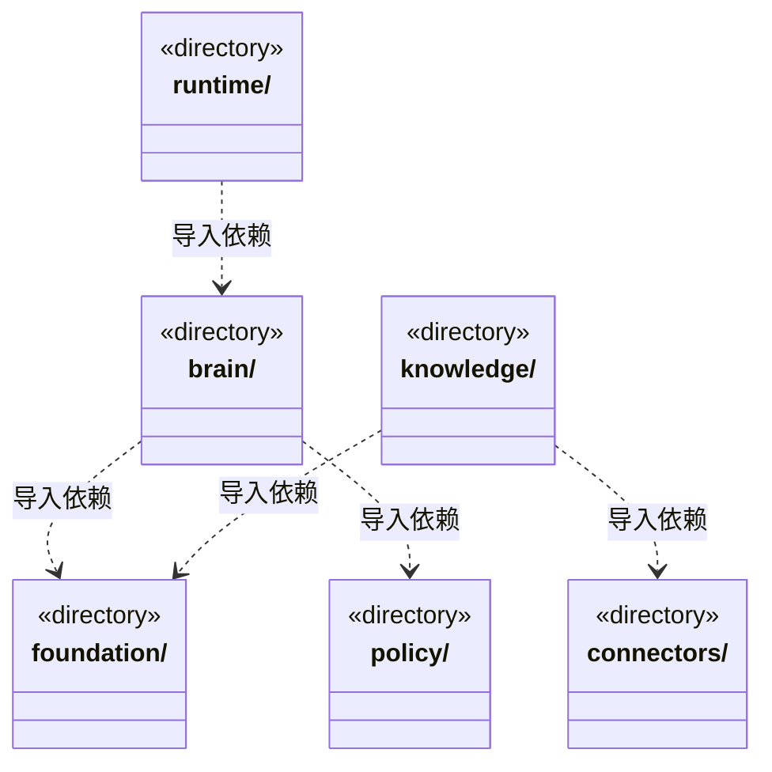
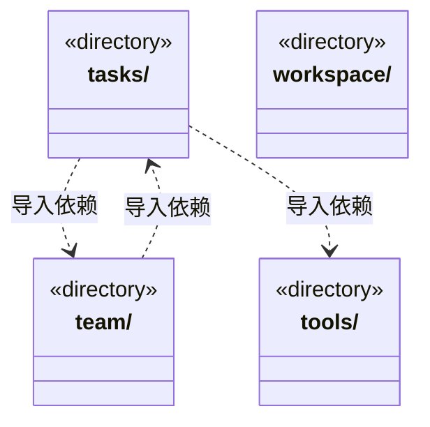

# src/backend/core 架构

## 目录定位

核心领域与通用执行契约。大脑、团队、业务模块、知识和工具各自维护语义；不导入 main、调度、IPC 或界面。brain/tasks、knowledge/team/workspace 的目录双向箭头来自不同契约文件，不代表文件级循环。

本文描述当前实现。通过分析目录边界后维护的 [源码架构脚本](../../../scripts/source-architecture.mjs) 同步清单和声明；代码变更时仍须核对职责、关键成员与关系。

## 代码清单

本层无直接代码文件。

## 架构类图

各图中的同名节点表示同一目录边界；跨组及完整直接依赖如下（无边不代表继承）：

- `brain` → `foundation`：导入。
- `brain` → `tasks`：导入。
- `brain` → `tools`：导入。
- `brain` → `policy`：导入。
- `knowledge` → `foundation`：导入。
- `knowledge` → `team`：导入。
- `knowledge` → `workspace`：导入。
- `knowledge` → `connectors`：导入。
- `policy` → `tools`：导入。
- `runtime` → `brain`：导入。
- `runtime` → `tasks`：导入。
- `runtime` → `team`：导入。
- `tasks` → `team`：导入。
- `tasks` → `brain`：导入。
- `tasks` → `policy`：导入。
- `tasks` → `foundation`：导入。
- `tasks` → `tools`：导入。
- `team` → `knowledge`：导入。
- `team` → `foundation`：导入。
- `team` → `tasks`：导入。
- `team` → `brain`：导入。
- `tools` → `foundation`：导入。
- `workspace` → `knowledge`：导入。
- `workspace` → `foundation`：导入。

## 子目录导航

- [brain/](brain/ARCHITECTURE.md)：引擎无关的执行循环与事件契约。主对话以 conversationBinding 固定实例，正式任务以 memberBinding 固定业务运行，两者互斥；可信结果来源与回执先落盘，旧历史不补造身份，续跑不改绑或混合原生上下文。
- [connectors/](connectors/ARCHITECTURE.md)：链接器定义、查询与唯一身份检查；当前不执行外部插件。
- [foundation/](foundation/ARCHITECTURE.md)：少量跨领域基础：错误、序列化、严格 JSON、标识及路径端口。files.ts 是 Node 文件原语，不管理应用目录、事务或账户。
- [knowledge/](knowledge/ARCHITECTURE.md)：知识快照、校验、领域查询、对象变更和可移植静态包规划。团队能力可独立复用，业务模板必须完整；物理事务与预览缓存经端口注入，不携带动态成员或任务。Team/Workspace 只依赖快照辅助，不依赖查询门面。
- [policy/](policy/ARCHITECTURE.md)：内部运行的统一授权：业务与知识写入共用 read/ask/execute，平台边界不可豁免；不声称操作系统隔离。
- [runtime/](runtime/ARCHITECTURE.md)：应用级运行监管契约：主会话和正式任务按可信绑定归属实例，旧 Loop 无绑定保留 role-only；实时对话占用、轮次用量和负载分开表达，只读投影不签发执行权。
- [tasks/](tasks/ARCHITECTURE.md)：任务计划、派发图、周期目标与安全等待检查点。原子校验输入、计划/审阅和不可逆关闭；waiting占唯一未关闭槽但无活动执行。公开摘要及详情用独立游标，模型判断不冒充人工验收。
- [team/](team/ARCHITECTURE.md)：Team、小组、Agent 和父链 Skill 视图、实例及静态角色 Session 履历契约。主实例归主会话，业务实例归周期与任务；履历按角色聚合真实通道，释放或删定义后保留，旧记录不补造实例。
- [tools/](tools/ARCHITECTURE.md)：工具 Schema、版本、副作用、调用决策、结构化提问及回执；统一校验结果的 JSON 传输快照，拒绝缺失文本等无效内容。回执绑定运行身份与输入结果哈希；注册和发现不授予执行权限。
- [workspace/](workspace/ARCHITECTURE.md)：领域工程、Module、本模块 Workflow 的只读视图及显式维护关系类型；作者与维护人分开，与 main/workspace 生命周期分开。

[返回上层](../ARCHITECTURE.md)。

每次修改本目录代码，同步维护文件头、关键契约说明及本图。未实现的治理、证据验收和自动编排能力不列入当前类图。
