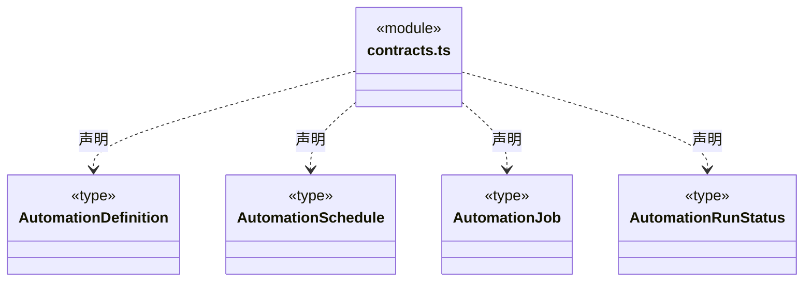
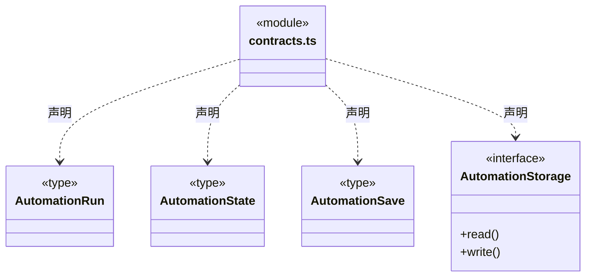
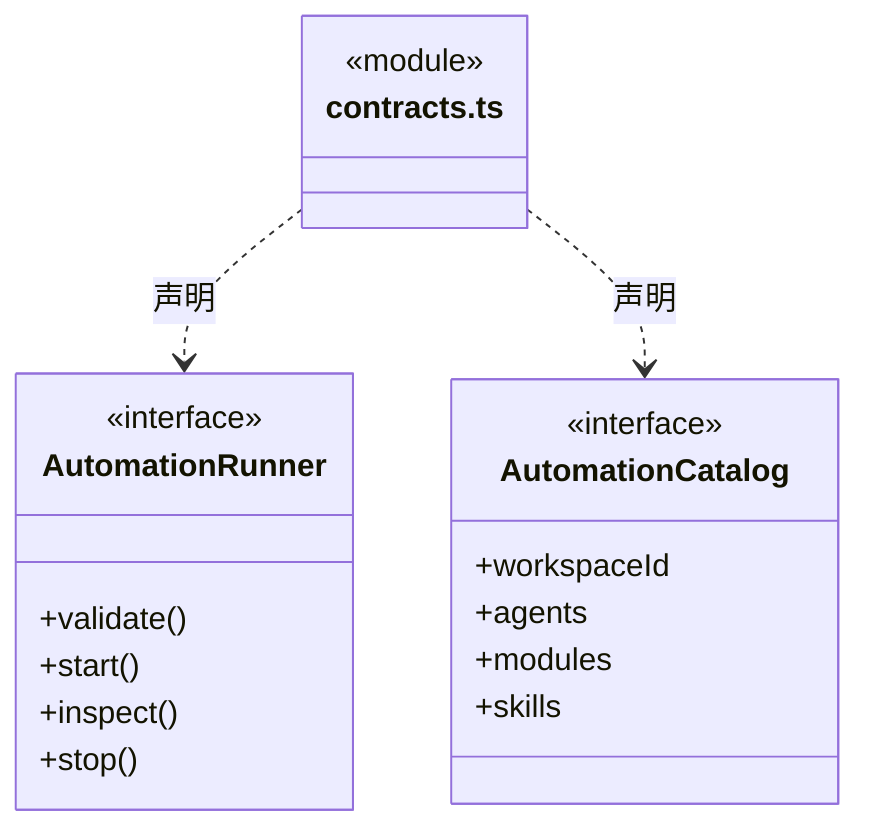
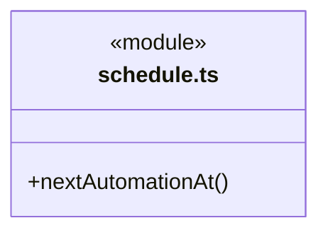
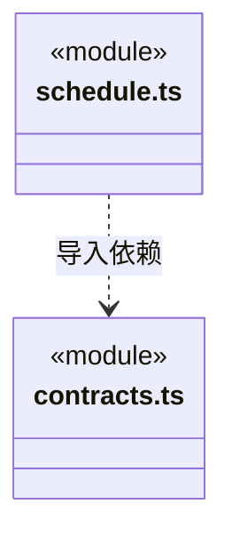

# src/backend/core/automation 架构

## 目录定位

自动化定义、运行与执行/存储端口及纯时区日程计算，不依赖调度和桌面实现。

本文描述当前实现。通过分析目录边界后维护的 [源码架构脚本](../../../../scripts/source-architecture.mjs) 同步清单和声明；代码变更时仍须核对职责、关键成员与关系。

## 代码清单

| 文件 | 当前职责 |
| --- | --- |
| [contracts.ts](contracts.ts) | 工作区自动化的定义、计划、持久启动记录及端口契约。 |
| [schedule.ts](schedule.ts) | 计算下一个自动化触发时刻，不触发执行或读写时钟。 |

## 架构类图

### contracts.ts

### schedule.ts

直接依赖：[contracts.ts](contracts.ts)。

### 本目录调用边界

## 子目录导航

无子目录。

[返回上层](../ARCHITECTURE.md)。

每次修改本目录代码，同步维护文件头、关键契约说明及本图。未实现的治理、证据验收和自动编排能力不列入当前类图。

## 设计契约 v1 与落地范围

以下内容区分已接通能力与后续设计；以各节的实现状态为准，不将目标图当作现状图。维护源：[CONTRACT.md](CONTRACT.md)；生成类图时同步附加，勿直接修改本附录。

# 工作区自动化契约

定义归工作区，运行冻结定义版本，不随配置编辑改写。固定计划为手动、间隔、按 IANA 时区每天及未来一次；不存在自选工作目录。默认 Agent 是主 Agent，成员选择是当前已采纳岗位 ID，不是新建运行实例。

AutomationStorage 只读写有界完整状态，AutomationRunner 提供校验、真实启动、状态观察和停止。启动必须先经 bind 保存实际主 taskId/runId，再执行模型。Unknown 保留原身份并阻止重叠；结果状态不表示业务验收。新日程变化在 schedule.ts，业务派发变化在 Main 适配，不反向改变契约层。
