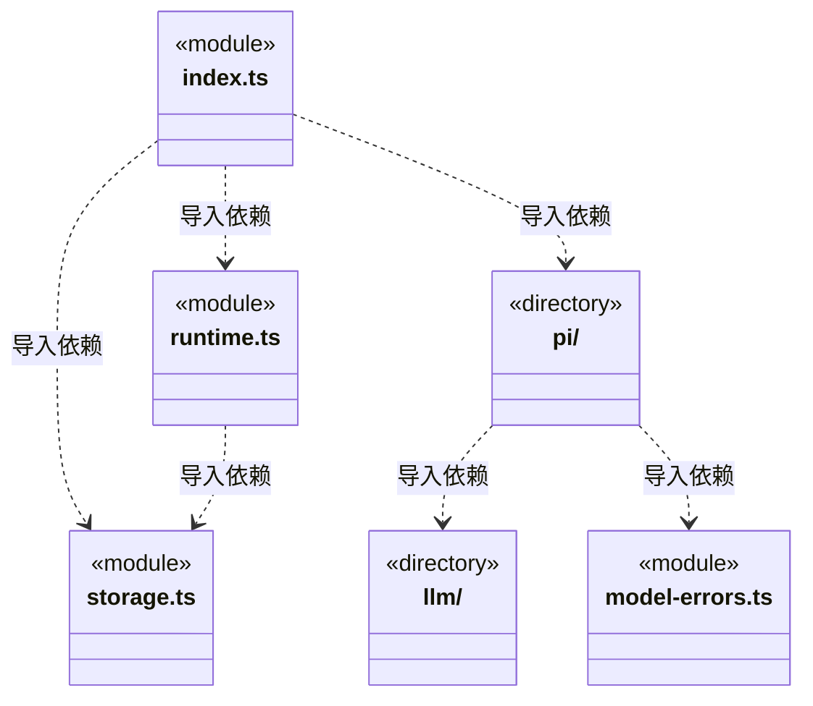
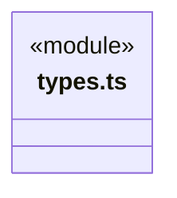

# src/backend/core/brain 架构

## 目录定位

引擎无关的执行循环与事件契约。工具决策先落盘，完成或未知结果生成运行回执；审批后复核停止，恢复不自动重放未知操作。

本文描述当前实现。通过分析目录边界后维护的 [源码架构脚本](../../../../scripts/source-architecture.mjs) 同步清单和声明；代码变更时仍须核对职责、关键成员与关系。

## 代码清单

| 文件 | 当前职责 |
| --- | --- |
| [index.ts](index.ts) | 大脑 执行层：对外重导出 Loop 核心契约、存储端口、运行时与 Pi 适配器。 |
| [model-errors.ts](model-errors.ts) | 把模型结束原因转换为用户可理解的执行错误，供实时引擎和历史回放共用。 |
| [runtime.ts](runtime.ts) | 大脑 执行层：LoopRuntime：任务租约、前置工具策略、运行终态与显式恢复。 |
| [storage.ts](storage.ts) | 执行循环使用的日志和任务目录存储端口。 |
| [types.ts](types.ts) | 大脑 执行层：与具体引擎无关的任务、事件、工具策略和执行摘要契约。 |

## 架构类图

各图中的同名节点表示同一目录边界；跨组及完整直接依赖如下（无边不代表继承）：

- `index.ts` → `types.ts`：导入。
- `index.ts` → `storage.ts`：导入。
- `index.ts` → `runtime.ts`：导入。
- `index.ts` → `pi`：导入。
- `pi` → `types.ts`：导入。
- `pi` → `llm`：导入。
- `pi` → `model-errors.ts`：导入。
- `runtime.ts` → `storage.ts`：导入。
- `runtime.ts` → `types.ts`：导入。
- `storage.ts` → `types.ts`：导入。

## 子目录导航

- [llm/](llm/ARCHITECTURE.md)：公开模型参数、能力元数据及运行快照端口。实际配置文件和加密凭据由 main/persistence/settings 持有。
- [pi/](pi/ARCHITECTURE.md)：Pi 协议、临时桥与运行参数。一次性 gate 连接统一授权，指引明确业务与知识共用运行权限；保留图片、恢复及长度错误报告。

[返回上层](../ARCHITECTURE.md)。

每次修改本目录代码，同步维护文件头、关键契约说明及本图。未实现的治理、证据验收和自动编排能力不列入当前类图。
