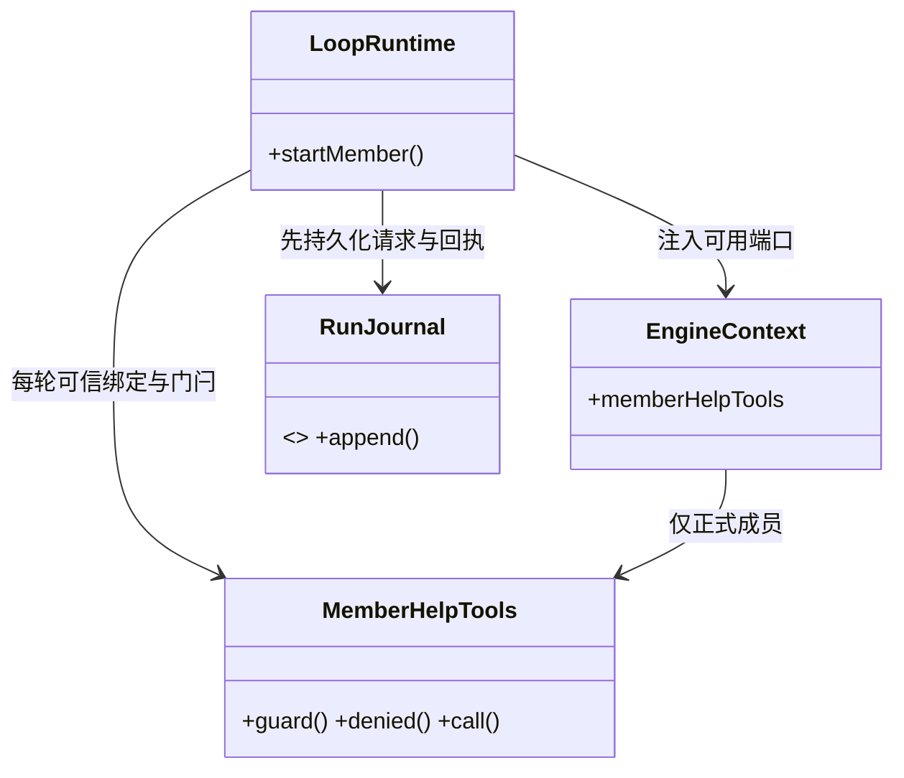
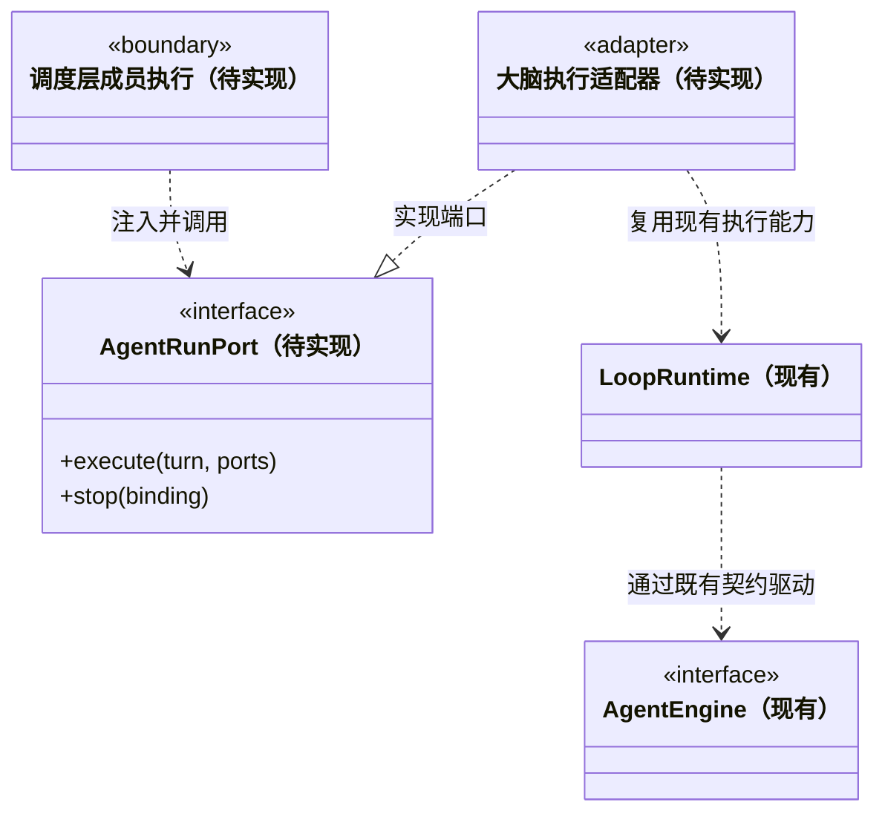

### 成员启动期间的可信停止

`LoopRuntime.startMember` 的可选第四参数只接受可信 `AbortSignal`。它复用主轮的启动停止边界，覆盖租约等待、日志初始化、原生引擎准备及模型调用前检查；不会因尚未登记 `active` 而让 `stop()` 落空。调度层在用户停止、服务关闭和工作区代际退役时同步触发信号。已经保存的领取/日志仍由原终态流程收尾，不删除历史或假装未执行；异常和未知操作继续保留 interrupted。

### 执行成员的一次性求助门闩

`EngineContext.memberHelpTools` 只在 `startMember` 的可信绑定下存在。Pi 透传一次性 gate 的真实 `toolCallId`；主 Agent 伪造工具名仍会被拒绝。运行时在任何异步策略前为求助预占门闩；正在审批或已放行未结束的其它调用都阻止求助。预占之后的新工具仅写入拒绝事实，不进入可能执行集合，也不能反过来干扰已批准的求助。

`cbim_task_help` 执行前再次检查停止、授权、所有在途操作和被引用工具确实属于本轮；先记录 `task.help_requested {help}`，再返回标准 `{state:'staged',help}` 正文，最后由统一 `tool.finished` 签发回执。请求使用固定 MemberRunBinding，没有模型提供的收件人或提权参数。落盘失败不在同轮重放；成功后任何工具仍被拒绝，成员应结束本轮。

staged 不是派发图交接。外层在引擎关闭和 canonical 日志核实后决定是否提交 `TaskNode.help`；取消、异常、未知副作用不发布求助信封。引擎 `run` 返回 completed 后、`close` 排空期间收到停止，最终正常终态改为 cancelled；已有异常或未决操作仍是 interrupted，不将停止解释成回滚。停止意图落盘失败仍尝试中止引擎并保留 interrupted；请求落盘前的参数/引用错误可在旧调用结束后以新 ID 修正，开始落盘后则不得同轮重放。



### 显式新主上下文

`LoopRuntime.startFreshMain(task, message, control)` 只供可信调度入口使用，要求已经登记的 `chat / cbim:main` 绑定。保留逻辑任务与主实例，在取得租约后枚举既有运行目录，并合并 `knownRunIds()` 返回的可靠旧意图（包括尚无日志的意图）；上限 4096 个去重身份。新 runId 与 nativeSessionId 由运行时生成，`beforeRun` 在任何日志或引擎创建前原子保存新周期及上下文边界。

这个入口不读旧运行日志，不传旧 sessionFile、source 或任务进度，不调用 reserveTask 覆盖原目录。旧文件、未知回执与原周期保持原状。`run.started.freshMain` 保存新原生身份与排除集合，便于核对可靠意图；模型和公开 IPC 不能提交这些字段。停止覆盖意图、日志和引擎准备；成功接收意图也不意味着执行成功，重启不自动重放。

`ConversationThreadView` 将可读历史与 `{runId,code,message}` 问题分开。`resumeRunId` 只能来自当前上下文的完整运行链，不能从坏记录过滤后的数组末项推测。展示历史与恢复执行的职责分开，问题占位不伪造 RunSummary。

### 当前主对话实例绑定

`ConversationAgentBinding` 为 `{ workspaceId, teamId, agentId, agentInstanceId, agentSessionId, rootSessionId }`，由后端已登记的主实例和会话通道装配到 `RuntimeOptions.conversationBinding`。每个主会话拥有自己的 `cbim:main` 实例；聊天与该会话派发图根引用同一个实例，不以相同角色名代替实例身份。大脑只接收可信身份快照，不创建或寻找实例。`checkedConversationAgentBinding` 拒绝额外字段、无效标识、非 `chat / cbim:main` 输入、不同工作区或 `rootSessionId !== TaskSpec.taskId`，并复制输入。

`run.started.conversationBinding` 持久化这份身份，`EngineContext` 接收独立快照，`RunSummary` 从日志校验恢复。续聊已有绑定时必须完整保持原团队、实例、通道和根身份，不能丢失字段或改换实例；旧日志没有绑定时保持缺省，允许后端在显式新一轮续聊时首次绑定，旧日志不改写。当前兼容映射仍使用聊天 `TaskSpec.taskId` 作为根会话 ID，不因此产生业务任务节点。

主对话的 `conversation` 通道与图根结果邮箱分别登记。主实例负责调度与团队/业务知识管理，正式业务任务使用独立执行实例；不能同时提供 `conversationBinding` 与 `MemberRunBinding`。聊天的原生历史仍通过原任务日志中的 `sessionFile` 续接，保留完整任务定义和未决工具检查。运行时从原轮次最后一次 `session.bound.sessionId` 提取期望原生身份，与该事件的文件一起传给适配器；不能把逻辑 `agentSessionId` 或聊天 `taskId` 当作旧原生 ID。Pi 在模型调用前核对实际原生 ID，防止同工作区错误文件串入别的主会话。旧日志缺少原生 ID 时不补造，Pi 明确拒绝恢复并要求核实原始记录或新建对话；旧记录仍可阅读。可信成员结果来源可以与主对话绑定并存，仍需安全完成后才接续。实例租约、图投影和注册对象一致性由调度层负责，运行日志读取不启动执行。

主 Agent 的 Pi 指引区分两种能力：内部 `cbim_` 知识服务保留查询、预览和 CRUD，知识写入遵循本轮 read/ask/execute 及实际审批、版本和事务检查；原生业务 `write/edit/bash` 始终不提供，业务实现交给独立执行 Agent。运行装配对 `business-write / command` 另设主角色拒绝边界，不能靠用户选择 execute 或批准恢复这些能力。工具发现不等于写入授权，知识提交仍经过 `beforeTool` 的持久化决策与工具回执。

### 当前显式用户补充与启动屏障

`RunInputSource` 是判别联合：`MemberResultSource` 表示成员资料；`UserContinuationSource` 为 `{kind:'user-continuation',continuationId,scopeId,waitId,inputRevision}`，表示用户通过专门入口补充原目标。后者仍作为真实用户消息进入 Pi；两者都不能签署人工验收，公开聊天参数不能构造可信来源。

`LoopRuntime.start` 第五参 `RunStartControl` 由可信调度注入。取得租约并核实旧日志绑定后生成真实 runId，在新日志和引擎创建前等待 `beforeRun({task,runId})` 提交启动意图。真实 Pi 文件/身份仍在 `engine.start` 内复核，后置失败不能自动还原等待或重放意图。

`AbortSignal` 覆盖 beforeRun、日志初始化、引擎准备和模型发送窗口；执行管理器在 active 登记前也能取消在途启动。提交前中止不消费检查点，用户取消仍可另行关闭目标；提交后停止保留意图并关闭对应周期。启动回执不等于模型已经运行，最终事实继续由日志报告。跨派发日志与运行日志没有原子提交，不把缺日志意图补造为成功执行。

### 当前主会话成员回注入口

`RunInputSource` 的成员结果分支结构为 `{ kind:'member-results', continuationId, messageIds, taskIds }`。`continuationId` 标识同一主轮收到的一批回传；`messageIds` 为结果信封集合，可以为空以报告没有交付候选的失败或受阻任务；`taskIds` 为非空任务集合，两组 ID 不要求逐项对应。`checkedRunInputSource` 校验 ID、集合唯一性和额外字段，并复制输入，避免调用方在异步启动期间改写来源。

`LoopRuntime.start(task, message, resume?, source?)` 只有在原 `chat` 运行安全完成且没有未决工具时才接收此来源。它仍核对完整原任务及会话文件、持有工作区租约、执行本轮权限检查；结果正文没有新增授权。`run.started` 保存来源，`RunSummary.source` 恢复来源，`EngineContext.source` 传入适配器。启动后停止或失败也保留尝试记录，不能把“曾回注”理解成“已业务验收”。普通用户续聊不带此字段。

`RuntimeOptions.createEngine({task, runId})` 提供本轮可信身份，便于调度装配派发工具；模型不能指定该身份。自动链路如何在主轮释放租约后启动成员、如何按来源去重及确认信封，由调度协调器负责。大脑不会在读取日志或应用重启时自行重新执行。

### 当前成员执行入口

`member-run.ts` 已实现 `MemberRunBinding` 和 `MemberRunLaunch`：调度先保存任务、成员和运行绑定，再调用 `LoopRuntime.startMember(task, message, launch)`。绑定包括 `workspaceId / teamId / agentId / agentInstanceId / agentSessionId / rootSessionId / taskId / runId / leaseEpoch / planRevision`；原生 `nativeSessionId / sessionFile?` 作为单独的后端启动参数传入，不进入公开任务图。业务任务必须指定成员及非空模块列表，运行日志写入完整绑定，读取时核对任务和轮次身份。

`startMember` 与普通 `start / resume` 共用租约、工具决策持久化、回执、计划工具和终态处理，使用调度预分配的 `runId`。成员新任务不能伪装为旧 `TaskSpec` 的恢复；现阶段拒绝重复业务任务及普通 `resume` 恢复成员日志，不自动重试。是否能复用同成员通道由调度核实：上轮必须安全完成且没有未决工具，并持有成员及通道执行槽；大脑不会根据角色名寻找最近的 Session。

`EngineContext.nativeSessionId` 使首次启动可以使用成员通道的原生身份，后续任务通过该身份和已核实的 `sessionFile` 继续同一通道。Pi 同时验证文件属于该工作区受管理会话目录，并从真实子进程 `get_state` 核对 `sessionId`，不一致时在模型生成前中断。未提供该字段的普通对话保留原有以 `taskId` 新建会话的行为。

`RuntimeOptions.onEngineReady` 是启动事务的可靠确认点：`engine.start` 完成后，在 `engine.run` 和本轮模型生成之前等待回调。Pi 会在 `start` 返回前等待 `session.bound` 落盘；其他引擎未报告文件时，回调中的 `sessionFile` 可以缺省。回调携带实际 `taskId / runId / sessionFile?`，调度可在此提交成员运行状态和原生会话绑定。回调失败会关闭引擎并记录 `interrupted`，不会发送本轮提示。`onEvent` 只观察已落盘事件，其异常被隔离，不能替代该可靠确认。

`start / startMember` 返回的是 `{ runId, done }` 句柄，不保证引擎已经准备成功；最终结果通过 `done` 获取。`stop(taskId)` 只请求停止当前活动运行，不存在活动运行时为空操作；停止请求返回不等于终态已经落盘，也不代表工具副作用已回滚。`close()` 禁止新启动，等待启动注册、停止和结束；成员跨任务的互斥与结果交接仍由调度持有。

执行 `completed` 只表示这段引擎循环正常结束。结构化交付候选仍由 `cbim_delivery_prepare` 在真实计划、有效工具回执和当前验证证据具备时产生；没有提交的普通回复不能成为派发图的 `result_ready`，候选也不等于业务验收。Pi 跨任务同成员通道复用、跨成员隔离及错误原生身份拒绝，由真实 Pi 子进程和本地确定性模型服务验证。

停止在 Pi 发出原生 abort 后可能收到标准 `This operation was aborted` 错误文本；只有已经显式停止且匹配标准取消文本时才归一为取消，其他供应商错误仍保留失败。未知工具结果继续由 `LoopRuntime` 标为 `interrupted`，不会因为用户点击停止而伪装成没有发生副作用。

### 独立成员的大脑执行端口设计

以下保留后续通用执行端口的设计；`AgentRunPort / PreparedAgentTurn / AgentRunOutcome` 及安全等待让出等类型**尚未按下列形式完整实现**。当前实现使用上一节的 `MemberRunLaunch` 与 `startMember`，不把设计中的所有能力描述为已交付。

#### 当前可复用能力与需要拆开的身份

当前 `LoopRuntime` 已提供任务租约、先持久化再执行的工具决策、工具回执、运行终态和显式恢复。`EngineContext.emit` 与 `beforeTool` 是事实记录和权限入口，成员执行继续使用这些入口，不能另开一条绕过门禁的执行链。

普通对话兼容路径仍以 `taskId` 关联聊天线程、运行目录和 Pi 的新建会话标识；恢复要求 `TaskSpec` 与历史完全一致。成员业务任务现通过 `MemberRunBinding.agentSessionId` 和独立原生身份支持同一通道先后处理不同任务；下列设计继续描述未来会话分支、任务分支和等待提交的统一端口，不能把新任务伪装为旧任务的 `resume`。

```ts
/** 每次执行都有成员、通道与运行身份；尚未定位模块的会话也能启动。 */
interface AgentRunIdentity {
  workspaceId: string;
  teamId: string;
  agentId: string;
  agentInstanceId: string;
  /** 当前成员运行租约的代际；正常重启保持成员 ID，接管时递增该值。 */
  leaseEpoch: number;
  agentSessionId: string;
  rootSessionId: string;
  runId: string;
}
type ConversationRunBinding = AgentRunIdentity & { kind: 'conversation' };
type TaskRunBinding = AgentRunIdentity & { kind: 'task'; taskId: string };
type AgentRunBinding = ConversationRunBinding | TaskRunBinding;

/** 后端内部的原生会话绑定；不得进入公开图节点或前端事件。 */
interface NativeSessionBinding {
  agentSessionId: string;
  nativeSessionId?: string;
  sessionFile?: string;
}

/** 以下引用是待实现的不透明内部标识；解析结果固定到本次 run。 */
type ModelSnapshotRef = Readonly<{ kind: 'model'; id: string }>;
type PolicySnapshotRef = Readonly<{ kind: 'policy'; id: string }>;
type ToolSetSnapshotRef = Readonly<{ kind: 'toolset'; id: string }>;
interface ExecutionSnapshotBindings {
  model: ModelSnapshotRef;
  policy: PolicySnapshotRef;
  tools: ToolSetSnapshotRef;
}

/** 共有不可变输入；角色/模型/权限/工具仍逐次固定，不从旧任务隐式继承。 */
interface PreparedTurnInput {
  goal: string;
  knowledgeRevision: string;
  roleInstructions: string;
  snapshots: ExecutionSnapshotBindings;
  input: {
    messageId: string;
    kind: 'user' | 'assignment' | 'result' | 'followup';
    text: string;
    sourceTaskId?: string;
  };
  images?: InputImage[];
  session: NativeSessionBinding;
}

// ModuleBinding 使用 core/tasks 契约的类型；此处只补充固定知识正文。
type PreparedModuleBinding = ModuleBinding & { context: string };
type PreparedAgentTurn = PreparedTurnInput & (
  | { binding: ConversationRunBinding; moduleBindings?: [] }
  | { binding: TaskRunBinding;
      moduleBindings: [PreparedModuleBinding, ...PreparedModuleBinding[]] }
);

/** 只报告 staged 提交，不代表图中的 result_ready / waiting 已经生效。 */
type BusinessTurnOutcome =
  | { kind: 'result_submission'; planRevision: number;
      submissionRef: string }
  | { kind: 'wait_submission';
      awaitedChildren: { taskId: string; planRevision: number }[]; reason: string;
      planRevision: number; submissionRef: string }
  | { kind: 'none'; reason: 'no_submission' };

/** 引擎片段终态；普通会话完成与业务任务提交不能互相替代。 */
type AgentRunOutcome = {
  unresolvedToolCallIds: string[];
  session: NativeSessionBinding;
} & (
  | { binding: ConversationRunBinding; status: 'completed';
      outcome: { kind: 'conversation_complete' } }
  | { binding: TaskRunBinding; status: 'completed';
      outcome: BusinessTurnOutcome }
  | { binding: AgentRunBinding;
      status: 'cancelled' | 'failed' | 'interrupted';
      outcome: { kind: 'execution_not_completed' } }
);

/** 与本次完整 binding 绑定的能力端口；函数和凭据不序列化进任务图。 */
interface AgentRunPorts {
  createEngine(snapshots: ExecutionSnapshotBindings): Promise<AgentEngine>;
  emit(event: EngineEvent): Promise<void>;
  beforeTool(call: ToolCall): Promise<ToolDecision>;
}

/** 由调度层调用、装配层提供实现；Core 不反向引用调度或 Electron。 */
interface AgentRunPort {
  execute(turn: PreparedAgentTurn, ports: AgentRunPorts): Promise<AgentRunOutcome>;
  stop(binding: AgentRunBinding): Promise<void>;
}
```

会话输入与业务任务输入是独立的联合分支。主 Agent 分析请求、查询知识和定位模块时使用 `kind:'conversation'`，无需 `taskId`，模块绑定为空或缺省；普通交流可以正常完成，不创建虚假的业务节点。正式执行才使用 `kind:'task'`，必须具有真实 `taskId` 和至少一个已核实的 `ModuleBinding`。会话中查到的候选模块仍是分析材料，只有调度成功后的任务输入才持有正式模块绑定。

从会话根派发时，可信 Caller 携带成员、`rootSessionId`、`runId` 和 `leaseEpoch`，不携带 `taskId`；父节点由根身份确定。从任务继续派发时才注入当前任务 ID。不能为了复用旧运行目录或工具参数，在会话分支合成一个业务任务 ID。

`ModuleBinding` 复用 [任务图契约](../tasks/CONTRACT.md) 的设计类型，保留维护关系、版本和 `workflow` 的 `module / general` 联合类型，不再定义另一套 Workflow 数组。模块流程只能来自自身定义；通用流程仅按该联合类型记录明确来源、版本与采用原因。`context` 是该绑定对应的固定知识正文，不能把几个模块拼成无来源的共享流程。

`InputImage`、`AgentEngine`、`EngineEvent`、`ToolCall` 和 `ToolDecision` 引用现有 Core 契约；`ModuleBinding`、快照引用与 `AgentRunPorts` 是待实现类型。三个快照引用不能由模型构造，失效或跨工作区引用必须拒绝，不回退成“当前默认设置”。装配层在执行开始前解析并固定模型能力/参数与凭据、权限策略及本轮可用工具清单：模型凭据只进入现有后端 `ResolvedLlm` 快照与受控引擎，绝不进入图事件、角色配置或公开 DTO。权限引用包含本次任务范围及审批有效期，工具引用固定发现清单，但发现某工具不等于授权执行。

`createEngine` 只装配该快照允许的工具集合；`beforeTool` 绑定相同策略与完整运行身份，调用成功也必须持久化决策后才能放行副作用。`emit` 绑定本次持久化日志，失败时不得继续无记录执行。引擎实现不得保留一个绕过这些端口的工具执行入口。运行中设置修改留给下一次执行，当前快照不随全局设置漂移。

`status:'completed'` 仅表示执行片段安全结束。会话分支返回 `conversation_complete`，表示本次交流或分析完成，不等于已派出的所有任务完成；它不适用“业务任务缺少交付或等待提交则阻塞”的判定。任务分支没有结构化提交时返回 `outcome:{kind:'none',reason:'no_submission'}`，不能根据结尾文本或模型宣称补造交付。

`submitResult / waitForChildren` 先持久化 `status:'staged'` 的提交；`submissionRef` 指向该回执的 `submissionId`，同时携带提交时的 `planRevision`。Brain 只返回 `result_submission / wait_submission`，不宣布图状态。片段结束后，调度层核对完整运行绑定、租约代际、任务及计划版本、证据、依赖和未决副作用，再在最终事务中发布 `result_ready / waiting` 及关联 outbox。提交后新增写入、运行失败或基线改变会令 staged 候选失效；失效提交保留审计，不能先让下游消费再回头撤销。候选结果也不代表验收通过。

等待工具提交 staged 请求后，由引擎适配器在安全片段边界停止继续生成与新工具调用，等待在途工具收尾，再回传 `wait_submission`。这一受控让出不伪装成用户取消；它也不能用一个永久未完成的工具 Promise 占住成员执行槽。若存在未决副作用则返回 `interrupted`，不释放成可继续执行的业务等待；未接通安全让出能力前，不向模型提供等待工具。

上面的 `AgentRunPort` 不直接暴露 `resume(taskId, runId)`：恢复是调度层审核旧执行事实后的显式操作。普通新任务、结果唤醒与故障恢复必须分别准备输入，不能用一个“继续”标志代替它们的校验。

#### 会话、租约和权限边界

1. `agentSessionId` 与 `NativeSessionBinding.agentSessionId` 必须相等，且绑定到同一工作区和角色。原生会话文件只能由后端在受管理目录内解析；模型或前端提交的任意路径不得成为会话恢复来源。
2. 同一成员实例首版只有一个活动执行；同一 `agentSessionId` 还必须有独立的运行租约，避免进程重启或错误路由造成两个执行同时写入同一个原生会话。只按 `taskId` 加锁不够。正常重启保留 `agentInstanceId`；新持有者以递增的 `leaseEpoch` 接管，所有执行回调均须匹配当前代际。
3. 每次执行固定角色、任务、模块、模型和权限快照。换任务先准备当前任务上下文，再决定复用其正确通道；不得因为成员相同就恢复任意最近的 session 文件。
4. 同一通道的历史可作为有来源的协作背景，但当前目标与权限以本次固定输入为准。不同 `rootSessionId` 的上下文默认隔离；跨根会话协作须显式传递必要摘要，不能拼接完整历史。
5. 本次任务授权不向同成员的下一任务或被派发成员传播。派发工具在发起者处通过策略检查，接收者的实际副作用仍经过自身 `beforeTool`。收到消息不等于获得写权限。
6. `stop` 只有在完整绑定匹配当前活动执行时才生效。不能以角色名停止其它通道，也不能把“请求停止”当作已停止。工具已放行但回执未知时，保持 `interrupted` 和未决工具清单。

#### 执行事实到派发图事件

`StoredEvent.seq` 仍是单个 `runId` 内的执行日志序号；不能用它给整个派发图排序。图的增量事件由调度层在接收已持久化执行事实后独立提交，拥有图自己的顺序与命令幂等语义。

| 大脑事实 | 调度层可以投影的变化 | 不允许的推断 |
| --- | --- | --- |
| 执行开始、Session 绑定 | 会话或真实任务关联本次 `runId`，成员进入工作态 | 为分析会话制造业务节点 |
| 思考、文本、工具状态 | 当前会话或任务的实时进度 | 依赖任务已成功 |
| 工具放行与回执 | 更新本次执行证据、未决副作用 | 模型自述可以替代真实回执 |
| 会话正常结束 | `conversation_complete`，保留其已派发任务 | 没有业务提交就应把正常对话阻塞 |
| 任务片段正常结束 | 调度层复核 staged 提交或处理缺少提交的情况 | 当前节点与所有子任务自动完成 |
| 停止、失败或进程丢失 | 取消请求或中断事实，保留可恢复状态 | 可以无条件重放历史工具 |

事实应携带完整 `AgentRunBinding`，调度层先核对持久化成员身份、`leaseEpoch`、活动 `runId` 和通道，再接受状态变化。迟到的旧运行事件可保留到旧运行审计中，但不得覆盖新运行的节点状态。

新事件外壳按 `conversation / task` 绑定区分日志归属，不能把 conversation 硬塞进现有必填 `taskId` 的 `StoredEvent`。实施时增加版本化外壳或明确兼容映射；工具 proposed/allowed/denied、执行回执、状态、图片输入和原生会话绑定等既有事实全部保留，两种输入都经过相同权限与日志端口。

大脑只持有注入的执行/存储/策略端口，负责报告执行事实，不寻找团队成员、分配收件箱、选择业务模块或直接操作图存储。成员消息通过调度层可靠投递，不能把已有 `AgentEngine.steer` 当作有持久化、去重和确认语义的邮箱。

#### 恢复与旧数据兼容

- 旧日志、队列、Pi Session 不自动修改 ID。实施时增加显式版本及映射记录，区分旧聊天 `taskId` 与新业务节点 `taskId`；旧事件继续用原标识读取。
- 现有恢复的知识版本校验、任务一致性校验和未知工具人工核实不能因为拆分 Session 而移除。新增通道迁移也必须保留这些保护。
- 业务节点重试保留 `taskId`，生成新 `runId`；运行日志只追加，不抹去失败尝试。是否复用原生通道由核实后的恢复策略决定。
- 引擎或软件退出不意味着副作用尚未发生。未决工具回执未核实时，不自动消费重复任务消息重新执行；可恢复的消息等待与不可安全重放的执行分别标记。
- 第一阶段应以假执行端口验证身份、串行化和事件语义，再接真实 Pi 并验证独立通道、停止、恢复与工具审批。通过假端口测试不能宣称已交付真实多成员执行。

#### 待实现的端口关系



图中的适配关系是实施方向，不表示当前 `LoopRuntime` 已实现 `AgentRunPort`。与 [成员契约](../team/CONTRACT.md) 和 [任务图契约](../tasks/CONTRACT.md) 一起评审后再增加代码文件；当前代码类图仍以实际声明为准。
### 磁盘执行证据完整性

`RunSummary.logIntegrity` 为可选的磁盘读取诊断，当前 `RunJournal.read` 总会提供 `partialTail`。完整前缀仍可供展示；尾行未写完不解析、不截断，也不能据前缀的 settled 证明完整日志。`LoopRuntime` 在创建新引擎或调用启动意图前拒绝续接已知不完整的原日志，并释放预检租约；即使传入工具核实 ID 也不能跳过。内存摘要或旧端口未提供该字段时不补造磁盘诊断。读取本身不授权重放。

### 周期的保守计量

`scope-usage.ts` 是无 I/O 的计量模块，消费已核实归属的 `RunSummary`，不使用界面宽松的 `usageReported` 推断完整性。`measureScopeRunUsage` 验证事件身份与顺序；消息只提供部分数字，最终有效 `run-usage` 覆盖此前消息消耗，不能把两者相加。reasoning 是 output 的子集，不再次计入 total。

只有位于最后一条模型消息之后的完整原生汇总、匹配且位于日志末尾的终态，以及明确 `logIntegrity.partialTail === false`，才能标记本轮 reported；缺省完整性、截断、在途或矛盾汇总保留 partial/missing 及原因。失败或取消仍可有已报告消耗；缺失 Token 与未知价格不能当作零。已知价格可形成估算，已明确免费才可显示零费用。

`summarizeScopeUsage` 汇总同一周期的唯一运行集合，遇重复身份或超出安全数字范围会明确拒绝，不归零伪装成功。legacy、读取期间变化、空集合、缺日志或在途运行均不能声明周期计量完整。结果只代表已经报告的消耗与估算费用，不覆盖未报告的供应商费用，也不参与预算授权、停止或恢复。
