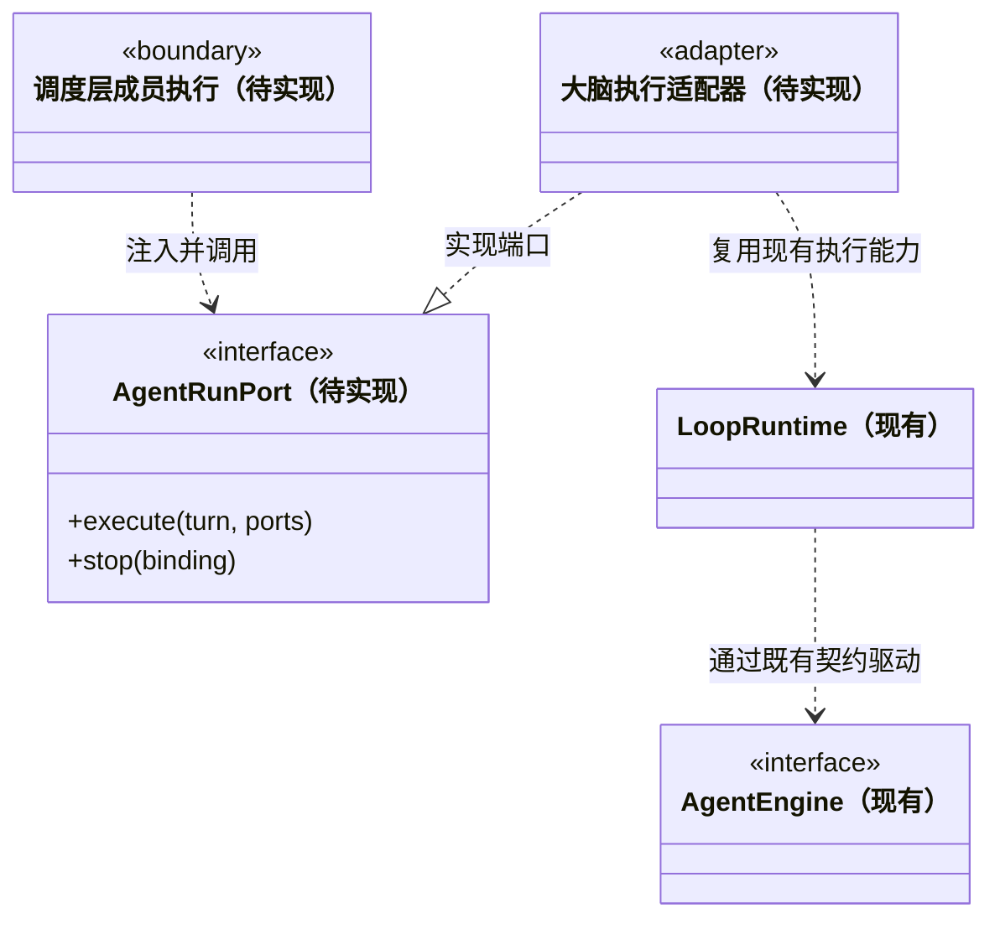

### 独立成员的大脑执行端口

本附录定义后续 Agent 封装接入大脑时的接口语义，**尚未实现多成员 Session 管理和任务派发**。现有 `LoopRuntime`、`AgentEngine`、工具门禁、事件日志和 Pi 适配器继续按当前代码运行；以下类型是待实现设计。

#### 当前可复用能力与需要拆开的身份

当前 `LoopRuntime` 已提供任务租约、先持久化再执行的工具决策、工具回执、运行终态和显式恢复。`EngineContext.emit` 与 `beforeTool` 是事实记录和权限入口，成员执行继续使用这些入口，不能另开一条绕过门禁的执行链。

目前 `taskId` 同时用于聊天线程、运行目录和 Pi 的新建会话标识；恢复还要求 `TaskSpec` 与历史完全一致。这不足以表示“同一成员的独立会话内先后执行不同任务”。后续必须显式绑定 `agentSessionId`，不能把新任务伪装为旧任务的 `resume`。

```ts
/** 每次执行都有成员、通道与运行身份；尚未定位模块的会话也能启动。 */
interface AgentRunIdentity {
  workspaceId: string;
  teamId: string;
  agentId: string;
  agentInstanceId: string;
  /** 当前成员运行租约的代际；正常重启保持成员 ID，接管时递增该值。 */
  leaseEpoch: number;
  agentSessionId: string;
  rootSessionId: string;
  runId: string;
}
type ConversationRunBinding = AgentRunIdentity & { kind: 'conversation' };
type TaskRunBinding = AgentRunIdentity & { kind: 'task'; taskId: string };
type AgentRunBinding = ConversationRunBinding | TaskRunBinding;

/** 后端内部的原生会话绑定；不得进入公开图节点或前端事件。 */
interface NativeSessionBinding {
  agentSessionId: string;
  nativeSessionId?: string;
  sessionFile?: string;
}

/** 以下引用是待实现的不透明内部标识；解析结果固定到本次 run。 */
type ModelSnapshotRef = Readonly<{ kind: 'model'; id: string }>;
type PolicySnapshotRef = Readonly<{ kind: 'policy'; id: string }>;
type ToolSetSnapshotRef = Readonly<{ kind: 'toolset'; id: string }>;
interface ExecutionSnapshotBindings {
  model: ModelSnapshotRef;
  policy: PolicySnapshotRef;
  tools: ToolSetSnapshotRef;
}

/** 共有不可变输入；角色/模型/权限/工具仍逐次固定，不从旧任务隐式继承。 */
interface PreparedTurnInput {
  goal: string;
  knowledgeRevision: string;
  roleInstructions: string;
  snapshots: ExecutionSnapshotBindings;
  input: {
    messageId: string;
    kind: 'user' | 'assignment' | 'result' | 'followup';
    text: string;
    sourceTaskId?: string;
  };
  images?: InputImage[];
  session: NativeSessionBinding;
}

// ModuleBinding 使用 core/tasks 契约的类型；此处只补充固定知识正文。
type PreparedModuleBinding = ModuleBinding & { context: string };
type PreparedAgentTurn = PreparedTurnInput & (
  | { binding: ConversationRunBinding; moduleBindings?: [] }
  | { binding: TaskRunBinding;
      moduleBindings: [PreparedModuleBinding, ...PreparedModuleBinding[]] }
);

/** 只报告 staged 提交，不代表图中的 result_ready / waiting 已经生效。 */
type BusinessTurnOutcome =
  | { kind: 'result_submission'; planRevision: number;
      submissionRef: string }
  | { kind: 'wait_submission';
      awaitedChildren: { taskId: string; planRevision: number }[]; reason: string;
      planRevision: number; submissionRef: string }
  | { kind: 'none'; reason: 'no_submission' };

/** 引擎片段终态；普通会话完成与业务任务提交不能互相替代。 */
type AgentRunOutcome = {
  unresolvedToolCallIds: string[];
  session: NativeSessionBinding;
} & (
  | { binding: ConversationRunBinding; status: 'completed';
      outcome: { kind: 'conversation_complete' } }
  | { binding: TaskRunBinding; status: 'completed';
      outcome: BusinessTurnOutcome }
  | { binding: AgentRunBinding;
      status: 'cancelled' | 'failed' | 'interrupted';
      outcome: { kind: 'execution_not_completed' } }
);

/** 与本次完整 binding 绑定的能力端口；函数和凭据不序列化进任务图。 */
interface AgentRunPorts {
  createEngine(snapshots: ExecutionSnapshotBindings): Promise<AgentEngine>;
  emit(event: EngineEvent): Promise<void>;
  beforeTool(call: ToolCall): Promise<ToolDecision>;
}

/** 由调度层调用、装配层提供实现；Core 不反向引用调度或 Electron。 */
interface AgentRunPort {
  execute(turn: PreparedAgentTurn, ports: AgentRunPorts): Promise<AgentRunOutcome>;
  stop(binding: AgentRunBinding): Promise<void>;
}
```

会话输入与业务任务输入是独立的联合分支。主 Agent 分析请求、查询知识和定位模块时使用 `kind:'conversation'`，无需 `taskId`，模块绑定为空或缺省；普通交流可以正常完成，不创建虚假的业务节点。正式执行才使用 `kind:'task'`，必须具有真实 `taskId` 和至少一个已核实的 `ModuleBinding`。会话中查到的候选模块仍是分析材料，只有调度成功后的任务输入才持有正式模块绑定。

从会话根派发时，可信 Caller 携带成员、`rootSessionId`、`runId` 和 `leaseEpoch`，不携带 `taskId`；父节点由根身份确定。从任务继续派发时才注入当前任务 ID。不能为了复用旧运行目录或工具参数，在会话分支合成一个业务任务 ID。

`ModuleBinding` 复用 [任务图契约](../tasks/CONTRACT.md) 的设计类型，保留维护关系、版本和 `workflow` 的 `module / general` 联合类型，不再定义另一套 Workflow 数组。模块流程只能来自自身定义；通用流程仅按该联合类型记录明确来源、版本与采用原因。`context` 是该绑定对应的固定知识正文，不能把几个模块拼成无来源的共享流程。

`InputImage`、`AgentEngine`、`EngineEvent`、`ToolCall` 和 `ToolDecision` 引用现有 Core 契约；`ModuleBinding`、快照引用与 `AgentRunPorts` 是待实现类型。三个快照引用不能由模型构造，失效或跨工作区引用必须拒绝，不回退成“当前默认设置”。装配层在执行开始前解析并固定模型能力/参数与凭据、权限策略及本轮可用工具清单：模型凭据只进入现有后端 `ResolvedLlm` 快照与受控引擎，绝不进入图事件、角色配置或公开 DTO。权限引用包含本次任务范围及审批有效期，工具引用固定发现清单，但发现某工具不等于授权执行。

`createEngine` 只装配该快照允许的工具集合；`beforeTool` 绑定相同策略与完整运行身份，调用成功也必须持久化决策后才能放行副作用。`emit` 绑定本次持久化日志，失败时不得继续无记录执行。引擎实现不得保留一个绕过这些端口的工具执行入口。运行中设置修改留给下一次执行，当前快照不随全局设置漂移。

`status:'completed'` 仅表示执行片段安全结束。会话分支返回 `conversation_complete`，表示本次交流或分析完成，不等于已派出的所有任务完成；它不适用“业务任务缺少交付或等待提交则阻塞”的判定。任务分支没有结构化提交时返回 `outcome:{kind:'none',reason:'no_submission'}`，不能根据结尾文本或模型宣称补造交付。

`submitResult / waitForChildren` 先持久化 `status:'staged'` 的提交；`submissionRef` 指向该回执的 `submissionId`，同时携带提交时的 `planRevision`。Brain 只返回 `result_submission / wait_submission`，不宣布图状态。片段结束后，调度层核对完整运行绑定、租约代际、任务及计划版本、证据、依赖和未决副作用，再在最终事务中发布 `result_ready / waiting` 及关联 outbox。提交后新增写入、运行失败或基线改变会令 staged 候选失效；失效提交保留审计，不能先让下游消费再回头撤销。候选结果也不代表验收通过。

等待工具提交 staged 请求后，由引擎适配器在安全片段边界停止继续生成与新工具调用，等待在途工具收尾，再回传 `wait_submission`。这一受控让出不伪装成用户取消；它也不能用一个永久未完成的工具 Promise 占住成员执行槽。若存在未决副作用则返回 `interrupted`，不释放成可继续执行的业务等待；未接通安全让出能力前，不向模型提供等待工具。

上面的 `AgentRunPort` 不直接暴露 `resume(taskId, runId)`：恢复是调度层审核旧执行事实后的显式操作。普通新任务、结果唤醒与故障恢复必须分别准备输入，不能用一个“继续”标志代替它们的校验。

#### 会话、租约和权限边界

1. `agentSessionId` 与 `NativeSessionBinding.agentSessionId` 必须相等，且绑定到同一工作区和角色。原生会话文件只能由后端在受管理目录内解析；模型或前端提交的任意路径不得成为会话恢复来源。
2. 同一成员实例首版只有一个活动执行；同一 `agentSessionId` 还必须有独立的运行租约，避免进程重启或错误路由造成两个执行同时写入同一个原生会话。只按 `taskId` 加锁不够。正常重启保留 `agentInstanceId`；新持有者以递增的 `leaseEpoch` 接管，所有执行回调均须匹配当前代际。
3. 每次执行固定角色、任务、模块、模型和权限快照。换任务先准备当前任务上下文，再决定复用其正确通道；不得因为成员相同就恢复任意最近的 session 文件。
4. 同一通道的历史可作为有来源的协作背景，但当前目标与权限以本次固定输入为准。不同 `rootSessionId` 的上下文默认隔离；跨根会话协作须显式传递必要摘要，不能拼接完整历史。
5. 本次任务授权不向同成员的下一任务或被派发成员传播。派发工具在发起者处通过策略检查，接收者的实际副作用仍经过自身 `beforeTool`。收到消息不等于获得写权限。
6. `stop` 只有在完整绑定匹配当前活动执行时才生效。不能以角色名停止其它通道，也不能把“请求停止”当作已停止。工具已放行但回执未知时，保持 `interrupted` 和未决工具清单。

#### 执行事实到派发图事件

`StoredEvent.seq` 仍是单个 `runId` 内的执行日志序号；不能用它给整个派发图排序。图的增量事件由调度层在接收已持久化执行事实后独立提交，拥有图自己的顺序与命令幂等语义。

| 大脑事实 | 调度层可以投影的变化 | 不允许的推断 |
| --- | --- | --- |
| 执行开始、Session 绑定 | 会话或真实任务关联本次 `runId`，成员进入工作态 | 为分析会话制造业务节点 |
| 思考、文本、工具状态 | 当前会话或任务的实时进度 | 依赖任务已成功 |
| 工具放行与回执 | 更新本次执行证据、未决副作用 | 模型自述可以替代真实回执 |
| 会话正常结束 | `conversation_complete`，保留其已派发任务 | 没有业务提交就应把正常对话阻塞 |
| 任务片段正常结束 | 调度层复核 staged 提交或处理缺少提交的情况 | 当前节点与所有子任务自动完成 |
| 停止、失败或进程丢失 | 取消请求或中断事实，保留可恢复状态 | 可以无条件重放历史工具 |

事实应携带完整 `AgentRunBinding`，调度层先核对持久化成员身份、`leaseEpoch`、活动 `runId` 和通道，再接受状态变化。迟到的旧运行事件可保留到旧运行审计中，但不得覆盖新运行的节点状态。

新事件外壳按 `conversation / task` 绑定区分日志归属，不能把 conversation 硬塞进现有必填 `taskId` 的 `StoredEvent`。实施时增加版本化外壳或明确兼容映射；工具 proposed/allowed/denied、执行回执、状态、图片输入和原生会话绑定等既有事实全部保留，两种输入都经过相同权限与日志端口。

大脑只持有注入的执行/存储/策略端口，负责报告执行事实，不寻找团队成员、分配收件箱、选择业务模块或直接操作图存储。成员消息通过调度层可靠投递，不能把已有 `AgentEngine.steer` 当作有持久化、去重和确认语义的邮箱。

#### 恢复与旧数据兼容

- 旧日志、队列、Pi Session 不自动修改 ID。实施时增加显式版本及映射记录，区分旧聊天 `taskId` 与新业务节点 `taskId`；旧事件继续用原标识读取。
- 现有恢复的知识版本校验、任务一致性校验和未知工具人工核实不能因为拆分 Session 而移除。新增通道迁移也必须保留这些保护。
- 业务节点重试保留 `taskId`，生成新 `runId`；运行日志只追加，不抹去失败尝试。是否复用原生通道由核实后的恢复策略决定。
- 引擎或软件退出不意味着副作用尚未发生。未决工具回执未核实时，不自动消费重复任务消息重新执行；可恢复的消息等待与不可安全重放的执行分别标记。
- 第一阶段应以假执行端口验证身份、串行化和事件语义，再接真实 Pi 并验证独立通道、停止、恢复与工具审批。通过假端口测试不能宣称已交付真实多成员执行。

#### 待实现的端口关系



图中的适配关系是实施方向，不表示当前 `LoopRuntime` 已实现 `AgentRunPort`。与 [成员契约](../team/CONTRACT.md) 和 [任务图契约](../tasks/CONTRACT.md) 一起评审后再增加代码文件；当前代码类图仍以实际声明为准。
