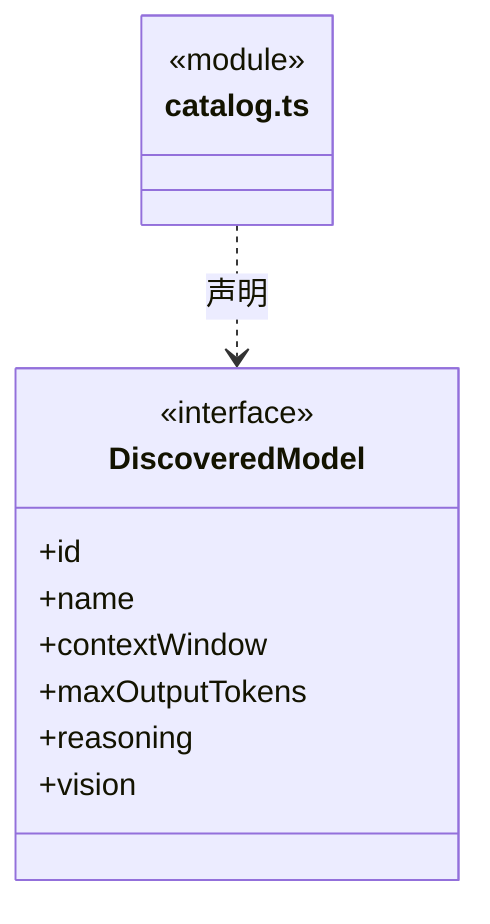
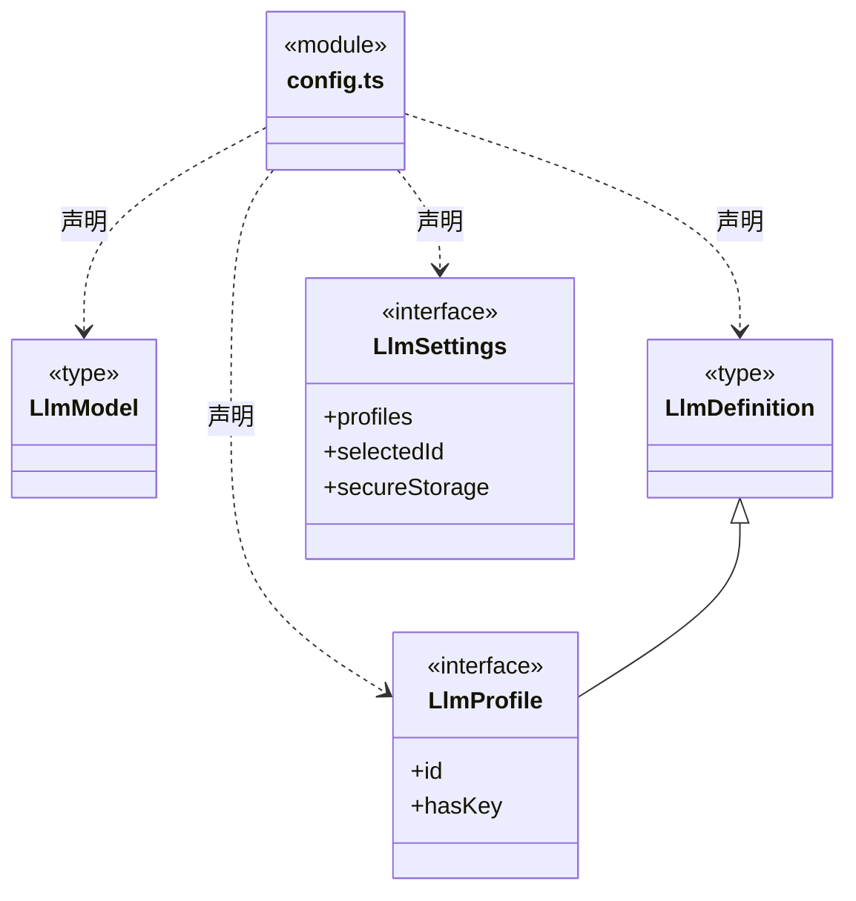
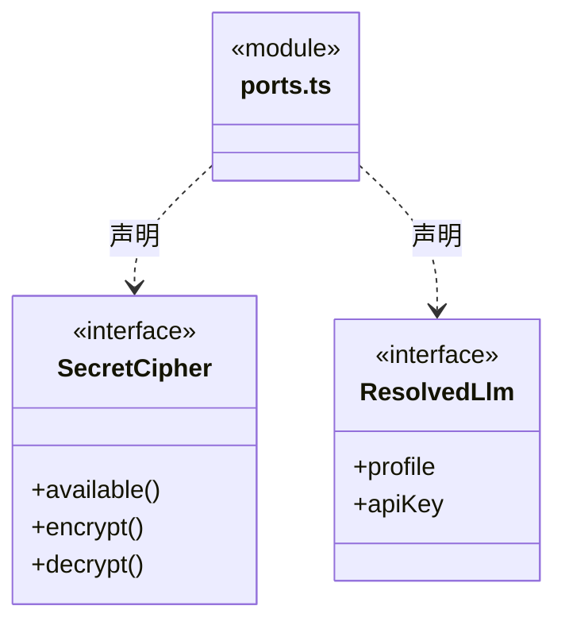
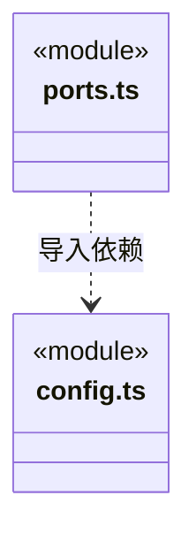

# src/backend/core/brain/llm 架构

## 目录定位

公开模型参数、能力元数据及运行快照端口。实际配置文件和加密凭据由 main/persistence/settings 持有。

本文描述当前实现。通过分析目录边界后维护的 [源码架构脚本](../../../../../scripts/source-architecture.mjs) 同步清单和声明；代码变更时仍须核对职责、关键成员与关系。

## 代码清单

| 文件 | 当前职责 |
| --- | --- |
| [catalog.ts](catalog.ts) | 解析供应商模型目录的能力资料，供新增模型和显式同步容量使用。 |
| [config.ts](config.ts) | 定义自定义供应商及其模型目录的持久化与界面契约。 |
| [ports.ts](ports.ts) | 模型运行快照与凭据加解密端口。 |

## 架构类图

### catalog.ts

### config.ts

### ports.ts

直接依赖：[config.ts](config.ts)。

### 本目录调用边界

## 子目录导航

无子目录。

[返回上层](../ARCHITECTURE.md)。

每次修改本目录代码，同步维护文件头、关键契约说明及本图。未实现的治理、证据验收和自动编排能力不列入当前类图。
