# src/backend/core/brain/llm 架构

## 目录定位

公开模型参数、能力元数据及运行快照端口。实际配置文件和加密凭据由 main/persistence/settings 持有。 engine 定义公开引擎/选型；共享 request-budget-transport 和 SSE 用量解析服务 Pi、Claude Code 与 Codex。

本文描述当前实现。通过分析目录边界后维护的 [源码架构脚本](../../../../../scripts/source-architecture.mjs) 同步清单和声明；代码变更时仍须核对职责、关键成员与关系。

## 代码清单

| 文件 | 当前职责 |
| --- | --- |
| [catalog.ts](catalog.ts) | 解析供应商模型目录的能力资料，供新增模型和显式同步容量使用。 |
| [config.ts](config.ts) | 定义自定义供应商及其模型目录的持久化与界面契约。 |
| [engine.ts](engine.ts) | 用户模型目录和 Agent 运行选型共用的引擎标识与纯选择规则。 |
| [ports.ts](ports.ts) | 模型运行快照与凭据加解密端口。 |
| [request-budget-transport.ts](request-budget-transport.ts) | 每运行创建只接受随机令牌的本机供应商代理，逐 HTTP 尝试预留并结算预算。 |
| [request-budget-usage.ts](request-budget-usage.ts) | 严格读取三种受支持 SSE 协议的请求用量，并暂存终态帧供可靠结算后交付。 |
| [request-budget.ts](request-budget.ts) | 定义各引擎共用传输与工作区请求账本之间的可信窄端口。 |

## 架构类图

### catalog.ts

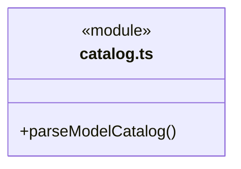

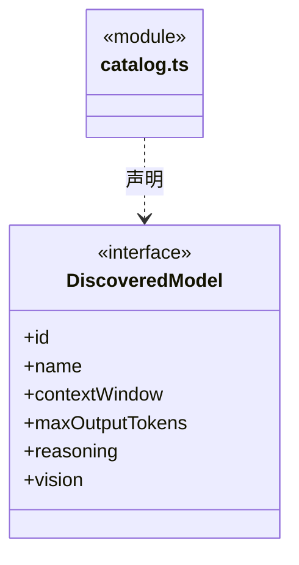

### config.ts

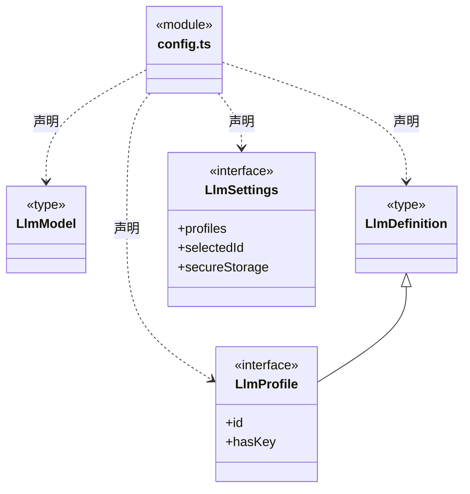

直接依赖：[engine.ts](engine.ts)。

### engine.ts

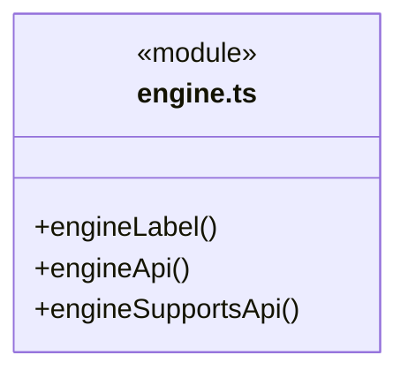

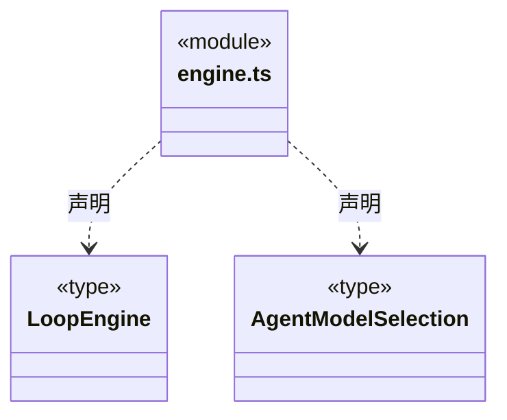

### ports.ts

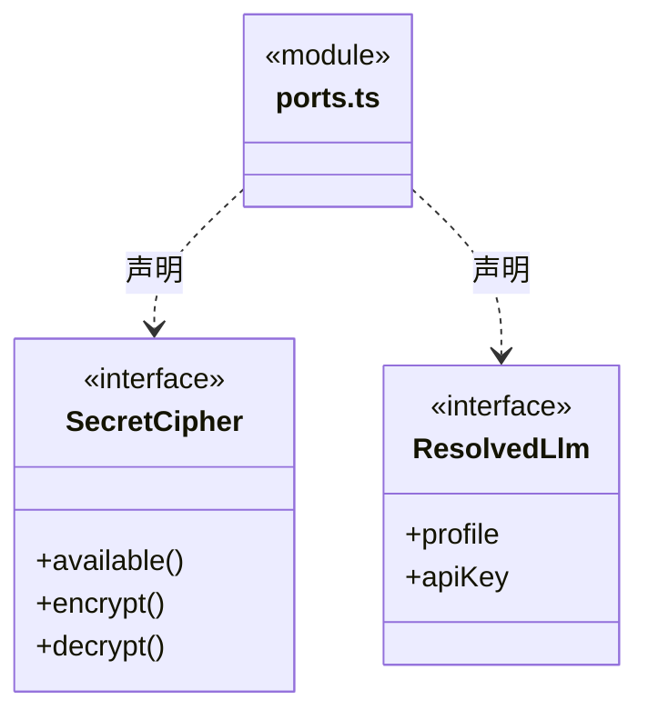

直接依赖：[config.ts](config.ts)、[engine.ts](engine.ts)。

### request-budget-transport.ts

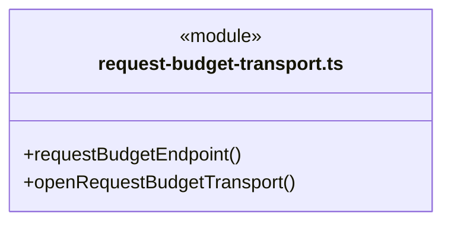

直接依赖：[ports.ts](ports.ts)、[request-budget.ts](request-budget.ts)、[request-budget-usage.ts](request-budget-usage.ts)、[../../tasks/model-request-budget-rules.ts](../../tasks/model-request-budget-rules.ts)、[../../foundation/errors.ts](../../foundation/errors.ts)、[../../team/workspace-member-rules.ts](../../team/workspace-member-rules.ts)。

### request-budget-usage.ts

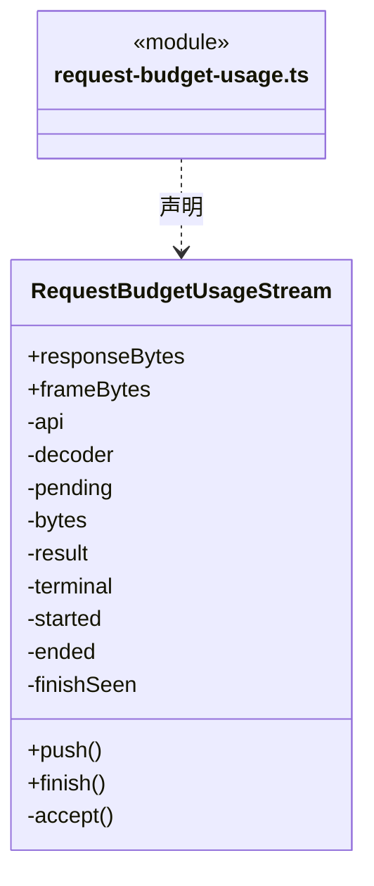

直接依赖：[../../tasks/model-request-budget.ts](../../tasks/model-request-budget.ts)。

### request-budget.ts

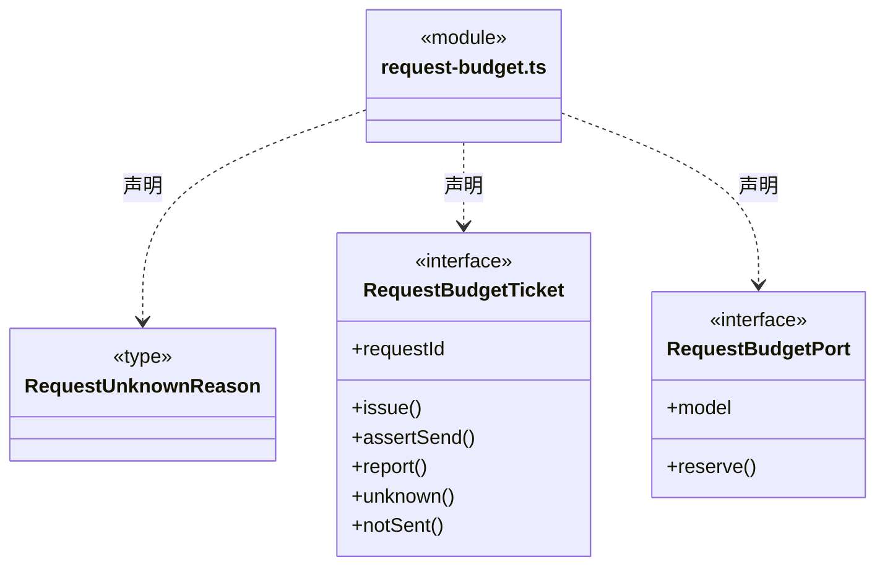

直接依赖：[../../tasks/model-request-budget.ts](../../tasks/model-request-budget.ts)。

### 本目录调用边界

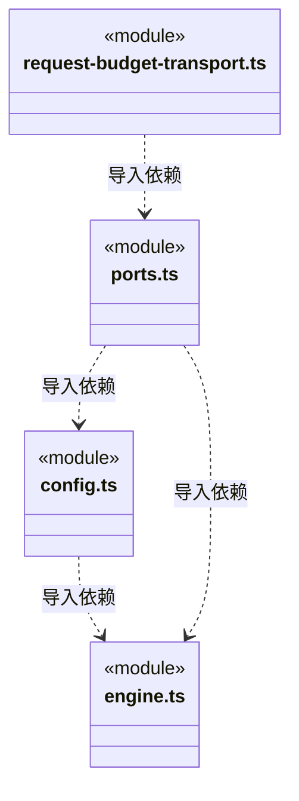

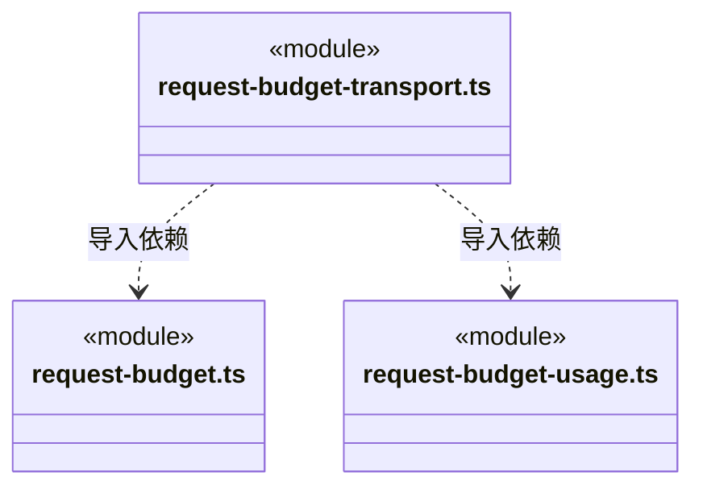

## 子目录导航

无子目录。

[返回上层](../ARCHITECTURE.md)。

每次修改本目录代码，同步维护文件头、关键契约说明及本图。未实现的治理、证据验收和自动编排能力不列入当前类图。

## 设计契约 v1 与落地范围

以下内容区分已接通能力与后续设计；以各节的实现状态为准，不将目标图当作现状图。维护源：[CONTRACT.md](CONTRACT.md)；生成类图时同步附加，勿直接修改本附录。

# llm 维护契约

## 逐请求预算（R06）

`RequestBudgetPort` 仅由可信工厂提供，模型只能生成原协议正文。ticket 的 reserve / issue 分别可靠保存申请与发送意图；实际发送前同步 assertSend，报告、明确未发送和未知各有独立事实，不提供模型可调用写入入口。

## 引擎配置与共享请求传输

engine.ts 定义始终存在的 Pi / Claude Code / Codex、显示名与 Agent 选型。供应商仅维护接口和模型目录；旧 definition.engine 只兼容解析，不再决定或限制运行。engineSupportsApi 是前后端共用的纯兼容规则：Pi 支持三种协议，Claude Code 支持 Anthropic Messages，Codex 支持 OpenAI Responses；不按模型名称猜测、不模拟跨协议转换，也不使用外部客户端账号。同一模型可被所有兼容引擎选中。运行显式传入的 engine 进入 ResolvedLlm.profile 与岗位快照哈希；历史缺省字段不补写。

request-budget-transport.ts 与 request-budget-usage.ts 从 pi/ 移至本目录。Pi 仍需启动握手；Claude SDK 使用随机令牌的 Anthropic 路由。Codex 在冻结模型/输出上限代理后复用同一 /request 入口。所有入口固定同一供应商与模型，实际请求均先 reserve/issue，终态用量可靠保存后才交付；不接受任意转发地址。

Claude/Codex 原生流式调用可早于响应结束；request-budget-transport 的 assertSettled 等待当前实际请求全部结算，供工具授权前调用。停止或结算失败时拒绝，不能把“终态尚未转发”当作工具尚未启动的证明。
