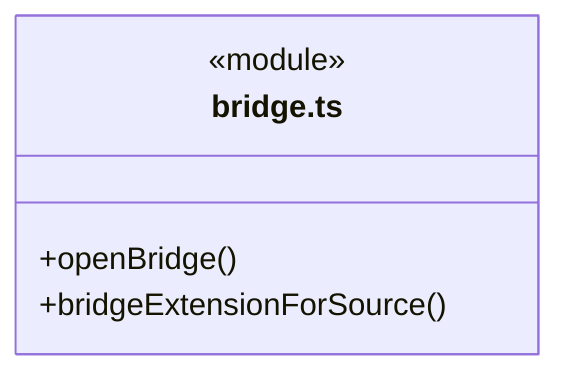
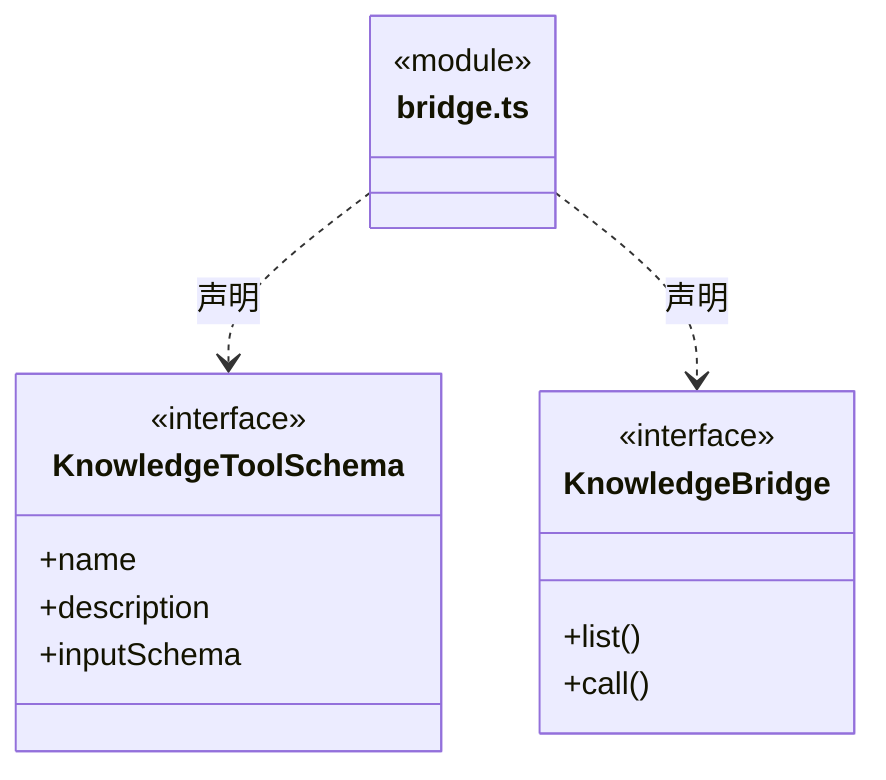
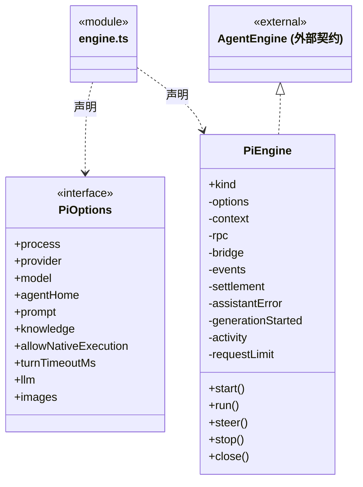
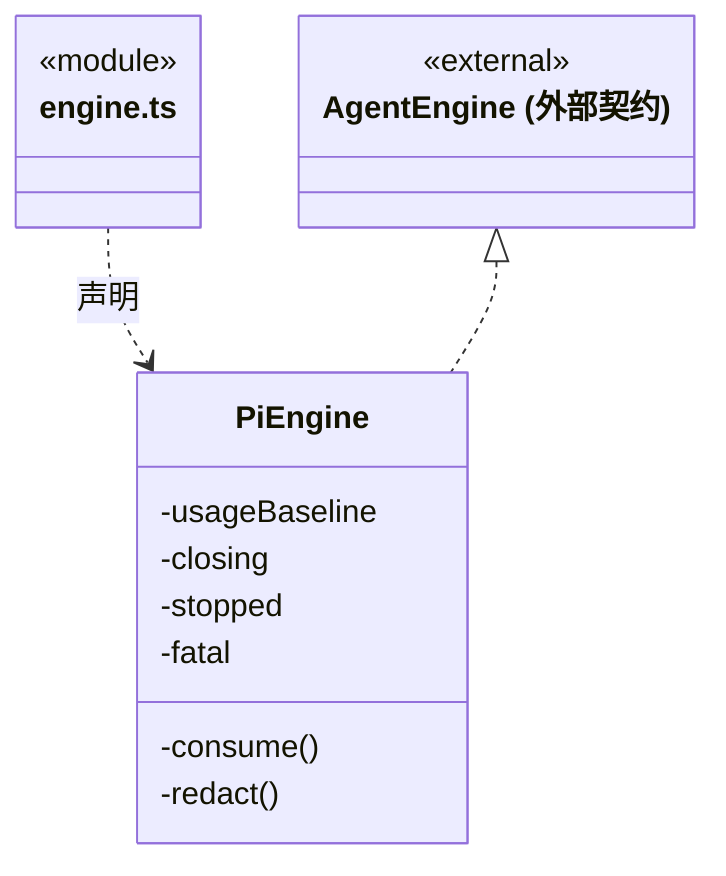
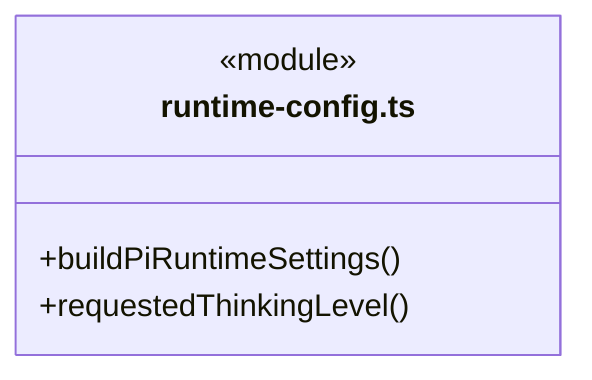
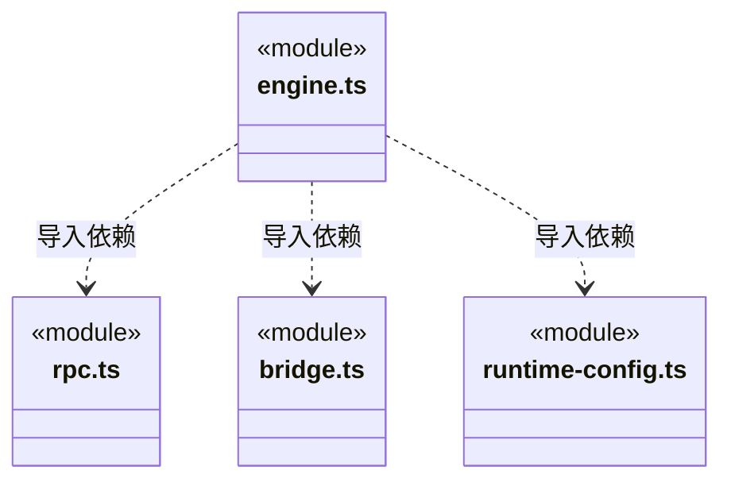
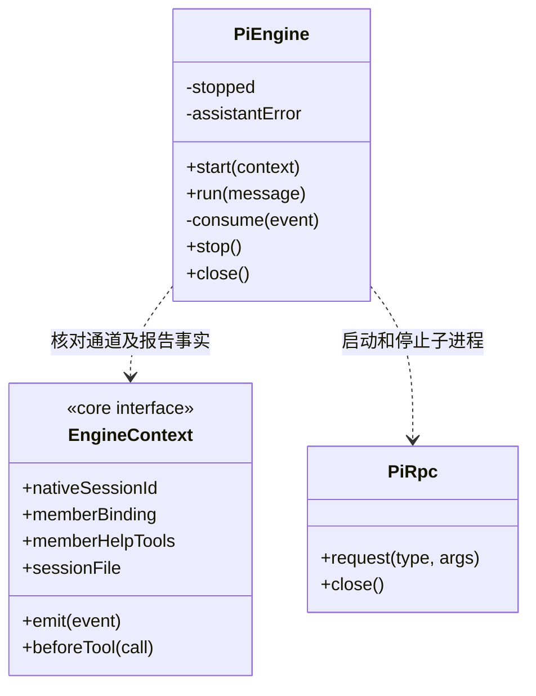

# src/backend/core/brain/pi 架构

## 目录定位

Pi 协议、临时桥与运行参数；插入在原生状态查询后复核取消，发送后只凭queued回复确认，不自动重试。工具经一次性gate授权并校验结果；结构验证仅在正式成员有冻结要求及真实端口时公开。受控续执行在启动及加载原生会话后再核冻结证明，回传作为custom数据，不冒充用户授权。

本文描述当前实现。通过分析目录边界后维护的 [源码架构脚本](../../../../../scripts/source-architecture.mjs) 同步清单和声明；代码变更时仍须核对职责、关键成员与关系。

## 代码清单

| 文件 | 当前职责 |
| --- | --- |
| [bridge.ts](bridge.ts) | 大脑 执行层：内部知识 Schema/调用的本机临时桥及 Pi 扩展，工具授权先落盘再放行。 |
| [engine.ts](engine.ts) | Pi 引擎适配器，负责隔离配置、主对话与成员原生会话校验、工具桥与公开执行事件转换。 |
| [rpc.ts](rpc.ts) | 大脑 执行层：PiRpc：JSONL 拆包、命令关联、超时与进程结束处理。 |
| [runtime-config.ts](runtime-config.ts) | 将模型容量和工作预算转换为 Pi 原生运行设置，供每轮隔离进程使用。 |

## 架构类图

### bridge.ts

直接依赖：[../types.ts](../types.ts)、[../../tools/results.ts](../../tools/results.ts)、[../../foundation/errors.ts](../../foundation/errors.ts)、[../input-source.ts](../input-source.ts)。

### engine.ts

成员 1/2（同名节点为同一声明，跨图合并阅读）。

成员 2/2（同名节点为同一声明，跨图合并阅读）。

直接依赖：[../types.ts](../types.ts)、[rpc.ts](rpc.ts)、[bridge.ts](bridge.ts)、[../llm/ports.ts](../llm/ports.ts)、[../model-errors.ts](../model-errors.ts)、[runtime-config.ts](runtime-config.ts)、[../../tools/native-tools.ts](../../tools/native-tools.ts)、[../../foundation/errors.ts](../../foundation/errors.ts)。

### rpc.ts

### runtime-config.ts

直接依赖：[../llm/config.ts](../llm/config.ts)。

### 本目录调用边界

## 子目录导航

无子目录。

[返回上层](../ARCHITECTURE.md)。

每次修改本目录代码，同步维护文件头、关键契约说明及本图。未实现的治理、证据验收和自动编排能力不列入当前类图。

## 设计契约 v1 与落地范围

以下内容区分已接通能力与后续设计；以各节的实现状态为准，不将目标图当作现状图。维护源：[CONTRACT.md](CONTRACT.md)；生成类图时同步附加，勿直接修改本附录。

### 冻结 JSON 验证工具接入

`cbim_validation_run` 仅在本轮实际 `EngineContext.validationTools` 存在时注册，经同一 `/gate` 与一次性 `/call` 传递真实调用 ID。主运行、无验证要求或缺平台能力的运行不会得到此工具；不存在按名字临时创建能力的分支。提示明确路径和 Schema 来自冻结要求，`rejected` 与工具调用失败不同，工具成功也不等于结构通过，更不构成业务或人工验收。

### 成员文件基线工具接入

Pi 仅在可信 `EngineContext.artifactTools` 存在时注册采集工具，并经既有 `/gate`、一次性 `/call` 许可透传原生 toolCallId。采集结果沿标准工具完成事件进入 canonical 日志，不能由工具名、模型正文或独立桥接事件自行签发基线。主调度没有此端口；没有新增路径、命令或恢复权限。

`memberCheckpointTools` 同样只按实际端口注册，透传可信调用 ID；指引明确一次 checkpoint/一次 resume，以及命令、动态目录、额外知识查询或未知操作不属于当前可恢复白名单。暂存后正常结束而非发送 abort；引擎不自行发布 checkpointed 或释放调度占用。

专用续执行在启动 Pi 之前及 `get_state` 载入核实后、配置与本轮输入之前调用 `assertMemberResume`，再次核实原 canonical、业务文件、知识和原生字节。Runtime 在 Pi 准备与 running 事务结束后再通过 `assertMemberResumeInputs` 核业务文件、知识与旧日志，随后才发送 prompt。沿原 sessionId/sessionFile 启动同通道的新 run，旧 native 不能悄悄修复或改写后当作原检查点；已核实载入后允许本轮配置合法追加。该复核不是操作系统原子隔离；后续工具仍受新一轮门禁与批准。

### 当前成员结果接续

普通用户输入及 `user-continuation` 显式文本补充保持 RPC `prompt` 的 `started` 行为。成员回传与 `human_decisions` 分别使用 `customType:'cbim-member-results'` / `cbim-human-decisions` 的一次性首条输入处理器，保存可信来源 details，通过 `triggerTurn:true` 发起生成，原 prompt 返回 `handled`。后续用户 steer 不被拦截。成员正文说明候选尚未验收；人工正文说明这是系统转交的本机已保存意见，仅针对所述条件和所选成果，不是用户自由消息、新目标或工具提权，须重新规划和核实。输入加普通文字前缀，避免意见被解析为斜杠命令。

`PiEngine.run` 按来源核验 started/handled，并继续等待真实 `agent_settled`，不会把 handled 当成完成。异步 custom 启动的 `extension_error` 会终止等待并由运行日志保留中断，不超时后盲目重放。没有 source 的普通对话完全保留用户消息语义。回注不重复发送上一轮附件。

`KnowledgeBridge.call(name,args,signal,toolCallId?)` 第四参是工具门禁已批准的真实原生调用 ID；`openBridge` 核对调用 ID、名称和原始参数，并消耗一次性许可后透传。调度据此构造幂等命令键，不从模型参数获取可信派发身份。

### 当前成员通道与取消处理

`PiEngine.start(context)` 同时检查受管 `sessionFile` 路径和原生会话身份：成员使用已登记 `nativeSessionId`，普通主会话续聊使用原日志 `session.bound.sessionId`，不能用逻辑通道 ID 代替。`get_state` 返回的 sessionId 必须与期望身份一致，错误文件即使位于同一工作区也在模型调用前拒绝；活动流或待处理消息不为空时拒绝覆盖。首次普通聊天没有文件时仍以 taskId 新建。旧恢复记录缺少原生 ID 时，在创建工具桥和子进程之前明确拒绝，保留原历史供核实，不猜测或重写旧记录。

每个实例只服务一次运行。`start` 完成时已保存原生会话绑定，但尚未发送本轮提示；调用方即使遇到启动失败也必须调用 `close`，释放可能已经创建的工具桥或子进程。`run` 超时抛出结果待核实的错误，不自动重发提示；`close` 关闭进程并排空已接收事件，无论事件处理是否成功都会关闭工具桥。

`stop()` 先记录本轮停止意图再发送 RPC abort。`consume()` 只有在已经停止且供应商错误文本精确匹配标准取消消息时，将该条消息归一为 aborted；真实模型错误不被取消意图吞掉。`run()` 等待 agent_settled，工具结果未知仍由 LoopRuntime 最终标记 interrupted，不把停止视为回滚。

### 成员求助工具接入

Pi 的工具桥合并知识、执行进度及当前成员专属求助工具；后者仅在 `EngineContext.memberHelpTools` 存在时注册。调用透传真实 `toolCallId`，复用 `/gate` 与 `/call` 一次性授权，不创建第二套权限通道。成员指引要求先核实已结束的操作，求助暂存后立即结束本轮；不允许继续调用工具或把求助当成成功交付。主调度仍通过可信 custom 回传接收求助数据，正文不升格为用户授权。
### 原生工具能力与执行约定

Pi 的 `--tools` 参数使用 `core/tools/native-tools.ts` 的同一注册表。只读模式仅提供 read/grep/find/ls，ask/execute 才提供 write/edit/bash；可提供不等于某次调用已批准。成员启动前的 Workflow 能力检查读取相同清单，不能从模型提示词或声明推断能力。

Workflow 计划与交付门禁位于共享 Runtime 和任务工具，Pi 仍经既有 gate/call 协议执行，不额外绕过批准或扩大主调度原生工具范围。bash 的成功工具事实不等于命令语义已验证，其影响范围仍为 unknown。
# 原生插入的发送边界

`PiEngine.steer` 使用原运行模型和权限，并接收可信停止信号。`get_state` 返回后再次检查停止、关闭和 streaming；此检查至 `steer` 命令发送之间不再等待其它异步操作。停止在发送前发生时不发新消息；发送之后只有原回复的 `disposition:queued` 确认接收，迟到取消不把它改称未接收。发送后的错误、超时或不明确回复统一保留 `QUEUE_INSERT_UNKNOWN`，不泄露底层回包或重发。
