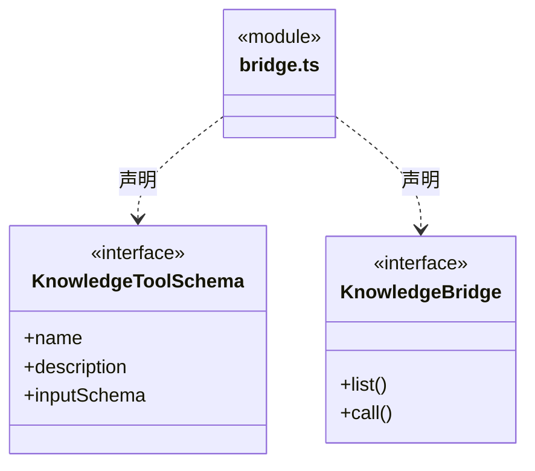
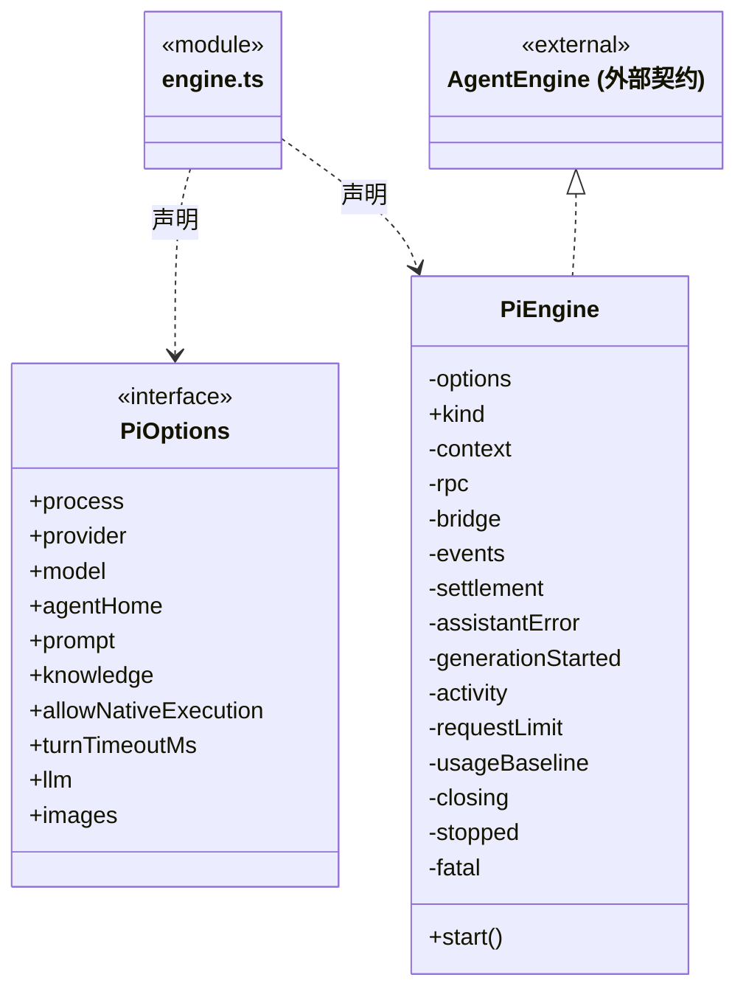
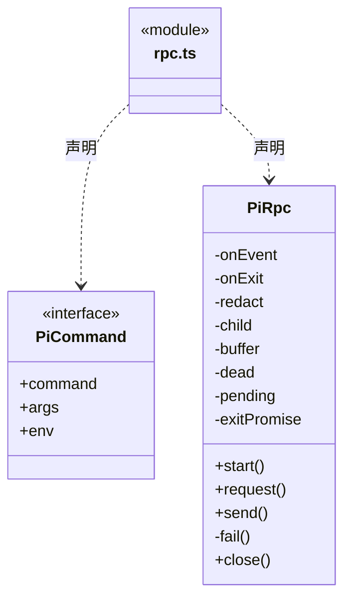
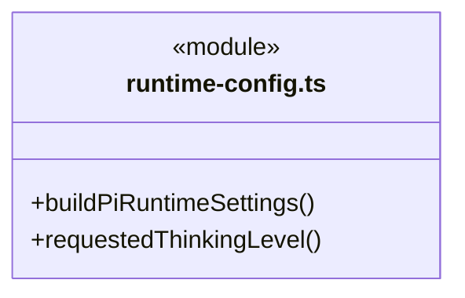
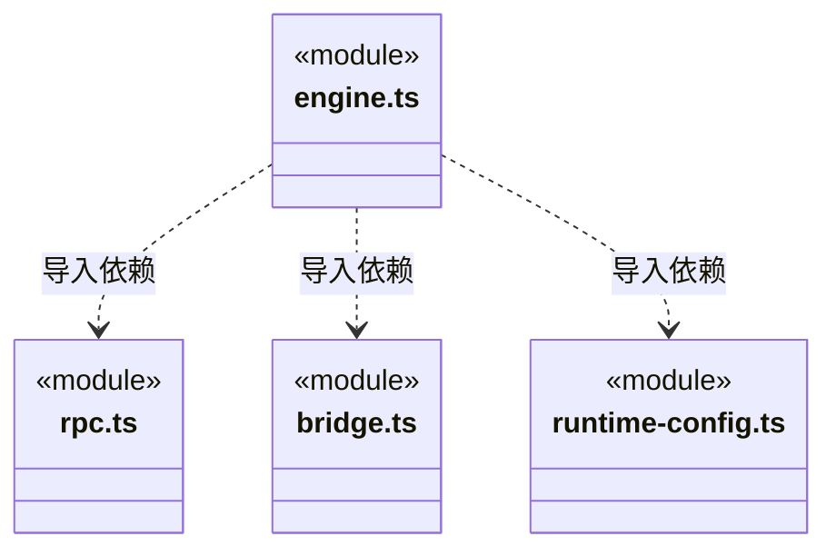

# src/backend/core/brain/pi 架构

## 目录定位

Pi 进程协议适配、工具桥与运行参数。保持真实工具调用门禁、图片输入、恢复及长度错误报告。

本文描述当前实现。通过分析目录边界后维护的 [源码架构脚本](../../../../../scripts/source-architecture.mjs) 同步清单和声明；代码变更时仍须核对职责、关键成员与关系。

## 代码清单

| 文件 | 当前职责 |
| --- | --- |
| [bridge.ts](bridge.ts) | 大脑 执行层：内部知识 Schema/调用的本机临时桥及 Pi 扩展，工具授权先落盘再放行。 |
| [engine.ts](engine.ts) | 大脑 执行层：PiEngine：启动隔离配置的 Pi 子进程、转换事件并等待 agent_settled。 |
| [rpc.ts](rpc.ts) | 大脑 执行层：PiRpc：JSONL 拆包、命令关联、超时与进程结束处理。 |
| [runtime-config.ts](runtime-config.ts) | 将模型容量和工作预算转换为 Pi 原生运行设置，供每轮隔离进程使用。 |

## 架构类图

### bridge.ts

直接依赖：[../types.ts](../types.ts)。

### engine.ts

直接依赖：[../types.ts](../types.ts)、[rpc.ts](rpc.ts)、[bridge.ts](bridge.ts)、[../llm/ports.ts](../llm/ports.ts)、[../model-errors.ts](../model-errors.ts)、[runtime-config.ts](runtime-config.ts)。

### rpc.ts

### runtime-config.ts

直接依赖：[../llm/config.ts](../llm/config.ts)。

### 本目录调用边界

## 子目录导航

无子目录。

[返回上层](../ARCHITECTURE.md)。

每次修改本目录代码，同步维护文件头、关键契约说明及本图。未实现的治理、证据验收和自动编排能力不列入当前类图。
