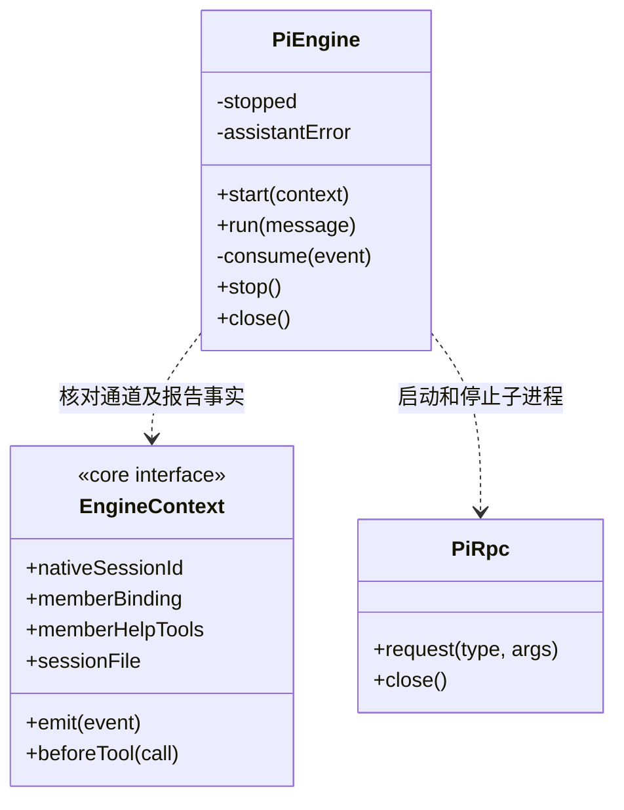

### 当前成员结果接续

普通用户输入及 `user-continuation` 显式目标补充保持 RPC `prompt` 的 `started` 行为；只有 `EngineContext.source.kind==='member-results'` 时，`bridgeExtensionForSource` 才为本轮生成一次性可信输入处理器。首条输入写为 `customType:'cbim-member-results'` 的原生 custom 消息，保存来源 details，通过 `triggerTurn:true` 发起生成，原 prompt 返回 `handled`。后续用户 steer 不被拦截，custom 正文明示“任务数据、非用户新指令或授权、候选尚未验收”。输入加普通文字前缀，避免结果正文被当成斜杠命令。

`PiEngine.run` 按来源核验 started/handled，并继续等待真实 `agent_settled`，不会把 handled 当成完成。异步 custom 启动的 `extension_error` 会终止等待并由运行日志保留中断，不超时后盲目重放。没有 source 的普通对话完全保留用户消息语义。回注不重复发送上一轮附件。

`KnowledgeBridge.call(name,args,signal,toolCallId?)` 第四参是工具门禁已批准的真实原生调用 ID；`openBridge` 核对调用 ID、名称和原始参数，并消耗一次性许可后透传。调度据此构造幂等命令键，不从模型参数获取可信派发身份。

### 当前成员通道与取消处理

`PiEngine.start(context)` 同时检查受管 `sessionFile` 路径和原生会话身份：成员使用已登记 `nativeSessionId`，普通主会话续聊使用原日志 `session.bound.sessionId`，不能用逻辑通道 ID 代替。`get_state` 返回的 sessionId 必须与期望身份一致，错误文件即使位于同一工作区也在模型调用前拒绝；活动流或待处理消息不为空时拒绝覆盖。首次普通聊天没有文件时仍以 taskId 新建。旧恢复记录缺少原生 ID 时，在创建工具桥和子进程之前明确拒绝，保留原历史供核实，不猜测或重写旧记录。

每个实例只服务一次运行。`start` 完成时已保存原生会话绑定，但尚未发送本轮提示；调用方即使遇到启动失败也必须调用 `close`，释放可能已经创建的工具桥或子进程。`run` 超时抛出结果待核实的错误，不自动重发提示；`close` 关闭进程并排空已接收事件，无论事件处理是否成功都会关闭工具桥。

`stop()` 先记录本轮停止意图再发送 RPC abort。`consume()` 只有在已经停止且供应商错误文本精确匹配标准取消消息时，将该条消息归一为 aborted；真实模型错误不被取消意图吞掉。`run()` 等待 agent_settled，工具结果未知仍由 LoopRuntime 最终标记 interrupted，不把停止视为回滚。

### 成员求助工具接入

Pi 的工具桥合并知识、执行进度及当前成员专属求助工具；后者仅在 `EngineContext.memberHelpTools` 存在时注册。调用透传真实 `toolCallId`，复用 `/gate` 与 `/call` 一次性授权，不创建第二套权限通道。成员指引要求先核实已结束的操作，求助暂存后立即结束本轮；不允许继续调用工具或把求助当成成功交付。主调度仍通过可信 custom 回传接收求助数据，正文不升格为用户授权。
