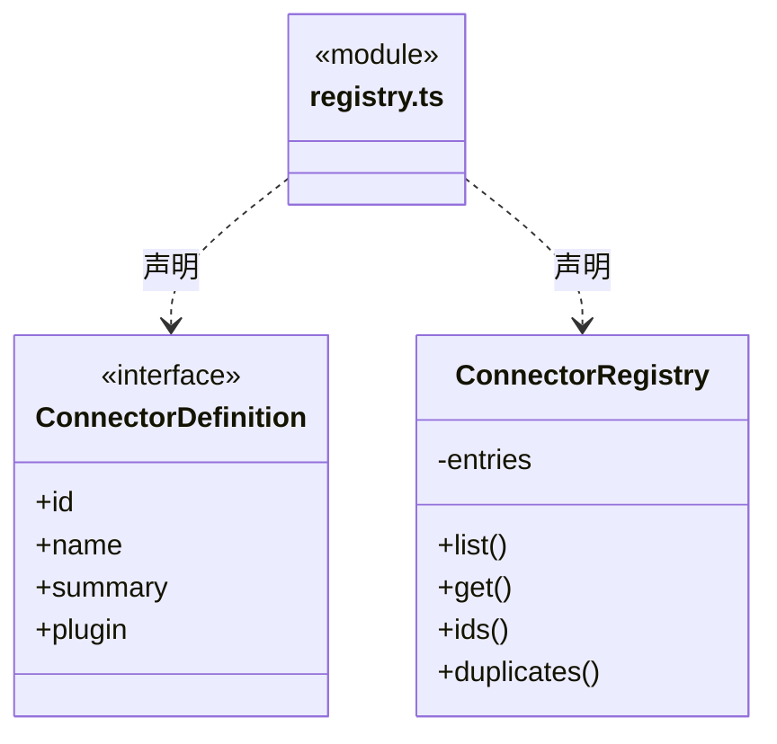

# src/backend/core/connectors 架构

## 目录定位

链接器定义、查询与唯一身份检查；当前不执行外部插件。

本文描述当前实现。通过分析目录边界后维护的 [源码架构脚本](../../../../scripts/source-architecture.mjs) 同步清单和声明；代码变更时仍须核对职责、关键成员与关系。

## 代码清单

| 文件 | 当前职责 |
| --- | --- |
| [registry.ts](registry.ts) | 链接器领域封装，管理注册身份、插件映射、查询和重复校验。 |

## 架构类图

### registry.ts

## 子目录导航

无子目录。

[返回上层](../ARCHITECTURE.md)。

每次修改本目录代码，同步维护文件头、关键契约说明及本图。未实现的治理、证据验收和自动编排能力不列入当前类图。
